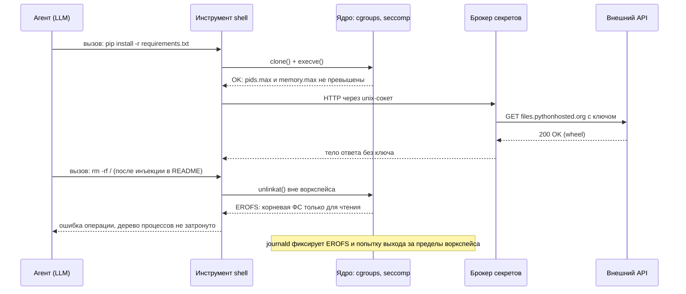
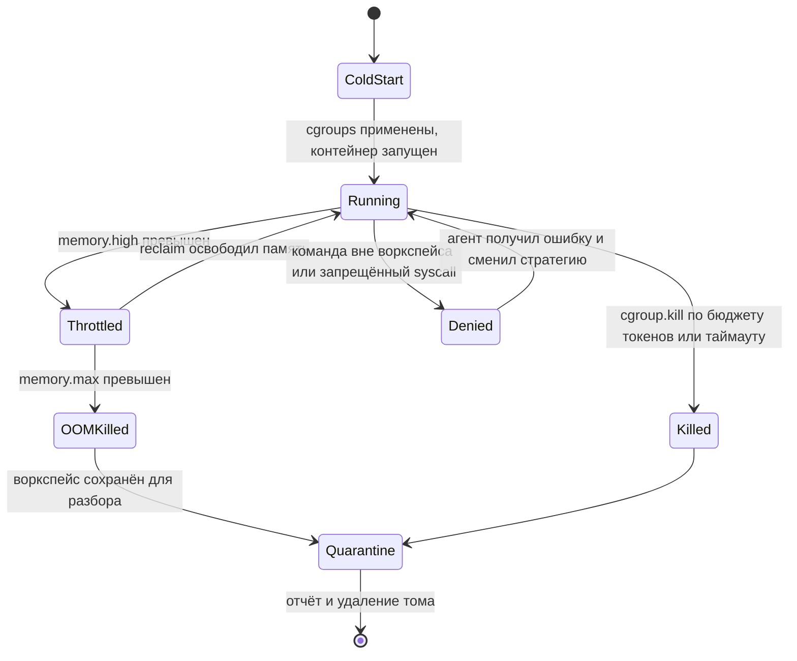

+++
title = "Песочница для автономного AI-агента на Linux: cgroups v2, rootless-контейнер и allowlist исходящего трафика"
date = 2026-11-13
description = "Инженерный разбор изоляции кодового AI-агента: отдельный пользователь, лимиты cgroup v2, rootless Podman с read-only rootfs, сброс capabilities, seccomp, вынос секретов из воркспейса и egress-allowlist для PyPI и LLM API."
[taxonomies]
tags = ["ai-agents", "devops", "software-engineering", "security", "linux"]
[extra]
toc = true
mermaid = true
katex = true
+++

Автономный кодовый агент отличается от обычного скрипта тем, что команду формирует языковая модель по тексту, который пришёл извне: из задачи пользователя, из README репозитория, из вывода `pip install`, из веб-страницы, открытой инструментом. Из этого следует неприятный вывод, который редко проговаривают в туториалах: **любая строка, которую агент прочитал, является потенциальным входом в командную оболочку**. Песочница здесь не «дополнительная мера безопасности», а условие, при котором агента вообще можно оставлять работать без человека.

Разбор ниже опирается на практическое руководство David Ondrej «The Ultimate Linux Tutorial for AI Agents» ([youtu.be/us6SRuWuqWc](https://youtu.be/us6SRuWuqWc), 25 минут), но идёт дальше пересказа: конкретные директивы systemd, файлы cgroup v2, команда запуска rootless-контейнера, правила nftables, арифметика лимитов и честный список того, что такая схема **не** закрывает.

<!-- more -->

---

## 1. Модель угроз: пять классов отказов

Прежде чем настраивать изоляцию, полезно разделить риски, потому что разные классы закрываются разными механизмами и путать их дорого.

| Класс | Пример события | Что должно сработать |
| :--- | :--- | :--- |
| **Деструктивная команда** | `rm -rf ~`, `git clean -xdf`, `dd if=/dev/zero of=/dev/sda` | права файловой системы, read-only rootfs, отдельный пользователь |
| **Истощение ресурсов** | fork bomb, утечка памяти в собранном коде, заполнение диска логами | `pids.max`, `memory.max`, `cpu.max`, квота на tmpfs |
| **Утечка секретов** | агент печатает `env` и отправляет содержимое в модель или в URL | ключи вне окружения и вне воркспейса, брокер секретов |
| **Эксфильтрация и произвольный egress** | `curl` на чужой домен с содержимым репозитория | сетевой allowlist, прокси с белым списком |
| **Незаметный выход за пределы роли** | агент правит CI-конфиг, добавляет себя в `sudoers`, ставит пакет с post-install скриптом | отсутствие capabilities, `NoNewPrivileges`, seccomp, аудит |

Ключевая количественная поправка к интуиции: даже при малой вероятности ошибки на шаг суммарный риск за длинную автономную сессию растёт нелинейно. Если вероятность деструктивного шага равна $q$, а шагов $N$, то вероятность хотя бы одного инцидента:

$$P\_{\text{incident}} = 1 - (1 - q)^{N}$$

| $q$ на шаг | $N = 100$ | $N = 1000$ | $N = 5000$ |
| :--- | :--- | :--- | :--- |
| $10^{-4}$ | 1.0% | 9.5% | 39.3% |
| $10^{-3}$ | 9.5% | 63.2% | 99.3% |
| $10^{-2}$ | 63.4% | ≈100% | ≈100% |

Строка $q = 10^{-3}$ при 5000 шагах — это не гипотетика: сутки работы агента с шагом раз в 20 секунд дают около 4300 шагов. Вывод практический: **изоляция обязана быть детерминированной и не зависеть от аккуратности модели**, потому что снижать $q$ до нуля промптом нельзя, а снижать последствия инцидента — можно.

---

## 2. Слой 0: отдельный пользователь и systemd-юнит

Первый и самый дешёвый уровень — не давать агенту прав, которые ему не нужны. Агент работает от выделенной учётной записи без `sudo`, без членства в группах `docker`, `wheel`, `adm` (группа `docker` эквивалентна root, поскольку даёт монтирование произвольной файловой системы в контейнер).

Для долгоживущего агента запуск через systemd-юнит полезнее, чем `nohup`: юнит сам применяет ограничения ядра, ведёт журнал и позволяет атомарно убить всё дерево процессов.

```ini
# /etc/systemd/system/agent-worker.service
[Unit]
Description=Autonomous coding agent sandbox
After=network-online.target

[Service]
Type=simple
User=agent
Group=agent
WorkingDirectory=/srv/agent/workspace
ExecStart=/srv/agent/bin/run-agent --config /etc/agent/config.json

# Файловая система: всё, что не объявлено, только для чтения
ProtectSystem=strict
ProtectHome=read-only
PrivateTmp=yes
PrivateDevices=yes
ReadWritePaths=/srv/agent/workspace

# Привилегии
NoNewPrivileges=yes
CapabilityBoundingSet=
AmbientCapabilities=
RestrictSUIDSGID=yes
LockPersonality=yes

# Ядро и /proc
ProtectKernelTunables=yes
ProtectKernelModules=yes
ProtectKernelLogs=yes
ProtectControlGroups=yes
ProtectClock=yes
ProtectHostname=yes
ProtectProc=invisible
ProcSubset=pid

# Системные вызовы и сеть
SystemCallFilter=@system-service
SystemCallArchitectures=native
RestrictAddressFamilies=AF_UNIX AF_INET AF_INET6
MemoryDenyWriteExecute=yes
RestrictRealtime=yes

# Ресурсы (см. раздел 3)
MemoryMax=3G
MemoryHigh=2400M
TasksMax=256
CPUQuota=200%

# Исходящая сеть: только зеркала пакетов и API модели
IPAddressDeny=any
IPAddressAllow=10.20.0.0/24
```

Несколько замечаний, которые экономят часы отладки:

- `ProtectSystem=strict` делает `/usr`, `/boot`, `/etc` только для чтения, но **не** защищает домашний каталог — для него отдельный `ProtectHome=read-only`. Директиву `ProtectHome=yes` в сценарии агента использовать неудобно: она скрывает домашний каталог целиком, и агент теряет доступ к конфигурации инструментов, если та лежит там.
- `ReadWritePaths` работает только вместе с `ProtectSystem=strict`; при `ProtectSystem=yes` перечисленные пути уже доступны на запись.
- `IPAddressDeny`/`IPAddressAllow` реализованы через eBPF-фильтр на control group и требуют ядра с `CONFIG_BPF_SYSCALL`; в контейнерах без доступа к `/sys/fs/cgroup` директива молча не применяется — проверять надо фактом, а не наличием строки в юните.
- `SystemCallFilter=@system-service` — разумный базовый профиль, но он не мешает вызвать `execve`; от «агент запускает что угодно из воркспейса» он не защищает и не должен.

Проверка того, что ограничения реально наложены, а не проигнорированы:

```bash
systemctl show agent-worker -p ProtectSystem -p MemoryMax -p TasksMax -p IPAddressDeny
# сравнить Effective-значения, а не только заданные в юните
systemctl status agent-worker --no-pager | head -20
cat /proc/$(systemctl show -p MainPID --value agent-worker)/limits
```

---

## 3. Слой 1: cgroups v2 и арифметика лимитов

Юнит systemd — это обёртка над cgroup v2. Полезно понимать сами файлы, потому что при запуске без systemd (например, из CI или из другого контейнера) лимиты ставятся напрямую.

| Файл cgroup v2 | Смысл | Типичное значение для агента |
| :--- | :--- | :--- |
| `memory.max` | жёсткий предел, при превышении OOM-kill внутри cgroup | 3 GiB |
| `memory.high` | порог троттлинга: ядро замедляет выделение и вытесняет page cache | 0.8 от `memory.max` |
| `memory.swap.max` | swap для группы; `0` делает поведение предсказуемым | 0 |
| `pids.max` | максимум задач: закрывает fork bomb | 256 |
| `cpu.max` | `"квота период"` в микросекундах | `"200000 100000"` = 2 ядра |
| `io.max` | лимиты `rbps`/`wbps`/`riops`/`wiops` по устройству | `8:0 wbps=52428800` |
| `cgroup.kill` | атомарное убийство всего поддерева | используется при инциденте |

Размер `memory.max` считается не «на глаз», а из наблюдаемого профиля:

$$M\_{\text{max}} \approx k \cdot \text{RSS}\_{p99}(\text{один шаг}) + S\_{\text{tmpfs}} + M\_{\text{cache}}$$

где $k$ — число одновременных рабочих процессов (у большинства агентов это 1–2, а не 8), $S\_{\text{tmpfs}}$ — размер tmpfs-воркспейса (он живёт в памяти и учитывается в той же cgroup), $M\_{\text{cache}}$ — запас под page cache сборки, обычно 256–512 MiB. Если пренебречь $S\_{\text{tmpfs}}$, первый же `npm install` на 2 GiB уронит агента по OOM, и это будет выглядеть как «баг модели».

Важная деталь про `memory.high`: это не мягкая рекомендация, а механизм давления. При его превышении ядро вызывает reclaim, сборка начинает идти в разы медленнее, а таймауты инструментов срабатывают чаще. Поэтому `memory.high` ставят ниже `memory.max` (обычно 0.8), чтобы деградация была постепенной и попадала в логи как замедление, а не как внезапное убийство процесса в середине записи файла.

Размер `pids.max`:

$$P\_{\text{max}} \approx 4 \cdot c\_{\parallel} + P\_{\text{base}}$$

где $c\_{\parallel}$ — число параллельных вызовов инструментов, $P\_{\text{base}}$ — базовые процессы рантайма (обычно 40–80 у Python-агента с httpx-пулом). Значение 256 при $c\_{\parallel}=4$ оставляет запас на компиляторы, которые плодят потоки: `cargo build` и `webpack` легко занимают десятки задач.

Ручная настройка без systemd:

```bash
# cgroup v2: контроллеры уже смонтированы в /sys/fs/cgroup
CG=/sys/fs/cgroup/agent.slice/session-1
mkdir -p "$CG"
echo 3G          > "$CG/memory.max"
echo 2400M       > "$CG/memory.high"
echo 0           > "$CG/memory.swap.max"
echo 256         > "$CG/pids.max"
echo "200000 100000" > "$CG/cpu.max"
echo $$          > "$CG/cgroup.procs"

# инцидент: мгновенно убить всё поддерево (Linux >= 5.14)
echo 1 > "$CG/cgroup.kill"
```

`cgroup.kill` стоит отдельного упоминания: до его появления корректное убийство дерева процессов требовало обхода `cgroup.procs` в цикле, и процессы успевали форкнуться между итерациями. Теперь это одна запись, атомарная относительно создания новых потомков в этой группе.

---

## 4. Слой 2: rootless Podman, read-only rootfs, capabilities и seccomp

Контейнер здесь нужен не для «воспроизводимости окружения», а как второй барьер на случай, если первый обойдён: агент получил право писать в воркспейс, но не видит `/etc`, `/home` хоста и не имеет capabilities.

Запуск без root — принципиальное решение. Rootless-контейнер использует user namespace, где пользователь контейнера 0 отображается в непривилегированного пользователя хоста; компрометация процесса внутри уже не даёт прав на хосте.

```bash
podman run --rm -it \
  --userns=keep-id \
  --read-only \
  --tmpfs /tmp:rw,noexec,nosuid,size=512m \
  --tmpfs /run:rw,noexec,nosuid,size=64m \
  -v /srv/agent/workspace:/work:rw \
  --mount type=tmpfs,destination=/work/build,tmpfs-size=2g,tmpfs-mode=1777 \
  --cap-drop=all \
  --security-opt no-new-privileges \
  --security-opt seccomp=/etc/agent/seccomp-agent.json \
  --network=none \
  -v /run/agent-broker/proxy.sock:/run/proxy.sock \
  --pids-limit=256 \
  --memory=3g --memory-swap=3g \
  --cpus=2 \
  agent-sandbox:2026-11
```

Разбор по флагам, потому что именно здесь чаще всего ошибаются:

- `--read-only` делает корневую файловую систему контейнера неизменяемой. Всё, что пишется при работе, обязано попасть в tmpfs или в явно смонтированный том. Ошибка новичка — оставить `--read-only`, но смонтировать `-v /var/lib/agent:/var/lib/agent:rw`, вернув запись туда, где живут конфиги.
- `--cap-drop=all` убирает все capabilities. В rootless-режиме они и так ограничены, но явный сброс защищает от случая, когда контейнер позже запустят от root.
- `no-new-privileges` запрещает повышение прав через setuid-бинарники. Без него `sudo` внутри образа (если он там есть) остаётся вектором.
- seccomp-профиль — единственный слой, который работает на уровне системных вызовов. Стандартный профиль Podman блокирует около 40 вызовов, но оставляет доступными `ptrace`, `bpf`, `keyctl`, `mount`, `unshare`, `perf\_event\_open`. Для агента они не нужны и их стоит запрещать явно — дополнением к базовому профилю:

```json
{
  "defaultAction": "SCMP\_ACT\_ALLOW",
  "syscalls": [
    { "names": ["ptrace", "bpf", "keyctl", "add\_key", "request\_key",
                "mount", "umount2", "pivot\_root", "chroot", "swapon",
                "reboot", "kexec\_load", "finit\_module", "delete\_module",
                "sethostname", "setdomainname", "perf\_event\_open",
                "userfaultfd", "kcmp", "process\_vm\_readv", "process\_vm\_writev",
                "unshare", "setns", "iopl", "ioperm"],
      "action": "SCMP\_ACT\_ERRNO",
      "errnoRet": 38 }
  ]
}
```

`errnoRet: 38` — это `ENOSYS`: для сборщиков и рантаймов такой отказ выглядит как «функция не поддерживается ядром», и они деградируют по штатной ветке, а не падают с `EPERM`. Формально это чёрный список, и он слабее белого: новый опасный вызов, появившийся в ядре, в него не попадёт. Компромисс осознанный — полный белый список ломает GCC и `node-gyp`, а поддерживать его в актуальном состоянии дороже, чем риск, который он закрывает поверх контейнера с `--cap-drop=all` и отдельным user namespace.

Проверять профиль нужно прогоном реальной задачи агента, а не `echo hello`: `node-gyp`, `cargo` и `gcc` ходят в разные наборы вызовов, и отказ всплывает на этапе, который smoke-прогон не покрывает. Проверка соблюдения профиля:

```bash
podman inspect agent-run | jq -r '.[0].HostConfig.SecurityOpt, .[0].HostConfig.CapDrop'
grep Seccomp /proc/$(podman inspect -l | jq -r '.[0].State.Pid')/status
```

---

## 5. Слой 3: файловая система и вынос секретов

Правило, которое закрывает большинство реальных инцидентов: **воркспейс — единственное место, доступное на запись, и в нём не должно быть ничего, что даёт власть**. Ни ключей, ни `~/.ssh`, ни `~/.aws`, ни `kubeconfig`, ни `.git/config` с токеном в URL remote.

Секреты выносятся в отдельный процесс-брокер, который слушает unix-сокет и умеет ровно один вид операции: подставить заголовок авторизации в запрос к разрешённому upstream. Агент видит только путь к сокету.

```python
# /srv/agent/bin/broker.py — минимальный брокер секретов
import json, os, socket, urllib.request

ALLOWED\_HOSTS = {"api.anthropic.com", "openrouter.ai", "pypi.org", "files.pythonhosted.org"}
SOCK = "/run/agent-broker/proxy.sock"
KEY = os.environ["UPSTREAM\_API\_KEY"]          # читается только процессом брокера

def handle(conn: socket.socket) -> None:
    raw = conn.makefile("rb").readline(1 << 20)
    req = json.loads(raw)
    url = req.get("url", "")
    host = urllib.parse.urlsplit(url).hostname or ""
    if host not in ALLOWED\_HOSTS:
        conn.sendall(b'{"error":"host\_not\_allowed"}\n')
        return
    r = urllib.request.Request(url, data=req.get("body", b"").encode(),
                               headers={**req.get("headers", {}),
                                        "Authorization": f"Bearer {KEY}"},
                               method=req.get("method", "POST"))
    with urllib.request.urlopen(r, timeout=120) as resp:
        conn.sendall(resp.read() + b"\n")

if \_\_name\_\_ == "\_\_main\_\_":
    try:
        os.unlink(SOCK)
    except FileNotFoundError:
        pass
    srv = socket.socket(socket.AF\_UNIX, socket.SOCK\_STREAM)
    srv.bind(SOCK)
    os.chmod(SOCK, 0o660)                      # доступ только группе agent
    srv.listen(8)
    while True:
        conn, \_ = srv.accept()
        with conn:
            handle(conn)
```

Что это даёт и чего не даёт. Даёт: ключ не попадает в `/proc/<pid>/environ` процесса агента, не печатается в `env`, не утекает при `git commit -a` или `tar czf` воркспейса, а список доменов жёстко ограничен — попытка отправить данные на произвольный хост возвращает `host\_not\_allowed`. Не даёт: если скомпрометирован сам брокер или если агент может вызвать его с URL внутри разрешённого домена (например, подставить свой путь на `openrouter.ai`), эксфильтрация всё равно возможна через разрешённый канал. Это ограничение класса «data diode against unknown hosts», а не полноценная защита от утечки.

Дополнительно стоит помнить, что переменные окружения того же пользователя читаются через `/proc/<pid>/environ` только при совпадении UID и наличии `PTRACE\_MODE\_READ`; `ProtectProc=invisible` и отдельный PID-namespace контейнера уменьшают поверхность, но не заменяют вынос ключа.

---

## 6. Слой 4: сеть — allowlist вместо «интернет есть или нет»

Два полярных подхода одинаково плохи: полный доступ в сеть (экфильтрация, загрузка произвольного кода) и `--network=none` (агент не может поставить зависимости и вызвать модель). Рабочий вариант — прокси с белым списком доменов.

В rootless-режиме настройка через nftables внутри контейнера невозможна без дополнительных привилегий, поэтому практичнее схема из предыдущего раздела: `--network=none` плюс unix-сокет к прокси на хосте. Если контейнер запускается rootful или через systemd-юнит, применим фильтр на cgroup:

```bash
# nftables: разрешить только зеркала пакетов и API модели, остальное — reject
nft add table inet agent\_egress
nft add chain inet agent\_egress out '{ type filter hook output priority 0; policy drop; }'
nft add rule inet agent\_egress out meta skuid agent ip daddr '{ 10.20.0.10, 10.20.0.11 }' tcp dport 443 accept
nft add rule inet agent\_egress out meta skuid agent udp dport 53 ip daddr 10.20.0.2 accept
nft add rule inet agent\_egress out meta skuid agent ct state established,related accept
nft add rule inet agent\_egress out meta skuid agent log prefix "agent-egress-drop " level info
```

Три тонкости, которые обычно всплывают на второй неделе эксплуатации:

1. **DNS — это тоже egress.** Запрос `dig suspicious.example` уходит на резолвер, и через DNS-туннель можно вынести данные. Поэтому резолвер фиксируется по адресу, а внутри контейнера `/etc/resolv.conf` указывает только на него.
2. **CDN ломает allowlist по IP.** `pypi.org` и `files.pythonhosted.org` живут за динамическими адресами; список IP устаревает за дни. Фильтр по доменному имени требует либо прокси уровня приложения, либо DNS-фильтр с последующим allow по IP из ответа — второе хрупко, первое предсказуемо.
3. **`curl | bash` внутри контейнера не отличается от `pip install`.** Разрешив `files.pythonhosted.org`, вы разрешили скачивание произвольного wheel-файла и его установку скриптом. Сеть и файловая система должны рассматриваться как одна граница, а не две независимые.

---

## 7. Как это выглядит в динамике



Жизненный цикл песочницы удобнее описывать состояниями, потому что инцидент — это переход, а не отдельное событие:



Практическая ценность схемы в том, что состояние `Denied` — нормальное рабочее состояние, а не авария: агент должен получать внятную ошибку (`EROFS`, `ENOSYS`, `host\_not\_allowed`) и продолжать работу. Если изоляция возвращает `EPERM` без деталей, модель начинает ретраить один и тот же запрещённый вызов, и сессия выгорает по токенам, ничего не сделав.

---

## 8. Аудит, бюджет и kill-switch

Изоляция без наблюдаемости превращается в «оно падало, но мы не знаем почему». Минимальный набор сигналов:

- **Дерево процессов.** `journalctl -u agent-worker -o json` даёт `\_PID` и `\_PPID`; для хостов без systemd подойдёт опрос `cgroup.procs` с интервалом 1 с или `pidfd\_open` на корневой процесс. Отдельно логируется число потомков: рост к `pids.max` — ранний признак fork-петли.
- **Отказы ядра.** Сообщения `EROFS`, `ENOSYS`, `EPERM` из журнала группируются по типу: всплеск `ENOSYS` означает, что seccomp-профиль режет нужный сборке вызов, а не что агент «сломался».
- **Стоимость.** Бюджет на сессию считается по формуле

$$C_{\text{session}} = \sum_{i=1}^{n} \left( T^{\text{in}}_i \cdot p_{\text{in}} + T^{\text{out}}_i \cdot p_{\text{out}} \right)$$

и проверяется до вызова модели, а не после. Жёсткий предел полезно ставить не на деньги, а на число шагов: 400 шагов по 20 000 входных токенов — это предсказуемая величина, тогда как стоимость одного шага зависит от компакции контекста.

Kill-switch реализуется двумя строками, если песочница живёт в своей cgroup:

```bash
systemctl stop agent-worker            # штатно: SIGTERM, затем SIGKILL по TimeoutStopSec
echo 1 > /sys/fs/cgroup/agent.slice/cgroup.kill   # аварийно: всё поддерево
```

---

## 9. Что эта схема не закрывает

Честный перечень ограничений важнее списка возможностей, потому что именно на нём строятся решения о том, где всё-таки нужен человек:

- **Семантические ошибки.** Агент может удалить правильный файл внутри воркспейса, сломать сборку или переписать тесты под свой код. Изоляция ограничивает радиус, но не качество решений. Защита здесь — git-снапшоты и ревью диффа, а не cgroups.
- **Компрометация через разрешённые каналы.** Разрешённый `pypi.org` пропускает произвольный пакет; разрешённый API модели пропускает текст задачи. Allowlist сужает поверхность, но не делает её нулевой.
- **Атаки на уровне ядра и гипервизора.** Контейнер — не граница безопасности против эксплойта ядра. Если модель угроз включает целенаправленного противника с эксплойтом, нужна виртуальная машина (`krun`, Firecracker, gVisor) или отдельный хост.
- **Утечки через побочные каналы.** Время выполнения, размер ответа, коды ошибок — всё это observable и в принципе передаваемо. Практически значимо редко, теоретически — всегда.
- **Человеческий фактор в конфигурации.** `--privileged`, забытый `:rw` на `/etc`, `--network=host` для отладки «на пять минут» — самый частый способ потерять всю схему. Поэтому проверки должны быть автоматическими: `conftest`-тест, который поднимает песочницу и проверяет, что запись в `/etc` возвращает `EROFS`.

---

## 10. Чек-лист перед запуском долгоживущего агента

| Проверка | Как убедиться, что выполнено |
| :--- | :--- |
| Отдельный непривилегированный пользователь | `id agent`: нет групп `sudo`, `docker`, `adm` |
| Rootfs только для чтения | `touch /etc/probe` внутри контейнера → `Read-only file system` |
| Воркспейс — единственный rw-путь | `findmnt` внутри контейнера: один `rw`-mount, остальные `ro` |
| Лимит памяти и swap | `memory.max` задан, `memory.swap.max = 0` |
| Лимит задач | `pids.max` задан, тест fork-бомбы не роняет хост |
| CPU-квота | `cpu.max`/`CPUQuota` задан, сборка не занимает все ядра |
| Capabilities сброшены | `capsh --print` в контейнере: пустой `Current:` |
| `no-new-privileges` | `grep NoNewPrivs /proc/self/status` → `1` |
| seccomp активен | `grep Seccomp /proc/self/status` → `2` (filter mode) |
| Ключи вне воркспейса и вне env | `env | grep -i key` пусто, ключ только у брокера |
| Egress ограничен | `curl https://example.com` внутри → отказ, лог зафиксирован |
| Аудит включён | журнал содержит `_PID`, отказы `EROFS`/`ENOSYS` |
| Kill-switch проверен | `cgroup.kill` протестирован на тестовой группе |
| Бюджет шагов задан | лимит в конфиге рантайма, а не «на усмотрение модели» |

---

## 11. Выводы

Изоляция агента — это не один флаг, а набор независимых барьеров, каждый из которых рассчитан на свой класс отказа. Отдельный пользователь и `ProtectSystem=strict` закрывают деструктивные команды в файловой системе. cgroup v2 превращает истощение ресурсов из аварии хоста в локальный OOM конкретной группы. Rootless-контейнер с `--cap-drop=all`, `no-new-privileges` и seccomp убирает возможность повышения прав и вызова ненужных ядру функций. Брокер секретов и egress-allowlist ограничивают утечку данных разрешёнными каналами.

Практический порядок внедрения, если начинать с нуля: сначала лимиты cgroup и read-only rootfs (полчаса работы, закрывает два самых частых класса инцидентов), затем вынос ключей из воркспейса (час, закрывает утечки через `env` и архивы), затем seccomp и сетевой allowlist (день, требует валидации на реальных задачах агента), затем аудит и бюджет шагов. Каждый шаг проверяем тестом, а не доверием к конфигурации — именно это отличает песочницу от её имитации.

---

## Источник

- David Ondrej, «The Ultimate Linux Tutorial for AI Agents (watch before 2027)», 25:27 — [youtu.be/us6SRuWuqWc](https://youtu.be/us6SRuWuqWc). Разбор даёт уровень контейнеризации и управления правами; конкретные директивы systemd, файлы cgroup v2, профиль seccomp, брокер секретов и правила nftables в этой статье добавлены как инженерное расширение и проверены на документации ядра и systemd.
- Документация: `man 5 systemd.exec` (директивы `ProtectSystem`, `IPAddressAllow`), `man 7 cgroups` (`memory.max`, `pids.max`, `cgroup.kill`), `man 5 oci-hooks` и профиль seccomp Podman по умолчанию, `man 8 nft`.
