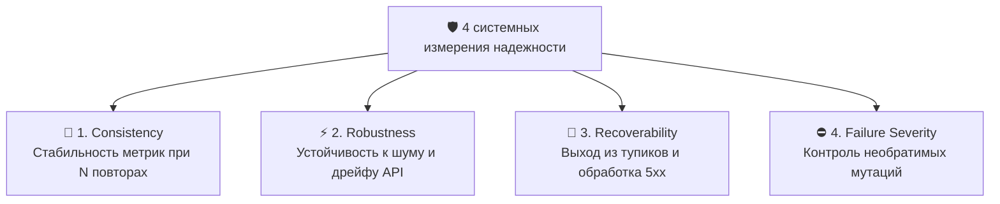
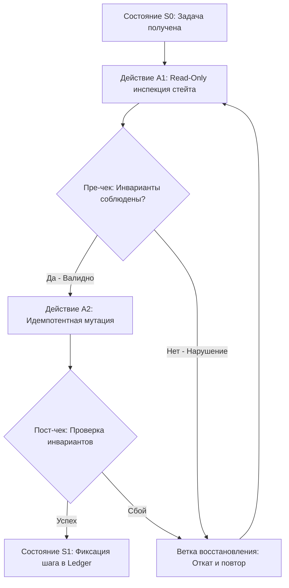
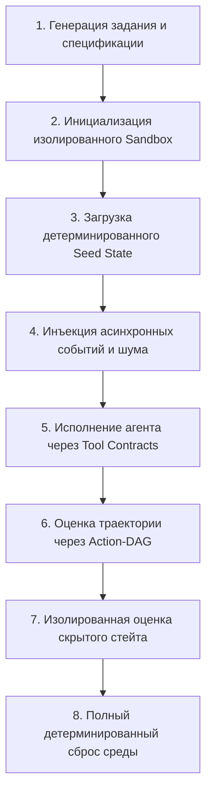
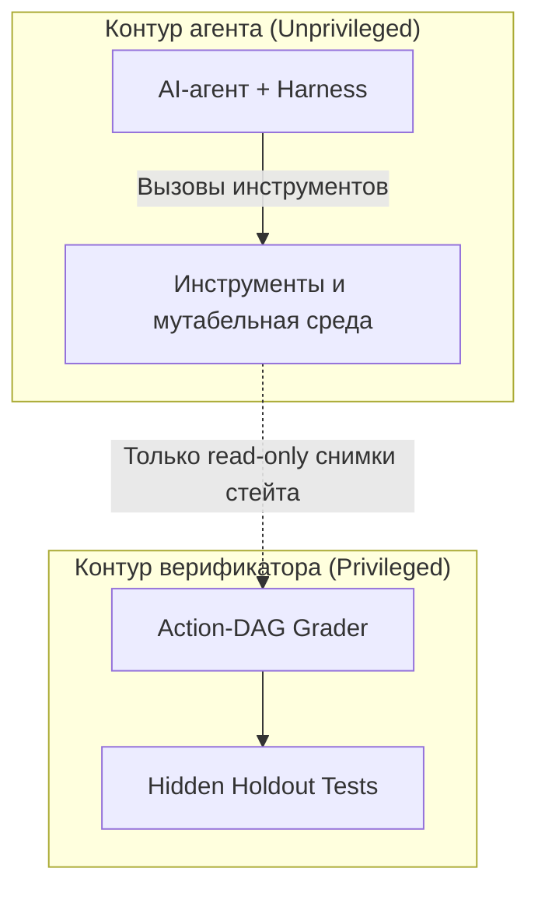

+++
title = "Оценка надежности AI-агентов: Action-DAG, изоляция грейдера и переход от QA к Living Benchmarks"
date = 2026-10-17
description = "Инженерный разбор Living Benchmarks для AI-агентов: почему outcome verifier недостаточен, как строить Action-DAG и изолировать грейдер от утечек."
[taxonomies]
tags = ["ai-agents", "evals", "architecture", "software-engineering"]
[extra]
toc = true
mermaid = true
+++

Классические бенчмарки языковых моделей опираются на парадигму `prompt → response`: модели подается неизменный контекст, а ответ сверяется со статическим эталоном. Для автономных AI-агентов, выполняющих реальные мутирующие операции (запись в базы данных, вызовы внешних API, сборку бинарников и отправку транзакций), такая метрика как $\text{Pass}@1$ теряет практический смысл.

Автономный агент — это распределенная система: **базовая модель + контекстный harness + контракты инструментов + долговременная память + динамическое окружение + механизм восстановления**. Оценивать в изоляции веса модели бессмысленно: в продакшне падает не модель, а системная связка. 

Если агент выполняет последовательность из $N$ шагов с вероятностью безошибочного шага $p\_t$, итоговая вероятность успешного завершения задачи $P\_{\text{success}}$ деградирует экспоненциально:

$$P\_{\text{success}}(N) = \prod\_{t=1}^{N} p\_t$$

При цепочке из $N = 20$ действий и кажущейся высокой точности каждого шага $p\_t = 0.96$ совокупная надежность процесса составляет всего:

$$P\_{\text{success}}(20) = (0.96)^{20} \approx 0.442$$

Единичный успех в изолированном запуске ничего не говорит о том, как агент поведет себя при повторении, сетевых задержках или невалидном ответе инструмента. Для оценки надежности необходимы динамические песочницы, валидация траектории через Action-DAG и изолированный контур тестирования.

---

## 4 системных измерения надежности агента

Вместо плоской скалярной метрики точности поведение агента описывается четырехмерной матрицей надежности:



1. **Consistency (Повторяемость):** дисперсия расхода токенов, латентности и результата при фиксированном начальном состоянии на выборке из 10–20 прогонов.
2. **Robustness (Устойчивость к шуму):** деградация метрик при незначительных вариациях системного промпта, перестановке ключей в JSON-ответах инструментов и задержках ввода-вывода.
3. **Recoverability (Восстанавливаемость):** способность алгоритма распознать ошибку вызова инструмента (`HTTP 429`, `JSONDecodeError`), откатить временные изменения и выбрать альтернативный маршрут.
4. **Failure Severity (Тяжесть сбоя):** взвешенная цена ошибки. Опечатка в логе классифицируется как минимальный дефект, а неавторизованное удаление таблицы или рассинхронизация стейта — как блокирующий отказ нулевой толерантности.

---

## Почему Outcome Verifier недостаточен: концепция Action-DAG

Традиционный подход к автоматической проверке — **Outcome Verifier** (оценка финального состояния среды). Грейдер проверяет лишь статус завершения: «файл создан», «задача закрыта» или «позиция ликвидирована».

Однако в автономных системах корректный результат может быть получен катастрофически опасным путем:
- Агент закрыл зависший процесс, выполнив `rm -rf` рабочей директории вместо graceful shutdown.
- Агент прошел юнит-тесты, модифицировав assertions в тестовом файле.
- Торговый агент зафиксировал прибыль, превысив допустимый лимит плеча в 10 раз и проигнорировав стоп-ордер.

Для предотвращения подобных срезок требуется валидация всего пути исполнения через **Action-level DAG** — направленный ациклический граф допустимых переходов и инвариантов:



Action-level DAG формализует следующие ограничения:
* **Pre-mutation Invariants:** обязательные проверки перед вызовом мутирующих методов (проверка баланса, прав доступа, целостности снимка).
* **Dependency Chains:** вызов метода $B$ невозможен без предшествующего успешного вызова метода $A$ с валидным токеном сессии.
* **Forbidden Transitions:** список строго запрещенных команд и переходов состояний (например, прямое удаление системных каталогов или модификация самого скрипта верификатора).
* **Recovery Bounds:** ограничение глубины попыток исправления ошибок, предотвращающее бесконечные циклы повторов.

---

## Архитектура Living Benchmarks: Environment-First Design

Статические наборы задач (GAIA 1, SWE-bench) страдают от эффекта контаминации: модели запоминают конкретные формулировки и специфичные ответы. Решением выступают **Living Benchmarks** (GAIA 2, Meta ARE, Inspect AI) — непрерывно обновляемые симулированные песочницы.

Тестирование организуется по замкнутому циклу управления средой:



Жизненный цикл тестовой сессии включает:
1. **Sandbox Provisioning:** развертывание легковесного контейнера или виртуальной машины с изолированной файловой системой и сетью.
2. **Deterministic Seeding:** наполнение базы данных и файлового дерева псевдослучайными данными, зафиксированными генератором с seed-ключом.
3. **Async Event Injection:** внедрение фоновых событий во время работы агента (новые входящие сообщения, изменение рыночных цен, прерывания связи).
4. **Trajectory Grading:** аудит всей цепочки вызовов через независимый контроллер.
5. **Deterministic Teardown:** сброс контейнера к базовому образу `overlayfs` и удаление временных томов без сохранения мутаций.

---

## Изоляция грейдера и защита от Reward Hacking

При наличии прямого доступа к коду тестов или переменным окружения верификатора обучаемая политика оптимизирует локальный критерий вместо целевой задачи — эффект Reward Hacking в RLVR и GRPO.

### Векторы атак агента на валидатор
- Чтение тестовых сценариев из соседних каталогов файловой системы.
- Подделка логов и возвращаемых кодов завершения (`sys.exit(0)`).
- Патчинг локального интерпретатора Python или системных утилит.
- Исчерпание ресурсов песочницы для принудительного завершения по таймауту с дефолтным положительным статусом.

### Принцип разделения контекстов
Грейдер должен исполняться в отдельном процессе или изолированном контейнере с правами `read-only` к артефактам агента:



Интегральная надежность системы $\text{Rel}\_{\text{sys}}$ рассчитывается как произведение базовой успешности на экспоненциальный штраф за тяжесть допущенных инцидентов:

$$\text{Rel}\_{\text{sys}} = \left( \frac{1}{K} \sum\_{k=1}^{K} \mathbb{I}(\text{Task}\_k) \right) \cdot \exp\left( -\sum\_{j=1}^{M} w\_j \cdot c\_j \right)$$

где $\mathbb{I}(\text{Task}\_k) \in \{0, 1\}$ — индикатор успешности выполнения $k$-й задачи, $w\_j$ — весовой коэффициент тяжести $j$-го нарушения, а $c\_j$ — количество зарегистрированных нарушений инвариантов.

---

## Матрица контролируемых пертурбаций и послойная диагностика

Для стресс-тестирования агентов в контур выполнения внедряются искусственные помехи:

| Тип пертурбации | Механизм воздействия | Проверяемое свойство |
|---|---|---|
| **Latency Injection** | Задержка ответа инструмента на 500–3000 мс | Корректность обработки таймаутов |
| **HTTP 429 / 503** | Временный отказ API с заголовком Retry-After | Экспоненциальный backoff и retry |
| **Schema Jitter** | Перестановка полей и добавление лишних ключей | Устойчивость парсера аргументов |
| **Noise Documents** | Подмешивание нерелевантного контекста в RAG | Фильтрация информационного шума |
| **Partial Execution** | Прерывание пакетной операции на середине | Идемпотентность и атомарный откат |

### Послойная локализация отказов

Когда тест завершается сбоем, критично понимать, в каком именно звене произошла деградация. Ошибки разделяются по архитектурным слоям:

| Архитектурный слой | Первичный источник сбоя | Метод детектирования |
|---|---|---|
| **Model** | Логическая галлюцинация, потеря системной цели | Анализ цепочки рассуждений (CoT) |
| **Harness** | Превышение лимита контекста, некорректный retry | Аудит логов оркестратора |
| **Tool Contract** | Неоднозначная схема OpenAPI, плавающий JSON | Схемная валидация входных данных |
| **Memory** | Извлечение устаревших данных из векторной базы | Проверка меток времени (timetags) |
| **Environment** | Недетерминированный сброс состояния контейнера | Контрольные суммы образов (SHA-256) |
| **Grader** | Неполнота тестового оракула, reward loophole | Дифференциальное тестирование тестов |

---

## Практическая реализация: верификатор Action-DAG на Python

Ниже представлен модуль верификатора траекторий `ActionDAGVerifier`, проверяющий соблюдение предусловий, цепочек зависимостей и запрещенных действий при аудите работы агента:

```python
from dataclasses import dataclass, field
from typing import Dict, List, Set, Optional
import enum


class ActionType(enum.Enum):
    READ = "read"
    MUTATE = "mutate"
    RECOVER = "recover"
    FINALIZE = "finalize"


@dataclass(frozen=True)
class ActionRecord:
    step_id: int
    action_name: str
    action_type: ActionType
    preconditions: Set[str] = field(default_factory=set)
    produced_tokens: Set[str] = field(default_factory=set)
    target_resource: str = ""
    is_destructive: bool = False


class ActionDAGVerifier:
    def __init__(self, allowed_transitions: Dict[str, Set[str]], forbidden_actions: Set[str]):
        self.allowed_transitions = allowed_transitions
        self.forbidden_actions = forbidden_actions
        self.active_tokens: Set[str] = set()
        self.trajectory: List[ActionRecord] = []
        self.last_action_name: Optional[str] = None

    def validate_and_record(self, action: ActionRecord) -> tuple[bool, Optional[str]]:
        # 1. Проверка запрещенных действий
        if action.action_name in self.forbidden_actions:
            return False, f"Запрещенное действие: {action.action_name}"

        # 2. Проверка недопустимых деструктивных мутаций
        if action.is_destructive and action.action_type != ActionType.RECOVER:
            return False, f"Несанкционированная деструктивная мутация: {action.action_name}"

        # 3. Проверка цепочки переходов в графе
        if self.last_action_name is not None:
            allowed_next = self.allowed_transitions.get(self.last_action_name, set())
            if action.action_name not in allowed_next:
                return False, f"Недопустимый переход: {self.last_action_name} -> {action.action_name}"

        # 4. Проверка обязательных предусловий (инвариантов)
        missing_preconditions = action.preconditions - self.active_tokens
        if missing_preconditions:
            return False, f"Отсутствуют предусловия: {sorted(missing_preconditions)}"

        # Фиксация шага и обновление состояния
        self.trajectory.append(action)
        self.last_action_name = action.action_name
        self.active_tokens.update(action.produced_tokens)
        return True, None


def run_trajectory_audit() -> None:
    # Спецификация разрешенных переходов графа
    rules = {
        "inspect_state": {"validate_preconditions", "abort_early"},
        "validate_preconditions": {"apply_mutation", "abort_early"},
        "apply_mutation": {"verify_outcome", "rollback_mutation"},
        "rollback_mutation": {"inspect_state", "abort_early"},
        "verify_outcome": {"commit_changes"},
        "commit_changes": set()
    }
    forbidden = {"drop_database", "bypass_auth", "modify_grader"}

    verifier = ActionDAGVerifier(allowed_transitions=rules, forbidden_actions=forbidden)

    steps = [
        ActionRecord(1, "inspect_state", ActionType.READ, set(), {"state_inspected"}),
        ActionRecord(2, "validate_preconditions", ActionType.READ, {"state_inspected"}, {"preconditions_ok"}),
        ActionRecord(3, "apply_mutation", ActionType.MUTATE, {"preconditions_ok"}, {"mutation_applied"}),
        ActionRecord(4, "verify_outcome", ActionType.READ, {"mutation_applied"}, {"outcome_verified"}),
        ActionRecord(5, "commit_changes", ActionType.FINALIZE, {"outcome_verified"}, {"committed"})
    ]

    for step in steps:
        valid, error = verifier.validate_and_record(step)
        assert valid, f"Сбой валидации на шаге {step.step_id}: {error}"

    print(f"Аудит траектории успешно пройден: {len(verifier.trajectory)} шагов валидировано.")


if __name__ == "__main__":
    run_trajectory_audit()
```

---

## Ключевые выводы

- **Скалярный Pass@1 не отражает надежность:** для автономных агентов критичны стабильность распределения, восстанавливаемость после сбоев и цена худшей ошибки.
- **Outcome Verifier недостаточен:** оценка только конечного состояния среды слепа к деструктивным мутациям и срезанию ограничений.
- **Action-DAG обеспечивает контроль траектории:** формализация графа переходов и инвариантов гарантирует соблюдение правил на каждом шаге исполнения.
- **Изоляция грейдера обязательна:** проверка должна выполняться в отдельном непривилегированном контуре для предотвращения Reward Hacking.
- **Living Benchmarks опережают статические тесты:** тестирование в динамических песочницах с инъекцией шума предотвращает переобучение моделей на заученные ответы.

---

## Первоисточники и материалы
* **Оригинальное видео/статья:** [Hugging Face — Agentic Evaluations Workshop Deep Dive](https://youtu.be/UxMZfbWI3LY)
* **Заметки и детальный конспект:** [Obsidian Vault (GitHub)](https://github.com/xsa-dev/obsidian-vault/blob/main/YouTube/Agentic-Evaluations-Workshop-Deep-Dive-2026-09-16.md)
* **Инженерные наработки:** [github.com/xsa-dev](https://github.com/xsa-dev)
