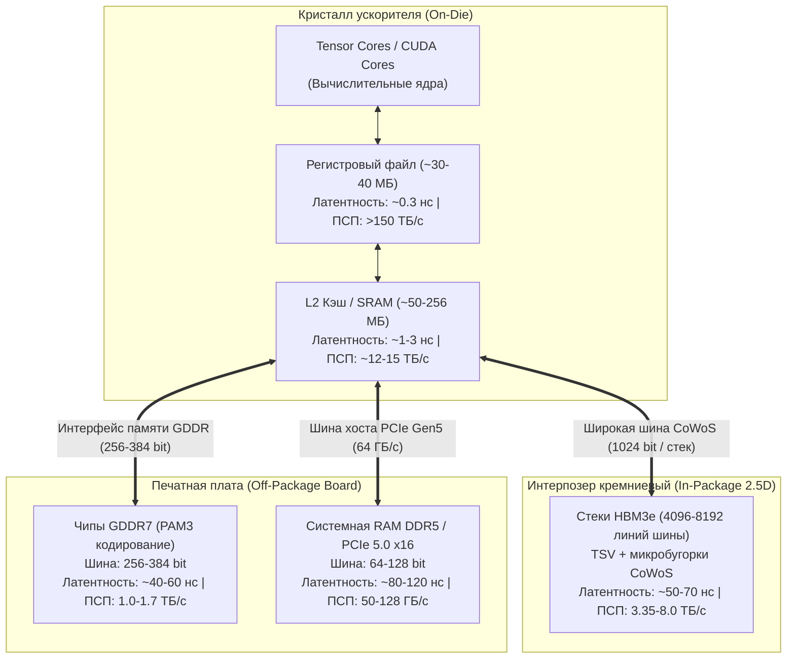

+++
title = "Иерархия памяти AI-ускорителей: SRAM, HBM3e, GDDR7 и математика Memory Wall в инференсе LLM"
date = 2026-10-23
description = "Архитектурный разбор иерархии памяти AI-ускорителей: физика SRAM, HBM3e и GDDR7, Roofline-модель, расчет Memory Wall и оптимизация Memory-Bound инференса LLM."
[taxonomies]
tags = ["architecture", "mlops", "evals"]
[extra]
toc = true
mermaid = true
+++

В проектировании высокопроизводительных вычислительных систем для машинного обучения ключевым фактором производительности все чаще выступает не пиковая вычислительная мощность тензорных ядер ($\text{TFLOPS}$), а пропускная способность подсистемы памяти ($\text{Memory Bandwidth}$, выражаемая в $\text{ГБ/с}$ или $\text{ТБ/с}$). Данный дисбаланс между темпами роста вычислительной мощности и скорости памяти известен как **Memory Wall (стена памяти)**.

В задачах авторегрессионного инференса больших языковых моделей (LLM) фаза генерации токенов (Decode Phase) фундаментально ограничена скоростью извлечения весов из памяти, а не производительностью ALU. Ниже приводится системный разбор архитектурной иерархии памяти современных ускорителей (SRAM, HBM3e, GDDR7, DDR5), математическая формализация Roofline-модели, расчеты деградации утилизации GPU на примере модели Llama-3-70B и верифицируемый скрипт профилирования.

> **Первоисточники:**
> * **Видеоразбор концепции:** [SRAM vs DRAM vs HBM vs GDDR: What's the Difference?](https://youtu.be/Xe22fsiGQXA) (канал *Learn with Whiteboard*).
> * **Аппаратные спецификации:** Архитектурные whitepapers NVIDIA Hopper (H100/H200), Blackwell (B200), JEDEC HBM3e (JESD238) и JEDEC GDDR7 (JESD239).

---

## 1. Математика Memory Wall: Roofline-модель и операционная интенсивность

Предел производительности любого вычислительного ядра формализуется классической **двухпараметрической Roofline-моделью** (Williams et al., 2009). Предельная достижимая производительность алгоритма $P\_{\text{attainable}}$ ($\text{TFLOPS}$) определяется как минимум между пиковой производительностью процессора $P\_{\text{peak}}$ и произведением операционной (арифметической) интенсивности алгоритма $I$ на пропускную способность памяти $B\_{\text{mem}}$:

$$P\_{\text{attainable}} = \min \left( P\_{\text{peak}}, \; I \cdot B\_{\text{mem}} \right)$$

где:
* $P\_{\text{peak}}$ — теоретическая пиковая вычислительная мощность тензорных ядер ($\text{TFLOPS}$ или $\text{FLOPS/s}$).
* $B\_{\text{mem}}$ — реальная пропускная способность интерфейса памяти ($\text{TB/s}$ или $\text{Bytes/s}$).
* $I$ — операционная интенсивность алгоритма ($\text{Operational/Arithmetic Intensity}$), измеряемая в количестве операций с плавающей точкой на один байт переданных данных:

$$I = \frac{\text{Количество операций (FLOPs)}}{\text{Объем переданных данных из памяти (Bytes)}}$$

Граница между двумя режимами называется **точкой перегиба Roofline (Ridge Point)** $I\_{\text{ridge}}$:

$$I\_{\text{ridge}} = \frac{P\_{\text{peak}}}{B\_{\text{mem}}}$$

* Если $I < I\_{\text{ridge}}$, алгоритм находится в режиме **Memory-Bound**: вычислительные ядра простаивают в ожидании данных, а фактический $\text{TFLOPS}$ масштабируется линейно с ростом $B\_{\text{mem}}$.
* Если $I \ge I\_{\text{ridge}}$, алгоритм находится в режиме **Compute-Bound**: шина памяти полностью обеспечивает вычислитель, и производительность упирается в $P\_{\text{peak}}$.

### Расчет Ridge Point для ускорителя NVIDIA H100 SXM5

Рассмотрим характеристики ускорителя NVIDIA H100 SXM5:
* Пиковая производительность Tensor Core (FP16/BF16 без разреженности): $P\_{\text{peak}} = 989.5 \times 10^{12} \; \text{FLOP/s} \; (989.5 \; \text{TFLOPS})$.
* Пропускная способность HBM3 памяти (80 ГБ, 5 активных стеков): $B\_{\text{mem}} = 3.35 \times 10^{12} \; \text{Byte/s} \; (3.35 \; \text{TB/s})$.

Рассчитаем критическую операционную интенсивность:

$$I\_{\text{ridge}} = \frac{989.5 \times 10^{12}}{3.35 \times 10^{12}} \approx 295.37 \; \text{FLOPs/Byte}$$

Чтобы вычислительные ядра H100 работали со 100% утилизацией в режиме FP16, алгоритм обязан производить не менее **295.4 математических операций на каждый байт**, загруженный из HBM3.

---

## 2. Prefill Phase vs Decode Phase: почему инференс LLM попадает в Memory-Bound

Жизненный цикл инференса трансформерной модели разделен на две фазы с кардинально различающейся операционной интенсивностью:

### 2.1. Фаза обработки контекста (Prefill / Prompt Processing)

На этапе Prefill модель обрабатывает входной промпт длиной $S\_{\text{in}}$ токенов параллельно. Основная вычислительная нагрузка приходится на умножение матриц проекций весов $W \in \mathbb{R}^{d \times d}$ на матрицу активаций $X \in \mathbb{R}^{S\_{\text{in}} \times d}$ (операция General Matrix Multiply, **GEMM**).

Для одного слоя трансформера с размером скрытого состояния $d$ и длиной последовательности $S\_{\text{in}}$:
* Количество операций: $\text{FLOPs} = 2 \cdot S\_{\text{in}} \cdot d^2$.
* Объем загрузки весов: $\text{Bytes}\_{\text{weights}} = 2 \cdot d^2$ (для формата FP16/BF16, 2 байта на параметр).
* При $S\_{\text{in}} \gg 1$ операционная интенсивность фазы Prefill равна:

$$I\_{\text{prefill}} \approx \frac{2 \cdot S\_{\text{in}} \cdot d^2}{2 \cdot d^2} = S\_{\text{in}} \; \text{FLOPs/Byte}$$

При длине промпта $S\_{\text{in}} = 2048$ токенов значение $I\_{\text{prefill}} = 2048 \gg 295.4$. Фаза Prefill является строго **Compute-Bound**, эффективно загружая тензорные ядра на 60–80% от теоретического максимума.

### 2.2. Фаза пошаговой генерации (Decode Phase)

На этапе Decode модель генерирует токены строго последовательно (авторегрессия). На каждом шаге $t$ генерируется ровно один новый токен ($S = 1$). Матричное умножение вырождается в умножение матрицы на вектор (General Matrix-Vector Multiply, **GEMV**).

Для извлечения одного токена при размере пакета (batch size) $B = 1$:
* Модель обязана прочитать **все $P$ параметров модели** из внешней памяти HBM в регистры/SRAM кристалла.
* Объем памяти для загрузки весов: $\text{Bytes} = P \cdot b\_{\text{param}}$, где $b\_{\text{param}} = 2 \; \text{байта}$ для FP16.
* Количество операций для прямого прохода: $\text{FLOPs} = 2 \cdot P$.
* Операционная интенсивность фазы Decode:

$$I\_{\text{decode}} = \frac{2 \cdot P}{2 \cdot P} = 1.0 \; \text{FLOP/Byte}$$

При переходе на квантование FP8 ($b\_{\text{param}} = 1$ байт):

$$I\_{\text{decode, FP8}} = \frac{2 \cdot P}{1 \cdot P} = 2.0 \; \text{FLOPs/Byte}$$

Сравним $I\_{\text{decode}} = 1.0$ с порогом $I\_{\text{ridge}} = 295.4$. Операционная интенсивность деривации токена в 295 раз ниже порога насыщения вычислителя.

Фактическая производительность H100 в фазе Decode при $B = 1$:

$$P\_{\text{decode}} = I\_{\text{decode}} \cdot B\_{\text{mem}} = 1.0 \; \text{FLOP/Byte} \times 3.35 \times 10^{12} \; \text{Byte/s} = 3.35 \; \text{TFLOPS}$$

$$\text{Утилизация ядер} = \frac{3.35 \; \text{TFLOPS}}{989.5 \; \text{TFLOPS}} \approx 0.338\%$$

**Тензорные ядра простаивают 99.66% времени**, ожидая доставки весов по шине памяти. Скорость генерации токенов определяется исключительно физической пропускной способностью интерфейса памяти.

---

## 3. Сравнительная архитектура уровней памяти: SRAM, HBM3e, GDDR7, DDR5

Для преодоления физических ограничений кремния в современных вычислительных системах применяется многоуровневая иерархия памяти, в которой каждый уровень оптимизирован под компромисс между емкостью, латентностью, пропускной способностью и энергопотреблением.



### 3.1. SRAM (Static RAM): верстак на кристалле

* **Физическая структура:** Ячейка памяти состоит из 6 транзисторов (схема 6T), образующих два перекрестно связанных инвертора и два ключа доступа. В ячейке SRAM отсутствует конденсатор, поэтому данные сохраняются статически без необходимости циклов регенерации заряда (Refresh).
* **Характеристики:** Латентность доступа составляет единицы тактов (менее 1 нс), а внутренняя пропускная способность распределенного массива L2 кэша превышает 10–15 ТБ/с.
* **Ограничения:** Площадь одной ячейки 6T на техпроцессе TSMC N4/N5 составляет около $0.021 \; \mu\text{m}^2$. Включение 1 ГБ памяти SRAM потребовало бы более $170 \; \text{мм}^2$ чистой площади кремния (более 20% от максимального литографического ретикула $858 \; \text{мм}^2$). Поэтому емкость SRAM на GPU ограничена диапазоном 50–256 МБ (H100 имеет 50 МБ L2, B200 — 256 МБ).

### 3.2. HBM3e и HBM4: трехмерная интеграция памяти

* **Физическая структура:** HBM (High Bandwidth Memory) формируется вертикальным стекированием (3D Stacking) от 8 до 16 кристаллов DRAM на логическом базовом кристалле (Base Die). Соединение слоев выполняется сквозными кремниевыми контактами (Through-Silicon Vias, **TSV**) и микробугорками (Micro-bumps).
* **Интерфейс CoWoS:** Стек HBM монтируется в непосредственной близости от вычислительного чипа (менее 2–3 мм) на кремниевом интерпозере (технология упаковки TSMC CoWoS — Chip-on-Wafer-on-Substrate).
* **Ширина шины:** Каждый стек HBM3e использует независимую 1024-битную шину данных. Ускоритель с 6 стеками HBM3e (NVIDIA H200) обладает суммарной шиной данных шириной:

$$\text{Ширина шины} = 6 \times 1024 = 6144 \; \text{бит}$$

При эффективной частоте передачи данных $6.4 \; \text{Гбит/с}$ на контакт пропускная способность достигает:

$$B\_{\text{mem}} = \frac{6144 \times 6.4 \times 10^9}{8 \times 10^{12}} \approx 4.915 \; \text{TB/s}$$

* **Энергетическая эффективность:** Минимальная длина проводников на кремниевом интерпозере сокращает паразитную емкость линий, снижая затраты энергии на передачу одного бита до **3–4 пДж/бит** (по сравнению с 7–10 пДж/бит у GDDR6/7 и 15–20 пДж/бит у DDR5).

### 3.3. GDDR7: экстремальные частоты на печатной плате

* **Физическая структура:** Память GDDR7 представляет собой дискретные интегральные микросхемы, распаянные непосредственно на печатной плате (PCB) вокруг графического процессора.
* **Механизм PAM3:** Для преодоления предела затухания высокочастотного сигнала в стандарте GDDR7 осуществлен переход от двухуровневой модуляции NRZ (Non-Return-to-Zero) к трехуровневой широтно-импульсной модуляции **PAM3** (-1, 0, +1). Это позволяет кодировать 3 бита данных за 2 тактовых цикла, снижая рабочую частоту шины на 25% при сохранении полезной скорости передачи до 28–36 Гбит/с на контакт.
* **Ширина шины:** Ограничена топологией трассировки печатной платы и составляет от 128 до 384 бит. При шине 384 бит (уровень RTX 5090) и скорости 32 Гбит/с пропускная способность составляет:

$$B\_{\text{GDDR7}} = \frac{384 \times 32 \times 10^9}{8 \times 10^{12}} = 1.536 \; \text{TB/s}$$

### 3.4. Сводная спецификация архитектурных уровней памяти

| Параметр | SRAM (L2 Cache) | HBM3e (SXM / OAM) | GDDR7 (Discrete) | DDR5 (System DIMM) |
|---|---|---|---|---|
| **Расположение** | На кристалле (On-die) | В упаковке (2.5D CoWoS) | На плате (PCB) | В слоте (DIMM PCB) |
| **Структура ячейки** | 6T (транзисторы) | 1T1C (3D TSV стек) | 1T1C (планарный) | 1T1C (планарный) |
| **Ширина шины данных** | Внутренняя шина кристалла | 4096 – 8192 бит | 128 – 384 бит | 64 – 128 бит на канал |
| **Скорость на контакт** | Частота процессора | 6.4 – 9.6 Гбит/с | 28.0 – 36.0 Гбит/с (PAM3) | 4.8 – 6.4 Гбит/с |
| **Пиковая пропускная способность** | 10 – 15 ТБ/с | 3.35 – 8.0 ТБ/с | 1.0 – 1.7 ТБ/с | 50 – 128 ГБ/с |
| **Латентность (случайный доступ)** | 0.8 – 2.0 нс | 55 – 75 нс | 45 – 65 нс | 85 – 120 нс |
| **Типичная емкость на чип** | 50 – 256 МБ | 80 – 144 ГБ | 16 – 32 ГБ | 32 – 128 ГБ (модуль) |
| **Энергия на перенос бита** | < 0.5 пДж/бит | 3.0 – 4.2 пДж/бит | 7.0 – 9.5 пДж/бит | 14.0 – 22.0 пДж/бит |
| **Стоимость производства** | Экстремальная (площадь кристалла) | Высокая (CoWoS + стеки) | Умеренная (SMD монтаж) | Низкая (массовая) |

---

## 4. Количественный расчет инференса: Llama-3-70B на H100 SXM5

Рассчитаем предельную теоретическую и практическую скорость генерации токенов для модели Llama-3-70B ($70.55 \times 10^9$ параметров) на одном ускорителе NVIDIA H100 SXM5 ($B\_{\text{mem}} = 3.35 \; \text{TB/s}$).

### 4.1. Объем передаваемых данных на один шаг генерации

Вес модели при разрядности параметров:
* В формате FP16 (16 бит / 2 байта): $M\_{\text{weights}} = 70.55 \times 2 = 141.1 \; \text{ГБ}$.
* В формате FP8 (8 бит / 1 байт): $M\_{\text{weights}} = 70.55 \times 1 = 70.55 \; \text{ГБ}$.
* В формате INT4 (4 бита / 0.5 байта): $M\_{\text{weights}} = 70.55 \times 0.5 = 35.28 \; \text{ГБ}$.

Для генерации каждого токена при размере пакета $B = 1$ вся матрица весов считывается из HBM ровно один раз. Предельная частота генерации токенов (Tokens Per Second, **TPS**) ограничена пропускной способностью памяти:

$$\text{TPS}\_{\max} = \frac{B\_{\text{mem}}}{M\_{\text{weights}}}$$

### 4.2. Расчет предела генерации при B = 1

1. **Формат FP16:** Модель 141.1 ГБ физически не помещается в один H100 (80 ГБ). Требуется распределение на 2 GPU (Tensor Parallelism $TP = 2$). Суммарная пропускная способность двух карт: $B\_{\text{total}} = 2 \times 3.35 = 6.70 \; \text{ТБ/с}$:

$$\text{TPS}\_{\max, \text{FP16}} = \frac{6.70 \times 10^{12} \; \text{байт/с}}{141.1 \times 10^9 \; \text{байт}} \approx 47.48 \; \text{токенов/с}$$

2. **Формат FP8:** Модель 70.55 ГБ помещается в память одного H100 (80 ГБ):

$$\text{TPS}\_{\max, \text{FP8}} = \frac{3.35 \times 10^{12} \; \text{байт/с}}{70.55 \times 10^9 \; \text{байт}} \approx 47.48 \; \text{токенов/с}$$

3. **Формат INT4:** Вес модели 35.28 ГБ:

$$\text{TPS}\_{\max, \text{INT4}} = \frac{3.35 \times 10^{12} \; \text{байт/с}}{35.28 \times 10^9 \; \text{байт}} \approx 94.95 \; \text{токенов/с}$$

### 4.3. Влияние непрерывного батчинга (Continuous Batching)

При увеличении размера пакета параллельно обрабатываемых запросов до $B > 1$ загруженные из памяти веса модели повторно переиспользуются для всех $B$ токенов пакета.

Операционная интенсивность масштабируется пропорционально размеру пакета:

$$I\_{\text{decode}}(B) \approx B \cdot \frac{2 \cdot P}{P \cdot b\_{\text{param}}} = B \cdot \frac{2}{b\_{\text{param}}} \; \text{FLOPs/Byte}$$

Для формата FP8 ($b\_{\text{param}} = 1$) значение $I\_{\text{decode}}(B) = 2 \cdot B$.

Найдем размер пакета $B\_{\text{sat}}$, при котором ускоритель достигает точки насыщения Roofline ($I\_{\text{ridge}} = 295.4$):

$$2 \cdot B\_{\text{sat}} \ge 295.4 \implies B\_{\text{sat}} \ge 148$$

При размере пакета $B \ge 148$ инференс Llama-3-70B на H100 полностью переходит из режима Memory-Bound в режим **Compute-Bound**, достигая предельной утилизации тензорных ядер. Однако увеличение $B$ требует пропорционального роста емкости под KV-Cache в HBM:

$$\text{Память KV-Cache} = 2 \times L \times n\_{\text{kv}} \times d\_{\text{head}} \times S\_{\text{ctx}} \times B \times b\_{\text{kv}}$$

Для Llama-3-70B ($L = 80$, $n\_{\text{kv}} = 8$, $d\_{\text{head}} = 128$, контекст $S\_{\text{ctx}} = 4096$, $b\_{\text{kv}} = 2$ байта):
* На один запрос в контексте 4096 токенов объем KV-Cache составляет $1.34 \; \text{ГБ}$.
* Для $B = 148$ требуемый объем памяти под KV-Cache равен $198.3 \; \text{ГБ}$, что превышает физическую емкость HBM3 на одном ускорителе и требует кластерного масштабирования.

---

## 5. Программный контракт: профилирование Roofline и симуляция задержки

Ниже представлен верифицируемый скрипт на Python 3 без внешних зависимостей, рассчитывающий параметры Roofline-модели, точки перегиба $I\_{\text{ridge}}$ и время генерации токенов для различных конфигураций оборудования и разрядностей весов.

```python
"""
Скрипт профилирования Roofline-модели и расчета Memory Wall для LLM.
Проверяет параметры насыщения памяти и прогнозирует Tokens/s (TPS).
"""

from typing import Dict, Any


def calculate_roofline_metrics(
    peak_tflops: float,
    mem_bandwidth_tbs: float,
    model_params_billions: float,
    bytes_per_param: float,
    batch_size: int,
) -> Dict[str, Any]:
    """Рассчитывает точку перегиба Roofline и достижимую производительность.

    :param peak_tflops: Пиковая мощность ядра в TFLOPS (FP16/FP8).
    :param mem_bandwidth_tbs: Пропускная способность памяти в ТБ/с.
    :param model_params_billions: Число параметров модели (млрд).
    :param bytes_per_param: Байт на параметр (2 для FP16, 1 для FP8).
    :param batch_size: Размер батча (параллельных последовательностей).
    :return: Словарь метрик утилизации и пропускной способности.
    """
    # 1. Точка перегиба Roofline (Ridge Point) в FLOPs/Byte
    # 1 TFLOPS / 1 TB/s = 1 FLOP/Byte
    ridge_point: float = peak_tflops / mem_bandwidth_tbs

    # 2. Операционная интенсивность алгоритма Decode
    # FLOPs = 2 * P * B, Bytes = P * bytes_per_param
    operational_intensity: float = (2.0 * batch_size) / bytes_per_param

    # 3. Достижимая производительность по Roofline формуле
    attainable_tflops: float = min(
        peak_tflops, operational_intensity * mem_bandwidth_tbs
    )
    core_utilization_pct: float = (attainable_tflops / peak_tflops) * 100.0

    # 4. Расчет генерации токенов (TPS)
    model_size_bytes: float = model_params_billions * 1e9 * bytes_per_param
    time_per_step_sec: float = model_size_bytes / (
        mem_bandwidth_tbs * 1e12
    )
    tokens_per_second: float = batch_size / time_per_step_sec

    is_memory_bound: bool = operational_intensity < ridge_point

    return {
        "ridge_point_flops_per_byte": round(ridge_point, 2),
        "operational_intensity": round(operational_intensity, 2),
        "is_memory_bound": is_memory_bound,
        "attainable_tflops": round(attainable_tflops, 2),
        "core_utilization_pct": round(core_utilization_pct, 3),
        "step_latency_ms": round(time_per_step_sec * 1000.0, 3),
        "tokens_per_second_total": round(tokens_per_second, 2),
    }


def run_verification_suite() -> None:
    # Конфигурация: NVIDIA H100 SXM5 (80GB HBM3)
    h100_peak_fp8_tflops = 1979.0  # FP8 Tensor Core peak
    h100_hbm3_bandwidth_tbs = 3.35

    # Модель: Llama-3-70B в формате FP8 (1 байт на вес)
    model_params = 70.55

    # Тест 1: Инференс одного пользователя (Batch Size = 1)
    res_b1 = calculate_roofline_metrics(
        peak_tflops=h100_peak_fp8_tflops,
        mem_bandwidth_tbs=h100_hbm3_bandwidth_tbs,
        model_params_billions=model_params,
        bytes_per_param=1.0,
        batch_size=1,
    )

    assert res_b1["is_memory_bound"] is True
    assert res_b1["operational_intensity"] == 2.0
    assert 47.0 <= res_b1["tokens_per_second_total"] <= 48.0
    assert res_b1["core_utilization_pct"] < 1.0

    # Тест 2: Промышленный батчинг (Batch Size = 128)
    res_b128 = calculate_roofline_metrics(
        peak_tflops=h100_peak_fp8_tflops,
        mem_bandwidth_tbs=h100_hbm3_bandwidth_tbs,
        model_params_billions=model_params,
        bytes_per_param=1.0,
        batch_size=128,
    )

    assert res_b128["operational_intensity"] == 256.0
    assert res_b128["tokens_per_second_total"] > 5000.0
    assert res_b128["core_utilization_pct"] > 40.0

    print("Проверочные сценарии Roofline успешно пройдены:")
    print(f"Batch=1: TPS={res_b1['tokens_per_second_total']}, Утилизация ядер={res_b1['core_utilization_pct']}%")
    print(f"Batch=128: TPS={res_b1['tokens_per_second_total']}, Утилизация ядер={res_b128['core_utilization_pct']}%")


if __name__ == "__main__":
    run_verification_suite()
```

---

## 6. Системные методы преодоления Memory Wall в современных AI-стеках

Для минимизации задержек и повышения утилизации ядер в современных архитектурах применяются 4 инженерных метода:

1. **Тайлинг внимания (FlashAttention-2/3):** Традиционный механизм внимания $\text{Softmax}(Q K^T) V$ требует материализации промежуточной матрицы $S \in \mathbb{R}^{S \times S}$ в HBM, вызывая $O(S^2)$ операций чтения/записи. FlashAttention разбивает матрицы $Q, K, V$ на блоки (тайлы), полностью помещающиеся в сверхбыструю память SRAM (L2 кэш), вычисляя online-softmax за один проход и сокращая обращения к HBM с квадратичных до линейных $O(S)$.
2. **Пейджинг памяти KV-Cache (PagedAttention):** В библиотеке vLLM память под ключи и значения организуется по аналогии с виртуальной памятью ОС блоками по 16 токенов. Это исключает фрагментацию памяти (падение потерь с 60–80% до менее 4%), высвобождая HBM для увеличения размера пакета $B$.
3. **Спекулятивное декодирование (Speculative Decoding):** Компактная модель-черновик (Draft Model, например Llama-3-8B) быстро генерирует блок из $K$ кандидатов токенов. Основная модель 70B валидирует все $K$ токенов параллельно за **один прямой проход GEMM** в режиме Compute-Bound. При коэффициенте подтверждения $\alpha \approx 0.75$ эффективная скорость генерации возрастает в 2–3 раза без изменения весов.
4. **Квантование весов и активаций (W4A16, FP8, FP4):** Сокращение разрядности весов в 2–4 раза пропорционально снижает объем передачи данных по шине HBM на каждый шаг генерации, удваивая предельную скорость вывода в режиме Memory-Bound.

---

## Ключевые выводы

1. **Приоритет пропускной способности памяти:** В авторегрессионном выводе LLM скорость генерации токенов определяется не терафлопсами ядер, а пропускной способностью памяти $B\_{\text{mem}}$. При $B = 1$ вычислительные ядра GPU утилизированы менее чем на 1%.
2. **Roofline и Ridge Point:** Точка насыщения $I\_{\text{ridge}} = P\_{\text{peak}} / B\_{\text{mem}}$ для ускорителя NVIDIA H100 составляет 295.4 FLOPs/Byte. Одиночный Decode шаг имеет интенсивность $I = 1.0$ FLOP/Byte, оставаясь глубоко в зоне Memory-Bound.
3. **Преимущество 3D-стекирования HBM3e:** За счет сверхширокой параллельной шины (4096–8192 бит) и монтажа на кремниевом интерпозере CoWoS память HBM3e обеспечивает до 4.9–8.0 ТБ/с пропускной способности при энергоэффективности 3–4 пДж/бит, превосходя GDDR7 и DDR5 в разы.
4. **Батчинг как мост к Compute-Bound:** Увеличение размера непрерывного пакета $B$ поднимает операционную интенсивность пропорционально $B$, переводя инференс в эффективный режим Compute-Bound ценой пропорционального расхода емкости HBM под KV-Cache.

---

## Первоисточники и материалы

* **Оригинальный видеоразбор:** [Learn with Whiteboard — SRAM vs DRAM vs HBM vs GDDR: What's the Difference?](https://youtu.be/Xe22fsiGQXA)
* **Конспект и материалы:** [Obsidian Vault — Архитектура памяти AI-ускорителей](https://github.com/xsa-dev/obsidian-vault)
* **Инженерный репозиторий блога:** [github.com/xsa-dev/blog](https://github.com/xsa-dev/blog)
