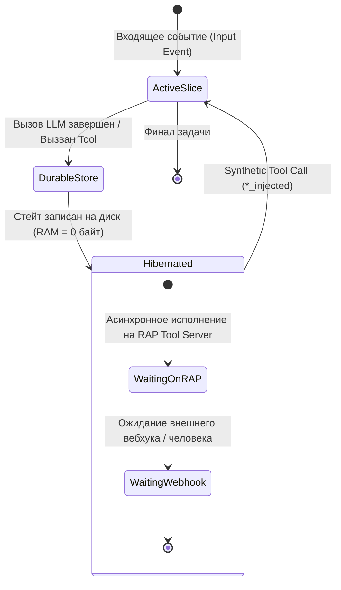
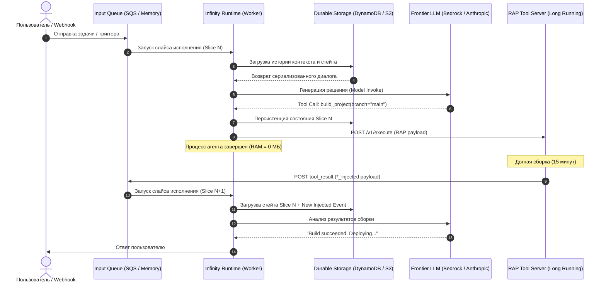
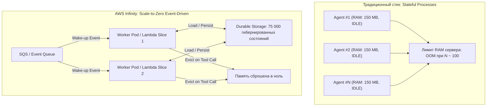
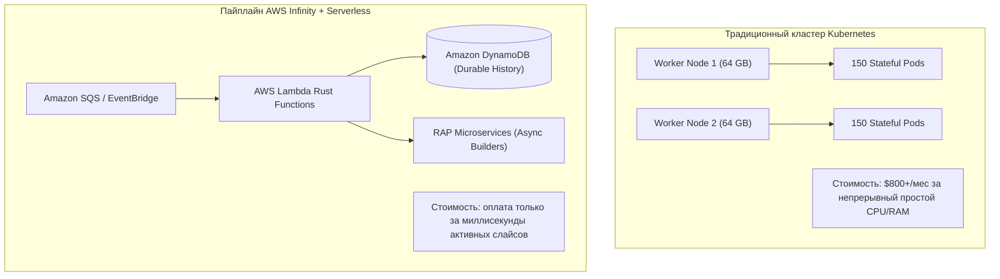

+++
title = "AWS Infinity: архитектура рантайма на Rust для экстремальной конкурентности AI-агентов, слайсы исполнения и протокол RAP"
date = 2026-11-04
description = "Инженерный разбор открытого рантайма AWS Infinity на Rust: как проекция модели async/await на жизненный цикл агента, слайсы исполнения (Execution Slices), протокол RAP и синтетические тулколлы (*_injected) позволяют масштабировать до 75 000 агентов в 8 ГБ RAM и реализовывать бессерверных агентов со Scale-to-Zero."
[taxonomies]
tags = ["ai-agents", "rust", "architecture", "software-engineering", "performance"]
[extra]
toc = true
mermaid = true
katex = true
+++

Современная разработка автономных агентных систем столкнулась с фундаментальным инфраструктурным барьером: **агенты проводят подавляющее большинство времени своей жизни в ожидании**. В сценариях реальной промышленной эксплуатации — от автоматизации DevOps и триажа тикетов до алгоритмического ресерча — шаг выполнения агента часто блокируется внешними асинхронными процессами:
- Пайплайн CI/CD в GitHub Actions или GitLab собирается 15–30 минут;
- Вебхук от стороннего API или внешней базы данных приходит через часы;
- Человек-оператор (Human-in-the-Loop) дает подтверждение или ревьюит дифф в течение нескольких часов или суток.

Классические агентные фреймворки (LangChain, AutoGen, CrewAI и большинство проприетарных платформ) архитектурно спроектированы в парадигме **непрерывного процесса**: под каждого запущенного агента аллоцируется постоянный процесс ОС, контейнер Docker или изолированная виртуальная машина. Этот процесс держит открытыми сетевые сокеты, треды планировщика и десятки мегабайт контекста в оперативной памяти. В результате инженеры оплачивают непрерывный простой серверов, а горизонтальное масштабирование упирается в лимиты памяти задолго до исчерпания вычислительных мощностей.

Компания Amazon представила открытый фреймворк **AWS Infinity** — специализированный рантайм на языке Rust, решающий задачу экстремальной конкурентности (Extreme Concurrency). Infinity внедряет концепцию **слайсов исполнения (Execution Slices)**, полностью перенося семантику модели `async/await` из системного программирования на жизненный цикл автономного агента.

В данном материале мы разберем внутреннюю архитектуру AWS Infinity, протокол реактивных агентов (RAP), механику синтетических тулколлов (`*_injected`) и физику масштабирования до 75 000 агентов в 8 ГБ памяти.

> **Первоисточники и техническая документация:**
> * **Видеоразбор и демонстрация:** [Amazon built a new AI agent runtime in Rust](https://youtu.be/os5eNeAVRpc) (канал *Let's Get Rusty*, автор Bogdan Trifunović).
> * **Официальный инженерный блог AWS:** [Introducing Infinity: A runtime for extreme agent concurrency](https://aws.amazon.com/blogs/opensource/introducing-infinity-a-runtime-for-extreme-agent-concurrency/) (AWS Open Source Blog).
> * **Открытый репозиторий проекта:** AWS Infinity Open Source Project (GitHub / AWS Labs).

---

## 1. Анатомия проблемы: «Стена ожидания» (Waiting Wall) и цена сохранения процессов

Чтобы оценить масштаб проблемы, сопоставим две метрики жизненного цикла среднестатистического кодинг- или DevOps-агента: **активное время CPU (Compute Time)** и **время ожидания I/O (Idle Wait Time)**.

В типичном сценарии агент получает задачу: «Собрать проект, запустить тесты, проанализировать ошибку компиляции и выкатить hotfix»:
1. **Генерация промпта и вызов LLM:** 2–5 секунд (активное время вызова API).
2. **Запуск билд-пайплайна через инструмент bash:** 18 минут ожидания.
3. **Получение логов и принятие решения:** 3 секунды вызова LLM.
4. **Запрос аппрува у инженера в Slack:** 4 часа ожидания.

Отношение полезного времени к общему времени выполнения (Duty Cycle) выражается формулой:

$$\eta = \frac{T_{\text{compute}}}{T_{\text{compute}} + T_{\text{wait}}} \times 100\%$$

При $T_{\text{compute}} \approx 10\text{ с}$ и $T_{\text{wait}} \approx 14\,400\text{ с}$ (4 часа), полезный коэффициент использования ресурсов $\eta$ составляет **менее $0.07\%$**.

### Ресурсная утечка традиционных сред

Когда система запускает 10 000 одновременных агентов в контейнерной среде:
- Минимальный оверхед одного легковесного контейнера или Python-рантайма с зависимостями: $\sim 80$–$250\text{ МБ RAM}$.
- 10 000 агентов требуют: $10\,000 \times 150\text{ МБ} = 1.5\text{ ТБ оперативной памяти}$.
- 99.9% этой памяти расходуется на удержание спящих тредов, открытых файловых дескрипторов и стеков вызовов, ожидающих завершения сетевых пакетов.



AWS Infinity устраняет эту неэффективность за счет радикального архитектурного постулата: **агент никогда не должен находиться в оперативной памяти между шагами принятия решений**.

---

## 2. Архитектурная парадигма: Слайсы исполнения (Execution Slices) как проекция Rust async/await

В основе AWS Infinity лежит изоморфизм между асинхронным рантаймом языка Rust (таким как Tokio) и жизненным циклом автономного агента.

### Как работает `Future` в Rust

В стандартной библиотеке Rust асинхронная функция не выделяет отдельный тред операционной системы. Компилятор преобразует блок `async fn` в **конечный автомат (State Machine)**, реализующий типаж `Future`:

```rust
pub trait Future {
    type Output;
    fn poll(self: Pin<&mut Self>, cx: &mut Context<'_>) -> Poll<Self::Output>;
}
```

Когда функция доходит до вызова `.await`, она возвращает `Poll::Pending`. Стек функции сохраняется внутри структуры-автомата, тред воркера освобождается для других задач, а пробуждение происходит только тогда, когда реактор операционной системы вызывает `Waker::wake()`.

### Проекция на агентные абстракции в Infinity

AWS Infinity переносит этот же принцип на макро-уровень распределенной агентной системы:

| Компонент Rust Async | Эквивалент в AWS Infinity | Физическая реализация |
|---|---|---|
| **`Future`** | **Агентная сессия (Agent Thread)** | Долгоживущий логический контекст задачи, разбитый на дискретные фазы |
| **`State Machine`** | **Durable Storage (Персистентный стейт)** | Сериализованная история диалога, токены и переменные окружения в S3/DynamoDB |
| **`.await point`** | **Вызов инструмента (Tool Call)** | Момент прерывания: генерация запроса к RAP и немедленная гибернация рантайма |
| **`Reactor / IO Driver`**| **RAP Tool Server + Event Queue** | Внешний брокер задач (SQS / EventBridge), выполняющий тяжелую операцию |
| **`Waker::wake()`** | **Синтетический возврат (`*_injected`)** | Сообщение в очереди, инициирующее запуск следующего слайса исполнения |

### Жизненный цикл Execution Slice

Каждый слайс исполнения (Execution Slice) — это изолированная транзакция:

1. **Trigger:** В очередь входящих сообщений агента поступает событие (сообщение пользователя, ответ вебхука или результат выполнения инструмента).
2. **Context Restoration:** Рантайм Infinity поднимает минимальный воркер, считывает из Durable Storage историю сообщений и восстанавливает контекст.
3. **Preprocessing & Model Call:** Формируется промпт, отправляется вызов в API LLM (Anthropic Claude, OpenAI, Amazon Bedrock).
4. **State Persistence:** Ответ модели (рассуждения, текст или манифест вызова инструментов) фиксируется в Durable Storage.
5. **Tool Dispatch:** Если модель запросила вызов инструмента, формируется асинхронный HTTP/gRPC запрос к серверу инструментов RAP.
6. **Eviction / Shutdown:** Процесс агента **немедленно завершается**, высвобождая 100% оперативной памяти и процессорного времени.



---

## 3. Протокол реактивных агентов (RAP) и механика синтетических тулколлов (`*_injected`)

Одной из самых элегантных инженерных находок AWS Infinity является решение проблемы **семантической консистентности диалогового контекста** при асинхронных событиях.

### Проблема атрибуции в агентных диалогах

В протоколах взаимодействия с языковыми моделями (OpenAI Chat Completion API, Anthropic Messages API) определены три фундаментальные роли:
1. `system` — системные инструкции и ограничения;
2. `user` — ввод человека;
3. `assistant` — ответы модели (текст или вызов инструментов `tool_use`);
4. `tool` — результат работы инструмента (`tool_result`), привязанный к конкретному `tool_use_id`.

Когда внешняя система (например, долгоиграющий фоновый воркер, монитор базы данных или под-агент) хочет отправить в контекст агента уведомление, традиционные фреймворки часто инжектируют его как `user message`:

```json
{"role": "user", "content": "[SYSTEM EVENT]: Subagent #4 finished security audit. Found 2 bugs."}
```

Это ломает логику рассуждения LLM:
- Модель перестает различать реальные инструкции человека и системные технические оповещения;
- Открывается вектор атак на базе Prompt Injection через полезную нагрузку сторонних систем;
- Нарушается причинно-следственная цепочка вызовов инструментов.

### Синтетические события: соглашение `*_injected`

AWS Infinity формулирует принцип: **«Всё есть сообщение, но события инструментов должны оставаться в протоколе инструментов»**.

Когда агент инициирует асинхронную операцию (например, создание дочернего треда через инструмент `spawn_thread`), он генерирует стандартный вызов:

```json
{
  "role": "assistant",
  "tool_calls": [
    {
      "id": "call_981247a",
      "type": "function",
      "function": {
        "name": "spawn_thread",
        "arguments": "{"task": "Review auth.rs for security vulnerabilities"}"
      }
    }
  ]
}
```

Infinity принимает этот запрос, персистирует состояние слайса и выгружает агента. Сервер RAP запускает задачу в изолированном фоне. Спустя произвольное время (минуты или часы), когда результат готов, RAP сервер возвращает событие обратно в очередь не как пользовательское сообщение, а как **синтетический вызов инструмента (Synthetic Injected Tool Call)**:

```json
{
  "role": "tool",
  "tool_call_id": "call_981247a",
  "name": "spawn_thread_injected",
  "content": "{"status": "completed", "findings": ["Unchecked unwrap in token validation"]}"
}
```

Суффикс `_injected` выполняет две функции:
1. **Прозрачность для модели:** LLM воспринимает событие нативно как штатное завершение вызванного ранее асинхронного инструмента, сохраняя структуру диалога.
2. **Отсутствие in-process стейт-машины:** Рантайму не требуется поддерживать открытые корутины или каналы в памяти. Любое входящее событие самодостаточно и однозначно сопоставляется с точкой в истории, откуда агент ушел в гибернацию.

---

## 4. Физика масштабирования Scale-to-Zero: как 75 000 агентов умещаются в 8 ГБ RAM

Заявление инженеров AWS о возможности запуска **75 000 агентов на 8 ГБ памяти** (эквивалент скромного Raspberry Pi 4/5) звучит радикально. Проведем математический расчет плотности ресурсов.

### Математическая модель потребления памяти

Пусть общая оперативная память системы $M_{\text{total}} = 8\,192\text{ МБ}$.
В традиционной архитектуре непрерывных процессов ($N$ активных агентов):

$$M_{\text{traditional}} = N \times (M_{\text{runtime}} + M_{\text{context}} + M_{\text{stack}})$$

Где:
- $M_{\text{runtime}}$ — оверхед интерпретатора Python и зависимостей ($\sim 60\text{ МБ}$);
- $M_{\text{context}}$ — буфер токенов и векторных индексов ($\sim 40\text{ МБ}$);
- $M_{\text{stack}}$ — стек потоков и системные структуры ОС ($\sim 10\text{ МБ}$).
- Итого на агента: $M_{\text{agent}} \approx 110\text{ МБ}$.

Максимальное количество агентов до исчерпания RAM (OOM):

$$N_{\max} = \frac{8\,192\text{ МБ}}{110\text{ МБ}} \approx 74\text{ агента}$$

В архитектуре **AWS Infinity Execution Slices**:
Агенты, находящиеся в состоянии ожидания, занимают **$0\text{ байт}$** оперативной памяти. Их состояние находится в Durable Storage на диске или в распределенной базе данных.

Оперативную память потребляют только те агенты, которые в данную миллисекунду выполняют активный слайс (Compute Phase):

$$M_{\text{infinity}} = M_{\text{os}} + M_{\text{broker}} + \sum_{k=1}^{K_{\text{active}}} M_{\text{slice}\_k}$$

Где:
- $M_{\text{os}} + M_{\text{broker}}$ — базовый оверхед Linux и рантайма Rust ($\sim 250\text{ МБ}$);
- $M_{\text{slice}}$ — аллокация одного легковесного слайса в Rust ($\sim 1.5\text{ МБ}$ благодаря отсутствию тяжелого рантайма);
- $K_{\text{active}}$ — число агентов, одновременно проводящих валидацию или формирующих сетевой запрос.

При общем пуле в $N = 75\,000$ спящих агентов с коэффициентом одновременности активных слайсов $\alpha = 0.05\%$ (37–40 одновременно исполняемых слайсов):

$$M_{\text{total}} \approx 250\text{ МБ} + (38 \times 1.5\text{ МБ}) \approx 307\text{ МБ}$$

Даже при всплеске одновременной нагрузки до 4 000 активных слайсов потребление памяти не превысит $6.5\text{ ГБ}$.



### Бессерверная синергия с AWS Lambda

Поскольку каждый слайс исполнения изолирован, детерминирован и кратковременен (от сотен миллисекунд до нескольких секунд сетевого вызова к LLM), архитектура идеально ложится на модель **AWS Lambda**:
1. Событие из очереди SQS запускает микро-контейнер Lambda;
2. Функция на Rust подгружает стейт, опрашивает LLM, сбрасывает дельту состояния в DynamoDB;
3. Отправляется асинхронный вызов в сервис очередей инструментов;
4. Функция Lambda завершается. Стоимость простоя равна нулю.

---

## 5. Проектирование State Machine на Rust: реализация слайса исполнения

Рассмотрим архитектурную реализацию ядра такого рантайма на Rust. Мы спроектируем систему типов, гарантирующую типобезопасность переходов и сериализуемость стейта при сбросе процесса.

### Модель типов и переходы автомата

```rust
use serde::{Deserialize, Serialize};
use std::time::SystemTime;

#[derive(Debug, Clone, Serialize, Deserialize)]
pub struct Message {
    pub role: Role,
    pub content: String,
    pub tool_calls: Option<Vec<ToolCall>>,
    pub tool_call_id: Option<String>,
}

#[derive(Debug, Clone, Serialize, Deserialize, PartialEq, Eq)]
pub enum Role {
    System,
    User,
    Assistant,
    Tool,
}

#[derive(Debug, Clone, Serialize, Deserialize)]
pub struct ToolCall {
    pub id: String,
    pub function_name: String,
    pub payload: serde_json::Value,
}

/// Состояние сессии, персистируемое в Durable Storage
#[derive(Debug, Clone, Serialize, Deserialize)]
pub struct AgentSessionState {
    pub session_id: String,
    pub history: Vec<Message>,
    pub pending_tool_calls: Vec<String>,
    pub updated_at: u64,
}

/// Результат выполнения одного слайса исполнения
#[derive(Debug)]
pub enum SliceResult {
    /// Модель вернула финальный ответ, сессия завершена
    Completed(String),
    /// Модель запросила внешние инструменты; процесс гибернирует
    YieldToTools {
        dispatched_calls: Vec<ToolCall>,
        next_session_state: AgentSessionState,
    },
    /// Ошибка инференса или валидации
    Failed(String),
}
```

### Трейт слайса исполнения и диспетчер

```rust
use async_trait::async_trait;

#[async_trait]
pub trait ExecutionSliceHandler: Send + Sync {
    async fn execute_slice(
        &self,
        incoming_event: Message,
        persisted_state: Option<AgentSessionState>,
    ) -> Result<SliceResult, Box<dyn std::error::Error + Send + Sync>>;
}

pub struct InfinityEngine<M, S> {
    model_client: M,
    durable_store: S,
}

#[async_trait]
pub trait DurableStore: Send + Sync {
    async fn load_state(&self, session_id: &str) -> Result<Option<AgentSessionState>, String>;
    async fn save_state(&self, state: &AgentSessionState) -> Result<(), String>;
}

#[async_trait]
pub trait ModelClient: Send + Sync {
    async fn invoke(&self, messages: &[Message]) -> Result<Message, String>;
}

#[async_trait]
impl<M, S> ExecutionSliceHandler for InfinityEngine<M, S>
where
    M: ModelClient,
    S: DurableStore,
{
    async fn execute_slice(
        &self,
        incoming_event: Message,
        _persisted_state: Option<AgentSessionState>,
    ) -> Result<SliceResult, Box<dyn std::error::Error + Send + Sync>> {
        let session_id = "sess_prod_01"; // Извлекается из метаданных события
        
        // 1. Загрузка исторического контекста из персистентного хранилища
        let mut state = self
            .durable_store
            .load_state(session_id)
            .await?
            .unwrap_or_else(|| AgentSessionState {
                session_id: session_id.to_string(),
                history: Vec::new(),
                pending_tool_calls: Vec::new(),
                updated_at: 0,
            });

        // 2. Валидация синтетических событий (*_injected)
        if incoming_event.role == Role::Tool {
            if let Some(ref call_id) = incoming_event.tool_call_id {
                state.pending_tool_calls.retain(|id| id != call_id);
            }
        }

        state.history.push(incoming_event);

        // 3. Вызов модели (активная вычислительная фаза слайса)
        let response = self.model_client.invoke(&state.history).await?;
        state.history.push(response.clone());

        // 4. Определение дальнейшего шага конечного автомата
        if let Some(tool_calls) = response.tool_calls {
            if !tool_calls.is_empty() {
                for tc in &tool_calls {
                    state.pending_tool_calls.push(tc.id.clone());
                }
                state.updated_at = SystemTime::now()
                    .duration_since(SystemTime::UNIX_EPOCH)
                    .unwrap()
                    .as_secs();

                // 5. Персистенция состояния перед гибернацией
                self.durable_store.save_state(&state).await?;

                return Ok(SliceResult::YieldToTools {
                    dispatched_calls: tool_calls,
                    next_session_state: state,
                });
            }
        }

        // Фиксация завершенного состояния
        self.durable_store.save_state(&state).await?;
        Ok(SliceResult::Completed(response.content))
    }
}
```


### Паттерн Typestate для компиляторных гарантий переходов

В критических распределенных системах ошибка перехода состояния в рантайме (например, попытка вызвать инструмент у агента, находящегося в состоянии гибернации) должна отсекаться на этапе компиляции. В Rust это элегантно реализуется через паттерн **Typestate**:

```rust
use std::marker::PhantomData;

// Маркерные типы фаз жизненного цикла
pub struct Hibernated;
pub struct Restoring;
pub struct Executing;
pub struct AwaitingToolResponse;

/// Агентная сессия с типизированной фазой
pub struct AgentThread<Phase> {
    pub session_id: String,
    pub history_len: usize,
    _phase: PhantomData<Phase>,
}

impl AgentThread<Hibernated> {
    pub fn new(session_id: String) -> Self {
        Self {
            session_id,
            history_len: 0,
            _phase: PhantomData,
        }
    }

    /// Пробуждение по сигналу очереди: переход в фазу восстановления контекста
    pub fn wake_by_event(self) -> AgentThread<Restoring> {
        AgentThread {
            session_id: self.session_id,
            history_len: self.history_len,
            _phase: PhantomData,
        }
    }
}

impl AgentThread<Restoring> {
    /// Загрузка персистентного состояния и переход к вычислениям слайса
    pub fn into_execution(self, restored_messages: usize) -> AgentThread<Executing> {
        AgentThread {
            session_id: self.session_id,
            history_len: restored_messages,
            _phase: PhantomData,
        }
    }
}

impl AgentThread<Executing> {
    /// Модель инициировала вызов инструмента: транзиция в ожидание и выгрузка
    pub fn dispatch_tool(self) -> AgentThread<AwaitingToolResponse> {
        AgentThread {
            session_id: self.session_id,
            history_len: self.history_len + 1,
            _phase: PhantomData,
        }
    }
}

impl AgentThread<AwaitingToolResponse> {
    /// Прием синтетического события (*_injected) и повторная гибернация или новый слайс
    pub fn complete_with_synthetic_event(self) -> AgentThread<Hibernated> {
        AgentThread {
            session_id: self.session_id,
            history_len: self.history_len + 1,
            _phase: PhantomData,
        }
    }
}
```

Такая организация гарантирует, что методы исполнения и взаимодействия с LLM физически невозможно вызвать на экземпляре сессии, находящейся в гибернации или ожидающей инструмента — компилятор Rust (`rustc`) выдаст ошибку `mismatched types` еще до сборки бинарника.

Обратите внимание: функция `execute_slice` полностью свободна от постоянных циклов `loop { ... }`. Она отрабатывает ровно один шаг перехода состояния, коммитит изменения в `DurableStore` и передает управление диспетчеру очередей.

---

## 6. Сравнительный аудит архитектурных паттернов агентных систем

Сопоставим три доминирующих подхода к проектированию сред исполнения автономных агентов:

| Характеристика / Метрика | Stateful Containers (Docker/K8s) | Actor Model (Erlang/Ray) | AWS Infinity (Execution Slices) |
|---|---|---|---|
| **Модель владения состоянием** | In-Memory процесс в контейнере | Стейт актора в памяти виртуальной машины | Externalized Durable Storage |
| **Потребление RAM при ожидании** | 100–300 МБ на агента | 10–30 КБ на процесс BEAM | **0 байт (Scale-to-Zero)** |
| **Устойчивость к рестартам узлов** | Потеря контекста / долгий recovery | Восстановление через супервизор | **Абсолютная (Crash-safe by design)** |
| **Поддержка длительных пауз (дни)** | Крайне дорогая (оплата ресурсов VM) | Требует персистентных очередей акторов | **Нативная (транзакция завершена)** |
| **Сложность диспетчеризации I/O** | Блокирующие потоки или корутины | Асинхронные почтовые ящики сообщений | **Реактивный протокол RAP + очереди** |
| **Поддержка Serverless (FaaS)** | Невозможно без cold-start штрафов | Затруднительно (stateful cluster) | **Оптимизировано для AWS Lambda** |



---

## 7. Инженерные компромиссы, ограничения и применимость в Production

Несмотря на очевидные преимущества в плотности масштабирования, архитектура дискретных слайсов накладывает специфические ограничения, которые необходимо учитывать при выборе стека:

### 1. Налог на сериализацию (Durable Storage I/O Latency)
При каждом пробуждении агент обязан вычитать полную или сжатую историю сообщений из персистентного хранилища (DynamoDB, Redis, S3).
- Для коротких диалогов оверхед составляет 5–15 мс.
- Для глубоких контекстов (50k+ токенов) сериализация и передача JSON по сети может занимать от 150 до 350 мс.
- *Решение в Infinity:* применение дифференциальных снепшотов состояния (Delta History) и бинарных форматов сериализации (MessagePack / Postcard).

### 2. Специфика локального состояния файловой системы
Если агент ожидает завершения скрипта на локальном диске, он не может просто сбросить контейнер:
- При традиционном подходе агент держит локальную папку проекта смонтированной в `/tmp`.
- В Infinity выполнение внешних эффектов **делегировано серверу RAP**. Агент передает команду в RAP-воркер, а воркер управляет персистентным томом (EFS, EBS или удаленным Git-репозиторием). Агент оперирует абстрактными ссылками на артефакты, а не локальными дескрипторами файлов.

### 3. Где применение AWS Infinity безальтернативно?
1. **Массовые службы поддержки и триаж инцидентов:** десятки тысяч пользователей пишут с непредсказуемыми паузами. Держать активные контейнеры под каждого клиента экономически нецелесообразно.
2. **Мультиагентные фабрики разработки (Software Factories):** где главный агент делегирует задачи десяткам специализированных субагентов, ожидающих сборки, статического анализа и ревью кода.
3. **Бессерверные автоматизации на периферии (Edge & IoT):** запуск агентов на устройствах с ограниченной памятью (8 ГБ и менее), где требуется обслуживание тысяч периодических устройств.

---

## Резюме

AWS Infinity демонстрирует фундаментальный сдвиг в разработке AI-инфраструктуры: переход от тяжелых имитаций «человекоподобных процессов» к строгим системным абстракциям. 

Проекция принципов Rust `async/await` на агентные циклы управления — слайсы исполнения (Execution Slices), протокол RAP и синтетические тулколлы (`*_injected`) — решает кризис масштабируемости, превращая агентные системы из монолитных пожирателей оперативной памяти в высокоэффективные бессерверные конечные автоматы.
