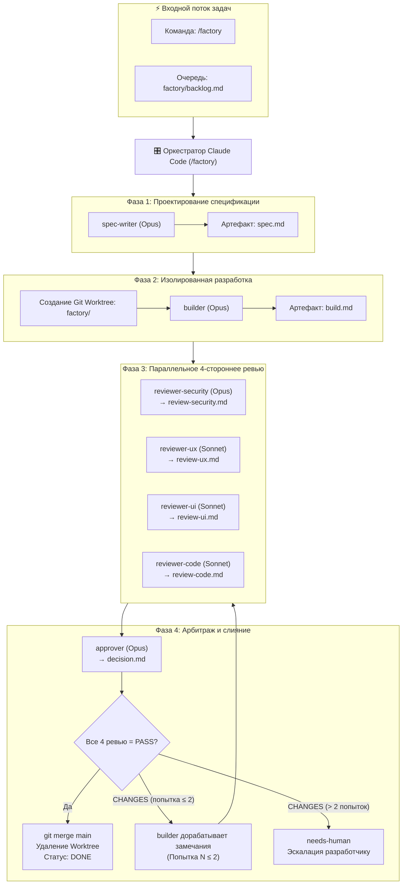
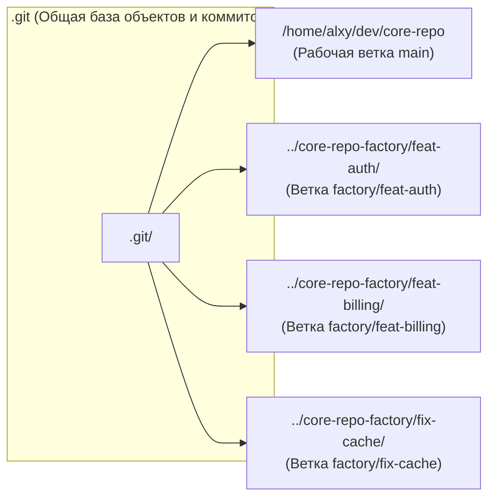
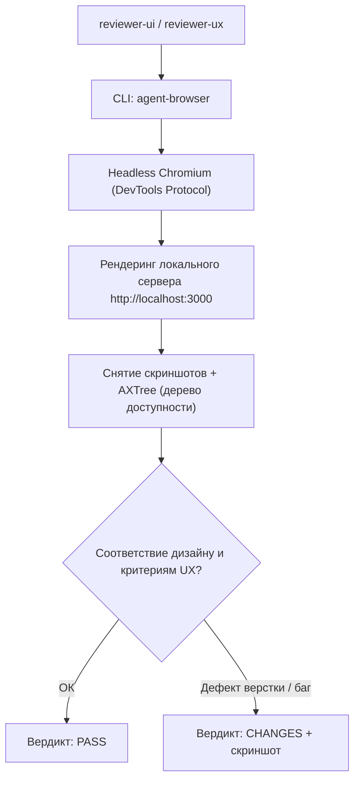

+++
title = "Локальная AI Software Factory на Claude Code: архитектура 7 субагентов, изоляция в Git Worktrees и 4-стороннее ревью"
date = 2026-10-26
description = "Инженерный разбор построения автономной программной фабрики на базе Claude Code CLI: мультиагентная иерархия Spec-Writer → Builder → 4 Reviewers → Approver, изоляция контекста через Markdown State Machine, разработка в параллельных Git Worktrees и сквозное UI-тестирование через agent-browser."
[taxonomies]
tags = ["software-engineering", "ai-agents", "architecture", "devops", "evals"]
[extra]
toc = true
mermaid = true
+++

Инструменты автономного кодинга на базе языковых моделей (Claude Code, OpenAI Codex CLI, Aider) коренным образом изменили скорость генерации кода. Однако при попытке переложить на агентный CLI не просто точечный рефакторинг одной функции, а реализацию комплексной фичи или сквозного сервиса, разработчики неизбежно сталкиваются с системным пределом индивидуального агентного окна:

1. **Деградация внимания и загрязнение контекста (Context Pollution):** диалог с агентом, разрастающийся за пределы десятков шагов, накапливает промежуточные логи компилятора, линтеров и черновые попытки. Модель «забывает» изначальные архитектурные ограничения и начинает плодить регрессионные ошибки.
2. **Конфликт интересов (Self-Review Bias):** агент-генератор, проверяющий свой собственный код, склонен подтверждать собственные предположения и игнорировать граничные условия безопасности или пользовательского опыта.
3. **Блокировка рабочей копии:** классический подход с переключением веток (`git checkout -b`) делает невозможной параллельную автономную работу нескольких агентов в одном репозитории.

Решением этих проблем является переход от монолитного диалога к локальной программной фабрике — **AI Software Factory**. Архитектурный подход ZazenCodes демонстрирует, как с помощью нативных возможностей Claude Code, иерархии субагентов, файлового конечного автомата и механизма **Git Worktrees** развернуть полностью изолированный производственный конвейер на рабочей станции инженера.

> **Первоисточники:**
> * **Видеоразбор:** [Build Your Own AI Software Factory with Claude Code](https://youtu.be/ctoaIC4LHmI) (канал ZazenCodes).
> * **Архитектурный шаблон:** концепция локального мультиагентного оркестратора на базе Claude Code CLI, Markdown State Machine и Git Worktrees.

---

## 1. Математика надежности и декомпозиция ролей

Вероятность успешной реализации комплексной программной задачи $P\\_{\\text{success}}$ в монолитном агентном цикле из $N$ последовательных шагов экспоненциально деградирует с ростом глубины задачи:

$$P\\_{\\text{success}} = \\prod_{i=1}^N p_i$$

где $p_i$ — вероятность безошибочного исполнения шага $i$. Если средняя точность отдельного действия агента $p_i = 0.95$, то уже при цепочке из 20 действий итоговая надежность составляет:

$$P\\_{\\text{success}} = 0.95^{20} \\approx 0.358\\; (35.8\\\%)$$

В архитектуре Software Factory монолитный агент разделяется на специализированные роли с изолированными контекстами и ортогональными критериями приемки. Конвейер опирается на 7 ролей:

| Роль агента | Модель | Артефакт вывода | Зона ответственности и критерии приемки |
|---|---|---|---|
| **`spec-writer`** | Claude 3.7 / Opus | `spec.md` | Формулирует функциональные требования, границы изменений (Scope Boundaries), интерфейсы API и критерии готовности (Definition of Done). |
| **`builder`** | Claude 3.7 / Opus | `build.md` | Создает изолированную ветку, пишет код фичи, юнит-тесты и запускает компиляцию/линтеры. |
| **`reviewer-security`** | Claude 3.7 / Opus | `review-security.md` | Аудит OWASP Top 10, поиск утечек секретов/токенов, валидация пользовательского ввода и строгая типизация. |
| **`reviewer-ux`** | Claude 3.7 / Sonnet | `review-ux.md` | Проверка пользовательских сценариев, валидация состояний ошибок и краевых случаев взаимодействия. |
| **`reviewer-ui`** | Claude 3.7 / Sonnet | `review-ui.md` | Визуальное соответствие дизайн-системе, адаптивность, отступы и скриншот-тестирование через браузер. |
| **`reviewer-code`** | Claude 3.7 / Sonnet | `review-code.md` | Читаемость кода, соблюдение кодстайла проекта, цикломатическая сложность и покрытие тестами. |
| **`approver`** | Claude 3.7 / Opus | `decision.md` | Финальный арбитр: агрегация 4 вердиктов ревьюеров, решение о слиянии (`APPROVE`) или эскалации человека (`ESCALATE`). |

---

## 2. Архитектурный пайплайн фабрики

Каждая задача инициируется через пользовательскую команду `/factory <название-фичи>` или берется из очереди `factory/backlog.md`. Оркестратор запускает строгую последовательность фаз:



---

## 3. Файловый конечный автомат (Markdown State Machine)

Главная архитектурная ошибка многоагентных систем — передача всей истории сообщений через единый контекст диалога. Когда 7 агентов пытаются общаться в одном чате, контекстное окно забивается служебными префиксами и разметкой, а стоимость каждого вызова масштабируется как $O(N^2)$.

В Software Factory коммуникация декомпозирована по принципу **File-Based State Machine**:

1. **Изоляция контекста:** каждый субагент запускается как независимый процесс без истории предыдущих обсуждений. На вход он получает исключительно целевую спецификацию и исходные файлы проекта.
2. **Строгий файловый контракт:** субагент имеет право на запись только в свой выделенный файл (`review-security.md`, `review-code.md` и т.д.).
3. **Единый манифест состояния:** оркестратор поддерживает файл `factory/jobs/<job-id>/job.json`, в котором фиксируется текущий статус, идентификатор ветки и счетчик итераций:

```json
{
  "job_id": "feat-20261026-auth-tokens",
  "feature": "JWT Refresh Token Rotation with Blacklist",
  "status": "in_review",
  "worktree_path": "../core-repo-factory/feat-20261026-auth-tokens",
  "branch": "factory/feat-20261026-auth-tokens",
  "iteration": 1,
  "max_iterations": 2,
  "reviews": {
    "security": "PASS",
    "ux": "PASS",
    "ui": "PASS",
    "code": "CHANGES"
  },
  "created_at": "2026-10-26T08:15:00Z"
}
```

### Защита от бесконечных циклов (Rework Cap)

Если хотя бы один из 4 ревьюеров возвращает вердикт `CHANGES`, задача не может быть автоматически объединена с основной веткой. Включается цикл доработки: замечания из markdown-файлов передаются агенту `builder`.

Однако, чтобы исключить зацикливание агентов и бесконечный слив токенов на взаимные придирки, действует строгое ограничение:

$$\text{Rework Loops} \le 2$$

Если после двух раундов доработки хотя бы один ревьюер сохраняет статус `CHANGES`, арбитр `approver` выносит вердикт `ESCALATE`. Задача переходит в статус `needs-human`, а на локальный дашборд выводится уведомление для разработчика.

---

## 4. Параллельная разработка через Git Worktrees

Традиционный Git-воркфлоу блокирует работу: если запустить агента в текущей рабочей директории, разработчик не может параллельно редактировать файлы или собирать проект на другой ветке.

Фабрика решает эту проблему через встроенный механизм ядра Git — **Worktrees**:



Каждое дерево `worktree` имеет отдельную рабочую директорию на диске, собственный индекс (`index`) и независимый указатель `HEAD`, но разделяет общее хранилище объектов `.git`.

### Скрипт инициализации изолированного воркспейса

При старте задачи оркестратор вызывает подготовленный шелл-скрипт:

```bash
#!/usr/bin/env bash
set -euo pipefail

JOB_ID="$1"
BRANCH_NAME="factory/${JOB_ID}"
WORKTREE_DIR="../$(basename "$PWD")-factory/${JOB_ID}"

echo "==> Создание изолированной ветки и worktree: ${BRANCH_NAME}"
git worktree add -b "${BRANCH_NAME}" "${WORKTREE_DIR}" main

# Переход в изолированную директорию
cd "${WORKTREE_DIR}"

# Симлинк зависимостей или быстрое окружение (без дублирования node_modules/venv)
if [ -d "../$(basename "$PWD")/node_modules" ]; then
    ln -s "../../$(basename "$PWD")/node_modules" ./node_modules
fi

echo "Worktree готово в: ${WORKTREE_DIR}"
```

Благодаря этому разработчик может запустить 3–4 параллельных процесса Claude Code в независимых терминалах:

```bash
# Терминал 1: разработка фичи A
claude --skill factory "Implement rate limiter on Redis"

# Терминал 2: рефакторинг фичи B
claude --skill factory "Migrate authentication middleware to axum 0.8"
```

Оба процесса работают физически в разных папках на диске, не перезаписывают файлы друг друга и не вызывают конфликтов сборки. После успешного ревью и мержа оркестратор удаляет временное воркдерево:

```bash
git worktree remove --force "${WORKTREE_DIR}"
git branch -d "${BRANCH_NAME}"
```

---

## 5. Сквозное UI/UX-тестирование через agent-browser

Критическая проблема чисто текстовых LLM-ревьюеров — неспособность оценить реальный рендеринг пользовательского интерфейса. Статический анализ HTML или React-компонентов не показывает, что кнопка перекрыта модальным окном, выпадает за пределы вьюпорта или теряет фокус при табуляции.

В Software Factory субагенты `reviewer-ui` и `reviewer-ux` вооружаются CLI-инструментом `agent-browser` (разработка Vercel Labs / Playwright-обертка):



Субагент запускает тестовый сервер в изолированном воркдереве и подает команды браузеру:

```bash
# Переход на страницу новой фичи
agent-browser navigate "http://localhost:3000/settings/security"

# Ввод тестовых данных и нажатие кнопки
agent-browser fill "input[name='password']" "SecretPass123!"
agent-browser click "button[type='submit']"

# Снятие скриншота для валидации визуального состояния
agent-browser screenshot "factory/jobs/job-102/artifacts/ui-submit-state.png"
```

Полученный скриншот анализируется мультимодальной моделью на предмет артефактов верстки, отступов и контрастности текста. Это исключает попадание в `main` кода с визуальными дефектами, которые не отлавливаются юнит-тестами.

---

## 6. Локальный наблюдаемый дашборд и Governance

Для контроля состояния фабрики используется легковесный одностраничный дашборд `factory/dashboard.html`, раздаваемый локальным сервером (`python3 -m http.server 8080`).

Дашборд опрашивает манифесты `factory/jobs/*/job.json` каждые 2 секунды и отображает канбан-доску со следующими колонками:
* **Backlog:** новые задачи, ожидающие взятия в работу.
* **Planning (Spec):** задачи в обработке у `spec-writer`.
* **Building:** задачи в активной разработке у `builder` в соответствующем worktree.
* **Review (4 Gates):** статус прохождения 4 ворот ревью в реальном времени (Security, UX, UI, Code).
* **Needs Human:** задачи, исчерпавшие лимит 2 раундов доработки и требующие вмешательства человека.
* **Done:** задачи, успешно прошедшие все гейты и объединенные в `main`.

```text
┌────────────────────────────────────────────────────────────────────────┐
│                   LOCAL AI SOFTWARE FACTORY DASHBOARD                  │
├──────────────┬──────────────┬──────────────┬─────────────┬─────────────┤
│   BACKLOG    │ SPEC / BUILD │ 4-WAY REVIEW │ NEEDS HUMAN │    DONE     │
├──────────────┼──────────────┼──────────────┼─────────────┼─────────────┤
│ • Export CSV │ • JWT Auth   │ • Dark Theme │ • Payment   │ • Health API│
│              │   WT: #feat-1│   Sec: PASS  │   Rework: 2 │   Merged    │
│              │              │   UX:  PASS  │   [Approve] │   4/4 PASS  │
│              │              │   UI:  CHANGES│  [Reject]  │             │
│              │              │   Code:PASS  │             │             │
└──────────────┴──────────────┴──────────────┴─────────────┴─────────────┘
```

### Команды ручного вмешательства

Если задача перешла в статус `needs-human`, инженер анализирует файлы в `factory/jobs/<job-id>/` и принимает решение одной командой в Claude Code:

```bash
# Ручное одобрение фичи с принудительным слиянием
/factory approve feat-20261026-auth-tokens

# Отправка на доработку с конкретными указаниями инженера
/factory rework feat-20261026-auth-tokens "Использовать argon2id вместо bcrypt для хеширования"
```

---

## 7. Сравнительный анализ: Одиночный агент vs Software Factory

| Параметр сравнения | Одиночный Claude Code CLI | Локальная AI Software Factory |
|---|---|---|
| **Изоляция контекста** | Нет: все шаги в одной сессии диалога | Полная: каждый агент стартует с чистым окном |
| **Параллелизм** | 1 фича на репозиторий (блокировка ветки) | 3–5 параллельных фичей в Git Worktrees |
| **Качество верификации** | Self-review автором кода (высокий риск дефектов) | 4 независимых специализированных ревьюера |
| **UI-тестирование** | Ограничено догадками по коду компонентов | Реальный рендеринг и клики через `agent-browser` |
| **Расход токенов на фичу** | $O(N^2)$ из-за раздувания контекста | $O(N)$ благодаря файловой передаче состояния |
| **Контроль зацикливания** | Ручной останов пользователем | Автоматический лимит 2 раундов и эскалация |

---

## Резюме для практикующего инженера

1. **Не смешивайте роли:** разделение обязанностей на `spec-writer`, `builder` и независимых `reviewers` устраняет субъективную слепоту модели к собственным ошибкам.
2. **Используйте файлы вместо памяти:** передача состояния через артефакты `spec.md`, `build.md` и `decision.md` сохраняет токены и предотвращает деградацию внимания.
3. **Изолируйте ветки через Git Worktrees:** это позволяет запускать несколько агентов одновременно на одной машине без риска повредить текущую рабочую копию.
4. **Ограничивайте контуры обратной связи:** лимит в 2 цикла доработки защищает от бесконечных споров между моделями и вовремя привлекает человека к сложным архитектурным решениям.
