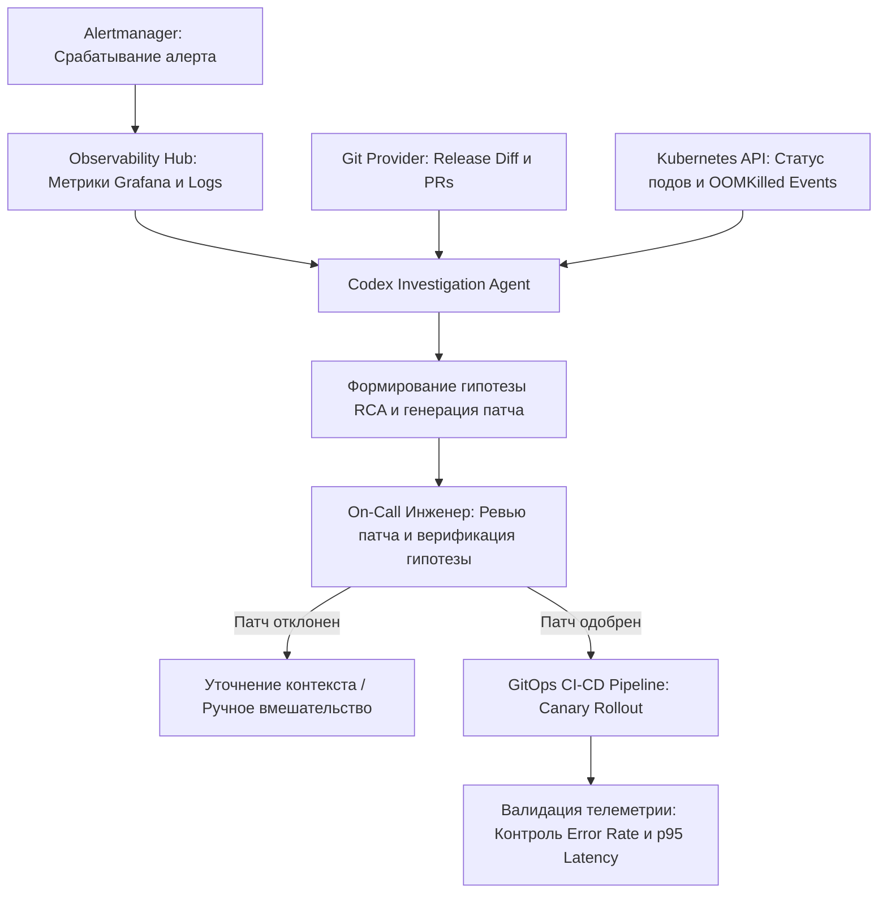
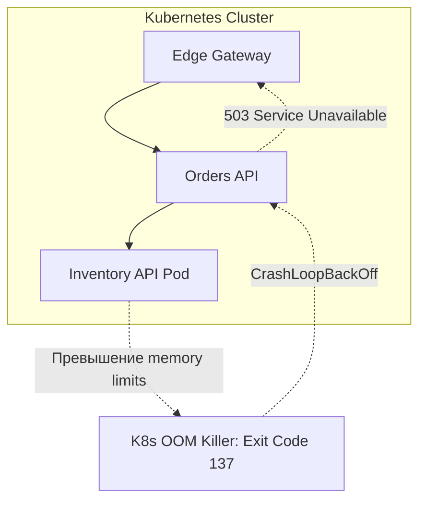

+++
title = "Codex в контуре инцидент-менеджмента: как AI расследует регрессии в Kubernetes и Grafana"
date = 2026-10-11
description = "Инженерный разбор применения Codex при расследовании production-инцидентов: сбор контекста Grafana, OOMKilled в Kubernetes и human-in-the-loop верификация патчей."
[taxonomies]
tags = ["ai-agents", "software-engineering", "devops", "architecture"]
[extra]
toc = true
mermaid = true
katex = false
+++

> **Инженерный дисклеймер:** Материал представляет собой архитектурный анализ интеграции AI-ассистентов в SRE-пайплайны на основе демонстрационных сценариев OpenAI. Приведенные метрики и сценарии носят иллюстративный характер и не гарантируют автоматического устранения инцидентов в произвольной инфраструктуре.

Традиционный инцидент-менеджмент в распределенных системах упирается в «проклятие фрагментированного контекста»: инженер видит график всплеска ошибок в Grafana, но для понимания первопричины вынужден вручную сопоставлять логи подов Kubernetes, манифесты ресурсов, историю коммитов в Git и диффы недавних деплоев. На это уходят десятки минут критического времени простоя.

Использование специализированных AI-агентов (в частности, OpenAI Codex) в контуре инцидент-менеджмента переводит фокус с ручного поиска на валидацию гипотез. Однако критически важно разделять автономное выполнение опасных команд и контролируемую подготовку исправлений. Ниже представлен детальный архитектурный разбор контура расследования production-инцидентов, типовых сценариев сбоев и правил безопасной интеграции агентов.

## Архитектура контура расследования инцидентов

Ключевой принцип надежной интеграции AI в инфраструктурный мониторинг — замкнутый цикл с обязательным участием человека (Human-in-the-Loop, HITL) на этапе модификации состояния продакшена. Агент выступает в роли аналитического ядра, синтезирующего разрозненные сигналы телеметрии в причинно-следственную гипотезу.

В таком контуре права агента жестко ограничены чтением (read-only):
- Доступ к Prometheus/Grafana API для выборки метрик $p95$, $p99$ и кодов ответов HTTP.
- Доступ к Kubernetes API исключительно на чтение событий (`kubectl get events`, `describe pod`, логи завершившихся контейнеров).
- Доступ к репозиторию на чтение diff между релизами.

Агент генерирует артефакт исправления (Pull Request или конфигурационный патч), но физический деплой инициируется исключительно через утверждение инженером и стандартный GitOps-пайплайн.

## Разбор трех сценариев production-сбоев

Практика расследования инцидентов охватывает разные классы отказов: от прикладных багов в новом коде до инфраструктурного голодания и исчерпания общих ресурсов.

### 1. Прикладная регрессия после релиза (Checkout Error Spike)

Симптом: после выкатки релиза сервиса корзины V2 доля пятисотых ошибок (HTTP 500) подскакивает до ~20%. 

Действия агента:
1. Коррелирует таймстемп всплеска ошибок с последним завершившимся деплоем в кластере.
2. Анализирует release diff между тегами `v1.9.4` и `v2.0.0`.
3. Находит измененный обработчик платежного шлюза, в котором отсутствует обработка специфического исключения тайм-аута внешней платежной системы.
4. Готовит точечный хотфикс с добавлением fallback-обработчика и повторных попыток с экспоненциальной задержкой.

Инженер утверждает патч, хотфикс раскатывается без полного отката (rollback) релиза, и уровень ошибок возвращается к нулю.

### 2. Скрытый каскадный сбой: OOMKilled после успешного CI/CD

Один из самых коварных классов сбоев — когда сервис успешно проходит модульные и интеграционные тесты в CI, но падает под реальным профилем нагрузки в Kubernetes.

Симптом: сервис `Inventory API` циклично падает с кодом выхода 137 (`OOMKilled`), вызывая деградацию зависимых микросервисов `Orders API` и сетевого шлюза.

Действия агента со специализированным навыком (Skill):
1. Агент опрашивает события кластера: фиксирует событие `OOMKilled` и статус контейнера `CrashLoopBackOff`.
2. Анализирует график использования оперативной памяти подом: выявляет монотонный рост потребления (Memory Leak) при обработке очередей сообщений.
3. Исследует код недавнего коммита: находит незакрытый буфер обработки потоковых данных либо заниженный лимит `resources.limits.memory` в Helm-чарте.
4. Формирует патч с исправлением утечки ресурсов и временной корректировкой квот памяти.

### 3. Исчерпание ресурсов без нового релиза (Resource Starvation)

Инциденты нередко происходят в отсутствие каких-либо изменений в кодовой базе или инфраструктуре. Причиной становится аномальный входящий трафик или тяжелые пользовательские запросы.

Симптом: резкая деградация $p95$ задержки ключевых бизнес-операций при стабильном потреблении ресурсов отдельными подами.

Механизм сбоя: неоптимизированный аналитический запрос отчета монополизирует общий пул воркеров приложения (`shared worker pool`), блокируя обработку транзакционных клиентских запросов.

Действия агента безопасности и устойчивости (Codex Security/Resilience):
1. Выявляет, что истощение потоков вызвано не внешним сетевым трафиком, а внутренним тяжелым запросом.
2. Формирует конфигурацию изоляции: выделение отдельного пула потоков под аналитические запросы (Bulkhead pattern) и внедрение жестких лимитов времени выполнения запросов отчетов.
3. При повторном выполнении проблемный запрос изолируется, сохраняя работоспособность критического пути пользователей.

## Сравнительный анализ сценариев расследования

Для наглядности сведем симптомы, механизмы расследования и результаты в структурированную матрицу.

| Сценарий инцидента | Первичный симптом в Grafana | Источник контекста агента | Тип формируемого исправления | Итоговый результат |
|---|---|---|---|---|
| Регрессия релиза V2 | Рост Error Rate до ~20% | Git release diff + логи приложения | Прикладной хотфикс обработчика ошибок | Ошибки устранены без отката релиза |
| Каскадный OOMKilled | CrashLoopBackOff подов | Kubernetes Events + профиль памяти | Устранение утечки памяти / правка limits | Восстановление цепочки зависимостей |
| Исчерпание пула воркеров | Рост p95 Latency до тайм-аута | Трассировка вызовов + пул потоков | Изоляция ресурсов (Bulkhead) и лимиты | Блокировка деградации транзакций |

## Инженерные принципы внедрения AI-агентов в SRE

Чтобы использование агентов не создавало дополнительных рисков для доступности систем, командам следует придерживаться следующих правил:

1. **Строгий принцип наименьших привилегий (Read-Only By Default):** Агенту категорически запрещается выдавать сервисные токены Kubernetes с правами на запись или изменение ресурсов. Любые действия должны проходить через Pull Request.
2. **Верификация причинно-следственной связи:** Отчет агента обязан содержать ссылки на конкретные метрики и строки логов, обосновывающие гипотезу. Голый вывод LLM без телеметрических доказательств не подлежит рассмотрению.
3. **Разделение среды анализа и среды исполнения:** Диагностика проводится во внешнем аналитическом контуре, не нагружающем кластер дополнительными диагностическими запросами.
4. **Контроль каскадных правок (Bounded Iterations):** Число итераций автоматического формирования исправлений должно быть жестко ограничено. Если предложенный патч не стабилизирует систему с первой попытки, управление передается человеку для предотвращения неконтролируемых циклических рестартов.

## Ключевые выводы
- Мониторинг в Grafana фиксирует лишь внешние симптомы деградации; поиск первопричины требует объединения телеметрии, событий оркестратора и диффа кодовой базы.
- Успешное прохождение пайплайна CI/CD не гарантирует стабильности релиза под нагрузкой из-за скрытых утечек памяти и неверно сконфигурированных лимитов Kubernetes.
- Применение AI-агентов оправдано в роли аналитического ассистента инженера: агент собирает доказательную базу и формирует патч, а человек верифицирует гипотезу и санкционирует деплой.

---

## Первоисточники и материалы
* **Оригинальное видео:** [OpenAI — Production Monitoring with Codex: Grafana, Kubernetes, & Security](https://youtu.be/RQfg-zo4R-g)
* **Заметки и детальный конспект:** [Obsidian Vault (GitHub)](https://github.com/xsa-dev/obsidian-vault/blob/main/YouTube/OpenAI-Production-Monitoring-Codex-Grafana-Kubernetes-2026.md)
* **Инженерные наработки:** [github.com/xsa-dev](https://github.com/xsa-dev)
