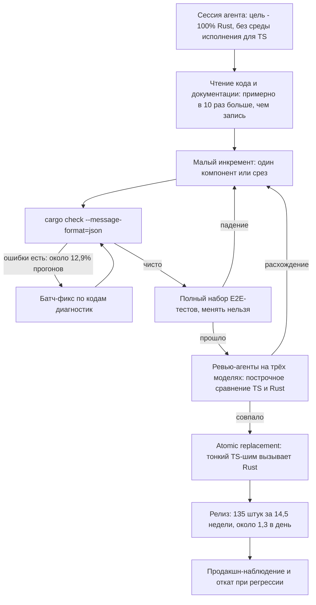

+++
title = "Перенос рантайма Copilot на Rust: что 8 678 ошибок компилятора говорят об AI-агентах"
date = 2026-11-14
description = "Разбор переноса рантайма Copilot на Rust: 8 678 ошибок компилятора, 84% из них — обычная типизация, 1.7% — borrow checker, и что это значит для агентов."
[taxonomies]
tags = ["rust", "ai-agents", "software-engineering", "evals", "architecture"]
[extra]
toc = true
mermaid = true
+++

GitHub переписал рантайм Copilot из TypeScript в Rust: около 430 тыс. строк TypeScript прошли через перенос, на выходе 832 378 строк production-Rust, 128 pull request'ов, 14,5 недели, один ведущий инженер и агенты, которые написали большую часть кода. Вокруг этого кейса почти сразу сложился удобный вывод: «Rust идеален для AI, потому что компилятор даёт агенту детерминированный цикл обратной связи».

Стивен Тауб, distinguished engineer в GitHub, опубликовал не только результат, но и логи сессий: 23 096 команд компиляции, 8 678 сработавших кодов ошибок `rustc`, 136,3 млрд токенов и счёт примерно на 120 000 USD. Это позволяет проверить мем на данных, а не на вере: **какие именно ошибки ловил компилятор**. Ответ неприятен для мема — 84% диагностик это обычная статическая типизация, которую поймал бы компилятор C#, Java или Go, а на владение, заимствование и лайфтаймы пришлось 1,7%.

Ниже — анатомия этих ошибок, самодельный классификатор `rustc`-диагностик, который можно натравить на свои CI-логи, арифметика бюджета компиляций и разбор того, что скомпилировалось, но всё равно было неверным.

**Первоисточник:** Stephen Toub, *Migrating the GitHub Copilot runtime to Rust, using Copilot*, GitHub Blog, 16 сентября 2026 ([github.blog](https://github.blog/ai-and-ml/generative-ai/migrating-the-github-copilot-runtime-to-rust-using-copilot/)). Разбор и обсуждение цифр — ForrestKnight, *I Was Wrong About Rust...*, 12 ноября 2026 ([youtu.be/ZsF_zibQwP8](https://youtu.be/ZsF_zibQwP8)).

## 1. Зачем вообще переносили

Рантайм Copilot — это агентный harness, на котором работают Copilot CLI, приложение Copilot и шесть языковых SDK: C#, TypeScript, Python, Rust, Go, Java. Пока рантайм жил на Node.js и V8, каждый клиент на «чужом» языке поднимал целый процесс Copilot CLI и общался с ним через pipe: минимум около 100 МБ на клиента и межпроцессный обмен на каждое сообщение.

Цель формулировалась не как «переписать на Rust», а как «одна нативная библиотека, которую все шесть SDK грузят прямо в свой процесс по C ABI, а внешний сервер остаётся опцией». Тауб прямо оговаривает: «Я не собирался переходить на Rust. Я собирался уйти от Node.js и V8». Компилятор в выборе языка не участвовал — участвовали embedding, минимум зависимостей, предсказуемая память и interop.

## 2. Что получилось в цифрах

| Метрика | До | После |
|---|---|---|
| Production-код рантайма | ок. 430 тыс. строк TypeScript (прошли через перенос) | 832 378 строк Rust |
| Тесты | — | 468 689 строк Rust-юнит-тестов + 174 675 строк E2E на TypeScript |
| Запуск клиента, прогрев сессии, один ответ | 5,25 с | 55,3 мс |
| Память на 10 клиентов | 1 383 МБ | 126 МБ |
| 1 000 одноходовых сессий, 100 параллельных пайплайнов | 7,55 цикла/с | 120 циклов/с |
| npm-зависимости | — | минус около 60 пакетов |
| `unsafe`-блоки | — | 158, все на границе с C/ОС |
| Процесс | — | 128 PR, 135 релизов, 14,5 недели, один инженер |
| Токены и деньги | — | 136,3 млрд токенов, около 120 000 USD |

Две оговорки по таблице. Бенчмарки сняты в окне, где выходили и другие изменения, — сам автор просит читать их с поправкой; главный реальный выигрыш в другом: клиенту больше не нужно поднимать JavaScript-движок, чтобы воспользоваться рантаймом. И 832 тыс. строк — это не чистый прирост: во время переноса в репозиторий влилось около 1,2 млн строк Rust, а ушло 365 тыс., то есть примерно 30% написанного Rust потом удалили или переписали.

## 3. Анатомия 8 678 ошибок

В логах сессий нашлось 8 678 срабатываний кодов ошибок `rustc`. Четыре крупнейших семейства покрывают 84%:

| Семейство | Доля | Что это на практике |
|---|---|---|
| Разрешение имён и импортов | 37% | доминирует `E0425`: «cannot find value in this scope» |
| Отсутствующий метод или поле | 22% | `E0599`, `E0609` — опечатка в имени, переименованное поле |
| Несовпадение типов | 14% | `E0308` — сигнатура не сошлась |
| Не выполнено ограничение трейта | 11% | `E0277` — абстракция осталась нереализованной |
| **Итого обычная статическая типизация** | **84%** | ловит любой типизированный компилятор |
| Владение, заимствование, лайфтаймы | **1,7%** | то, чем Rust знаменит |

Доли считаются тривиально:

$$
s_i = \frac{c_i}{\sum_{j} c_j}, \qquad \sum_{i \in \text{typing}} s_i = 0.84
$$

Если пересчитать проценты в штуки (округление исходных долей даёт небольшую погрешность): около 3 211 ошибок разрешения имён, 1 909 отсутствующих методов и полей, 1 215 несовпадений типов, 955 невыполненных ограничений трейтов. Вместе — примерно 7 290 из 8 678. На borrow checker, владение и лайфтаймы остаётся около 148 диагностик.

Плотность ошибок на объём тоже показательна:

$$
\lambda = \frac{1000 \cdot N_e}{L} = \frac{1000 \cdot 8678}{832378} \approx 10{,}43 \ \text{ошибки на 1000 строк}
$$

То есть на каждую тысячу строк сгенерированного Rust агенты получали примерно десять диагностик — и почти все они были механическими. Тауб называет borrow checker «тихим фоновым присутствием»: приятно, что он ловит, но не он делает Rust удобным для модели. Его вывод жёстче: если 84% ошибок — это проводка имён, полей и типов, то аргумент «агентам нужен Rust из-за компилятора» на самом деле аргумент «агентам нужен любой статически типизированный язык с быстрым циклом проверки».

## 4. Инструмент: классификатор диагностик по кодам `rustc`

Коды ошибок — стабильный контракт компилятора, поэтому ту же таксономию можно воспроизвести на своих логах без ручного чтения сообщений. Ниже — скрипт, который читает поток `cargo check --message-format=json` и раскладывает диагностики по семействам.

```python
#!/usr/bin/env python3
"""Classify rustc diagnostics from `cargo check --message-format=json` by error code."""
import json
import sys
from collections import Counter

FAMILIES = {
    "name_resolution": {"E0425", "E0433", "E0432", "E0412", "E0405", "E0531", "E0423"},
    "missing_item": {"E0599", "E0609", "E0061", "E0063", "E0560", "E0618"},
    "type_mismatch": {"E0308", "E0271", "E0369"},
    "trait_bound": {"E0277", "E0282", "E0283", "E0229"},
    "ownership": {"E0382", "E0499", "E0502", "E0505", "E0507", "E0515", "E0596"},
    "lifetime": {"E0106", "E0495", "E0521", "E0597", "E0621", "E0623"},
}
CODE_TO_FAMILY = {c: f for f, codes in FAMILIES.items() for c in codes}


def iter_error_codes(stream):
    for line in stream:
        line = line.strip()
        if not line.startswith("{"):
            continue
        try:
            msg = json.loads(line)
        except json.JSONDecodeError:
            continue
        if msg.get("reason") != "compiler-message":
            continue
        body = msg.get("message", {})
        if body.get("level") != "error":
            continue
        yield (body.get("code") or {}).get("code") or "E0000"


def main():
    counts = Counter(iter_error_codes(sys.stdin))
    total = sum(counts.values())
    by_family = Counter(CODE_TO_FAMILY[c] for c in counts if c in CODE_TO_FAMILY)
    other = total - sum(by_family.values())
    for fam in FAMILIES:
        n = by_family[fam]
        print(f"{fam:<16}{n:>8}{100.0 * n / total:>10.2f}")
    if other:
        print(f"{'other':<16}{other:>8}{100.0 * other / total:>10.2f}")
    typing = sum(by_family[f] for f in ("name_resolution", "missing_item",
                                        "type_mismatch", "trait_bound"))
    rust = by_family["ownership"] + by_family["lifetime"]
    print(f"total error diagnostics: {total}")
    print(f"ordinary typing share: {100.0 * typing / total:.2f}%")
    print(f"rust-specific share:   {100.0 * rust / total:.2f}%")


if __name__ == "__main__":
    main()
```

Скрипт прогнан на локальном крейте `errprobe`, где на каждое семейство намеренно оставлено по одной-две ошибки: `E0425` и неразрешённый импорт, отсутствующий метод у `Vec<u8>` и отсутствующее поле у структуры, `E0308` в возвращаемом типе, `E0277` при печати структуры, `E0382` и `E0499` на владении, `E0106` на лайфтайме. Реальный вывод — ниже:

```text
$ cargo check --message-format=json 2>/dev/null | python3 classify.py
name_resolution        2     22.22
missing_item           2     22.22
type_mismatch          1     11.11
trait_bound            1     11.11
ownership              2     22.22
lifetime               1     11.11
total error diagnostics: 9
ordinary typing share: 66.67%
rust-specific share:   33.33%
```

Здесь важно не обмануться: 66,67% против 33,33% — это **распределение моего тестового файла**, в котором семейства выбраны вручную по одному образцу, а не статистика реальных переносов. Ценность артефакта в другом: тот же скрипт на логах CI даёт распределение вашего кода, и его можно сравнить с 84/1,7 GitHub на одинаковой таксономии. Побочный результат прогона тоже полезен — `cargo check` вернул все девять диагностик за один проход, то есть компилятор отдаёт ошибки пакетом, и агенту не нужно «чинить по одной», чтобы увидеть картину целиком.

## 5. Бюджет компиляций и экономика переноса

Из опубликованных чисел считается не только распределение ошибок, но и стоимость самого цикла проверки. Ниже — арифметика без домыслов: все входные значения взяты из статьи GitHub, скрипт только делит одно на другое.

```python
P = {
    "rust_lines_out": 832_378, "prs": 128, "weeks": 14.5, "releases": 135,
    "cargo_checks": 4_478, "clean_share": 0.871, "compiles_total": 23_096,
    "error_occurrences": 8_678, "tokens_total_b": 136.3,
    "tokens_cached_read_b": 130.6, "tokens_cache_write_b": 4.2,
    "tokens_fresh_in_b": 0.9, "tokens_out_b": 0.6, "cost_usd": 120_000,
    "unsafe_blocks": 158, "user_messages": 31_247, "typed_prompts": 2_600,
    "rust_lines_entered": 1_200_000, "rust_lines_left": 365_000,
}

dirty = P["compiles_total"] * (1 - P["clean_share"])   # допущение: 12,9% переносится на все компиляции

print("errors per 1k lines   ", round(P["error_occurrences"] / P["rust_lines_out"] * 1000, 2))
print("unsafe per 1k lines   ", round(P["unsafe_blocks"] / P["rust_lines_out"] * 1000, 3))
print("compiles per PR       ", round(P["compiles_total"] / P["prs"], 1))
print("errors per PR         ", round(P["error_occurrences"] / P["prs"], 1))
print("errors per dirty build", round(P["error_occurrences"] / dirty, 2))
print("cost per PR, USD      ", round(P["cost_usd"] / P["prs"], 2))
print("cost per 1k lines, USD", round(P["cost_usd"] / P["rust_lines_out"] * 1000, 2))
print("blended USD per 1M tok", round(P["cost_usd"] / (P["tokens_total_b"] * 1000), 4))
print("cache-read share      ", round(P["tokens_cached_read_b"] / P["tokens_total_b"] * 100, 2))
print("output tok per line   ", round(P["tokens_out_b"] * 1e9 / P["rust_lines_out"]))
print("releases per week     ", round(P["releases"] / P["weeks"], 2))
print("rust lines removed, % ", round(P["rust_lines_left"] / P["rust_lines_entered"] * 100, 2))
```

```text
errors per 1k lines    10.43
unsafe per 1k lines    0.19
compiles per PR        180.4
errors per PR          67.8
errors per dirty build 2.91
cost per PR, USD       937.5
cost per 1k lines, USD 144.17
blended USD per 1M tok 0.8804
cache-read share       95.82
output tok per line    721
releases per week      9.31
rust lines removed, %  30.42
```

Что читается из этих строк:

- **180 компиляций на pull request.** Цикл проверки — основная работа агента, а не написание кода. Это же объясняет совет Тауба «оптимизируйте inner loop, он стал важнее, а не менее важным»: агент пишет быстро, а собирает и тестирует медленно.
- **Примерно 2,9 ошибки на грязную сборку** — при допущении, что измеренная доля чистых прогонов 87,1% переносится на все 23 096 компиляций. Ошибки приходят пачками, и это ровно то, что позволяет агенту чинить их батчем.
- **95,8% токенов — чтение кэша.** Стоимость такого переноса определяется не генерацией, а повторным чтением контекста: на выходе всего 0,6 млрд токенов из 136,3 млрд. Смешанная цена выходит около 0,88 USD за миллион токенов, 144 USD на 1000 строк Rust и 937 USD на pull request.
- **30% написанного Rust потом удалили.** Перенос — не линейная запись файлов, а перебор: 1,2 млн строк вошло, 365 тыс. ушло.
- **158 unsafe-блоков на 832 тыс. строк** — 0,19 на 1000 строк, все на границе с C/ОС. В разборе ForrestKnight для контраста приводится Bun: после переноса с Zig у него было больше десяти тысяч unsafe-блоков — но сравнивать эти цифры напрямую нельзя, потому что Bun шёл из языка без сборки мусора, где память и была основной проблемой.

## 6. Как выглядел цикл на практике



Две детали этой схемы стоят отдельного упоминания. Первая — **атомарная замена компонента**: каждый PR не добавлял Rust рядом с TypeScript, а заменял конкретный компонент тонким шимом, который вызывает Rust, и удалял старый код. Main оставался shippable на каждом шаге, регрессии ловились в ближайшем релизе. Вторая — **тесты как оракул**: агентам запретили их менять после случая, когда агент удалил тест вместе с фичей, которую тот защищал.

## 7. Что скомпилировалось, но было неверным

Самое полезное в разборе — не победа, а список регрессий, которые прошли компилятор и уехали в main. Крупнейшая группа — порядок жизненного цикла, владение и гонки, то есть ровно то, что должен ловить borrow checker. Причина в смешанном состоянии: оставшийся TypeScript держал handle на состояние, которое уже жило в Rust. Handle — это индекс в таблице, а не ссылка; компилятор не видит, что объект по этому индексу уже освобождён. Видят E2E-тесты.

Остальные категории:

- **Разные библиотеки с разными мнениями.** Rust-версия MCP SDK (`rmcp`) отвечала на некорректный JSON-RPC, а TypeScript-версия молчала; против сервера, который и на ошибку отвечает испорченным выводом, вежливость превратилась в бесконечный цикл на старте.
- **Дрейф веток.** При сотнях PR в неделю и сессиях, живущих днями, перенос потребовал тысяч ребейзов; даже высокая доля успешных оставляет сбои.
- **Медленные, но корректные.** Глубокое копирование 260-мегабайтного журнала событий вместо заимствования, потеря мемоизации, лишняя сериализация и локки на границе Rust-TypeScript.

Проверка «стало ли хуже для пользователей» тоже опубликована: доля quality-issues в `github/copilot-cli` была 22,9% до переноса и 23,7% во время и после, в `github/copilot-sdk` — 36,2% и 32,3%. Это не метрика доступности и не точный счёт дефектов, но всплеска обращений не видно.

Отсюда главный технический вывод статьи GitHub: **«если компилируется, значит корректно» — это шутка**. Все известные регрессии были влиты в main, то есть успешно скомпилировались. Компилятор проверяет внутреннюю связность написанной программы, но не может проверить, что программа написана целиком, что сохранён старый контракт, что вызывающие стороны соблюдают порядок и что стоимость работы приемлема.

## 8. Что действительно сделало перенос возможным

Три вещи, которые Тауб называет критическими, и ни одна из них не про Rust:

1. **End-to-end тесты как независимый оракул**, которые агентам запрещено ослаблять, обновлять снапшоты или помечать как ожидаемые падения. Без оракула агент, меняющий реализацию, может тихо переопределить корректность.
2. **Второй агент на ревью** — в GitHub это ревью-агенты на трёх разных моделях, построчно сравнивающие старый TypeScript с новым Rust. В Bun использовали другой приём: адверсариального ревьюера, которому велено считать весь код ошибочным.
3. **Сначала точный перенос, потом улучшения.** Каждый раз, когда автор разрешал «прибраться» в середине переноса, росло число регрессий, время и расход токенов.

Плюс два режима работы, которые видно в цифрах: агенты читали примерно в десять раз больше, чем писали, а 61% вызовов инструментов приходился на суб-агентов, а не на основной поток. Из 31 247 сообщений роли user только около 2 600 были набраны человеком — остальное служебные инструкции, автоматические тики и трафик дочерних сессий.

## 9. Ограничения разбора

- Это **один кейс без контрольной группы**. Мы знаем, что перенос сработал с агентами, но не знаем, сколько такой же подход стоил бы в Go или C#, и не знаем, сколько похожих проектов провалилось.
- **Логи — самоотчёт инструмента.** 8 678 ошибок — это срабатывания кодов в перехваченных командах валидации, а не полный список всего, что компилятор сказал агентам.
- **LOC как метрика обманчива.** В окно переноса вливался и независимый Rust-код, поэтому 832 тыс. строк — итог совместного действия переноса и обычной разработки.
- **Бенчмарки смешаны с другими изменениями** в том же окне, о чём предупреждает сам автор.
- **Сравнение с Bun некорректно** и по исходному языку, и по природе задачи: TypeScript со сборкой мусора почти не задевает borrow checker.

## 10. Чеклист, если вы затеваете похожий перенос

1. Сформулируйте конечное состояние явно: «нативный бинарник из 100% Rust, среды исполнения для TypeScript не остаётся». Размытая формулировка «перенеси компонент X» читается агентом как «перенеси горячий путь».
2. Сначала доведите E2E-тесты, потом начинайте перенос. Оракул дешевле регрессий.
3. Запретите агенту менять тесты, снапшоты и baseline-совместимость.
4. Режьте на компоненты и заменяйте атомарно, с шимом на старом языке; не держите долгоживущую ветку.
5. Считайте ошибки компилятора по кодам, а не «на глаз»: классификатор из раздела 4 даёт распределение, по которому видно, где именно агент теряет время.
6. Не разрешайте улучшения до конца переноса.
7. Оптимизируйте время сборки и тестов до старта: у агента доля времени на валидацию растёт, а не падает.

**Итог.** Rust в этом проекте был правильным выбором — но по причинам embedding, зависимостей и предсказуемой памяти, а не потому, что «компилятор учит модель». Если ваш аргумент за язык-цель для агентов звучит как «строгий компилятор ловит ошибки», то по данным этого переноса он одинаково работает для C#, Java и Go: 84% пойманных ошибок — обычная типизация, а на уникальную для Rust проверку владения пришлось 1,7%.

---

*Материал носит инженерный характер и не является финансовой или инвестиционной рекомендацией. Все числа взяты из публикации GitHub Blog и разбора ForrestKnight; вычисленные значения получены арифметикой над опубликованными данными и помечены как производные.*
