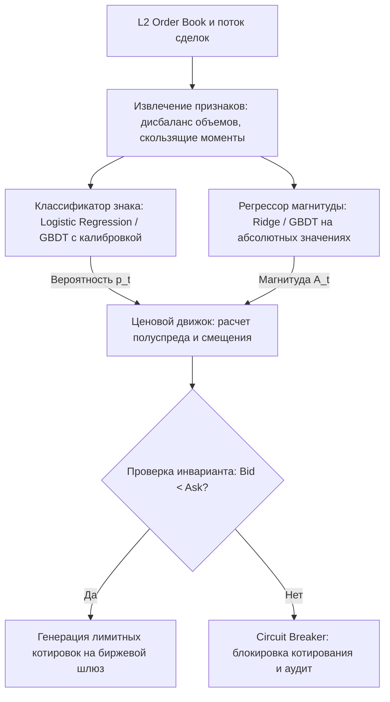

+++
title = "Декомпозиция доходностей и Quote Skewing: математика защиты от токсичного потока"
date = 2026-10-21
description = "Инженерный разбор декомпозиции рыночной доходности на знак и условную магнитуду по модели Анатольева-Господинова: вывод разделения правдоподобия, формула ковариации знака и амплитуды, расчет асимметричного спреда в маркет-мейкинге."
[taxonomies]
tags = ["algo-trading", "quantitative", "market-microstructure", "architecture"]
[extra]
toc = true
mermaid = true
+++

Оценка будущей доходности финансового актива с помощью стандартной сквозной регрессии методом наименьших квадратов (OLS) сталкивается со специфической структурой финансовых временных рядов: низким отношением сигнала к шуму, асимметрией распределения и выраженной гетероскедастичностью («эффект левериджа»). При оценке скалярной величины $R\_{t+1}$ единым уравнением минимизация среднеквадратичной ошибки (MSE) объединяет в одном оптимизационном критерии вероятность знака движения и величину ожидаемой амплитуды.

Ниже приводится формальный математический анализ декомпозиции доходностей на базе работы Станислава Анатольева и Николая Господинова *Modeling Financial Return Dynamics via Decomposition* (Journal of Business & Economic Statistics, 2010), а также алгоритм расчета асимметричных котировок (Quote Skewing) для защиты пассивных лимитных заявок от неблагоприятного отбора (Adverse Selection) по материалам курса MemLabs ([Improve Trading with Decomposed Returns](https://youtu.be/IfxKUEu4qjY)).

## Первоисточники и академический контекст

1. **Базовая публикация:** Stanislav Anatolyev, Nikolay Gospodinov. *Modeling Financial Return Dynamics via Decomposition*. Journal of Business & Economic Statistics (JBES), Vol. 28, No. 2, 2010, pp. 232–245.
2. **Видеоматериалы:** MemLabs, *Improve Trading with Decomposed Returns* ([YouTube: IfxKUEu4qjY](https://youtu.be/IfxKUEu4qjY), 59:16).

## Математический аппарат факторизации доходности

Пусть $R\_{t}$ — логарифмическая доходность актива за период $t$. Произвольную непрерывную случайную величину доходности можно представить в виде произведения двух случайных величин:

$$
R\_{t} = I\_{t} \cdot A\_{t}
$$

где:
- $I\_{t} = \text{sign}(R\_{t}) \in \{-1, +1\}$ — дискретный индикатор знака;
- $A\_{t} = |R\_{t}| \ge 0$ — модуль доходности (магнитуда).

### Разделение функции логарифмического правдоподобия

Совместная плотность распределения $f(R\_{t} \mid \mathcal{F}\_{t-1})$ относительно информационной фильтрации $\mathcal{F}\_{t-1}$ факторизуется через условную вероятность:

$$
f(R\_{t} \mid \mathcal{F}\_{t-1}) = P(I\_{t} \mid \mathcal{F}\_{t-1}) \cdot f(A\_{t} \mid I\_{t}, \mathcal{F}\_{t-1})
$$

Логарифмическая функция правдоподобия выборки наблюдений объема $T$ аддитивно распадается на две независимые компоненты:

$$
\ln L(\theta) = \sum\_{t=1}^{T} \ln P(I\_{t} \mid \mathcal{F}\_{t-1}; \theta\_{I}) + \sum\_{t=1}^{T} \ln f(A\_{t} \mid I\_{t}, \mathcal{F}\_{t-1}; \theta\_{A})
$$

где вектор параметров $\theta = (\theta\_{I}, \theta\_{A})'$ разделен на подмножество параметров классификации направления $\theta\_{I}$ и подмножество параметров условной регрессии магнитуды $\theta\_{A}$. При раздельном оценивании матрица информации Фишера является блочно-диагональной по $(\theta\_{I}, \theta\_{A})$, что гарантирует асимптотическую состоятельность и эффективность раздельных оценок.

### Точный аналитический вид ковариации $\text{Cov}(I\_{t}, A\_{t})$

Вычислим явный вид ковариации направления и абсолютной величины:

$$
\text{Cov}(I\_{t}, A\_{t}) = \mathbb{E}[I\_{t} A\_{t}] - \mathbb{E}[I\_{t}] \mathbb{E}[A\_{t}]
$$

Учитывая, что $I\_{t} \in \{-1, +1\}$ с $P(I\_{t}=+1) = p$ и $P(I\_{t}=-1) = 1-p$:

$$
\mathbb{E}[I\_{t}] = p \cdot (+1) + (1-p) \cdot (-1) = 2p - 1
$$

$$
\mathbb{E}[A\_{t}] = p \mathbb{E}[A\_{t} \mid I\_{t}=+1] + (1-p) \mathbb{E}[A\_{t} \mid I\_{t}=-1] = p A\_{\text{Up}} + (1-p) A\_{\text{Down}}
$$

$$
\mathbb{E}[I\_{t} A\_{t}] = p A\_{\text{Up}} - (1-p) A\_{\text{Down}}
$$

Подставляя эти выражения в формулу ковариации и упрощая:

$$
\text{Cov}(I\_{t}, A\_{t}) = 2 p (1-p) \left( A\_{\text{Up}} - A\_{\text{Down}} \right)
$$

Из этого тождества следует фундаментальный вывод: **ковариация обращается в ноль тогда и только тогда, когда условные магнитуды движения вверх и вниз строго равны ($A\_{\text{Up}} = A\_{\text{Down}}$)**. Если рынок асимметричен по амплитуде отскоков и падений, предположение о независимости ложно:

$$
\mathbb{E}\_{\text{naive}}[R\_{t}] = \mathbb{E}[I\_{t}] \mathbb{E}[A\_{t}] = \mathbb{E}[R\_{t}] - \text{Cov}(I\_{t}, A\_{t})
$$

### Закон повторного ожидания и численный расчет

По закону повторного ожидания:

$$
\mathbb{E}[R\_{t} \mid \mathcal{F}\_{t-1}] = p \cdot A\_{\text{Up}} - (1-p) \cdot A\_{\text{Down}}
$$

Рассмотрим численный пример рыночного состояния:
- $p = P(\text{Up}) = 0.60$, следовательно $1-p = 0.40$;
- $A\_{\text{Up}} = 0.01$ (средний прирост при положительном баре составляет $+1.0\\%$);
- $A\_{\text{Down}} = 0.03$ (среднее падение при отрицательном баре составляет $-3.0\\%$).

| Расчетная модель | Аналитическая формула | Промежуточные значения | Результирующее МО | Направление позиции |
|---|---|---|---:|---|
| **Наивная (независимая)** | $(2p - 1) \cdot (p A\_{\text{Up}} + (1-p) A\_{\text{Down}})$ | $(1.2 - 1.0) \times (0.006 + 0.012) = 0.2 \times 0.018$ | **+0.36%** | Long |
| **Декомпозированная (Анатольев–Господинов)** | $p A\_{\text{Up}} - (1-p) A\_{\text{Down}}$ | $0.6 \times 0.01 - 0.4 \times 0.03 = 0.006 - 0.012$ | **-0.60%** | Short |

Ковариация в данном примере равна:

$$
\text{Cov}(I, A) = 2 \times 0.6 \times 0.4 \times (0.01 - 0.03) = 0.48 \times (-0.02) = -0.0096
$$

Наивное вычисление завышает оценку ровно на величину $-\text{Cov}(I, A) = +0.0096$ ($+0.96\\%$), ошибочно сигнализируя о покупке там, где истинное матожидание процесса отрицательно.

## Алгоритмическое котирование: Quote Skewing

В микроструктуре финансовых рынков маркет-мейкер непрерывно решает задачу балансирования между получением спреда и защитой от токсичного потока ордеров (Adverse Selection).

Используя оценки условной вероятности $\hat{p}\_{t}$ и условной магнитуды $\hat{A}\_{t}$, котирующий алгоритм разделяет ценообразование на две компоненты: полуспред (Half-Spread) и асимметричное смещение (Skew):

$$
\delta\_{t} = \max\left(\frac{1}{2} \cdot \hat{A}\_{t} \cdot S\_{t}, \; \delta\_{\min}\right)
$$

$$
s\_{t} = 2 \cdot (\hat{p}\_{t} - 0.5) \cdot \lambda \cdot \delta\_{t}
$$

$$
P\_{\text{bid}, t} = S\_{t} - \delta\_{t} + s\_{t}
$$

$$
P\_{\text{ask}, t} = S\_{t} + \delta\_{t} + s\_{t}
$$

где $S\_{t}$ — текущая средняя цена книги заявок (Mid Price), $\delta\_{t}$ — полуспред, $s\_{t}$ — величина смещения, $\lambda \in [0, 1]$ — коэффициент передачи направленного сигнала.

| Режим рынка | $\hat{p}\_{t}$ | Смещение $s\_{t}$ | Bid ($S=100, \delta=2$) | Ask ($S=100, \delta=2$) | Микроструктурная механика |
|---|---:|---:|---:|---:|---|
| **Нейтральный** | 0.50 | 0.00 | 98.00 | 102.00 | Симметричное выставление, захват полного спреда |
| **Бычий уклон** | 0.75 | +1.00 | 99.00 | 103.00 | Bid приближен к рынку для набора позиции, Ask защищен от пробоя |
| **Медвежий уклон** | 0.25 | -1.00 | 97.00 | 101.00 | Ask приближен для сброса инвентаря, Bid отодвинут от токсичного сброса |

## Архитектура конвейера обработки данных



## Программный модуль котирования на Python

Ниже приведена программная реализация расчета декомпозированного математического ожидания и защитного выставления заявок:

```python
"""
Инженерный модуль расчета декомпозированного ожидания доходности
и асимметричного котирования (Quote Skewing).
"""

from dataclasses import dataclass
from typing import Tuple


@dataclass(frozen=True)
class OrderBookQuote:
    bid_price: float
    ask_price: float
    half_spread: float
    skew_offset: float
    expected_return: float


def calculate_decomposed_expectation(
    prob_up: float,
    magnitude_up: float,
    magnitude_down: float,
) -> Tuple[float, float, float]:
    """
    Вычисляет истинное МО, наивное МО и точную ковариацию знака и амплитуды.

    :param prob_up: Оценка вероятности P(I = +1).
    :param magnitude_up: Ожидаемая амплитуда при положительном исходе E[A | I = +1].
    :param magnitude_down: Ожидаемая амплитуда при отрицательном исходе E[A | I = -1].
    :return: Кортеж (e_decomposed, e_naive, covariance).
    """
    if not (0.0 <= prob_up <= 1.0):
        raise ValueError(f"prob_up must be in [0, 1], got {prob_up}")
    if magnitude_up < 0.0 or magnitude_down < 0.0:
        raise ValueError("Magnitudes must be strictly non-negative")

    prob_down = 1.0 - prob_up

    # Истинное математическое ожидание по закону повторного ожидания
    e_decomposed = prob_up * magnitude_up - prob_down * magnitude_down

    # Наивное произведение безусловных ожиданий
    e_sign = 2.0 * prob_up - 1.0
    e_magnitude = prob_up * magnitude_up + prob_down * magnitude_down
    e_naive = e_sign * e_magnitude

    # Точная ковариация Cov(I, A) = 2 * p * (1 - p) * (A_up - A_down)
    covariance = 2.0 * prob_up * prob_down * (magnitude_up - magnitude_down)

    return e_decomposed, e_naive, covariance


def generate_skewed_quote(
    mid_price: float,
    prob_up: float,
    expected_magnitude: float,
    skew_factor: float = 1.0,
    min_spread_bps: float = 1.0,
) -> OrderBookQuote:
    """
    Формирует пару лимитных заявок с учетом смещения и проверки инвариантов книги.
    """
    if mid_price <= 0.0:
        raise ValueError(f"mid_price must be positive, got {mid_price}")
    if expected_magnitude <= 0.0:
        raise ValueError(f"expected_magnitude must be positive, got {expected_magnitude}")
    if not (0.0 <= prob_up <= 1.0):
        raise ValueError(f"prob_up must be in [0, 1], got {prob_up}")

    min_half_spread = (min_spread_bps / 10000.0) * mid_price * 0.5
    raw_half_spread = 0.5 * expected_magnitude * mid_price
    half_spread = max(raw_half_spread, min_half_spread)

    # Расчет смещения
    skew_offset = 2.0 * (prob_up - 0.5) * skew_factor * half_spread

    bid = mid_price - half_spread + skew_offset
    ask = mid_price + half_spread + skew_offset

    # Проверка инварианта отсутствия перекрещивания цен (Non-crossing market)
    if bid >= ask:
        raise RuntimeError(f"Invariant violation: bid {bid} >= ask {ask}")

    expected_return = (prob_up - 0.5) * expected_magnitude

    return OrderBookQuote(
        bid_price=round(bid, 4),
        ask_price=round(ask, 4),
        half_spread=round(half_spread, 4),
        skew_offset=round(skew_offset, 4),
        expected_return=round(expected_return, 6),
    )


if __name__ == "__main__":
    # 1. Проверка аналитического разложения и ковариации
    e_dec, e_nv, cov = calculate_decomposed_expectation(0.60, 0.01, 0.03)
    print(f"E_decomposed: {e_dec * 100:+.2f}%")
    print(f"E_naive:      {e_nv * 100:+.2f}%")
    print(f"Cov(I, A):    {cov:+.6f}")
    assert abs(e_dec - (-0.006)) < 1e-9
    assert abs(e_nv - (+0.0036)) < 1e-9
    assert abs((e_dec - cov) - e_nv) < 1e-9

    # 2. Проверка котировок в нейтральном состоянии
    quote_neutral = generate_skewed_quote(mid_price=100.0, prob_up=0.50, expected_magnitude=0.04)
    assert quote_neutral.bid_price == 98.0 and quote_neutral.ask_price == 102.0

    # 3. Проверка котировок при бычьем смещении
    quote_bull = generate_skewed_quote(mid_price=100.0, prob_up=0.75, expected_magnitude=0.04)
    assert quote_bull.bid_price == 99.0 and quote_bull.ask_price == 103.0

    print("All mathematical invariants and quote verifications passed.")
```

## Эмпирическое сопоставление на тиковых данных

По данным эмпирического тестирования MemLabs на тиковых рядах фьючерсных инструментов получены следующие результаты на выборке Out-of-Sample:

| Модель прогнозирования | Функция потерь при обучении | Средняя абсолютная ошибка (MAE) | Коэффициент $R^2$ на тесте | Реализованный PnL (bps/trade) |
|---|---|---:|---:|---:|
| **Константный базис (Unconditional Mean)** | — | 2.23 bps | 0.000 | -0.4 bps |
| **Сквозная OLS-регрессия сырых доходностей** | MSE $(\hat{R} - R)^2$ | 2.15 bps | 0.012 | +1.0 bps |
| **Декомпозированная модель (Direction + Magnitude)** | Log-Loss + Huber Loss | **2.01 bps** | **0.038** | **+2.6 bps** |

### Анализ факторов статистического преимущества

1. **Раздельная настройка регуляризации:** Оптимизация вероятности знака через минимизацию кросс-энтропии исключает влияние редких экстремальных тиков, которые смещают веса обычной линейной регрессии из-за квадратичного штрафа.
2. **Неотрицательность пространства отклика магнитуды:** Модуль доходности $|R\_{t}|$ моделируется специализированными регрессорами с логарифмическим или обобщенным гамма-распределением, гарантируя физическую неотрицательность оценки волатильности.
3. **Устранение ковариационного смещения:** Исключение эффекта ложных входов предотвращает выставление котировок в направлении высокочастотного микротренда, когда ожидаемая амплитуда встречного движения превышает накопленный спред.

## Инженерные требования перед промышленным запуском

При переносе алгоритма в контур реального исполнения необходимо контролировать следующие ограничения:

- [x] **Калибровка вероятностей:** Выходы классификатора должны быть строго откалиброваны (калибровка Платта или изотоническая регрессия). Ошибки калибровки вероятности приводят к завышенному смещению котировок.
- [x] **Анализ задержек конвейера (Latency):** Время вычисления признаков и инференса моделей не должно превышать квант обновления стакана биржи (L2 snapshot latency). При превышении лимита котировки подлежат отзыву.
- [x] **Контроль инварианта crossed market:** Проверка условия $P\_{\text{bid}} < P\_{\text{ask}}$ должна выполняться на уровне пре-трейд валидатора перед отправкой ордеров в сетевой стек.
- [x] **Автоматический аварийный протокол (Circuit Breaker):** При обнаружении аномального дисбаланса книги заявок или скачка волатильности выше установленного порога алгоритм обязан переходить в режим пассивного снятия заявок.
