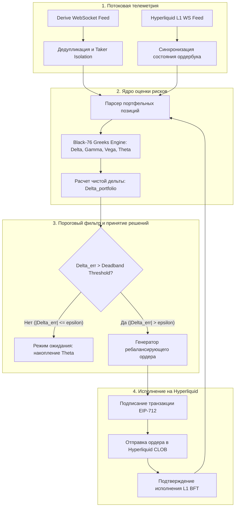

+++
title = "Ончейн-архитектура дельта-нейтральной торговли опционами: синтетический базис на Derive DEX и динамический хедж на Hyperliquid L1"
date = 2026-10-31
description = "Инженерный аудит квантовой стратегии на децентрализованных опционах Derive и перпетуалах Hyperliquid: микроструктура L2/L1 ордербуков, дельта-хеджирование, парсинг двойных записей в API и риски гамма-шоков."
[taxonomies]
tags = ["algo-trading", "quantitative", "derivatives", "risk-management", "architecture"]
[extra]
toc = true
mermaid = true
+++

Торговля децентрализованными опционами (DEX Options) долгое время оставалась узким сегментом крипторынка из-за фрагментации ликвидности, медленного времени блока в EVM-сетях и неэффективных AMM-пулов (Automated Market Makers). С появлением специализированных L2-роллапов с поддержкой портфельной маржи (Portfolio Margin) и высокоскоростных L1-блокчейнов с нативной централизованной книгой лимитных ордеров (CLOB) институциональные и алгоритмические трейдеры получили возможность реализовывать классические деривативные стратегии на публичном реестре.

Ниже представлен детальный количественный и архитектурный аудит сетапа крупного ончейн-игрока, зафиксированного в экосистемах **Derive DEX** (ранее Lyra Finance v2) и **Hyperliquid L1**. В исследовании подробно разбираются физика дельта-нейтрального синтетического базиса, сбор временного распада опционов ($\Theta$), специфика потоковой обработки API децентрализованных бирж, устранение дубликатов в логах сделок и критические риски ликвидации при разрыве маржинальных контуров между независимыми блокчейнами.

> **Академический и финансовый дисклеймер:** Представленный материал носит сугубо научно-исследовательский и инженерный характер. Он не является индивидуальной инвестиционной рекомендацией, публичной офертой или призывом к совершению финансовых операций. Торговля внебиржевыми деривативами, опционами и фьючерсными контрактами с кредитным плечом сопряжена с высоким риском катастрофической потери капитала.

---

## 1. Первоисточник и эмпирический контекст исследования

Анализ базируется на исследовании алгоритмической торговли в децентрализованных деривативах от канала **Moon Dev**:
* **Оригинал видео:** [This Trader Made $21 Million With Rented Bots. Here's His Exact Setup](https://youtu.be/Nmf91uLyPe0) (YouTube: `Nmf91uLyPe0`).
* **Автор:** Moon Dev.
* **Объект аудита:** Серия ончейн-транзакций и кошельков, задействованных в торговле опционными сериями на платформе Derive и бессрочными фьючерсами/спотом на Hyperliquid в течение торгового цикла 2026 года.
* **Зафиксированная статистика:**
  * Совокупный P&L кошелька: **+$21.6M** (включая **+$11.6M** на децентрализованных опционах Derive и **+$10.0M+** на Hyperliquid);
  * Профиль автоматизации: **1 235 исполненных ордеров ботами** против **56 ручных корректировок** оператора;
  * Стратегический паттерн: систематическая продажа опционов вне денег (OTM Options Selling) с компенсацией направленной экспозиции через базовый актив и лонги на Hyperliquid.

За броскими заголовками о сверхприбылях скрывается сложная инженерная конструкция. Рассматриваемый P&L формировался не за счет направленного угадывания рынка, а через структурированную комбинацию сбора опционной премии (Theta Harvesting) и синтетического дельта-хеджирования в условиях направленного бычьего тренда.

---

## 2. Микроструктура платформ: Derive L2 против Hyperliquid L1

Реализация высокочастотного опционного деска на публичных блокчейнах сталкивается с фундаментальным ограничением: опционные книги заявок требуют многомерного расчета греков и маржинальных требований на каждый тик цены, тогда как базовый перпетуал-рынок требует минимальной задержки исполнения (Sub-10ms Latency).

Для преодоления этой дилеммы стратегия опирается на разделение торговых функций между двумя специализированными средами исполнения:

```text
┌────────────────────────────────────────────────────────┐
│             DERIVE DEX (OP Stack Rollup)               │
│ • Специализированный L2 для опционов и деривативов     │
│ • Кассовый расчет в USDC (Cash-Settled European)       │
│ • Модуль Portfolio Margin (суб-аккаунты, риск-оракулы) │
│ • Роль: Генерация Theta и сбор опционной премии        │
└───────────────────────────┬────────────────────────────┘
                            │
                            │ Кросс-чейн асинхронный мост / WebSockets
                            ▼
┌────────────────────────────────────────────────────────┐
│             HYPERLIQUID L1 (Tendermint BFT)            │
│ • Собственный блокчейн 200k TPS без EVM-оверхеда       │
│ • Полностью ончейн CLOB ордербук и сопоставление (L1)  │
│ • Микросекундный детерминированный матчинг             │
│ • Роль: Динамический Delta-хедж и удержание базиса     │
└────────────────────────────────────────────────────────┘
```

### Специфика Derive DEX
Derive развернут как выделенный роллап на базе архитектуры OP Stack. Опционы на платформе являются европейскими с кассовым расчетом в USDC (Cash-Settled). Это означает, что при экспирации физической поставки базового токена (например, BTC, ETH или HYPE) не происходит: в момент экспирации $t = T$ смарт-контракт производит начисление или списание стейблкоинов в соответствии с разницей между ценой исполнения $K$ и расчетной ценой оракула $S\\_T$:

$$\text{Payoff}\\_C = \max(0, S\\_T - K), \quad \text{Payoff}\\_P = \max(0, K - S\\_T)$$

Ключевым преимуществом Derive является движок портфельной маржи (**Portfolio Margin**). В отличие от изолированной маржи, где под каждый проданный опцион блокируется 100% номинала или залога, портфельная маржа рассчитывает совокупный риск суб-аккаунта по 7 сценариям сдвига спота и подразумеваемой волатильности (IV), что позволяет высвободить капитал для масштабных серий проданных OTM-страйков.

### Специфика Hyperliquid L1
В качестве площадки для хеджирования задействован Hyperliquid — специализированный Layer 1 блокчейн, написанный на Rust с кастомным консенсусом Tendermint/BFT. В отличие от большинства DEX, где ордербук вынесен в оффчейн (как в dYdX v3 или Aevo), в Hyperliquid каждая отмена, перестановка и исполнение лимитного ордера валидируются консенсусом нативной цепочки. Скорость обработки блоков (~0.2 секунды) и отсутствие газовых транзакционных комиссий внутри книги позволяют запускать алгоритмические контуры ребалансировки без риска застрять в мемпуле.

---

## 3. Математика стратегии: Тета-харвестинг и динамическое дельта-хеджирование

Стратегия базируется на известной структурной аномалии финансовых рынков — **премии за риск волатильности (Variance Risk Premium, VRP)**:

$$\text{VRP} = \mathbb{E}[\sigma\\_{IV}] - \mathbb{E}[\sigma\\_{RV}] > 0$$

Подразумеваемая волатильность ($\sigma\\_{IV}$), заложенная в цены опционов покупателями для страхования от катастрофических движений, систематически превышает исторически реализуемую волатильность базового актива ($\sigma\\_{RV}$). Систематический продавец опционов продает эту переоцененную страховку, зарабатывая на естественном временном распаде опционов.

### Временной распад (Theta) европейских контрактов
В модели ценообразования Блэка-76 для форвардных цен $F$ временной распад короткой позиции по колл-опциону выражается формулой:

$$\Theta\\_{call} = -\frac{F \cdot \phi(d\\_1) \cdot \sigma}{2\sqrt{\tau}} - r K e^{-r\tau} \Phi(d\\_2) + r F e^{-r\tau} \Phi(d\\_1)$$

где:
* $\tau = T - t$ — оставшееся время до экспирации в долях года;
* $\phi(x) = \frac{1}{\sqrt{2\pi}} e^{-\frac{x^2}{2}}$ — плотность стандартного нормального распределения;
* $\Phi(x)$ — кумулятивная функция стандартного нормального распределения;
* $d\\_1 = \frac{\ln(F/K) + \frac{1}{2}\sigma^2 \tau}{\sigma \sqrt{\tau}}$, $d\\_2 = d\\_1 - \sigma \sqrt{\tau}$.

Для опционов вне денег (OTM, где $F \ll K$ для Call или $F \gg K$ для Put) кривая временного распада ускоряется по мере приближения экспирации ($\tau \to 0$). Продавая недельные и месячные опционы со страйками на 15–30% выше текущего спота, алгоритм генерирует стабильный положительный денежный поток $\Theta\\_{portfolio} > 0$.

### Динамическое выравнивание чистой дельты
Однако короткая позиция по опционам несет направленный риск (Delta):

$$\Delta\\_{call} = e^{-r\tau}\Phi(d\\_1) > 0 \implies \text{для короткой позиции } \Delta\\_{short\\_call} = -e^{-r\tau}\Phi(d\\_1) < 0$$

$$\Delta\\_{put} = -e^{-r\tau}\Phi(-d\\_1) < 0 \implies \text{для короткой позиции } \Delta\\_{short\\_put} = e^{-r\tau}\Phi(-d\\_1) > 0$$

Если продавец опционов продает OTM-коллы, его портфель приобретает отрицательную дельту. При резком восходящем движении базового актива короткие опционы переходят в категорию «в деньгах» (In-the-Money, ITM), генерируя экспоненциальный убыток.

Чтобы нейтрализовать направленный риск, суммарная дельта портфеля непрерывно сводится к нулю или к заданному целевому коэффициенту наклона (Skew Target):

$$\Delta\\_{portfolio} = \sum\\_{i=1}^{M} q\\_i \Delta\\_{opt, i} + Q\\_{perp} \approx 0$$

где:
* $M$ — количество активных опционных серий на Derive;
* $q\\_i$ — количество проданных ($q\\_i < 0$) или купленных контрактов серии $i$;
* $\Delta\\_{opt, i}$ — чувствительность цены опциона $i$ к цене базового актива;
* $Q\\_{perp}$ — размер позиции по бессрочному фьючерсу на Hyperliquid.

В каждый момент времени расчетная ошибка дельты составляет:

$$\Delta\\_{err} = \Delta\\_{portfolio} - \Delta\\_{target}$$

### Зона нечувствительности (Deadband Threshold)
Попытка балансировать портфель при малейшем изменении $\Delta\\_{err}$ приводит к катастрофическому росту транзакционных издержек из-за проскальзывания (Slippage) и торговых комиссий тейкера ($Fee$). Алгоритмический контур применяет гистерезисный фильтр (Deadband):

$$Q\\_{rebalance} = \begin{cases} -\Delta\\_{err}, & \text{если } |\Delta\\_{err}| > \epsilon\\_{\Delta} \\\\ 0, & \text{если } |\Delta\\_{err}| \le \epsilon\\_{\Delta} \end{cases}$$

где $\epsilon\\_{\Delta}$ — динамический порог чувствительности, калибруемый в зависимости от текущей волатильности рынка и ликвидности книги заявок.

---

## 4. Архитектура кросс-биржевого торгового контура

Алгоритмический комплекс функционирует как замкнутый контур мониторинга состояния блокчейнов, расчета греков и исполнения защитных ордеров:



Контур разделен на четыре строго изолированных уровня:
1. **Телеметрия:** непрерывный прием событий исполнения сделок и обновления глубины стакана (L2 Book);
2. **Риск-ядро:** пересчет греков каждого контракта по модели Black-76 с калибровкой поверхности волатильности;
3. **Фильтрация:** отсечение высокочастотного рыночного микрошума с помощью пороговых значений;
4. **Исполнение:** асинхронная отправка подписанных ордеров в Hyperliquid L1 API.

---

## 5. Инженерия данных: парсинг API Derive и изоляция тейкера

Один из важнейших практических нюансов, выявленных в процессе аудита кода ончейн-аналитиков — специфическая структура потока данных Derive API.

### Проблема двойной записи (Double-Count Anomaly)
При выгрузке публичных трейдов через эндпоинт сделок децентрализованной биржи протокол возвращает лог для каждого участника транзакции. На каждое атомарное сопоставление в ордербуке формируются **две отдельные записи**:
1. Запись для создателя лимитного ордера (`maker`);
2. Запись для агрессора, исполнившего ордер по рынку (`taker`).

Если аналитический скрипт агрегирует объем сделок простым суммированием поля `amount` без фильтрации, совокупный торговый объем **искусственно удваивается**. Более того, если алгоритм пытается определить направление открываемой позиции кита, нефильтрованный поток приводит к зеркальному искажению сигналов: исполнение продажи маркет-мейкером интерпретируется как рыночная продажа, хотя агрессивным действием была рыночная покупка тейкера.

```python
# ❌ Некорректная обработка потока трейдов: двойной учет
def parse_trades_naive(trades_raw):
    total_volume = sum(t["amount"] for t in trades_raw)
    return total_volume  # Объем завышен ровно в 2 раза!


# ✅ Корректная фильтрация: изоляция активного инициатора (Taker)
def parse_trades_robust(trades_raw, target_address):
    whale_actions = []
    for trade in trades_raw:
        # Учитываем только сторону тейкера для определения истинного намерения
        if trade.get("is_taker") is True:
            is_buyer = trade.get("direction") == "buy"
            whale_actions.append(
                {
                    "timestamp": trade["timestamp"],
                    "instrument": trade["instrument_name"],
                    "price": float(trade["price"]),
                    "amount": float(trade["amount"]),
                    "side": "BUY" if is_buyer else "SELL",
                    "taker_address": trade["trader_address"],
                }
            )
    return whale_actions
```

### Кросс-чейн маппинг суб-аккаунтов
Для связывания активности между L2 Derive и L1 Hyperliquid требуется постоянное сопоставление открытых позиций. На Hyperliquid адреса пользователей управляются через механизм Master/Agent ключей:
* **Master Wallet:** холодное хранилище залогового обеспечения (USDC);
* **API Agent:** временный сессионный ключ с правами исключительно на размещение и отмену ордеров без права вывода средств.

Это архитектурное решение исключает риск компрометации основного депозита при запуске торгового бота на облачных VPS-серверах.

---

## 6. Риски высших порядков: Гамма-шок, Вега и расхождение маржинальных контуров

Несмотря на внешнюю привлекательность «дельта-нейтрального сбора премий», стратегия несет в себе критические структурные риски, способные привести к моментальной ликвидации депозита при экстремальных рыночных движениях.

| Параметр риска | Механизм возникновения | Влияние на портфель | Архитектурная защита |
|---|---|---|---|
| **Гамма-взрыв ($\Gamma < 0$)** | Стремительный рост цены базового актива к страйкам проданных OTM Call | Экспоненциальный рост отрицательной дельты, вынужденная покупка на пике | Динамический шаг сетки страйков, покупка дальних защитных Call (OtM Wing) |
| **Вега-шок ($\mathcal{V} < 0$)** | Скачок подразумеваемой волатильности (IV Spike) на новостных факторах | Переоценка стоимости проданных опционов вверх, просадка по нереализованному P&L | Торговля календарными спредами, лимиты максимального отрицательного Vega-бюджета |
| **Фандинговое истощение (Funding Bleed)** | Удержание крупного перп-лонга на Hyperliquid в условиях бычьего рынка | Непрерывное списание Funding Rate (до 0.1% каждые 8 часов) | Включение расчетной стоимости фандинга в минимальный порог сбора Theta |
| **Разрыв маржинальных контуров (Margin Depeg)** | Рост позиции на одной бирже и убыток на другой без единого клиринга | Ликвидация коротких опционов на Derive при рекордной прибыли на Hyperliquid | Автоматизированный ребалансировщик кросс-чейн ликвидности через быстрые мосты |

### Анализ гамма-профиля короткой позиции
Чувствительность дельты к изменению цены базового актива выражается гаммой:

$$\Gamma = \frac{\partial^2 V}{\partial F^2} = \frac{e^{-r\tau}\phi(d\\_1)}{F \sigma \sqrt{\tau}}$$

Для любого проданного опциона (как Call, так и Put) гамма строго отрицательна: $\Gamma\\_{short} < 0$. Это создает эффект **отрицательной выпуклости (Negative Convexity)**:
* Если цена падает, позиция становится все более длинной (дельта растет к нулю);
* Если цена стремительно растет, позиция становится все более короткой (дельта падает в сторону $-1.0$).

Именно этот сценарий наблюдался в случае движения нативного токена Hyperliquid ($HYPE), когда цена выросла с \$84 до \$97. Продавец опционов с чистой короткой гаммой был обязан непрерывно наращивать лонг по бессрочным контрактам по все более высоким ценам (Buy High), чтобы удерживать дельту нейтральной. Общий размер лонга трейдера не опускался ниже 65 000 монет, что фактически превратило позицию из чисто дельта-нейтрального спреда в синтетический **Covered Call (покрытый колл)**.

### Проблема независимых маржинальных контуров (Margin Fragmentation)
Самый коварный риск децентрализованных деривативов — **отсутствие кросс-биржевого клиринга**. 

На централизованных биржах (например, Deribit или Binance) опционы и перпетуалы на один и тот же базовый актив рассчитываются в едином пуле Portfolio Margin. Прибыль от лонга по фьючерсу автоматически засчитывается как маржинальное обеспечение для поддержания убыточной позиции по проданному колл-опциону.

В кросс-биржевом ончейн-сетапе:
1. На **Derive** проданные коллы уходят в глубокий минус, генерируя Margin Call;
2. На **Hyperliquid** длинная позиция генерирует огромную нереализованную прибыль;
3. Однако **смарт-контракты Derive не видят баланс пользователя на Hyperliquid**!

Если волатильное движение происходит быстрее, чем оператор или кросс-чейн бот успевает закрыть часть фьючерсов на Hyperliquid, перевести USDC через мост в Optimism/Derive L2 и пополнить залог, аккаунт на Derive будет принудительно ликвидирован. Ликвидатор на Derive закроет опционы по рыночной (наихудшей) цене, забрав ликвидационный штраф, в то время как трейдер останется с незахеджированным лонгом на Hyperliquid прямо перед возможным откатом рынка.

---

## 7. Программная реализация: модуль расчета дельты и генерации хеджа

Ниже представлена архитектура производственного Python-модуля для непрерывного мониторинга кросс-биржевой дельты и расчета параметров ребалансировки с учетом порога нечувствительности (Deadband):

```python
"""Кросс-биржевой модуль динамического дельта-хеджирования: Derive DEX <-> Hyperliquid L1."""

from dataclasses import dataclass
import math
from typing import List, Optional


def norm_cdf(x: float) -> float:
    """Кумулятивная функция стандартного нормального распределения."""
    return 0.5 * (1.0 + math.erf(x / math.sqrt(2.0)))


def calculate_black76_delta(
    forward_price: float,
    strike_price: float,
    time_to_exp_years: float,
    volatility: float,
    is_call: bool,
    risk_free_rate: float = 0.04,
) -> float:
    """Расчет дельты европейского опциона по модели Блэка-76."""
    if time_to_exp_years <= 0.0 or volatility <= 0.0:
        if is_call:
            return 1.0 if forward_price > strike_price else 0.0
        else:
            return -1.0 if forward_price < strike_price else 0.0

    discount = math.exp(-risk_free_rate * time_to_exp_years)
    d1 = (
        math.log(forward_price / strike_price)
        + 0.5 * (volatility**2) * time_to_exp_years
    ) / (volatility * math.sqrt(time_to_exp_years))

    if is_call:
        return discount * norm_cdf(d1)
    else:
        return -discount * norm_cdf(-d1)


@dataclass
class OptionPosition:
    instrument_name: str
    strike: float
    time_to_exp_years: float
    implied_vol: float
    is_call: bool
    contracts_count: float  # Отрицательное число для коротких позиций


@dataclass
class RebalanceSignal:
    net_portfolio_delta: float
    delta_error: float
    order_size_required: float
    action: str  # 'BUY', 'SELL', 'HOLD'


class CrossExchangeDeltaHedger:

    def __init__(self, deadband_threshold: float = 2.5):
        self.deadband_threshold = deadband_threshold

    def evaluate_portfolio(
        self,
        forward_price: float,
        options: List[OptionPosition],
        hyperliquid_perp_contracts: float,
        target_delta: float = 0.0,
    ) -> RebalanceSignal:
        """Оценивает суммарную дельту и формирует торговый сигнал."""
        total_options_delta = 0.0

        for opt in options:
            single_delta = calculate_black76_delta(
                forward_price=forward_price,
                strike_price=opt.strike,
                time_to_exp_years=opt.time_to_exp_years,
                volatility=opt.implied_vol,
                is_call=opt.is_call,
            )
            # Дельта позиции = количество контрактов * дельта единичного опциона
            total_options_delta += opt.contracts_count * single_delta

        # Перпетуал контракт имеет дельту ровно 1.0 на единицу базового актива
        net_portfolio_delta = total_options_delta + hyperliquid_perp_contracts
        delta_error = net_portfolio_delta - target_delta

        # Проверка порога зоны нечувствительности
        if abs(delta_error) > self.deadband_threshold:
            rebalance_size = abs(delta_error)
            action = "SELL" if delta_error > 0 else "BUY"
            return RebalanceSignal(
                net_portfolio_delta=round(net_portfolio_delta, 4),
                delta_error=round(delta_error, 4),
                order_size_required=round(rebalance_size, 4),
                action=action,
            )

        return RebalanceSignal(
            net_portfolio_delta=round(net_portfolio_delta, 4),
            delta_error=round(delta_error, 4),
            order_size_required=0.0,
            action="HOLD",
        )


if __name__ == "__main__":
    # Демонстрационный расчет для портфеля коротких Call-опционов
    hedger = CrossExchangeDeltaHedger(deadband_threshold=1.5)

    # 100 проданных OTM Call опционов со страйком 105 при цене спота 92
    positions = [
        OptionPosition(
            instrument_name="HYPE-20261107-105-C",
            strike=105.0,
            time_to_exp_years=7.0 / 365.0,
            implied_vol=0.75,
            is_call=True,
            contracts_count=-100.0,
        )
    ]

    # Текущий лонг на Hyperliquid = +20 контрактов
    signal = hedger.evaluate_portfolio(
        forward_price=92.0,
        options=positions,
        hyperliquid_perp_contracts=20.0,
        target_delta=0.0,
    )

    print(f"Чистая дельта портфеля: {signal.net_portfolio_delta}")
    print(f"Сигнал исполнения: {signal.action} {signal.order_size_required}")
```

---

## 8. Выводы и инженерный аудит заявлений

Детальный анализ транзакционной истории и архитектуры опровергает расхожий миф о том, что «арендованные торговые боты генерируют пассивный доход из воздуха».

1. **Баланс между кодом и человеком:** Статистика в **1 235 исполнений ботами** против **56 ручных вмешательств** наглядно отражает реальность алгоритмического трейдинга. Рутинная балансировка дельты на Hyperliquid полностью автоматизирована, однако оператор вручную управляет роллованием опционных серий (Rolling Expirations), выбором страйков и довнесением межбиржевой ликвидности.
2. **Анатомия прибыли $21M:** Высокий P&L был получен не за счет «безупречного алгоритмического арбитража», а благодаря сочетанию систематического сбора временного распада с удержанием крупного базового лонга на взрывном бычьем тренде. Без базового лонга короткая гамма проданных опционов привела бы к катастрофическим убыткам.
3. **Ликвидационная изоляция:** Главное уязвимое место любого кросс-чейн деривативного портфеля — асинхронность маржинальных требований. До тех пор пока децентрализованные протоколы не реализуют доверенные кросс-чейн клиринговые хабы на базе zk-Proof доказательств состояний балансов, операторы вынуждены поддерживать значительный избыточный буфер свободного USDC на опционной стороне контура.

---

## Первоисточники и материалы

* **Оригинальное видео:** [Moon Dev — This Trader Made $21 Million With Rented Bots. Here's His Exact Setup](https://youtu.be/Nmf91uLyPe0)
* **Конспект в Obsidian Vault:** `~/Documents/Obsidian Vault/YouTube/Derive-Hyperliquid-21M-Options-Trader-MoonDev-2026.md`
* **Документация протокола Derive (Lyra v2):** [Derive Protocol Documentation](https://docs.derive.xyz/)
* **Документация Hyperliquid L1:** [Hyperliquid API & SDK Specifications](https://hyperliquid.gitbook.io/hyperliquid-docs)
* **Спецификация модели Black-76:** Black, F. (1976). *The pricing of commodity contracts*. Journal of Financial Economics.

