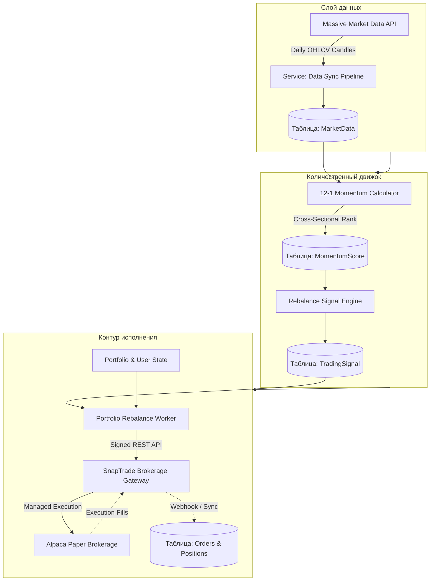
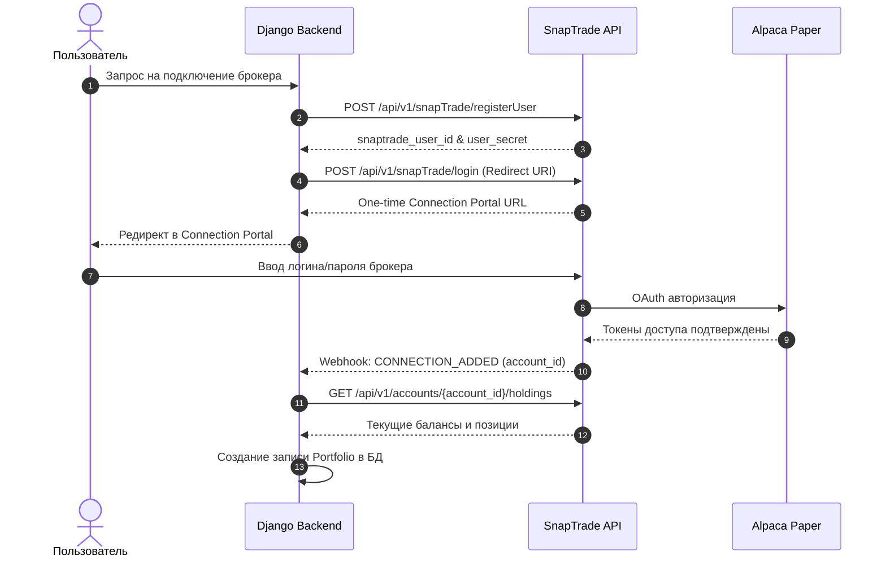

+++
title = "Full-Stack архитектура алготрейдинга на Python: Django, кросс-секционный моментум 12-1 и мультиброкерский шлюз SnapTrade"
date = 2026-10-26
description = "Инженерный разбор промышленной архитектуры торгового веб-приложения: доменные модели Django, математика 12-1 кросс-секционного моментума Jegadeesh-Titman с лагом отскока, универсальная брокерская абстракция через SnapTrade API и безрисковая paper-инкубация в Alpaca."
[taxonomies]
tags = ["algo-trading", "quantitative", "architecture", "software-engineering", "risk-management"]
[extra]
toc = true
mermaid = true
+++

Большинство алгоритмических стратегий в розничном и полупрофессиональном сегменте зарождаются в виде исследовательских Jupyter Notebooks. Однако при переходе от исторической симуляции к регулярному исполнению инженеры сталкиваются с фундаментальным кризисом архитектуры: скрипты не имеют персистентного аудиторского следа, жестко привязаны к API единственного брокера, хранят секреты в открытом виде и смешивают бизнес-логику сигналов с сетевыми вызовами исполнения.

В данном материале разобран архитектурный переход от исследовательского прототипа к полноценному веб-сервису **«Momentum Trader»** на стеке **Python 3.12+ / Django**. Система реализует классическую количественную модель кросс-секционного моментума ($12-1$ Momentum) с защитой от краткосрочного отскока, оркестрирует загрузку дневных свечей, управляет брокерскими подключениями через шлюз **SnapTrade** и направляет ордера на исполнение в симулированную среду **Alpaca Paper**.

---

## 1. Первоисточник и архитектурный контур

Разбор опирается на архитектурные решения и кодовую базу обучающего курса freeCodeCamp:
* **Первоисточник:** freeCodeCamp.org / Justin Mitchel, *Python Algorithmic Trading Course – Django, Massive, SnapTrade & Alpaca* ([YouTube: zH2Mg782XhA](https://youtu.be/zH2Mg782XhA), 2:00:00).
* **Стек ядра:** Python 3.12, Django 5.x, PostgreSQL/SQLite, Celery, Redis.
* **Поставщик рыночных данных:** Massive API (дневные исторические свечи EOD OHLCV).
* **Брокерский агрегатор:** SnapTrade API (универсальный OAuth-коннектор к 20+ брокерским системам).
* **Контур исполнения:** Alpaca Paper Trading API.

> **Финансовый дисклеймер.** Приведенный материал носит сугубо академический и инженерный характер. Моментум-стратегии подвержены риску резких просадок при смене рыночного режима (Momentum Crashes). Описанная реализация предназначена для демонстрации системной архитектуры и тестирования на бумажных счетах (paper trading), а не для прямого управления реальным капиталом.

### Высокоуровневая диаграмма компонентов

Для надежного функционирования торговый сервис разделен на изолированные слои: уровень персистентности и веб-управления (Django ORM & Admin), количественный движок ранжирования, модуль синхронизации рыночных данных и адаптер исполнения ордеров.



---

## 2. Количественная модель: 12-1 Cross-Sectional Momentum

В основе сигнального модуля лежит фундаментальная модель кросс-секционного моментума, сформулированная в классической работе Нарасимхана Джегадиша и Шеридана Титмана (*Jegadeesh & Titman, 1993, Journal of Finance*).

### Математическая постановка и лаг отскока ($t-1$)

В наивных алгоритмах моментум часто рассчитывается как простая доходность за последние $N$ месяцев:

$$
R_t = \frac{P_t - P_{t-N}}{P_{t-N}}
$$

Однако эмпирические исследования микроструктуры выявили феномен **краткосрочного возврата к среднему (Short-Term Mean Reversion)** на горизонте от 1 недели до 1 месяца, вызванный шоками ликвидности и закрытием позиций маркет-мейкерами.

Чтобы устранить негативное влияние краткосрочного отскока, формула $12-1$ Momentum исключает последний месяц ($t-1$) из расчетного окна:

$$
R\\\\_{i, t}^{\\\\text{mom}} = \\frac{P\\\\_{i, t-1} - P\\\\_{i, t-12}}{P\\\\_{i, t-12}}
$$

где:
* $P\\\\_{i, t-1}$ — цена закрытия актива $i$ на конец месяца $t-1$ (21 торговый день назад относительно текущего момента $t$);
* $P\\\\_{i, t-12}$ — цена закрытия актива $i$ за 12 месяцев (252 торговых дня) до текущего момента.

### Кросс-секционная нормализация и ранжирование

Модель оценивает не абсолютную доходность акции, а ее относительную силу внутри исследуемого пула (Universe):

1. **Формирование пула ликвидности (Universe Selection):** Отбираются наиболее ликвидные инструменты (например, компоненты индекса S&P 100 или Nasdaq 100), чтобы минимизировать издержки спреда и проскальзывания.
2. **Расчет Z-оценки моментума:**

$$
z\\\\_{i, t} = \\frac{R\\\\_{i, t}^{\\\\text{mom}} - \\mu\\\\_t}{\\sigma\\\\_t}
$$

где $\mu$ и $\sigma$ — среднее арифметическое и стандартное отклонение доходностей $R^{\text{mom}}$ по всем активам пула на дату $t$.

3. **Селекция верхнего дециля:** Активы ранжируются по убыванию Z-оценки. Верхний дециль (Top 10 акций) включается в целевой портфель с равными весами ($w = 10\\%$). Активы, выпавшие из целевого ранга, подлежат полной ликвидации.

### Анализ издержек оборота (Turnover Drag)

Частая ребалансировка моментум-портфелей порождает скрытые потери на спредах и комиссиях. Ожидаемая просадка от транзакционных издержек выражается как:

$$
\\text{Drag}\\\\_t = 2 \\cdot \\text{Turnover}\\\\_t \\cdot \\left( S\\\\_{\\\\text{half}} + \\text{Fee}\\\\_{\\\\text{broker}} + \\text{Impact}\\\\_{\\\\text{market}} \\right)
$$

При ежемесячной ребалансировке с коэффициентом обновления портфеля $\\text{Turnover} \\approx 20\\%$ и суммарных издержках в $5\\,\\text{bps}$ потери составляют около $0.24\\%\\,\\text{в год}$, что делает стратегию экономически жизнеспособной только при строгом контроле дельты ордеров.

---

## 3. Архитектура доменной модели Django

Архитектурное преимущество Django в алготрейдинге — наличие зрелой ORM со встроенными транзакциями, механизма миграций и готового административного интерфейса для ручного аудита состояния позиций.

Проект логически разделен на два связанных приложения:
* `trading` — хранение рыночных котировок, вычисление факторных скоров и генерация сигналов;
* `portfolio` — учет пользовательских брокерских подключений, портфелей, позиций и жизненного цикла ордеров.

### Описание моделей данных

Ниже приведена реализация ключевых доменных моделей с индексами по датам и составным ограничениям уникальности:

```python
from django.db import models
from django.contrib.auth import get_user_model

User = get_user_model()

class Stock(models.Model):
    ticker = models.CharField(max_length=10, unique=True, db_index=True)
    company_name = models.CharField(max_length=255)
    sector = models.CharField(max_length=100, blank=True)
    is_active = models.BooleanField(default=True)

    def __str__(self):
        return self.ticker


class MarketData(models.Model):
    stock = models.ForeignKey(Stock, on_delete=models.CASCADE, related_name='market_data')
    date = models.DateField(db_index=True)
    open_price = models.DecimalField(max_digits=12, decimal_places=4)
    high_price = models.DecimalField(max_digits=12, decimal_places=4)
    low_price = models.DecimalField(max_digits=12, decimal_places=4)
    close_price = models.DecimalField(max_digits=12, decimal_places=4)
    volume = models.BigIntegerField()

    class Meta:
        unique_together = ('stock', 'date')
        indexes = [
            models.Index(fields=['stock', 'date']),
        ]


class MomentumScore(models.Model):
    stock = models.ForeignKey(Stock, on_delete=models.CASCADE)
    date = models.DateField(db_index=True)
    score_12_1 = models.FloatField(help_text="Jegadeesh-Titman 12-1 Return")
    universe_rank = models.PositiveIntegerField(help_text="1 = Наивысший моментум")

    class Meta:
        unique_together = ('stock', 'date')


class TradingSignal(models.Model):
    class Action(models.TextChoices):
        BUY = 'BUY', 'Купить'
        SELL = 'SELL', 'Продать'
        HOLD = 'HOLD', 'Удерживать'

    stock = models.ForeignKey(Stock, on_delete=models.CASCADE)
    generated_at = models.DateTimeField(auto_now_add=True)
    action = models.CharField(max_length=4, choices=Action.choices)
    target_weight = models.FloatField(default=0.0)
    is_executed = models.BooleanField(default=False)
```

### Моделирование брокерского контура (`portfolio`)

```python
class SnapTradeUser(models.Model):
    user = models.OneToOneField(User, on_delete=models.CASCADE, related_name='snaptrade_profile')
    snaptrade_user_id = models.CharField(max_length=128, unique=True)
    snaptrade_user_secret = models.CharField(max_length=256)
    created_at = models.DateTimeField(auto_now_add=True)


class Portfolio(models.Model):
    snaptrade_user = models.ForeignKey(SnapTradeUser, on_delete=models.CASCADE, related_name='portfolios')
    broker_account_id = models.CharField(max_length=128, unique=True)
    broker_name = models.CharField(max_length=64, default="Alpaca")
    total_value = models.DecimalField(max_digits=14, decimal_places=2, default=0.00)
    cash_balance = models.DecimalField(max_digits=14, decimal_places=2, default=0.00)
    updated_at = models.DateTimeField(auto_now=True)


class Order(models.Model):
    class Status(models.TextChoices):
        PENDING = 'PENDING', 'В очереди'
        SUBMITTED = 'SUBMITTED', 'Отправлен брокеру'
        FILLED = 'FILLED', 'Исполнен'
        FAILED = 'FAILED', 'Ошибка исполнения'

    portfolio = models.ForeignKey(Portfolio, on_delete=models.CASCADE, related_name='orders')
    stock = models.ForeignKey(Stock, on_delete=models.PROTECT)
    action = models.CharField(max_length=4, choices=TradingSignal.Action.choices)
    units = models.DecimalField(max_digits=10, decimal_places=4)
    status = models.CharField(max_length=12, choices=Status.choices, default=Status.PENDING)
    broker_order_id = models.CharField(max_length=128, blank=True, null=True)
    created_at = models.DateTimeField(auto_now_add=True)
```

---

## 4. Реализация движка расчета моментума на Pandas & Django ORM

Для масштабируемой обработки котировок исторические свечи агрегируются из PostgreSQL в DataFrame. Ниже приведен рабочий модуль вычисления $12-1$ Momentum с валидацией непрерывности ценового ряда:

```python
import pandas as pd
import numpy as np
from datetime import timedelta
from django.utils import timezone
from trading.models import Stock, MarketData, MomentumScore

def calculate_momentum_scores_for_date(as_of_date=None, top_n=10):
    """
    Расчет 12-1 кросс-секционного моментума по активным тикерам.
    Окно расчета: от t-252 до t-21 торговых дней.
    """
    if as_of_date is None:
        as_of_date = timezone.now().date()

    # Окно выборки: 1 год назад с буфером
    start_date = as_of_date - timedelta(days=400)
    
    # Извлечение котировок единым запросом
    records = MarketData.objects.filter(
        stock__is_active=True,
        date__gte=start_date,
        date__lte=as_of_date
    ).values('stock__ticker', 'date', 'close_price')
    
    df = pd.DataFrame(list(records))
    if df.empty:
        raise ValueError(f"Нет котировок в БД для расчета на {as_of_date}")
        
    df['close_price'] = df['close_price'].astype(float)
    df = df.pivot(index='date', columns='stock__ticker', values='close_price').sort_index()

    # Проверка длины ряда (минимум 252 торговых дня)
    if len(df) < 252:
        raise ValueError(f"Недостаточно исторических торговых дней: {len(df)} < 252")

    # t-1 (конец прошлого месяца, 21 день назад) и t-12 (252 дня назад)
    price_t_minus_1 = df.iloc[-21]
    price_t_minus_12 = df.iloc[-252]

    # Расчет доходности Jegadeesh-Titman
    momentum_returns = (price_t_minus_1 - price_t_minus_12) / price_t_minus_12
    momentum_returns = momentum_returns.dropna()

    # Кросс-секционное ранжирование
    ranks = momentum_returns.rank(ascending=False, method='min')

    # Атомарное сохранение результатов в Django ORM
    scores_to_create = []
    ticker_to_stock = {s.ticker: s for s in Stock.objects.filter(ticker__in=momentum_returns.index)}

    for ticker, score in momentum_returns.items():
        scores_to_create.append(
            MomentumScore(
                stock=ticker_to_stock[ticker],
                date=as_of_date,
                score_12_1=float(score),
                universe_rank=int(ranks[ticker])
            )
        )

    MomentumScore.objects.filter(date=as_of_date).delete()
    MomentumScore.objects.bulk_create(scores_to_create)
    return ranks[ranks <= top_n].index.tolist()
```

---

## 5. Брокерская абстракция через шлюз SnapTrade

Прямая интеграция с API конкретного брокера (Alpaca, Interactive Brokers, TD Ameritrade) порождает сильное зацепление кода (*tight coupling*). При смене юрисдикции или брокера всю подсистему работы с ордерами приходится переписывать с нуля.

**SnapTrade** выступает универсальным унифицированным шлюзом (по аналогии с Plaid в банковском секторе), предоставляя единый REST API для чтения балансов и отправки торговых поручений.

### Жизненный цикл подключения счета (Connection Flow)



### Преимущества изоляции учетных данных

* **Безопасность учетных данных:** Сервер Django никогда не получает пароли или API-ключи брокера в открытом виде. Пользователь проходит OAuth-авторизацию во всплывающем защищенном iframe портала SnapTrade.
* **Портативность стратегии:** Переключение исполнения с Alpaca Paper на живой счет Interactive Brokers не требует изменения ни единой строчки в quantitative-коде: меняется лишь идентификатор `broker_account_id`.

---

## 6. Движок ребалансировки: расчет дельты ордеров и транзакционная безопасность

Ключевая задача сервиса ребалансировки — преобразование модельных весов сигналов в атомарные ордера на покупку и продажу с учетом текущего состояния портфеля.

### Математика расчета дельты

Пусть $V\\\\_{\\\\text{total}}$ — общая стоимость портфеля (Equity), $C$ — доступный остаток наличных средств, а $P\\\\_i$ — текущая рыночная цена актива $i$. Для каждого актива из целевого пула ($i \\in \\text{Target}$) и текущих открытых позиций ($j \\in \\text{Current}$) рассчитывается требуемое количество акций:

$$
Q\\\\_{i}^{\\\\text{target}} = \\left\\lfloor \\frac{w\\\\_i \\cdot V\\\\_{\\\\text{total}}}{P\\\\_i} \\right\\rfloor
$$

Дельта изменения позиции определяется как:

$$
\\Delta Q\\\\_k = Q\\\\_{k}^{\\\\text{target}} - Q\\\\_{k}^{\\\\text{current}}
$$

1. **Фаза ликвидации (Sell First):** Все активы с $\\Delta Q\\\\_k < 0$ продаются в первую очередь. Это освобождает кэш и предотвращает отклонение заявок брокером по причине маржинальной недостаточности (*Insufficient Buying Power*).
2. **Фаза набора позиций (Buy Second):** Активы с $\\Delta Q\\\\_k > 0$ закупаются на высвобожденную ликвидность.

```python
from decimal import Decimal
from django.db import transaction
from portfolio.models import Portfolio, Order
from trading.models import TradingSignal

@transaction.atomic
def execute_rebalance_delta(portfolio_id, target_weights, current_prices):
    """
    Атомарный расчет и постановка заявок с блокировкой записи портфеля (select_for_update).
    """
    portfolio = Portfolio.objects.select_for_update().get(id=portfolio_id)
    total_equity = portfolio.total_value
    
    # Текущие позиции из локального зеркала БД
    current_positions = {p.stock.ticker: p.units for p in portfolio.positions.all()}
    orders_to_create = []

    # 1. Ликвидация позиций, покинувших топ-рейтинг
    for ticker, current_qty in current_positions.items():
        if ticker not in target_weights:
            orders_to_create.append({
                'ticker': ticker,
                'action': TradingSignal.Action.SELL,
                'units': current_qty
            })

    # 2. Формирование целевых объемов
    for ticker, weight in target_weights.items():
        price = Decimal(str(current_prices[ticker]))
        target_allocation = total_equity * Decimal(str(weight))
        target_units = int(target_allocation // price)
        current_units = current_positions.get(ticker, Decimal('0'))
        
        delta = target_units - current_units
        if delta > 0:
            orders_to_create.append({
                'ticker': ticker,
                'action': TradingSignal.Action.BUY,
                'units': delta
            })
        elif delta < 0:
            orders_to_create.append({
                'ticker': ticker,
                'action': TradingSignal.Action.SELL,
                'units': abs(delta)
            })

    # Сортировка: SELL исполняются первыми
    orders_to_create.sort(key=lambda x: 0 if x['action'] == TradingSignal.Action.SELL else 1)
    
    # Сохранение ордеров в статусе PENDING
    created_orders = []
    for item in orders_to_create:
        order = Order.objects.create(
            portfolio=portfolio,
            stock_id=item['ticker'],
            action=item['action'],
            units=item['units'],
            status=Order.Status.PENDING
        )
        created_orders.append(order)

    return created_orders
```

---

## 7. Защитные гейты и правила Paper-First инкубации

В реальной эксплуатации автоматизированная ребалансировка не должна запускаться вслепую. В систему заложены детерминированные защитные фильтры:

| Риск-гейт | Условие срабатывания | Реакция системы |
|---|---|---|
| **Max Asset Allocation** | Вес одной бумаги превышает $15\\%$ портфеля | Автоматическая обрезка размера заявки до лимита |
| **Cash Buffer Reserve** | Свободный остаток кэша после покупок $< 5\\%$ | Снижение целевых весов всех покупок пропорционально |
| **Stale Price Detection** | Данные EOD свечи устарели более чем на 48 часов | Блокировка пересчета моментума, алерт оператору |
| **Max Turnover Cap** | Суммарный оборот ребалансировки $> 60\\%$ портфеля | Эскалация на ручное подтверждение через Django Admin |

---

## 8. Сравнение подходов: Jupyter Prototype vs Production Django

```text
┌────────────────────────────────┬────────────────────────────────┐
│   Jupyter Notebook Prototype   │   Full-Stack Django Service    │
├────────────────────────────────┼────────────────────────────────┤
│ • Отсутствие аудита сигналов   │ • Полная реляционная БД        │
│ • API ключи прямо в коде       │ • Изоляция в .env + SnapTrade  │
│ • Ручной запуск ячеек          │ • Периодический Celery / Cron  │
│ • Привязка к одному брокеру    │ • Мультиброкерский шлюз        │
│ • Нет валидации состояния      │ • Транзакции, гейты рисков     │
└────────────────────────────────┴────────────────────────────────┘
```

---

## Резюме

Полнофункциональная архитектура алгоритмической системы на Django переводит количественные исследования из плоскости случайных экспериментов в контролируемый инженерный процесс. Применение проверенной модели **12-1 Momentum (Jegadeesh & Titman)** нивелирует микроструктурный шум и эффект краткосрочного отскока, а разделение доменных контекстов и абстрагирование брокера через **SnapTrade API** гарантирует воспроизводимость и безопасность исполнения заявок.
