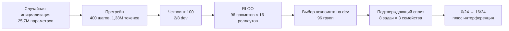

+++
title = "GLM-5.3-Flash в 25 миллионах параметров: что учебная реализация доказывает, а что нет"
date = 2026-11-15
description = "Разбор курса freeCodeCamp и репозитория glm-5.3-flash-from-scratch: гибридное внимание 3:1, MoE 8+1, четыре потока mHC, RL с исполняемой наградой 0/24 → 16/24 и провалившаяся репликация, которая важнее успеха."
[taxonomies]
tags = ["machine-learning", "architecture", "evals", "software-engineering"]
[extra]
toc = true
mermaid = true
+++

14 ноября 2026 года freeCodeCamp опубликовал 44-минутный курс «Build and Train a GLM-5.3-Flash Model From Scratch with Python» и репозиторий `vukrosic/glm-5.3-flash-from-scratch`. Обещание в заголовке сильное: собрать и обучить модель с нуля. Внутри — не 320-миллиардная модель Z.ai, а учебная на 25,7 млн параметров, и авторы честно пишут это в первом абзаце REPORT.md: «not a reproduction of GLM-5.3-Flash».

Разбирать такие проекты полезнее, чем читать пресс-релиз, ровно по одной причине: здесь видно, где заканчивается архитектура и начинается маркетинг. Ниже — что именно перенесено из продакшн-модели, какая арифметика за этим стоит, что показал RL-эксперимент и почему провалившаяся репликация в этом репозитории ценнее успешного прогона.

Учебный пайплайн повторяет четыре стадии продакшн-обучения, только каждая измеряется минутами:



## Что перенесли, а что упростили

Официальная GLM-5.3-Flash — 320B параметров, 18B активных, 45 слоёв, гибрид 34 KDA + 11 DSA, MoE с 288 экспертами (top-8) и четырьмя потоками mHC. Учебная модель сохраняет пропорции, но на два порядка меньше.

| Компонент | GLM-5.3-Flash | Учебная модель |
|---|---|---|
| Параметры | 320B (18B активных) | 25 730 592 (9 805 344 активных) |
| Слои | 45 | 12 |
| Внимание | 34 KDA + 11 DSA (3:1) | 9 линейных + 3 sparse (3:1) |
| MoE | 288 экспертов, top-8, 1 shared | 8 экспертов, top-2, 1 shared |
| Токенизатор | BPE, 154 880 токенов | байтовый, 260 токенов |
| Контекст | 1M | 192 |
| Потоки residuals | 4 (mHC) | 4 (упрощённый миксер) |

Пропорция 3:1 в коде задаётся одной строкой, и это стоит увидеть:

```python
self.layers = nn.ModuleList([
    HyperConnection(config, HybridBlock(config, sparse=((index + 1) % 4 == 0)))
    for index in range(config.layers)
])
```

При 12 слоях sparse получают индексы 3, 7 и 11 — три слоя из двенадцати, остальные девять линейные. Та же ритмика, что `[KDA, KDA, KDA, DSA]` в отчёте Z.ai, только вместо KDA и DSA — их учебные аналоги. Автор прямо предупреждает: «simplified mechanisms; they are not exact implementations of mHC, KDA, DSA, or IndexPool».

## Арифметика параметров: где на самом деле живут веса

Я склонировал репозиторий, поднял `ModelConfig()` и посчитал параметры по группам — цифры совпали с REPORT.md до единицы:

```text
embedding/output (tied)   49 920
attention              1 771 776
routed MoE            21 233 664
shared expert          2 654 208
norm/other                21 024
------------------------------
total                 25 730 592
active (estimate)      9 805 344
```

Две вещи здесь важнее самих чисел.

Первое: 82,5% весов — это маршрутизируемые эксперты, но каждый токен проходит только через два из восьми. Отсюда и оценка активных параметров, которая в коде выглядит так:

```python
total = sum(parameter.numel() for parameter in self.parameters())
active = total - routed_total + routed_total * config.top_k // config.experts
```

Второе: доля активных параметров в учебной модели — 38%, а у продакшн-модели — 5,6% (18B из 320B). Это не ошибка реализации, а следствие масштаба: при 12 слоях и 8 экспертах разреженность физически не может дать такое же соотношение, как при 45 слоях и 288 экспертах. Учебная модель показывает механизм, но не показывает выигрыш от него. Если вам когда-нибудь понадобится аргумент «MoE экономит compute», этот репозиторий его не подтверждает — он его только иллюстрирует.

## Линейное внимание: правильная идея и неудобная реализация

Линейный слой считает причинный префикс через положительные признаки:

```python
q, k = apply_rope(q, k)
q = F.elu(q) + 1.0
k = F.elu(k) + 1.0
kv = torch.einsum("bthd,bthe->bthde", k, v).cumsum(dim=1)
k_prefix = k.cumsum(dim=1)
numerator = torch.einsum("bthd,bthde->bthe", q, kv)
denominator = torch.einsum("bthd,bthd->bth", q, k_prefix).unsqueeze(-1)
```

Математика корректна: состояние накапливается как сумма внешних произведений `k v^T`, а нормировка идёт на сумму `k`. Это классическая линейная attention-формула с причинным префиксом, и тест `test_forward_shape_usage_and_causality` подтверждает, что будущие токены не протекают.

Но реализация материализует тензор `[batch, time, heads, head_dim, head_dim]` целиком и делает `cumsum` по времени. Память растёт линейно по длине контекста, а не остаётся фиксированной. Я посчитал размер этого тензора для конфигурации по умолчанию:

```text
T=  128  kv_tensor_est=    3.00 MiB
T=  256  kv_tensor_est=    6.00 MiB
T=  512  kv_tensor_est=   12.00 MiB
T= 1024  kv_tensor_est=   24.00 MiB
```

Для учебных 192 токенов это неважно. Но именно этот слой в статье должен объяснять, почему KDA даёт фиксированный state на миллион токенов, — а реализация демонстрирует ровно противоположное свойство. Настоящие ядра Flash Linear Attention считают состояние чанками и не держат `T` в размерности тензора. Если вы переносите код из репозитория в свой проект, это первое, что придётся заменить: на T = 1M такая материализация невозможна ни по памяти, ни по скорости.

То же ограничение у sparse-слоя, но по другой причине: вместо индексатора DSA с пулингом (IndexPool сжимает четыре ключа в один) здесь берётся локальное окно 32 токена плюс страйд-анкеры каждые 32 позиции. Это честная разреженность, но выбор позиций фиксирован структурой, а не выучен моделью. Для демонстрации «разреженное внимание работает» годится; для утверждений о качестве long-context — нет.

## Что показал претрейн

Данные синтетические и генерируются детерминированно: восемь семейств операций (increment, double, square, absolute, clamp, even, reverse, sum), рандомизированные имена функций, шаблонные комментарии. Модель учится предсказывать следующий байт.

| Шаг | Dev-задач решено | Dev pass@1 |
|---:|---:|---:|
| 0 | 0/8 | 0,0% |
| 100 | 2/8 | 25,0% |
| 200 | 7/8 | 87,5% |
| 400 | 8/8 | 100,0% |

Прогон: 1 381 760 токенов за 63,1 секунды, пик 2,14 GiB VRAM на RTX 3080 Ti. Чекпоинт 100 выбран для RL сознательно — на нём модель уже выучила синтаксис, но не дорешала задачи, то есть остался запас для улучшения. Это аккуратная методологическая деталь, которую в учебных проектах обычно пропускают: обучать RL с нуля бессмысленно, награда слишком разрежена.

## RL с исполняемой наградой: 0/24 → 16/24

Награда бинарная и внешняя:

```text
 1.0  проходит все три теста
 0.0  парсится и запускается, но ответ неверный
-0.1  невалидный исходник
```

Оптимизация — on-policy REINFORCE с leave-one-out базой (RLOO), 16 сэмплов на промпт, 96 промптов (32 идентичности × 3 семейства), 1536 роллаутов, температура 0.35, штраф за длину 48 токенов. Обучались только последний гибридный блок, финальная нормировка и связанная матрица эмбеддингов/выхода — 2 190 152 параметра из 25,7 млн.

Ключевое: модель **не получала эталонных ответов**. Только промпт и скалярный результат исполнения. Это тот же принцип, что в GRPO/RLOO для кода, и именно он делает результат интересным.

На подтверждающем сплите, который не использовался ни для обучения, ни для выбора чекпоинта:

| Метрика | До RL | После RL |
|---|---:|---:|
| Greedy-задач решено | 0/24 | **16/24** |
| Скрытых тестов пройдено | 2/72 | **48/72** |
| Точных сэмплов | 13/192 | **88/192** |
| Задач при 8 сэмплах (pass@8) | 9/24 | **19/24** |

Парное сравнение: 16 улучшений, ноль ухудшений, точный тест МакНемара даёт p ≈ 3,05 × 10⁻⁵, бутстрэп по задачам — прирост от +25,0 до +53,1 процентного пункта. Выглядит убедительно, пока не посмотреть на разбивку по семействам.

| Семейство | Учили в RL | До | После |
|---|---|:---:|---:|
| increment | да | 6/64 | **40/64** |
| double | да | 4/64 | **45/64** |
| even | да | 3/64 | 3/64 |
| square | нет | **52/64** | 37/64 |
| list_sum | нет | **61/64** | 56/64 |

Два обученных семейства выросли в семь-десять раз. Третье обученное — `even` — не изменилось вообще. А два необученных деградировали: `square` с 52/64 до 37/64. Это интерференция, и у неё есть конкретная причина: в апдейте нет KL-штрафа, политика свободно уезжает в сторону трёх промптов.

Именно поэтому фраза «RL улучшил модель» здесь неточна. Точнее: «RL усилил уже существующие латентные решения в двух семействах, сломав часть того, что модель умела в двух других». Для продакшн-модели это был бы инцидент, а не результат.

## Провалившаяся репликация — самая полезная часть репозитория

В слайдах и в `scripts/analyze_rl_group_confirmation.py` лежит отдельный эксперимент: размер группы 4 против 8. На dev группа 4 выглядела лучше. Проверка на свежих сидах:

```text
сид      группа 8   группа 4   разница
31415    12/40      13/40      +1
27182    14/40      13/40      −1
16180    11/40       8/40      −3

95% интервал: −6,7% … +1,7%  (пересекает ноль)
```

Три сида, 40 нетронутых задач, парная оценка — и вывод «группа 4 лучше» рассыпается. Авторы не прячут это в сноску: в REPORT.md есть отдельный раздел «Pilot history», где перечислены все пять предыдущих неудачных попыток RL, включая нестабильный прогон, где dev упал с 2/8 до 0/8, и три конфигурации, которые вообще ничего не изменили.

Вот это и есть настоящая ценность проекта. Большинство туториалов показывают финальный удачный конфиг и умалчивают, сколько было отброшено. Здесь ровно наоборот: видно, что успешный прогон — результат выбора метода на dev, и что перенос «победившей» настройки на новые сиды не подтверждается. Если вы строите свой RL-пайплайн, этот раздел стоит прочитать раньше, чем код.

## Vision-пилот: честно ограниченный

Отдельная часть — маленький визуальный энкодер: изображение 32×32 режется на патчи, каждый патч превращается в токен через 2D RoPE, всего 16 токенов, и они подаются в те же 12 слоёв языковой модели. Обучается только ограниченная поверхность (энкодер, финальный блок, нормировка, связанный эмбеддинг), градиенты идут через замороженные слои.

В отчёте это названо «bounded pilot»: одна синтетическая задача, один сид, чекпоинт не сохранён. То есть заявление «модель видит картинки» технически верно в смысле «путь градиентов работает», и совершенно неверно в смысле «модель научилась распознавать изображения». В статье Z.ai нативный vision-энкодер — 24 блока с проекцией в 4096-мерное пространство; сравнивать эти две вещи по качеству нельзя, только по топологии.

## Что я проверил сам

Репозиторий небольшой, поэтому проверки дешёвые и их стоит делать, прежде чем верить REPORT.md:

- **12 из 12 тестов проходят** (`tests/test_lab.py`, `test_vision.py`, `test_full_25m_vision_digit_pilot.py`) — включая проверку причинности, шаблона 3:1 и того, что эталонные решения действительно проходят верификатор.
- **Подсчёт параметров сходится**: 25 730 592 total, 21 233 664 в routed-экспертах, 9 805 344 активных по формуле из кода.
- **Форвард работает**: вход `[2, 64]` даёт логиты `[2, 64, 260]`.
- **CPU-бенчмарк**: 0,61 с/шаг при batch 1 и 1,01 с/шаг при batch 2 (4 потока, seq 128), то есть 209–254 токена/с. Экстраполяция на полный прогон в 400 шагов по 32×128 токенов даёт примерно 1,8 часа против 63 секунд на RTX 3080 Ti. Это оценка, а не замер полного прогона: 400 шагов на CPU я не запускал.

Чего я не проверял и что нельзя проверить по репозиторию: качество самой GLM-5.3-Flash. 25,7 млн параметров на синтетическом Python не говорят ничего ни о 320B-модели, ни о её бенчмарках, ни о long-context. Общее у них — только высокоуровневый рисунок архитектуры.

## Чек-лист для следующего такого репозитория

1. **Найдите фразу «not a reproduction»** в первых абзацах. Если её нет — это красный флаг.
2. **Пересчитайте параметры сами.** `parameter_counts()` может считать «активные» по упрощённой формуле; сверьте с ручным подсчётом по группам.
3. **Посмотрите на реализацию линейного внимания.** Если там `cumsum` по времени — это демонстрация идеи, а не воспроизведение эффективности.
4. **Проверьте, чем разреженное внимание выбирает позиции.** Фиксированное окно и страйд-анкеры — не то же самое, что выученный индексатор.
5. **Ищите разбивку по семействам, а не только среднее.** Средний прирост 0/24 → 16/24 скрывает 3/64 → 3/64 в `even` и деградацию в `square`.
6. **Ищите провалившиеся репликации.** Если их нет вообще — скорее всего, их просто не показали.

## Источники

- freeCodeCamp, «Build and Train a GLM-5.3-Flash Model From Scratch with Python», 14.11.2026 — [freecodecamp.org](https://www.freecodecamp.org/news/build-and-train-a-glm-53-flash-model-from-scratch-with-python/)
- Репозиторий `vukrosic/glm-5.3-flash-from-scratch`, файлы `REPORT.md`, `glm53_flash/model.py`, `tests/` — [github.com](https://github.com/vukrosic/glm-5.3-flash-from-scratch)
- Z.ai, «GLM-5.3-Flash: Frontier Intelligence, Flash Cost», 26.08.2026 — [z.ai](https://z.ai/blog/glm-5.3-flash)
- Sebastian Raschka, «GLM-5.3-Flash Architecture Notes», 26.08.2026 — [sebastianraschka.com](https://sebastianraschka.com/blog/2026/glm-5-3-flash-architecture-notes.html)
- NVIDIA NeMo AutoModel, карточка GLM-5.3-Flash (45 слоёв, 34 KDA + 11 DSA, 288 экспертов) — [docs.nvidia.com](https://docs.nvidia.com/nemo/automodel/model-coverage/vision-language-models/thudm/GLM-5.3-Flash)
