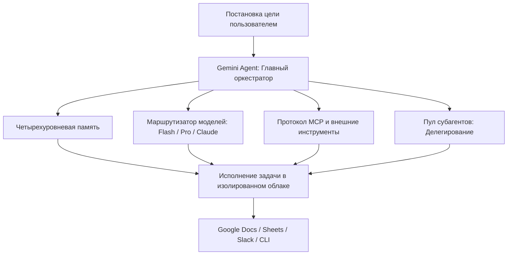

+++
title = "Google Gemini Agent: Архитектура корпоративного агента против Agent Sprawl"
date = 2026-10-12
description = "Инженерный разбор Google Gemini Agent: облачная среда, иерархия субагентов, 4 уровня памяти, протокол MCP и контроль расходов (Spend Caps)."
[taxonomies]
tags = ["ai-agents", "architecture", "software-engineering"]
[extra]
toc = true
mermaid = true
katex = false
+++

В корпоративной среде увлечение AI-ассистентами привело к предсказуемому кризису: **Agent Sprawl** — бесконтрольному разрастанию зоопарка узких ботов, плагинов и скриптов, которые не связаны между собой, теряют контекст при переключении задач и требуют ручного переноса данных между сервисами.

На конференции *Gemini at Work* Google представил платформенный ответ на эту проблему — **Gemini Agent**. Ниже — инженерный разбор архитектуры решения: как устроены оркестрация субагентов, четыре типа памяти, поддержка протокола Model Context Protocol (MCP) и финансовые лимиты выполнения.

Первоисточник материала — видеообзор канала [Tool Finder: Introducing Google's Gemini Agent](https://youtu.be/ueMFZ52R0qA).

## Архитектура решения: единый оркестратор вместо зоопарка ботов

Вместо попытки заставить одну LLM решать весь спектр задач в одном окне, Gemini Agent спроектирован как центральный оркестратор с разделением зон ответственности:

## Пять ключевых инженерных принципов

| Принцип | Реализация в системе | Практическая польза для инфраструктуры |
|---|---|---|
| **1. Cloud-Native Execution** | Фоновые изолированные контейнеры в Google Cloud | Задачи исполняются асинхронно без привязки к открытой сессии браузера или локальному ПК |
| **2. Иерархия субагентов** | Динамический наем и запуск узкоспециализированных воркеров | Параллелизация исследований, написания кода, проверки фактов и форматирования |
| **3. Четырехуровневая память** | Сессия, пользователь, проектный контекст, корпоративная база знаний | Устранение «амнезии» между задачами с соблюдением границ конфиденциальности |
| **4. Стандарт MCP и инструменты** | Поддержка Model Context Protocol и REST/CLI интерфейсов | Интеграция не только со стеком Google (Docs, Sheets, Gmail), но и с Slack, GitHub, Microsoft 365 |
| **5. Динамический роутинг моделей** | Автоподбор LLM под сложность каждого шага цепочки | Оптимизация бюджета: дешевые модели на рутину, флагманы — на рассуждения |

---

## 1. Иерархическая оркестрация субагентов (Sub-Agent Delegation)

Сложные задачи (например, «составить аналитический отчет по конкурентам с выгрузкой в Google Sheets и подготовкой саммари в Slack») не решаются одним последовательным промптом. 

Gemini Agent декомпозирует цель на граф зависимостей и создает изолированных субагентов:
- **Research Agent:** ищет документы во внутреннем хранилище и через веб-поиск;
- **Code/Data Agent:** агрегирует цифры, валидирует формулы и строит структуры таблиц;
- **Reviewer Agent:** перепроверяет согласованность выводов и фактов;
- **Formatter Agent:** записывает результат через API Google Workspace.

Каждый субагент получает только необходимый срез контекста, что снижает расход токенов и риск галлюцинаций.

---

## 2. Четырехуровневая модель памяти (Four-Way Memory)

Одна из главных причин неэффективности ассистентов первого поколения — сброс контекста в начале каждого диалога. В Gemini Agent реализовано разделение памяти на четыре слоя:

1. **Short-Term (Сессионная):** текущее состояние выполнения задачи и промежуточные шаги.
2. **User Profile (Персонализация):** стиль общения, формат ответов, язык и личные предпочтения разработчика.
3. **Project Context (Проектная память):** глоссарий проекта, задействованные репозитории, активные ветки и задачи.
4. **Enterprise Knowledge Base (Корпоративная память):** внутренние регламенты, документация, архитектурные гайдлайны и политики безопасности компании.

При этом доступ к корпоративному слою строго контролируется через IAM-роли организации.

---

## 3. Открытый протокол MCP и мультиплатформенность

Вместо создания проприетарного замкнутого протокола Google поддержал открытый стандарт **Model Context Protocol (MCP)**.

Это позволяет подключать к агенту существующие MCP-серверы:
- базы данных (PostgreSQL, BigQuery);
- репозитории (GitHub, GitLab);
- корпоративные мессенджеры (Slack, Google Chat);
- экосистему конкурентов (Microsoft 365, Notion).

Агент напрямую генерирует форматированные таблицы в Google Sheets, создает драфты писем в Gmail и публикует апдейты в проектные каналы без ручного копирования через буфер обмена.

---

## 4. Контроль бюджетов и безопасность (Spend Caps & Guardrails)

Автономные циклы агентных систем несут риск неконтролируемого расхода бюджета при зацикливании или масштабном параллельном поиске.

Платформа включает встроенные механизмы сдерживания:
- **Spend Caps:** жесткий лимит стоимости токенов на задачу или на отдел. При исчерпании лимита пайплайн автоматически приостанавливается и запрашивает одобрение инженера.
- **Human-in-the-Loop:** деструктивные или необратимые действия (отправка писем клиентам, изменение продакшен-баз данных, коммит в защищенные ветки) блокируются до явного подтверждения оператором.

---

## Ключевые выводы

Эволюция AI-инструментов перешла от генерации текста к оркестрации сквозных рабочих процессов. Решение проблемы **Agent Sprawl** лежит не в создании новых чат-ботов, а в переходе к платформенным оркестраторам с открытыми протоколами инструментов (MCP), многоуровневой памятью и строгими финансовыми квотами.

---

## Первоисточники и материалы

* **Оригинальный разбор:** [Tool Finder — Introducing Google's Gemini Agent](https://youtu.be/ueMFZ52R0qA)
* **Анонс платформы:** Google Cloud — Gemini at Work 2026
* **Инженерные наработки блога:** [github.com/xsa-dev](https://github.com/xsa-dev)
