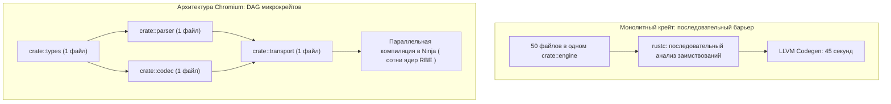

+++
title = "Внутренний Rust Style Guide от Google: дизайн API, типобезопасность и архитектура микрокрейтов в монорепозиториях"
date = 2026-11-01
description = "Инженерный разбор официального руководства Google по стилю Rust: гибкие срезы, newtypes против type aliases, запрет Rc/Arc по умолчанию, семантика non_exhaustive и компиляторная оптимизация в Chromium."
[taxonomies]
tags = ["rust", "software-engineering", "architecture", "performance"]
[extra]
toc = true
mermaid = true
+++

Проблема формулирования стандартов кодирования в системном программировании традиционно сводится к синтаксическому сахару: расстановке переносов строк, именованию идентификаторов и отступам. В экосистеме Rust инструмент `rustfmt` полностью закрыл эту дискуссию на уровне форматирования исходных текстов. Однако при масштабировании кодовых баз до десятков миллионов строк и тысяч разработчиков критическими становятся совершенно иные аспекты: предсказуемость контрактов API, строгость системы типов, контроль графа владения и время инкрементальной компиляции.

Компания Google официально опубликовала свое внутреннее руководство по стилю Rust ([Google Rust Style Guide](https://google.github.io/styleguide/rustguide.html)), используемое в таких масштабных проектах, как Chromium, Android Open Source Project (AOSP) и операционная система Fuchsia. Видео-анализ этого документа провел канал [Let's Get Rusty](https://youtu.be/bKUi8LH-C9I). 

В отличие от академических рекомендаций, стиль-гайд Google продиктован сугубо прагматическими требованиями надежности и масштабирования. В этой статье представлен детальный разбор ключевых инженерных правил Google, их влияние на производительность и архитектуру систем, а также компромиссы, возникающие при их внедрении.

---

## 1. Дизайн интерфейсов: концепция гибких ссылок (Flexible References)

Базовое правило проектирования сигнатур функций в Google Style Guide формулируется категорично: **публичные функции не должны требовать владения или конкретных аллокаторов данных, если им требуется лишь доступ на чтение**.

В коде разработчиков, переходящих на Rust с языков высокого уровня, часто встречается передача конкретных типов контейнеров по ссылке:

```rust
// ❌ Антипаттерн: жесткая привязка к контейнерам кучи
pub fn process_payload(data: &String) -> usize;
pub fn calculate_metrics(values: &Vec<f64>) -> f64;
pub fn inspect_header(header: &Box<PacketHeader>) -> bool;
```

Такая сигнатура накладывает искусственные ограничения на вызывающий код:
1. Для передачи строкового литерала (`&'static str`) или подстроки вызывающая сторона вынуждена аллоцировать память в куче через `to_string()`.
2. Функция `calculate_metrics` не может принять срез статического массива (`&[f64; 4]`) или часть другого вектора без полного копирования данных.
3. Передача `&Box<T>` добавляет ненужный уровень косвенной адресации (pointer indirection), заставляя процессор выполнять двойное разыменование указателя.

Рекомендация Google предписывает использовать наиболее общие типы заимствования благодаря механизму автоматического приведения типов по разыменованию (`Deref coercion`):

```rust
// ✅ Идиоматичный подход Google: абстрактные неизменяемые срезы и ссылки
pub fn process_payload(data: &str) -> usize {
    data.len()
}

pub fn calculate_metrics(values: &[f64]) -> f64 {
    values.iter().sum()
}

pub fn inspect_header(header: &PacketHeader) -> bool {
    header.is_valid()
}
```

```text
Память при вызове с &String vs &str:

&String:  [ Ptr to String struct ] -> [ String: ptr | cap | len ] -> [ Heap Buffer ]
                                      (лишний уровень косвенности)

&str:     [ Ptr to Buffer | Len ] ---------------------------------> [ Heap Buffer / Static Data ]
                                      (zero-cost fat pointer)
```

Сигнатура, принимающая `&str` или `&[T]`, работает одинаково эффективно со стековыми массивами, кучей, статическими срезами бинарного файла и кольцевыми буферами без единой дополнительной аллокации.

---

## 2. Безопасность типов: Newtypes против Type Aliases

В больших распределенных монорепозиториях одна из самых распространенных логических ошибок — непреднамеренная перестановка аргументов одинакового базового типа при вызове функций.

Псевдонимы типов (`type alias`), создаваемые ключевым словом `type`, не вводят новый тип для компилятора:

```rust
// ❌ Type Alias: компилятор считает оба типа взаимозаменяемыми синонимами u64
type AccountId = u64;
type OrderId = u64;

fn cancel_order(account: AccountId, order: OrderId) {
    // логика отмены
}

fn execute() {
    let acc: AccountId = 1001;
    let ord: OrderId = 99999;

    // Компилятор Rust НЕ выдаст ошибку, несмотря на перепутанные местами аргументы!
    cancel_order(ord, acc);
}
```

Стиль-гайд Google строго рекомендует паттерн **Newtype** (`кортежная структура с одним полем`) для всех доменных идентификаторов, единиц измерения и дескрипторов ресурсов:

```rust
// ✅ Newtype Pattern: создание изолированных типов на этапе компиляции
#[derive(Debug, Clone, Copy, PartialEq, Eq, Hash)]
pub struct AccountId(pub u64);

#[derive(Debug, Clone, Copy, PartialEq, Eq, Hash)]
pub struct OrderId(pub u64);

pub fn cancel_order(account: AccountId, order: OrderId) {
    // логика отмены
}

fn execute_safe() {
    let acc = AccountId(1001);
    let ord = OrderId(99999);

    // ОШИБКА КОМПИЛЯЦИИ: mismatched types: expected AccountId, found OrderId
    // cancel_order(ord, acc);

    cancel_order(acc, ord); // Корректный вызов
}
```

### Стоимость абстракции в рантайме и директива `#[repr(transparent)]`
Паттерн Newtype является классической абстракцией нулевой стоимости (Zero-Cost Abstraction). Для гарантии того, что структура в памяти имеет в точности такое же бинарное представление (ABI layout), как и оборачиваемый тип, в промышленном коде Google используется атрибут `#[repr(transparent)]`:

```rust
// Гарантия идентичного бинарного представления на уровне C-ABI
#[repr(transparent)]
#[derive(Debug, Clone, Copy, PartialEq, Eq, PartialOrd, Ord, Hash)]
pub struct AccountId(pub u64);

#[repr(transparent)]
#[derive(Debug, Clone, Copy, PartialEq, Eq, PartialOrd, Ord, Hash)]
pub struct OrderId(pub u64);
```

В процессе компиляции LLVM устраняет обертку: значение передается через стандартный регистр общего назначения (`%rdi` в System V AMD64 ABI) без выделения стекового фрейма:

```text
; LLVM IR после оптимизации (-O3):
define void @cancel_order(i64 %account, i64 %order) local_unnamed_addr {
    ; Никаких смещений структуры: прямая работа со скалярами в регистрах rdi и rsi
    ret void
}
```

Компилятор гарантирует типобезопасность строго на этапе статического анализа, исключая накладные расходы в рантайме.

---

## 3. Pattern Matching против Check-Then-Unwrap

В кодовых базах Google полностью запрещен антипаттерн `check-then-unwrap`, характерный для процедурного стиля:

```rust
// ❌ Категорический антипаттерн: явный вызов unwrap после проверки
fn process_optional(opt: Option<Payload>) {
    if opt.is_some() {
        let val = opt.unwrap(); // Риск паники при рефакторинге
        val.handle();
    }
}
```

### Почему `check-then-unwrap` опасен?
1. **Хрупкость при рефакторинге:** Если в процессе сопровождения кода между проверкой `is_some()` и вызовом `unwrap()` добавляется промежуточная логика или перемещение переменной, код компилируется, но приводит к `panic!` в продакшне при определенных условиях гонки или ветвления.
2. **Лишние проверки в машинном коде:** Метод `unwrap()` содержит внутреннюю проверку дискриминанта перечисления и ветку паники. Оптимизатор не всегда способен доказать инвариант и устранить мертвое ветвление.

Google Style Guide предписывает применение деструктуризации через сопоставление с образцом:

```rust
// ✅ Рекомендация Google: безопасное сопоставление
fn process_optional_idiomatic(opt: Option<Payload>) {
    if let Some(val) = opt {
        val.handle();
    }
}

// ✅ Для раннего возврата из функции (guard clause):
fn process_guard(opt: Option<Payload>) {
    let Some(val) = opt else {
        return;
    };
    val.handle();
}
```

Конструкция `let-else`, стабилизированная в Rust 1.65, признана корпоративным стандартом для валидации предварительных условий функций, поскольку она устраняет вложенность блоков (`right drift`) и гарантирует инициализацию значения в случае продолжения выполнения.

---

## 4. Обработка ошибок: семантический компромисс `Option` vs `Result`

Один из наиболее дискуссионных разделов гайда Google касается разграничения `Option<T>` и `Result<T, E>`.

- **Позиция Google:** Если операция имеет ровно одну очевидную причину невозможности возврата результата, и вызывающей стороне не требуется дополнительный диагностический контекст, функция должна возвращать `Option<T>`.
  Примеры из стандартной библиотеки: `checked_add`, `pop()`, `find()`.
- **Позиция пуристов сообщества:** Использование `Result<T, ()>` предпочтительнее, если операция концептуально завершилась *ошибкой* (например, таймаут или отказ парсинга), в то время как `Option<T>` должен обозначать исключительно *отсутствие значения* (например, поиск элемента по ключу в хеш-таблице).

Google делает прагматичный выбор в пользу простоты сигнатур:

```rust
// Стиль Google для простых функций без детального дерева ошибок:
pub fn parse_port(input: &str) -> Option<u16> {
    let port: u16 = input.parse().ok()?;
    if port > 0 {
        Some(port)
    } else {
        None
    }
}
```

Однако для любых публичных API уровня инфраструктуры, где сбой требует маршрутизации или логирования, Google обязывает использовать строго типизированные перечисления ошибок `enum Error` с реализацией типажа `std::error::Error`, запрещая потерю контекста сбоя (запрет `ok()` без веской причины).

---

## 5. Граф владения: запрет `Rc` и `Arc` по умолчанию

Разработчики, приходящие в Rust из языков с автоматической сборкой мусора (Java, Go, TypeScript), часто пытаются обойти систему заимствований (Borrow Checker) путем оборачивания структур данных в `Rc<RefCell<T>>` или `Arc<Mutex<T>>`.

В стиле Google сформулировано жесткое правило: **по умолчанию использовать строгое уникальное владение (Unique Ownership) и явные заимствования (`&` / `&mut`). Использование `Rc` и `Arc` допустимо только при наличии документированного архитектурного обоснования.**

### Инженерные причины запрета `Arc` по умолчанию

1. **Атомарный оверхед на кэш-линиях (Cache Line Bouncing и протокол MESI):**
   Каждое клонирование и уничтожение `Arc` выполняет атомарные инструкции `fetch_add` / `fetch_sub` с барьерами памяти (`Acquire`/`Release` или `SeqCst`). В многопроцессорных архитектурах кэш-линия, содержащая счетчик `strong_count` (64 бита), переходит в состояние `Modified` (протокол MESI/MOESI). Это инициирует транзакцию инвалидации (Bus Read Invalidate) во всех остальных L1/L2-кэшах процессорных ядер.
   При интенсивном разделении ресурсов между потоками ядра тратят значительную часть циклов на ожидание синхронизации шины памяти (Cache Line Bouncing):

   $$\text{Latency}\_{\text{atomic}} \approx 30\text{--}80\text{ ns (vs 1\text{--}3 ns for L1 cache hit)}$$

2. **Утечки памяти через циклические ссылки:**
   `Rc` и `Arc` не защищают от создания замкнутых графов ссылок. В долгоживущих демонах и микросервисах циклические структуры приводят к тому, что счетчик ссылок никогда не опускается до нуля, и память утекает без срабатывания паники.
3. **Размывание контрактов потокобезопасности:**
   Уникальное владение заставляет инженера явно спроектировать границы жизни объектов. Если ресурс передается по значению, вызывающий код точно знает, когда память будет освобождена.

```rust
// ❌ Архитектурная лень: разделяемое владение с блокировками
pub struct SharedConfigManager {
    inner: Arc<RwLock<ConfigState>>,
}

// ✅ Рекомендация Google: явная передача ссылок по времени жизни
pub struct Worker<'a> {
    config: &'a ConfigState,
}

impl<'a> Worker<'a> {
    pub fn new(config: &'a ConfigState) -> Self {
        Self { config }
    }
    
    pub fn run(&self) {
        // Доступ к конфигурации с нулевым оверхедом синхронизации
    }
}
```

Исключениями, где `Arc` официально разрешен в руководстве Google, являются:
- Нециклические структуры данных, разделяемые между независимыми пулами потоков выполнения (`Thread Pool`).
- Графы асинхронных задач в рантайме (например, контексты соединений в `tokio`).
- Неизменяемые глобальные таблицы маршрутизации (`Routing Tables`), заменяемые целиком атомарным свопом.

---

## 6. Эволюция распределенных API: атрибут `#[non_exhaustive]`

В монорепозиториях Google код сервисов обновляется непрерывно независимыми командами. Добавление нового варианта в публичное перечисление (`enum`) в стандартном Rust является обратно несовместимым изменением (Breaking Change): весь зависимый код перестает компилироваться, так как выражения `match` требуют исчерпывающего сопоставления.

Для решения этой проблемы Google обязывает маркировать публичные структуры и перечисления атрибутом `#[non_exhaustive]`:

```rust
// Публичный интерфейс крейта ядра
#[non_exhaustive]
#[derive(Debug, Clone, PartialEq, Eq)]
pub enum NetworkTransportEvent {
    Connected(SocketAddr),
    Disconnected,
    DataReceived(usize),
    // В следующей версии крейта может быть добавлен вариант:
    // Reconnecting(Duration),
}
```

Вызывающий код в стороннем крейте обязан явно предоставить резервную ветку `_`:

```rust
// Код клиента:
match event {
    NetworkTransportEvent::Connected(addr) => log::info!("Connected: {:?}", addr),
    NetworkTransportEvent::Disconnected => log::warn!("Disconnected"),
    NetworkTransportEvent::DataReceived(bytes) => metrics::record(bytes),
    // Без этой ветки компилятор выдаст ошибку: non-exhaustive pattern
    _ => log::debug!("Ignored unrecognized future transport event"),
}
```

Этот атрибут позволяет авторам библиотек расширять публичные контракты без необходимости повышения мажорной версии API (SemVer major version bump) и без риска сломать сборку зависимых подсистем.

---

## 7. Компиляторное масштабирование монорепо: архитектура микрокрейтов в Chromium

Один из самых удивительных разделов стиля Google касается правил разбиения проектов на крейты в кодовой базе Chromium.

В стандартной экосистеме Rust разработчики стремятся объединять связанную логику в крупные крейты (десятки и сотни файлов в одном крейте). Однако в сборочной системе Chromium (использующей метагенератор GN и компилятор Ninja) действует радикальное правило: **создавать предельно гранулярные микрокрейты, вплоть до одного файла на крейт**.

### Почему крупные крейты замедляют сборку?

Единицей трансляции для компилятора `rustc` является крейт. Внутри крейта фронтенд компилятора выполняет проверку типов и заимствований строго последовательно. Кроме того, кэширование артефактов на уровне систем распределенной сборки (таких как Google RBE / Goma / sccache) происходит посекционно для каждого крейта. 

Если в монолитном крейте на 50 000 строк кода изменяется один символ, вся единица трансляции компилируется заново. При декомпозиции на микрокрейты система сборки Ninja получает глубокий направленный ациклический граф (DAG), который параллелится на сотни ядер распределенного кластера.



Такое разделение требует строгой дисциплины изоляции модулей и минимизации публичных поверхностей взаимодействия, но обеспечивает время инкрементальной сборки огромных систем в пределах единиц секунд.

Пример объявления мелкодисперсного крейта в файле `BUILD.gn` Chromium:

```gn
# //mojo/public/rust:mojo_system_bindings
rust_static_library("mojo_system_bindings") {
  crate_name = "mojo_system_bindings"
  crate_root = "src/lib.rs"
  sources = [ "src/lib.rs" ]
  
  # Строгое ограничение видимости крейта для предотвращения циклических связей
  visibility = [ "//mojo/public/rust/*" ]
  
  deps = [
    ":mojo_system_types",
    "//base:base_rust",
  ]
}
```

Время сборки критического пути графа DAG рассчитывается как:

$$T\_{\text{critical}} = \max\_{p \in \text{Paths}} \sum\_{v \in p} t\_{v}$$

При высокой гранулярности $t\_v$ для отдельных микрокрейтов составляет 0.2–0.8 секунды, что позволяет параллельным воркерам Ninja полностью загружать процессорные мощности без простоев на ожидание «тяжелых» монолитных модулей.

---

## 8. Сводная матрица стандартов Google Rust Style Guide

В таблице ниже систематизированы ключевые правила и их архитектурный эффект:

| Правило | Запрещенный паттерн | Рекомендация Google | Архитектурный эффект |
|---|---|---|---|
| **Аргументы функций** | `&String`, `&Vec<T>`, `&Box<T>` | `&str`, `&[T]`, `&T` | Исключение двойной косвенности и лишних аллокаций памяти |
| **Доменные типы** | `type UserId = u64` | `struct UserId(pub u64)` | Статическая защита от перестановки параметров на этапе компиляции |
| **Обработка Option** | `if opt.is_some() { opt.unwrap(); }` | `if let Some(v) = opt` или `let Some(v) = opt else` | Исключение непреднамеренных паник при модификации логики |
| **Модель владения** | `Arc<Mutex<T>>` по умолчанию | Уникальное владение и явные ссылки `&'a T` | Устранение contention на шине памяти и защита от циклических утечек |
| **Публичные Enum** | Открытые `enum` без аннотаций | Атрибут `#[non_exhaustive]` | Бесшовная эволюция контрактов без поломки зависимых сервисов |
| **Организация крейтов** | Монолитные крейты на десятки модулей | Мелкодисперсные микрокрейты (Chromium GN) | Максимальный параллелизм и гранулярное кэширование в Ninja / RBE |

---

## 9. Чек-лист для аудита кодовой базы

При проектировании промышленных систем на Rust используйте следующий экспресс-чеклист соответствия стандартам промышленной разработки:

1. **Сигнатуры API:** Убедитесь, что ни одна открытая функция не принимает `&String` или `&Vec<T>`, если только ей не требуется модификация длины контейнера по месту (`&mut Vec<T>`).
2. **Идентификаторы:** Обернуты ли числовые идентификаторы сущностей в Newtype-структуры с деривацией `Copy, Clone, PartialEq, Eq, Hash`?
3. **Защитные проверки:** Устранены ли вызовы `.unwrap()` и `.expect()` в ветках валидации опциональных значений в пользу `let-else` или сопоставления с образцом?
4. **Синхронизация:** Обосновано ли каждое вхождение `Arc<T>`? Не является ли оно следствием непродуманного времени жизни структур?
5. **Обратная совместимость:** Добавлен ли `#[non_exhaustive]` на все перечисления, доступные внешним крейтам и пакетам?

Руководство Google демонстрирует зрелый инженерный подход: Rust в продакшне — это не просто средство предотвращения уязвимостей памяти, а высокоточный инструмент проектирования надежных, масштабируемых и поддерживаемых систем.
