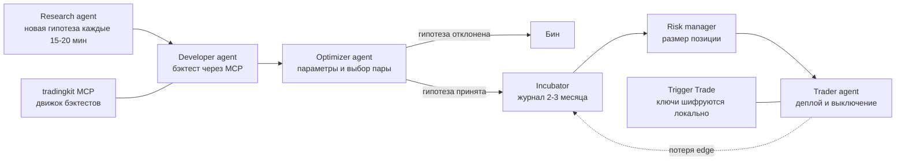

+++
title = "GrokBot: 22 часа автономной торговли и арифметика «лучшей из 50» стратегии"
date = 2026-11-14
draft = false
description = "Разбор эксперимента с no-code мульти-агентом, который торговал 22 часа на Bybit: сверка отчёта по комиссиям, архитектура шестиагентного торгового стола через MCP, расчёт инфляции Sharpe при отборе лучшей из 50 стратегий и правила трёхмесячной инкубации с последовательной остановкой."
[taxonomies]
tags = ["algo-trading", "ai-agents", "evals", "architecture", "quantitative"]
[extra]
toc = true
mermaid = true
katex = true
+++

Эксперимент устроен так, что проверяет две разные вещи: способность автономного агента провести сделки без заданной стратегии и способность того же инструмента собрать конвейер из шести агентов, который ищет, тестирует и отбирает стратегии. Первое проверяется бухгалтерией — 6 сделок, 84 цента прибыли, и вопрос, сходится ли отчёт с моделью издержек. Второе проверяется статистикой — что означает «лучшая из примерно 50 попыток» и какое число прибыли вообще может считаться свидетельством edge.

> **Первоисточник:** [I Gave the Grok Bot AI Trading Bot $10,000 for 22 Hours](https://www.youtube.com/watch?v=muHeyXiCn-A), канал *Trading with DaviddTech*; заметка в хранилище `YouTube/GrokBot-AI-Trading-10k-22h-DaviddTech-2026.md`.
> **Стек из видео:** GrokBot (клиент на базе X/Cursor), Trigger Trade (посредник к брокеру, ключи шифруются на машине пользователя), tradingkit.com (движок бэктестов TradingView-совместимых стратегий, отдаётся агенту как MCP-сервер).

> **Финансовый дисклеймер.** Материал носит исключительно образовательный характер и не является инвестиционной рекомендацией, офертой или обещанием доходности. Бэктесты, симуляции и цифры из видео не гарантируют будущий результат. Торговля цифровыми активами и деривативами с плечом может привести к потере всего капитала; перед любыми действиями нужны собственная проверка данных, расходов, ликвидности и риска.

---

## 1. Протокол эксперимента

Прежде чем считать прибыль, нужно зафиксировать правила, иначе результат нельзя ни воспроизвести, ни сравнить с чем-либо.

| Параметр | Значение | Следствие для интерпретации |
| --- | --- | --- |
| Счёт | 10 000 USD, Bybit | Капитал под риском несопоставим с используемой маржой |
| Горизонт | 22 часа | Статистически это один шумовой такт, не выборка |
| Коллатераль на сделку | ≤ 100 USD | 1% счёта; одновременно до 10 позиций по условиям промпта |
| Плечо | 10x | Номинал ~1 000 USD на сделку |
| Обязательные SL/TP | да | Ограничивает хвост, но не гарантирует исполнение по цене |
| Фактических сделок | 6 (3 прибыльных, 3 убыточных) | ~0.27 сделки в час |
| Итог | +0.84 USD после комиссий | 0.0084% на счёт за 22 часа |

Сразу видно главное: агент не «заработал» и не «слил» — он провёл шесть сделок и остался в пределах издержек. Это осмысленный результат, но он проверяет устойчивость пайплайна (может ли агент выставить ордер, поставить стоп, дождаться закрытия, отчитаться), а не наличие торгового преимущества.

## 2. Бухгалтерия: 84 цента против модели издержек

Отчёт в видео содержит два числа: сумма прибыльных сделок 10.81 USD и сумма убыточных 11.65 USD. Их разность — минус 84 цента до комиссий. Заявленный итог — плюс 84 цента после комиссий.

Проверим издержки. При коллатерали 100 USD и плече 10x номинал позиции равен 1 000 USD. Круговая комиссия на линейных перпетуалах Bybit по тейкеру составляет 0.055% на сторону:

$$c\_{\text{rt}} = N \cdot (f\_{\text{taker}} + f\_{\text{taker}}) = 1000 \cdot (0.00055 + 0.00055) = 1.10\ \text{USD}$$

То есть 1.10 USD — это 1.1% от коллатерали и 11 базисных пунктов от номинала. На шести сделках только тейкерских комиссий набегает 6.60 USD, по мейкеру (0.02% за сторону) — 2.40 USD.

```text
прибыльные сделки              +10.81
убыточные сделки               -11.65
--------------------------------------
валовой результат               -0.84
комиссии (тейкер, 6 сделок)      -6.60
--------------------------------------
ожидаемый итог                 -7.44   (по мейкеру: -3.24)
заявленный итог                +0.84
--------------------------------------
расхождение                    +8.28
```

Расхождение в 8.28 USD — это не «шум округления». Возможных объяснений три: в таблицу попали не все сделки, знак одной из сумм перепутан при переносе, либо комиссии и фандинг были учтены частично. Любой из вариантов означает одно: **отчёт агента о собственных сделках нельзя принимать как источник истины**. Артефакт, которому доверяют, должен строиться независимо — из выгрузки сделок брокера, а не из сообщения модели о её же результатах.

Отдельно стоит зафиксировать порядок величин. Доходность на счёт: 0.84 / 10 000 = 0.0084% за 22 часа, что при наивной экстраполяции даёт около 3.4% годовых. Доходность на задействованную маржу (6 сделок по 100 USD): 0.14%. Обе цифры лежат в зоне, где доминируют издержки, а не предсказание.

### Порог безубыточности с учётом комиссий

Для сделки с фиксированным соотношением прибыли к убытку $R = W/L$ вероятность безубыточности без издержек равна $p^* = \dfrac{L}{W+L}$. С комиссией $c$ (в тех же единицах, что и результат сделки) уравнение меняется:

$$p^* = \frac{L + c}{W + L}$$

При $W = L = 100$ USD и $c = 1.10$ USD порог сдвигается с 50.00% до 50.55%; при 2:1 — с 33.33% до 33.70%. Это выглядит безобидно, но только пока размер средней сделки сравним с комиссией. Когда агент ограничен коллатералью 100 USD и ставит тесные стопы, средний результат сделки часто оказывается в разы меньше её номинала, и тогда издержки съедают заметную долю edge.

Именно это произошло в родственном эксперименте с моделью решений Jev: за сутки около 600 сделок дали убыток порядка 2.3%, из которого примерно 1 300 USD из 2 300 приходилось на комиссии. Разница между «стратегия убыточна» и «стратегия убыточна из-за overtrading» — это разница между плохой идеей и плохой политикой исполнения.

## 3. Архитектура: шесть агентов и MCP как транспорт

Вторая половина видео интереснее первой, потому что описывает воспроизводимую инженерную схему. Вместо одного «умного» трейдера собирается конвейер с разделением обязанностей: поиск гипотез, реализация, оптимизация, инкубация, риск, исполнение.



Ключевое архитектурное решение — не сами агенты, а то, что вычисление вынесено из модели в детерминированный сервис. Бэктест выполняет движок (в видео — tradingkit.com с заявленным паритетом 99.9% с TradingView), а языковая модель только формулирует гипотезу, вызывает инструмент и интерпретирует отчёт. Это правильный водораздел: LLM не должен считать PnL, он должен решать, что считать.

Второе решение — локальное шифрование ключей в посреднике (Trigger Trade хранит секреты на машине пользователя, а не на стороне сервиса). Для агентной системы это принципиально: модель, у которой есть доступ к инструменту размещения ордеров, не должна иметь доступ к самому секрету.

| Стадия | Вход | Выход | Контракт, который стоит добавить |
| --- | --- | --- | --- |
| Research | рыночный контекст | гипотеза в текстовом виде | обязательные поля: пара, таймфрейм, логика входа и выхода |
| Developer | гипотеза | код стратегии и отчёт бэктеста | фиксированный сплит train/holdout, хэш датасета |
| Optimizer | код и отчёт | параметры и ранжирование | журнал всех испытаний, а не только лучшего |
| Incubator | принятая гипотеза | форвард-журнал 2–3 месяца | правило остановки, зафиксированное до старта |
| Risk manager | форвард-статистика | размер позиции | максимум риска на сделку и на портфель |
| Trader | решение риск-менеджера | ордера | идемпотентность, лимит на число действий в час |

Самая слабая часть схемы — не техническая, а процессная: журнал испытаний. Если оптимизатор тестирует десятки вариантов и наружу отдаёт только победителя, вся дальнейшая статистика (включая инкубацию) опирается на смещённую выборку. Об этом следующий раздел.

## 4. «Лучшая из 50»: почему +1703% — не свидетельство edge

Найденная стратегия: SUI/USDT, таймфрейм 90 минут, +1703% чистой прибыли, максимальная просадка 21%, winrate около 60%, profit factor 1.43. Автор честно оговаривает, что просмотрено примерно 50 стратегий, большинство из которых «абсолютно мусор», и что результат отправлен в трёхмесячную инкубацию.

### Что говорит внутренняя согласованность метрик

Profit factor и winrate связаны тождеством: $\mathrm{PF} = \dfrac{p \cdot \bar{W}}{(1-p) \cdot \bar{L}}$. Отсюда отношение средних:

$$\frac{\bar{W}}{\bar{L}} = \mathrm{PF} \cdot \frac{1-p}{p} = 1.43 \cdot \frac{0.4}{0.6} = 0.953$$

Прибыли в среднем чуть меньше убытков, и стратегия выигрывает частотой, а не размером. Порог безубыточности для такого отношения — 51.2%, то есть наблюдённый winrate превышает его на 8.8 процентных пункта. Это большой edge, и он должен проявляться в форварде почти без потерь — обычно этого не происходит, и первое, что стоит проверить, — устойчивость winrate по подпериодам.

### Смещение отбора при N попытках

Если протестировано $N$ стратегий без реального преимущества, максимум из них не распределён как одна стратегия: он смещён вправо. Для нормально распределённых оценок Sharpe ожидаемый максимум растёт примерно как $\sqrt{2 \ln N}$, а корректный порог значимости задаётся deflated Sharpe ratio (Bailey, López de Prado):

$$\mathrm{SR}^* = \sqrt{\frac{1}{T}}\left[(1-\gamma)\, z\!\left(1-\frac{1}{N}\right) + \gamma\, z\!\left(1-\frac{1}{N e}\right)\right]$$

где $T$ — число наблюдений, $\gamma \approx 0.5772$ — постоянная Эйлера–Маскерони, $z$ — обратная функция стандартного нормального распределения. Подставим реальные величины: 90-минутных баров в году $T = 5840$.

| Число испытаний N | Порог SR* на бар | Годовая шкала SR* |
| --- | --- | --- |
| 10 | 0.0206 | 1.57 |
| 50 | 0.0298 | 2.28 |
| 200 | 0.0362 | 2.77 |
| 2000 | 0.0451 | 3.45 |

То есть при 50 попытках стратегия должна показывать годовой Sharpe выше примерно 2.3 только для того, чтобы её результат нельзя было объяснить отбором. Это высокий, но достижимый уровень для настоящего edge — и он в разы выше типичного «хорошего бэктеста», который показывают как доказательство.

### Симуляция: сколько даёт шум и плечо

Более наглядный аргумент — прямая симуляция. Сгенерируем стратегии с нулевым средним и посмотрим, как выглядит лучшая из них.

```python
import numpy as np

rng = np.random.default_rng(7)

def best_of(n_strategies, n_trades, sigma, leverage=1.0, paths=2000):
    """Терминальная доходность лучшей из N стратегий с нулевым edge."""
    r = rng.normal(0.0, sigma, size=(paths, n_strategies, n_trades)) * leverage
    equity = np.prod(1.0 + r, axis=2) - 1.0
    return equity.max(axis=1)

for sigma, trades, lev in [(0.005, 400, 1.0), (0.02, 400, 1.0), (0.02, 400, 4.0)]:
    best = best_of(400, trades, sigma, lev)
    print(f"sigma={sigma}, trades={trades}, lev={lev}: "
          f"median={np.median(best)*100:.0f}% "
          f"p95={np.percentile(best, 95)*100:.0f}% "
          f"P(>=1703%)={(best >= 17.03).mean():.3f}")
```

Результаты запуска:

```text
sigma=0.005, trades=400, lev=1.0: median=34%   p95=43%    P(>=1703%)=0.000
sigma=0.02,  trades=400, lev=1.0: median=196%  p95=296%   P(>=1703%)=0.000
sigma=0.02,  trades=400, lev=4.0: median=2813% p95=8917%  P(>=1703%)=0.838
```

Вывод, который стоит запомнить: **+1703% при нулевом edge практически невозможно получить без плеча и почти обычно — с плечом**. Это не значит, что стратегия обязательно пустая. Это значит, что само число прибыли не несёт информации о наличии преимущества: оно измеряет принятый риск, а не качество предсказания.

Тот же вывод повторяется на уровне profit factor. Смоделируем 50 стратегий по 250 сделок с нулевым средним:

```python
pfs = []
for _ in range(2000):
    pnl = rng.normal(0, 0.01, size=(50, 250))
    pfs.append([row[row > 0].sum() / -row[row < 0].sum() for row in pnl])
pfs = np.array(pfs)
print(np.median(pfs.max(axis=1)), (pfs.max(axis=1) >= 1.43).mean())
```

```text
median best PF = 1.42, p90 = 1.59, P(best PF >= 1.43) = 0.482
```

Медиана лучшего из 50 «пустых» прогонов — 1.42, то есть ровно тот profit factor, который в отчёте выглядит как подтверждение edge. Почти в половине миров лучшая из 50 стратегий без преимущества превышает 1.43. Отсюда практическое правило: **PF выше 1.4 сам по себе не аргумент; аргумент — PF, посчитанный на форварде после того, как стратегия уже была выбрана.**

### Плечо как скрытый параметр

Коллатераль 100 USD при плече 10x означает ликвидацию при движении против позиции примерно на 9.5% (при поддерживающей марже 0.5%). При 20x это 4.5%, при 50x — 1.5%. На криптовалютной паре с суточной волатильностью в несколько процентов такое расстояние проходится без всяких новостей. Именно поэтому в эксперименте стояли обязательные стопы: без них 22 часа — это не горизонт проверки, а лотерея на выживание счёта.

## 5. Инкубация как гейт, а не как формальность

В видео звучит оценка, которая заслуживает большего внимания, чем сама стратегия: из более 2000 протестированных стратегий в живой торговле остаются семь. Это и есть реальная цена отбора. Если принять такую базу, то трёхмесячная инкубация — не бюрократия, а единственный способ отфильтровать смещение.

Проблема в том, что инкубация без заранее зафиксированного правила остановки превращается в наблюдение: за три месяца всегда найдётся объяснение, почему просадка временная. Рабочая схема — последовательная проверка гипотезы о сохранении edge. Зададим целевой profit factor из бэктеста $\mathrm{PF}\_0$ и правило: остановить стратегию, если на $n$ сделках нижняя граница доверительного интервала для PF опускается ниже $\theta \cdot \mathrm{PF}\_0$, где $\theta \in [0.6, 0.8]$ — допустимая деградация.

| Этап инкубации | Сделок | Решение |
| --- | --- | --- |
| Неделя 1 | ≥ 30 | нет решения, только сбор журнала |
| Месяц 1 | ≥ 100 | стоп, если PF ниже 0.6 от бэктеста |
| Месяц 2 | ≥ 200 | стоп, если winrate ниже порога безубыточности с комиссиями |
| Месяц 3 | ≥ 300 | допуск к реальному капиталу, начиная с 10% целевого размера |

Три условия делают такой гейт проверяемым. Первое: журнал ведётся независимо от агента, из выгрузки брокера. Второе: пороги фиксируются в конфиге до старта инкубации — иначе их подберут задним числом. Третье: число испытаний на этапе оптимизации тоже логируется, потому что без него нельзя посчитать deflated Sharpe и нельзя отличить «стратегия работает» от «мы посмотрели 200 вариантов».

## 6. Практические выводы

Ниже — шесть решений, которые в разобранной схеме отсутствовали или были неявными; каждое подкреплено числом из предыдущих разделов.

1. **Разделение ролей.** Гипотезу и вызов инструмента делает агент, а PnL, комиссии и просадку считает детерминированный движок. Причина не в недоверии к модели вообще, а в измеренном расхождении: отчёт агента о собственных сделках разошёлся с моделью издержек на 8.28 USD при шести сделках.
2. **Журнал всех испытаний.** Число попыток входит в порог значимости напрямую: при 50 вариантах годовой Sharpe должен превышать примерно 2.3, при 200 — 2.8. Без журнала этот порог посчитать нельзя, и «лучший результат» остаётся неотличимым от максимума шума.
3. **Издержки на единицу риска.** 1.1% коллатерали за круг на 10x — постоянная величина, не зависящая от качества сигнала. При среднем результате сделки в несколько долларов она определяет знак итога сильнее, чем точность входа.
4. **Прибыль в единицах риска.** Доходность 1703% при 4x плече воспроизводится симуляцией с нулевым edge в 84% прогонов. Отчёт о доходности без плеча, числа сделок и просадки проверить нельзя, поэтому его нельзя и сравнивать с другими.
5. **Раздельные права инструментов.** Доступ к размещению ордеров и доступ к ключам — разные разрешения; локальное шифрование секретов у посредника относится ко второму, а не к первому.
6. **Правило остановки до старта.** Инкубация без заранее зафиксированных порогов превращается в наблюдение, инкубация с порогами — в тест, у которого возможен отрицательный результат.

Если свести разбор к одной формулировке: 22 часа и шесть сделок подтвердили, что пайплайн исполнения работает и не разрушает счёт, и это корректный инженерный результат. Вопрос о наличии преимущества решается журналом испытаний, форвард-статистикой и порогом, установленным заранее, а не числом процентов в бэктесте.

> **Источник:** [I Gave the Grok Bot AI Trading Bot $10,000 for 22 Hours](https://www.youtube.com/watch?v=muHeyXiCn-A), канал *Trading with DaviddTech*. Все торговые цифры в разборе взяты из отчёта в видео; расчёты издержек, порогов и симуляции выполнены независимо и воспроизводятся кодом из статьи.
