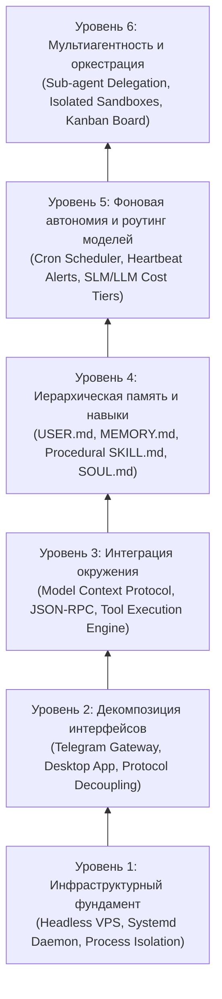
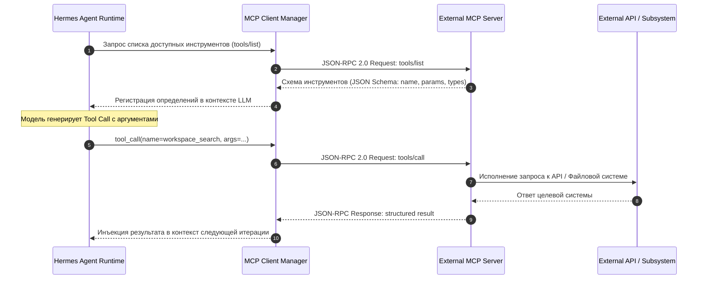
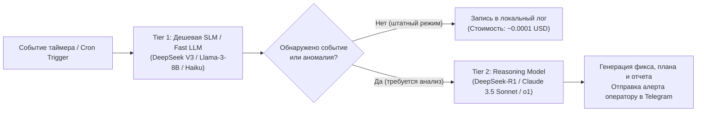
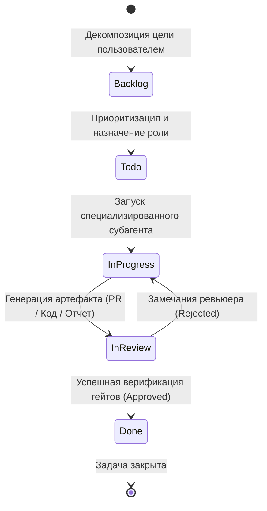

+++
title = "Архитектура автономного AI-агента: 6 уровней от 24/7 демона и шлюзов до MCP, иерархической памяти и Kanban-оркестрации"
date = 2026-10-27
description = "Инженерный разбор 6 уровней зрелости агентных рантаймов на примере Hermes Agent от Nous Research: архитектура фонового headless-демона, шлюзы Telegram/Desktop, интеграция инструментов через MCP, трехуровневая модель памяти и навыков, математика планирования cron и мультиагентная Kanban-оркестрация."
[taxonomies]
tags = ["ai-agents", "architecture", "devops", "software-engineering", "mcp"]
[extra]
toc = true
mermaid = true
+++

Интерактивные интерфейсы языковых моделей (браузерные веб-чаты, REPL в терминале) функционируют в синхронной модели запрос-ответ (In-the-loop): вычислительный процесс привязан к клиентской сессии. При потере сетевого соединения, закрытии окна терминала или сбое локального устройства исполнение инструкций прерывается, а контекстное состояние сбрасывается. Построение автономных систем требует отделения процесса принятия решений от клиентского интерфейса и развертывания **агентного рантайма как постоянного фонового сервиса операционной системы**.

В такой архитектуре рантайм функционирует непрерывно, самостоятельно обрабатывает внешние события по расписанию или через вебхуки, исполняет операции в локальной песочнице и координирует распределенные подзадачи.

Инженерный разбор открытой платформы **Hermes Agent** (Nous Research) позволяет формализовать шестиуровневую модель архитектурной зрелости агентных рантаймов: от изоляции системного процесса до мультиагентной оркестрации через визуальный интерфейс Kanban.

> **Первоисточники и материалы анализа:**
> * **Видеоматериал:** [The Ultimate Beginner’s Guide to Hermes Agent](https://youtu.be/XNcKUSL1CTE) (канал Metics Media, автор Matt).
> * **Официальная спецификация:** [Hermes Agent Documentation](https://hermes-agent.nousresearch.com/docs) (Nous Research).
> * **Концептуальная база:** Model Context Protocol (Anthropic/Open-Source MCP Specification), POSIX Process Supervision, Persistent Markdown-based State Layers.

---

## 6 уровней архитектурной зрелости агентного рантайма

Архитектура надежного автономного агента декомпозируется на шесть изолированных уровней абстракции:



Каждый уровень решает изолированную задачу управления ресурсами, состоянием или протоколами взаимодействия.

---

## Уровень 1: Инфраструктурный фундамент и headless-демон

Базовым требованием автономности является исполнение рантайма на независимом сервере (VPS) под управлением супервизора процессов ОС.

### Спецификация системного сервиса (systemd)

Для обеспечения непрерывности выполнения агент регистрируется как юнит `systemd` с жесткими квотами ресурсов (`cgroups v2`):

```ini
[Unit]
Description=Hermes Agent Headless Runtime Daemon
After=network-online.target
Wants=network-online.target

[Service]
Type=simple
User=hermes
Group=hermes
WorkingDirectory=/home/hermes
Environment="HOME=/home/hermes"
Environment="PYTHONUNBUFFERED=1"
ExecStart=/home/hermes/.local/bin/hermes daemon --config /home/hermes/.hermes/config.yaml
Restart=always
RestartSec=5s

# Ресурсная изоляция ядра Linux (cgroups v2)
MemoryMax=8G
MemoryHigh=7G
CPUQuota=200%
TasksMax=1024

# Ограничения безопасности файловой системы
ProtectSystem=full
ProtectHome=read-only
ReadWritePaths=/home/hermes/.hermes /home/hermes/workspace /tmp
NoNewPrivileges=true

[Install]
WantedBy=multi-user.target
```

### Отказоустойчивость и контрольные точки

1. **Супервизия жизненного цикла:** При возникновении аппаратных перезагрузок или падении процесса из-за Out-Of-Memory супервизор автоматически перезапускает демон (`Restart=always`) с задержкой 5 секунд.
2. **Транзакционные контрольные точки:** Состояние диалогов, очереди вызовов и метаданные задач фиксируются в локальной реляционной базе SQLite (`state.db`) в режиме WAL (Write-Ahead Logging), исключая повреждение данных при внезапном сбросе питания.
3. **Изоляция сессионных директорий:** Все операции изменения кода выполняются в выделенной рабочей директории (`~/workspace/`), изолированной от системных каталогов хоста.

---

## Уровень 2: Отделение рантайма от интерфейсов взаимодействия

В агентном рантайме пользовательские клиенты являются точками отправки событий (Event Sources), а не владельцами вычислительного процесса.

| Шлюз управления | Сетевой транспорт | Профиль сценариев использования |
| :--- | :--- | :--- |
| **Telegram Bot Gateway** | HTTPS Long-Polling / Webhook | Мобильное управление, аудиокоманды, push-нотификации и интерактивный контур подтверждения (HITL) |
| **Hermes Desktop App** | WebSocket / Local IPC / gRPC | Десктопная среда разработки, синхронизация файлов, просмотр диффов кода, инспекция логов |
| **Web Dashboard** | REST API + Server-Sent Events | Панель администрирования, аудит токенов, управление профилями моделей Nous Portal |

### Обработка асинхронных входящих событий через Telegram

Шлюз Telegram решает задачу круглосуточного асинхронного канала связи. Архитектура обработки сообщения:

1. **Прием пакета:** Шлюз получает обновление Telegram Bot API через HTTPS.
2. **Аудио-транскрибация:** При наличии голосовой заметки бинарный аудиопоток передается в оптимизированный инференс-модуль (Whisper), возвращающий нормализованный текст.
3. **Асинхронная постановка в очередь:** Команда помещается в системную очередь задач демона. Пользователю возвращается подтверждение приема (`msg_id`), предотвращая разрыв соединения по таймауту.
4. **Доставка результата:** По завершении вычислений результат (текстовый отчет, скомпилированный артефакт или лог) отправляется ответным сообщением с корректным MIME-типом.

---

## Уровень 3: Интеграция окружения через Model Context Protocol

Для взаимодействия с внешними подсистемами рантайм использует протокол **Model Context Protocol (MCP)**. MCP стандартизирует обмен данными между LLM и инструментами через JSON-RPC 2.0.



### Спецификация JSON-RPC 2.0 вызова инструмента

Пример полезной нагрузки между клиентом MCP и сервером инструментов:

```json
{
  "jsonrpc": "2.0",
  "id": "req-10492",
  "method": "tools/call",
  "params": {
    "name": "sqlite_query",
    "arguments": {
      "db_path": "/home/hermes/data/metrics.db",
      "query": "SELECT timestamp, cpu_load, mem_used FROM host_metrics ORDER BY timestamp DESC LIMIT 10;"
    }
  }
}
```

Преимущества протокольной изоляции:
* **Валидация типов данных:** Параметры проверяются на соответствие JSON Schema до исполнения на хосте.
* **Изоляция сбоев процесса:** Серверы инструментов функционируют как дочерние процессы по `stdio` или внешние сервисы по HTTP/SSE. Аварийный останов сервера не дестабилизирует супервизор агента.
* **Переносимость инструментария:** Любой сервис, реализующий спецификацию MCP, подключается конфигурационным блоком без правок кода рантайма.

---

## Уровень 4: Иерархическая память, процедурные навыки и поведенческая калибровка

Для устранения проблемы потери контекста между независимыми задачами состояние агента распределяется по четырем специализированным декларативным слоям.

```text
┌────────────────────────────────────────────────────────┐
│                   SOUL.md                              │
│       Поведенческие директивы, стиль, правила отказа   │
└───────────────────────────┬────────────────────────────┘
                            │
┌───────────────────────────▼────────────────────────────┐
│                   USER.md                              │
│       Профиль пользователя: аппаратный стек, лимиты    │
└───────────────────────────┬────────────────────────────┘
                            │
┌───────────────────────────▼────────────────────────────┐
│                  MEMORY.md                             │
│       Эпизодическая память: прецеденты, аудит ошибок   │
└───────────────────────────┬────────────────────────────┘
                            │
┌───────────────────────────▼────────────────────────────┐
│            ~/.hermes/skills/*.md                       │
│    Процедурные навыки: детерминированные алгоритмы     │
└────────────────────────────────────────────────────────┘
```

### Математическая модель контекстного бюджета

Контекстное окно языковой модели строго ограничено размером $C\_{\text{total}}$. Доступный объем памяти для генерации новых шагов рассуждения $C\_{\text{avail}}$ рассчитывается по балансовому уравнению:

$$C\_{\text{avail}} = C\_{\text{total}} - \left( C\_{\text{sys}} + C\_{\text{soul}} + C\_{\text{user}} + C\_{\text{tools}} + C\_{\text{mem}} + C\_{\text{hist}} + C\_{\text{out}} \right)$$

где:
* $C\_{\text{sys}}$ — фиксированный системный промпт рантайма;
* $C\_{\text{soul}}$ и $C\_{\text{user}}$ — постоянные профили ролевых директив и пользовательских ограничений;
* $C\_{\text{tools}}$ — токены схем зарегистрированных инструментов MCP;
* $C\_{\text{mem}}$ — фрагменты долговременной памяти, извлеченные семантическим поиском;
* $C\_{\text{hist}}$ — линейная история сообщений текущей задачи;
* $C\_{\text{out}}$ — гарантированный резерв генерации ответа модели.

При приближении размера истории $C\_{\text{hist}}$ к пороговому значению ($C\_{\text{hist}} \ge 0.7 \cdot C\_{\text{total}}$) активируется процедура контекстного уплотнения (Context Compaction): выводы выполненных системных утилит заменяются структурированными фактами, записываемыми в `MEMORY.md`, а сырой вывод очищается из буфера внимания.

### Процедурные навыки: архитектура SKILL.md

Повторяющиеся сложные алгоритмические процедуры упаковываются в формат навыков (Skills). Спецификация хранится в каталоге `~/.hermes/skills/<name>/SKILL.md`:

```markdown
---
name: zola-blog-deployment
description: Use when building and deploying blog updates to GitHub Pages via Zola.
---

# Zola Deployment Pipeline

1. Build static output: `cd ~/blog && zola build`
2. Verify exit status: must be 0 with 0 orphan pages.
3. Commit modified posts: `git add content/ && git commit -m "feat: new post"`
4. Push to remote: `git push origin main`
5. Watch CI workflow: `gh run watch $(gh run list --limit 1 --json databaseId -q '.[0].databaseId')`
```

Благодаря явному предикату в `description` тело навыка не загружается в контекст по умолчанию, сохраняя токены для полезной нагрузки.

---

## Уровень 5: Фоновая автономия и оптимизация стоимости инференса

Автономность требует от агента инициативы: регулярного исполнения контрольных процедур без прямого промпта оператора.

### Планировщик фоновых задач (Cron Engine)

Рантайм содержит внутренний планировщик периодических задач (Cron Scheduler). Каждая задача описывается тремя атрибутами:
1. **Расписание:** стандартное POSIX-выражение (например, `*/30 * * * *`).
2. **Исполняемая цель:** декларативная системная инструкция.
3. **Политика оповещения:** отправка сообщения оператору только при фиксации дельты состояния (`notify_on_change=true`).

### Двухуровневый роутинг моделей по стоимости (SLM vs Reasoning LLM)

Круглосуточный опрос инфраструктуры с использованием крупных reasoning-моделей экономически нецелесообразен. Hermes применяет разделение на два вычислительных контура:



Формула суммарных суточных эксплуатационных затрат $\text{Cost}\_{\text{daily}}$ при двухуровневом роутинге:

$$\text{Cost}\_{\text{daily}} = \sum\_{j \in \mathcal{T}\_{\text{poll}}} \left( T\_{\text{in}}^{(j)} P\_{\text{in}}^{\text{SLM}} + T\_{\text{out}}^{(j)} P\_{\text{out}}^{\text{SLM}} \right) + \sum\_{k \in \mathcal{T}\_{\text{synth}}} \left( T\_{\text{in}}^{(k)} P\_{\text{in}}^{\text{LLM}} + T\_{\text{out}}^{(k)} P\_{\text{out}}^{\text{LLM}} \right)$$

где:
* $\mathcal{T}\_{\text{poll}}$ — множество рутинных проверок состояния;
* $\mathcal{T}\_{\text{synth}}}$ — множество инцидентов, потребовавших глубокого анализа;
* $P^{\text{SLM}} \ll P^{\text{LLM}}$ — тарифная ставка за 1000 токенов соответствующего класса моделей.

Применение легковесных моделей первого эшелона снижает суммарные затраты на фоновый мониторинг на 85–92% по сравнению с монолитной архитектурой.

---

## Уровень 6: Мультиагентность и Kanban-оркестрация

При выполнении комплексных инженерных проектов (миграция кодовой базы, аудит безопасности) контекст одиночного агента быстро переполняется противоречивыми подзадачами. Архитектура решает это разделением труда между специализированными субагентами.

### Изолированное исполнение субагентов (delegate\_task)

Родительский агент декомпозирует целевую директиву на граф задач и порождает дочерние процессы через интерфейс `delegate_task`:
* **Песочница окружения:** Каждый субагент инициализируется в отдельном подкаталоге с независимой сессией терминала.
* **Изоляция контекста:** Промежуточные логи сборки и тестовые итерации не транслируются в контекст родителя.
* **Верифицируемый контракт возврата:** Субагент возвращает строго типизированный отчет с проверяемыми идентификаторами (хэш git-коммита, путь к скомпилированному артефакту, код возврата линтера).

### Машина состояний Kanban-оркестрации

Координация потока задач моделируется конечным автоматом (FSM), синхронизированным с доской Kanban:

$$\mathcal{S} = \{ \text{Backlog}, \text{Todo}, \text{InProgress}, \text{InReview}, \text{Done} \}$$



Субагенты принимают на себя специализированные роли (Architect, Developer, Reviewer, Tester) и перемещают карточки задач по колонкам доски только при успешном прохождении программных гейтов верификации.

---

## Сравнительный анализ архитектурных парадигм

| Параметр сравнения | Web-чатбот (ChatGPT/Claude) | Монолитный CLI (Claude Code/Aider) | Автономный рантайм (Hermes Agent) |
| :--- | :--- | :--- | :--- |
| **Среда исполнения** | Облачный stateless-контейнер | Локальный процесс в активном терминале | Headless-демон на VPS (24/7) под управлением systemd |
| **Жизненный цикл сессии** | Завершается при закрытии страницы | Завершается при прерывании терминала | Устойчив к сбоям сети, непрерывная супервизия |
| **Каналы управления** | Веб-интерфейс | Stdin/stdout терминала | Мультиканальные шлюзы: Telegram, Desktop App, REST |
| **Модель памяти** | Изолированный чат / плоская память | Локальный git-репозиторий | Иерархическая: `USER.md`, `MEMORY.md`, `SKILL.md` |
| **Фоновое исполнение** | Отсутствует | Отсутствует | Нативный Cron Scheduler, Push-on-Delta |
| **Оркестрация задач** | Одиночная модель в одном окне | Одиночная модель с вызовом подфункций | Иерархические субагенты с Kanban-синхронизацией |
| **Протокол расширения** | Проприетарные плагины | Локальные bash-команды | Открытый стандарт Model Context Protocol (MCP) |

---

## Инженерные выводы и правила развертывания

1. **Разделение рантайма и интерфейса:** Вычислительный процесс агента должен исполняться как независимый системный сервис операционной системы, защищенный от сбоев клиентских устройств.
2. **Динамическая загрузка навыков:** Процедурные знания должны быть оформлены в виде отдельных файлов `SKILL.md` и загружаться в оперативный контекст исключительно по релевантному триггеру.
3. **Двухуровневая модель расходов:** Фоновый мониторинг инфраструктуры должен быть поручен компактным моделям (SLM), сохраняя дорогостоящие reasoning-модели для этапа разрешения верифицированных аномалий.
4. **Верифицируемые артефакты вместо заверений:** Результатом работы любого субагента должен являться детерминированный системный артефакт (хэш коммита, путь к файлу, успешный вывод тестов), исключающий галлюцинации завершенности.
5. **Управление контекстным бюджетом:** Предотвращение деградации логики требует периодического уплотнения оперативной истории диалога и выгрузки фактов в долговременную память.
