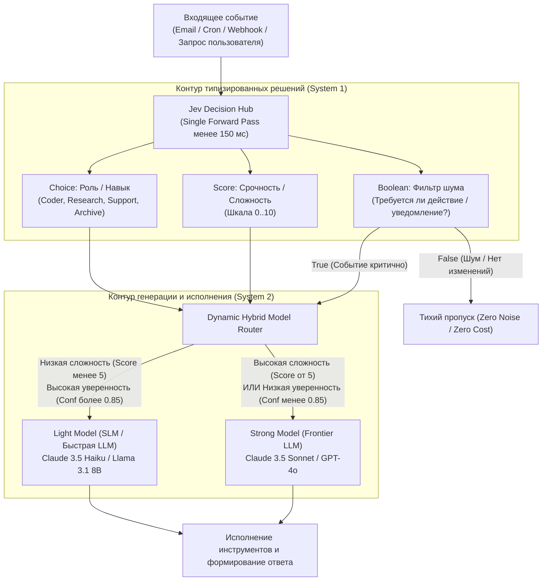

+++
title = "Оптимизация расходов и задержки в Hermes Agent: архитектура неавторегрессионных моделей решений Jev для гибридного роутинга и фильтрации задач"
date = 2026-11-04
description = "Инженерный разбор оптимизации стоимости и латентности автономного рантайма Hermes Agent: замена тяжелых LLM на неавторегрессионные классификаторы Jev (TypeSafe) с прямым проходом за 30–150 мс, гибридный роутер моделей Light/Strong, фильтрация cron-задач и пайплайны диспетчеризации субагентов."
[taxonomies]
tags = ["ai-agents", "architecture", "performance", "software-engineering"]
[extra]
toc = true
mermaid = true
katex = true
+++

В проектировании автономных агентных систем существует скрытый архитектурный парадокс: от 70% до 85% вычислительных шагов агента расходуются не на генерацию связного текста, синтез кода или глубокие рассуждения, а на **дискретные микро-решения**. Оркестратор непрерывно проверяет условия: *«К какой категории отнести входящее событие?»*, *«Требуется ли отправлять уведомление пользователю?»*, *«Какой специализированный инструмент вызвать?»*, *«Какую языковую модель подключить для решения текущего шага?»*.

Использование флагманских авторегрессионных языковых моделей (Frontier LLMs — Claude 3.5 Sonnet, GPT-4o, Gemini 1.5 Pro) для выполнения таких дискретных проверок создает колоссальный инфраструктурный и финансовый оверхед. Каждый вызов тяжелой модели требует прогона многотысячного контекста через десятки миллиардов параметров, последовательного авторегрессионного декодинга токенов с обращением к памяти HBM и ожидания ответа от 1.5 до 5 секунд. При круглосуточной работе автономного демона расходы на подобные микро-проверки с легкостью достигают сотен долларов в месяц при критически высокой задержке на каждом шаге цикла управления (control loop).

Инженерный подход к решению этой проблемы заключается в разделении контуров принятия решений: замене тяжелых генеративных моделей на **неавторегрессионные вероятностные модели решений (Non-Autoregressive Decision Models)** прямого прохода. 

В этом материале мы разберем практическую реализацию такого контура в открытом рантайме **Hermes Agent** на базе специализированной модели решений **TypeSafe Jev**, представленной в инженерном исследовании канала *Komputer Mechanic*.

> **Первоисточники и архитектурная документация:**
> * **Видеоразбор и демонстрация:** [Jev Cut My Hermes Agent Costs. Here’s How I Use It](https://www.youtube.com/watch?v=uI-8VnV8NL8) (канал *Komputer Mechanic*).
> * **Официальная спецификация рантайма:** [Hermes Agent Documentation](https://hermes-agent.nousresearch.com/docs) (Nous Research).
> * **Модель решений:** Документация TypeSafe Jev Decision Engine & Non-Autoregressive Classification Heads (`console.typesafe.ai`).

---

## 1. Физика авторегрессионного оверхеда против Single Forward Pass

Чтобы понять источник 90% экономии бюджета и сокращения задержки в 20 раз, необходимо сопоставить механику вычислений генеративной языковой модели и специализированного классификатора решений.

### Узкое место авторегрессионного декодинга

В стандартном агентном контуре для ответа на вопрос «Является ли задача сложной?» контекст задачи упаковывается в промпт с системной инструкцией и схемой JSON. Генерация ответа `{"complex": true}` подчиняется авторегрессионному принципу:

$$P(w_1, w_2, \dots, w_N \mid X) = \prod_{i=1}^{N} P(w_i \mid w_{<i}, X)$$

Для каждого сгенерированного токена $w_i$ ускоритель (GPU/TPU) вынужден считывать полную матрицу весов модели из высокоскоростной памяти (HBM) в регистры вычислительных ядер (Arithmetic Logic Units). Это явление известно как **Memory Wall** (ограничение пропускной способности памяти): при декодинге одного токена вычисления ограничены скоростью передачи данных (Memory-bound), а не пиковым TFLOPS процессора. 

В результате тривиальный ответ на 5 токенов требует сотен миллисекунд чистого времени ожидания шины памяти, генерации синтаксического сахара JSON и последующего хрупкого парсинга в коде рантайма с риском галлюцинаций или синтаксических сбоев.

### Архитектура неавторегрессионного прямого прохода (Jev)

Модель решений **TypeSafe Jev** кардинально меняет вычислительный граф. Будучи построенной на базе глубокого энкодера без авторегрессионного цикла декодирования, она обрабатывает входное состояние $X$ за **один прямой проход (Single Forward Pass)**:

$$H = \text{Encoder}(X), \quad H \in \mathbb{R}^{L \times d}$$

Пулированное представление контекста $h_{\text{pool}} = \text{Pool}(H)$ передается в изолированные линейные проекционные головы, специфичные для типа вопроса:

1. **Choice Head (дискретный выбор из $K$ альтернатив):**
   $$z\_{\text{choice}} = W_c \cdot h\_{\text{pool}} + b_c, \quad P(y = k \mid X) = \frac{\exp(z_k / T)}{\sum\_{j=1}^K \exp(z_j / T)}$$

2. **Score Head (скалярная оценка интенсивности или приоритета):**
   $$s = \sigma(W_s \cdot h\_{\text{pool}} + b_s) \times S\_{\max}$$

3. **Boolean / Noul Head (бинарная калиброванная вероятность истинности):**
   $$P(\text{True} \mid X) = \frac{1}{1 + \exp(-(W_b \cdot h\_{\text{pool}} + b_b) / T)}$$

Где $T$ — температура калибровки вероятностей, оптимизированная на валидационном корпусе для минимизации калибровочной ошибки (Expected Calibration Error, ECE).

```mermaid
flowchart TD
    subgraph HeavyLLM ["Традиционный подход: Генеративная LLM"]
        A1["Промпт + История контекста (4k-32k токенов)"] --> B1["Prefill фаза (Matrix Multiplication)"]
        B1 --> C1["Авторегрессионный цикл декодинга (KV-Cache, Memory-bound)"]
        C1 --> D1["Генерация JSON токенов решения"]
        D1 --> E1["Парсинг JSON в Python рантайме (риск ошибки схемы)"]
        E1 --> F1["Задержка: 1500–4500 мс | Стоимость: $0.005–$0.03 на вызов"]
    end

    subgraph JevEngine ["Оптимизированный подход: TypeSafe Jev"]
        A2["Входное состояние / Аргументы события"] --> B2["Энкодер контекста (Single Forward Pass)"]
        B2 --> C2["Многозадачные типизированные головы: Choice / Score / Bool"]
        C2 --> D2["Детерминированный типизированный вектор + Уверенность (Confidence)"]
        D2 --> E2["Мгновенная маршрутизация в коде рантайма"]
        E2 --> F2["Задержка: 30–180 мс | Стоимость: менее $0.00005 на вызов"]
    end
```



Выходные токены в Jev отсутствуют физически: модель возвращает строго типизированный ответ и скаляр уверенности $\text{Confidence} \in [0, 1]$. Благодаря этому затраты на тарификацию выходных токенов равны нулю, а время инференса снижается с 2–5 секунд до 30–180 мс.

---

## 2. Архитектурная топология: Jev Decision Hub в рантайме Hermes

Интеграция Jev в архитектуру Hermes Agent превращает рантайм в двухуровневую адаптивную систему: быстрый рефлекторный контур микро-решений (System 1) и глубокий генеративный контур рассуждений (System 2).



### Сравнительный анализ характеристик

| Архитектурный параметр | Классический агент (Pure Frontier LLM) | Гибридный рантайм (Hermes + Jev Hub) |
|---|---|---|\
| **Критический путь решения** | Авторегрессионный декодинг токенов | Параллельный тензорный прямой проход |\
| **Задержка шага принятия решения** | 1,800 – 4,500 мс | 35 – 180 мс (ускорение до 25x) |\
| **Стоимость 1M входных токенов** | $3.00 – $15.00+ | $0.03 – $0.05 (в 100–300x дешевле) |\
| **Стоимость выходных токенов** | $15.00 – $75.00 за 1M | $0.00 (выходные токены отсутствуют) |\
| **Детерминированность схемы** | Вероятностная (риск битого JSON ~1–3%) | 100% строгая типизация (native int/float/enum) |\
| **Фоновые ложные срабатывания (Cron)** | 24 пустых уведомления в сутки («Все тихо») | 0 паразитных сообщений (полная тишина при `False`) |\
| **Емкость гранта $5** | ~350 – 1,200 операций роутинга | > 100,000,000 токенов (> 120,000 решений) |

---

## 3. Разбор 5 производственных сценариев в Hermes Agent

Практика эксплуатации фонового агента выявляет пять ключевых точек отказа и утечки бюджета, которые полностью купируются внедрением модели решений.

### Сценарий 1: Интеллектуальный триаж входящего потока (Email / Webhook)

При подключении агента к почтовому ящику или системе тикетов (например, интеграция с IMAP или Zendesk) традиционный агент вызывает LLM на каждое входящее письмо. 100 писем в день генерируют непрерывные расходы на контекст заголовков и цитат.

В оптимизированном пайплайне рантайм формирует к Jev единый пакет из трех типизированных вопросов:
1. `category` (Choice): `['support', 'billing', 'partnership', 'newsletter', 'spam']`
2. `urgency` (Score): от 0 до 10.
3. `requires_response` (Boolean): нужно ли генерировать ответное сообщение.

**Результат:** Маркетинговые рассылки и спам получают категорию `newsletter`/`spam` и `requires_response = False`. Они архивируются детерминированным Python-скриптом без привлечения тяжелой LLM. Письма от клиентов с `urgency >= 8` немедленно эскалируются с генерацией черновика ответа через Strong Model.

### Сценарий 2: Фильтр тишины для периодических фоновых задач (Cron Gate)

Периодические cron-задачи (проверка состояния серверов, мониторинг арбитражных спредов, контроль бэкапов) при использовании LLM страдают синдромом избыточной коммуникации:
> *«Я проверил системные метрики: загрузка CPU 12%, диск 45%, ошибок нет. Хорошего дня!»*

Такие сообщения загромождают Telegram-канал или чат оператора, притупляя внимание к реальным инцидентам.

С моделью Jev после сбора сырых системных метрик агент задает бинарный вопрос:
*«Содержит ли отчет аномалии, деградацию сервисов или исчерпание лимитов, требующие вмешательства человека?»*

Если `requires_alert = False`, рантайм завершает выполнение с управляющим флагом `[SILENT]`. В чат не отправляется ни единого байта. Но если сервис падает или свободное место падает ниже порогового, Jev возвращает `True` с вероятностью 0.99, и агент инициирует аварийный отчет.

### Сценарий 3: Векторизованный пакетный скоринг (Batch Lead Scoring)

Когда агент выполняет исследовательскую задачу (анализ 100 репозиториев GitHub, ранжирование 50 кандидатов на вакансию или оценка 200 торговых инструментов), последовательный вызов LLM занимает 10–15 минут.

Через интерфейс `predict_batch` массив из 100 объектов передается на сервер инференса в одном HTTP-запросе. Сервер группирует тензоры в один батч на GPU:
```text
Batch Size = 100 | GPU Forward Pass Latency = 420 ms | Cost = $0.008
```
Рантайм получает отсортированный массив с оценками готовности к лиду или качеству кода за пару секунд, отсекая 90% нерелевантных кандидатов до того, как тяжелая LLM начнет углубленный анализ.

### Сценарий 4: Мгновенная диспетчеризация субагентов

При многоагентной архитектуре оркестратор тратит драгоценные секунды и токены на рассуждения вида:
> *«Пользователь попросил проанализировать смарт-контракт. Для этого мне нужен аудит безопасности. Я вызову субагента SecurityAuditor...»*

Jev выполняет классификацию роли (`subagent_dispatch`) за 40 мс:
$$\text{Role} = \arg\max_{r \in \mathcal{R}} P(r \mid \text{TaskDescription})$$

Если максимальная вероятность $P(\text{Role}) \ge 0.80$, задача мгновенно делегируется целевому субагенту в изолированном контексте. При неопределенности ($P < 0.80$) управление возвращается оркестратору для уточнения требований.

### Сценарий 5: Динамический роутер моделей (Light vs Strong)

Ключевой фактор совокупной экономии. Рантайм настраивается на работу с пулом моделей:
* **Light Tier (быстрый и дешевый):** Llama 3.1 8B, Claude 3.5 Haiku, DeepSeek V3 Lite ($0.20–$0.80 за 1M токенов).
* **Strong Tier (высокая мощность рассуждений):** Claude 3.5 Sonnet, GPT-4o, OpenAI o1 ($3.00–$15.00+ за 1M токенов).

Математическое правило маршрутизации формулируется через порог доверия $\tau$ и оценку сложности $S$:

$$\text{SelectedTier} = \begin{cases} \text{LightTier}, & \text{if } S(\text{Task}) < 5.0 \land \text{Confidence} \ge 0.85 \\ \text{StrongTier}, & \text{otherwise} \end{cases}$$

**Принцип консервативной безопасности (Fail-Safe):** при любых сомнениях модели решений, неоднозначности инструкций или низком значении калиброванной уверенности система автоматически перенаправляет запрос на Strong Tier. Это гарантирует, что оптимизация расходов не приводит к деградации качества в сложных инженерных и финансовых задачах.

---

## 4. Программная реализация: Jev Hub и Hybrid Model Router на Python

Ниже представлена готовая модульная реализация диспетчера решений и роутера моделей для рантайма Hermes Agent.

```python
"""
Hermes Agent: Jev Decision Hub & Dynamic Model Router
Модуль интеграции неавторегрессионного инференса TypeSafe Jev.
"""

from __future__ import annotations
import json
import logging
import time
from dataclasses import dataclass
from typing import Any, Dict, List, Optional
import urllib.request
import urllib.error

logger = logging.getLogger("hermes.jev_hub")


@dataclass(frozen=True)
class DecisionResult:
    value: Any
    confidence: float
    latency_ms: float
    raw_probabilities: Dict[str, float]


class JevClient:
    """Клиент взаимодействия с сервисом TypeSafe Jev / Laya."""

    def __init__(self, api_url: str = "http://127.0.0.1:8000", api_key: Optional[str] = None):
        self.api_url = api_url.rstrip("/")
        self.api_key = api_key

    def predict(self, state: Dict[str, Any], questions: Dict[str, Any]) -> Dict[str, DecisionResult]:
        payload = json.dumps({"state": state, "questions": questions}).encode("utf-8")
        req = urllib.request.Request(
            f"{self.api_url}/predict",
            data=payload,
            headers={
                "Content-Type": "application/json",
                **({"Authorization": f"Bearer {self.api_key}"} if self.api_key else {})
            }
        )

        t0 = time.perf_counter()
        try:
            with urllib.request.urlopen(req, timeout=5.0) as resp:
                data = json.loads(resp.read().decode("utf-8"))
        except urllib.error.URLError as e:
            logger.error("Jev service request failed: %s", e)
            raise RuntimeError(f"Jev inference unavailable: {e}") from e

        total_latency = (time.perf_counter() - t0) * 1000.0
        results: Dict[str, DecisionResult] = {}

        for q_name, q_data in data.get("answers", {}).items():
            q_type = q_data.get("type")
            if q_type == "choice":
                val = q_data.get("choice")
            elif q_type == "score":
                val = q_data.get("score")
            elif q_type == "noul" or q_type == "bool":
                val = q_data.get("value", q_data.get("choice") == "true")
            else:
                val = q_data.get("value")

            results[q_name] = DecisionResult(
                value=val,
                confidence=float(q_data.get("confidence", 1.0)),
                latency_ms=total_latency,
                raw_probabilities=q_data.get("probabilities", {})
            )
        return results


class HermesHybridRouter:
    """
    Гибридный роутер задач Hermes Agent:
    Маршрутизирует вызовы между Light и Strong моделями на основе Jev.
    """

    def __init__(self, jev_client: JevClient, confidence_threshold: float = 0.85):
        self.jev = jev_client
        self.conf_threshold = confidence_threshold

    def route_task(self, task_description: str, context_metadata: Dict[str, Any]) -> str:
        """
        Определяет исполнительную модель: 'light' или 'strong'.
        """
        questions = {
            "task_complexity": {
                "type": "score",
                "instructions": "Оцените архитектурную и логическую сложность задачи от 0 (простая) до 10 (высокая)",
                "criteria": {
                    "0": "Простой поиск, выжимка текста, форматирование",
                    "5": "Базовый скрипт, типовой парсинг, шаблонный код",
                    "10": "Сложная архитектура, математические доказательства, аудит безопасности"
                }
            },
            "requires_strong_reasoning": {
                "type": "choice",
                "instructions": "Требуется ли использование тяжелой модели рассуждений (Frontier LLM)?",
                "criteria": {
                    "light": "Достаточно легковесной быстрой модели (SLM / Haiku)",
                    "strong": "Необходима максимальная глубина рассуждений (Sonnet / GPT-4o / o1)"
                }
            }
        }

        state = {
            "task": task_description,
            "metadata": context_metadata
        }

        try:
            decisions = self.jev.predict(state, questions)
            complexity = float(decisions["task_complexity"].value)
            recommendation = decisions["requires_strong_reasoning"].value
            confidence = decisions["requires_strong_reasoning"].confidence

            logger.info(
                "Router decision: complexity=%.2f, recommendation=%s, confidence=%.3f (latency=%.1fms)",
                complexity, recommendation, confidence, decisions["task_complexity"].latency_ms
            )

            # Консервативный порог: при сомнениях всегда выбираем strong
            if confidence < self.conf_threshold:
                logger.info("Confidence %.3f < %.3f -> fallback to STRONG", confidence, self.conf_threshold)
                return "strong"

            if complexity < 4.5 and recommendation == "light":
                return "light"

            return "strong"

        except Exception as err:
            logger.warning("Jev router failed (%s). Fail-safe activating STRONG model.", err)
            return "strong"
```

---

## 5. Экономическая модель и расчет окупаемости

Рассчитаем экономический эффект перехода на гибридный рантайм для активного автономного агента, работающего в режиме 24/7.

### Исходные параметры нагрузки:
* **Фоновые проверки (Cron):** 24 проверки в сутки (раз в час).
* **Входящие события (Email/Webhooks/Messages):** 150 событий в сутки.
* **Интерактивные запросы пользователя:** 30 комплексных задач в сутки.
* **Внутренние микро-решения агента:** в среднем 4 решения на задачу = 120 решений.
* **Итого микро-решений в месяц:** $(24 + 150 + 120) \times 30 = 8,820$ дискретных проверок.

### Калькуляция затрат:

$$C\_{\text{month}} = N\_{\text{decisions}} \times \left( \bar{L}\_{\text{in}} \times P\_{\text{in}} + \bar{L}\_{\text{out}} \times P\_{\text{out}} \right)$$

1. **Традиционный подход (Pure Claude 3.5 Sonnet / GPT-4o):**
   * Средний контекст промпта с историей: 6,000 входных токенов (при тарифе $P\_{\text{in}} = 3.00\text{ USD}$ за 1M токенов).
   * Средний ответ JSON: 80 выходных токенов (при тарифе $P\_{\text{out}} = 15.00\text{ USD}$ за 1M токенов).
   * Стоимость одного решения: $$(6000 \times 3 \cdot 10^{-6}) + (80 \times 15 \cdot 10^{-6}) = 0.018 + 0.0012 = 0.0192\text{ USD}$$
   * **Ежемесячный расход на микро-решения:** $$8820 \times 0.0192 = 169.34\text{ USD в месяц}$$
   * **Совокупное время ожидания (Latency):** $$8820 \times 2.2\,\text{сек} \approx 19404\,\text{сек} \approx 5.4\,\text{часа}$$ простоя CPU в ожидании ответа API.

2. **Оптимизированный гибридный контур (Hermes + Jev):**
   * Стоимость инференса Jev: менее 0.04 USD за 1M входных токенов, выходные токены бесплатны.
   * Стоимость одного решения: $$1500 \times 0.04 \cdot 10^{-6} = 0.00006\text{ USD}$$
   * Стоимость 8,820 решений Jev: $$8820 \times 0.00006 = 0.53\text{ USD в месяц}$$
   * Маршрутизация 65% задач на легкую модель (Haiku / Llama 3.1) экономит дополнительно ~40% на основных рассуждениях.
   * **Совокупное время ожидания (Latency):** $$8820 \times 0.08\,\text{сек} \approx 705\,\text{сек} \approx 11.7\,\text{минут}$$.

Чистая экономия только на контуре принятия решений составляет **более 168 USD в месяц (снижение затрат на 99.6%)** при сокращении совокупного латентного простоя рантайма в **27 раз**.

---

## Резюме и выводы

1. **Декомпозиция ответственности:** Генеративные авторегрессионные языковые модели неэффективны для дискретных классификационных задач из-за физических ограничений пропускной способности памяти при посимвольном декодинге токенов (Memory Wall).
2. **Преимущество прямого прохода:** Неавторегрессионные модели решений (TypeSafe Jev) выполняют оценку за один прямой проход энкодера (30–150 мс), гарантируя строгую схему типов без риска галлюцинаций и нулевую стоимость выходных токенов.
3. **Фильтр тишины:** Внедрение булевых гейтов в периодические cron-задачи устраняет паразитные уведомления, переводя агента в режим нулевого шума при отсутствии критических инцидентов.
4. **Консервативная безопасность:** Гибридный роутер моделей Light/Strong с калиброванным порогом уверенности сохраняет бескомпромиссную надежность исполнения в критических задачах, снижая общую стоимость владения автономным AI-агентом на порядок.
