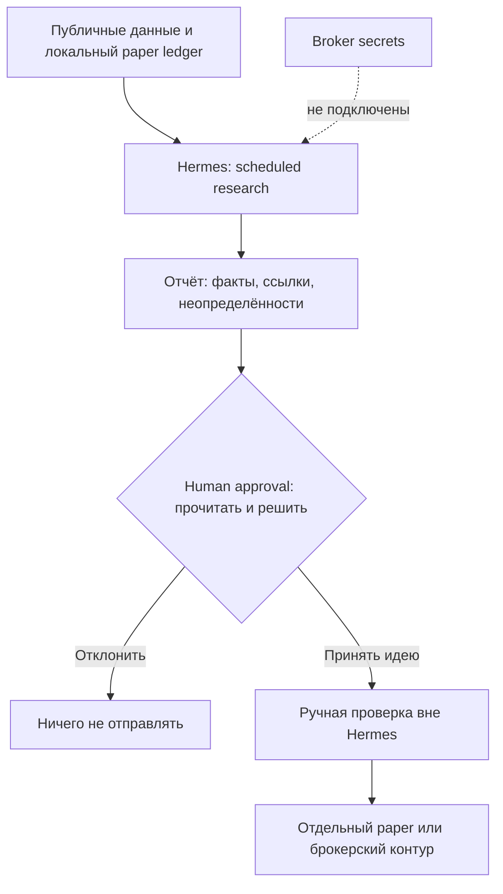

+++
title = "Hermes как торговый аналитик: расписание, память и human approval без доступа к деньгам"
date = 2026-10-15
description = "Безопасная архитектура Hermes для торговой аналитики: cron-расписание, bounded memory и ручное подтверждение, но без ключей брокера и автоторговли."
[taxonomies]
tags = ["ai-agents", "algo-trading", "architecture", "devops"]
[extra]
toc = true
mermaid = true
+++

LLM-агент может быть полезен трейдеру как исследовательский контур: по расписанию собрать наблюдения, напомнить о правилах, оформить список вопросов и дождаться решения человека. Это не то же самое, что «торговый сотрудник», которому выдали ключ брокера. В этой статье Hermes рассматривается только как аналитик и диспетчер отчётов: он не получает API-ключи биржи или брокера, не подписывает заявки и не отправляет ордера.

Видео AI Pathways показывает более широкий сценарий — Telegram, cron, память и торговые предложения. Его демонстрации и заявления о конкретной инфраструктуре остаются материалом видео, а не доказательством возможностей конкретной инсталляции. Ниже отделены проверяемые возможности Hermes от иллюстративной архитектуры.

## Что подтверждено документацией Hermes

Актуальная документация Hermes описывает встроенный cron: задания могут быть разовыми или повторяющимися, приостанавливаться, редактироваться и доставлять результат в исходный чат, файл или настроенную платформу. Задание запускается в отдельной сессии; планировщик разрешает явно закрепить модель или использовать настройки cron/основного агента. Для scheduled-run опасные команды по умолчанию блокируются настройкой `approvals.cron_mode: deny`.

Документация также описывает bounded persistent memory. Встроенные `MEMORY.md` и `USER.md` хранятся в Hermes home, имеют ограничения размера и загружаются как снимок в начале сессии. Запись памяти не означает, что текущая уже запущенная сессия немедленно получит новый снимок. Поэтому память — это компактный набор устойчивых правил, а не журнал котировок и не источник истины для позиции.

Отдельно Hermes хранит прошлые сессии, которые можно искать через session search. Это полезно для восстановления контекста исследования, но не превращает старый текст в подтверждённые рыночные данные. Цена, статус заявки, лимиты риска и баланс должны приходить из независимого источника, если они вообще нужны контуру.

Наконец, security-документация описывает human approval для опасных команд и режимы `smart`, `manual` и `off`; для cron отдельно предусмотрено поведение при срабатывании опасной команды. Это защита выполнения команд Hermes, а не универсальный брокерский risk engine. Наличие approval prompt само по себе не доказывает, что финансовая операция безопасна.

## Безопасная граница ответственности

Для аналитического режима достаточно дать агенту источники публичных данных, локальные обезличенные файлы и инструкции формата отчёта. Не давайте ему:

- API-ключи брокера, биржи, платёжной системы или кошелька;
- права на отправку, отмену или изменение ордеров;
- секреты с правом вывода денег;
- доступ к файлам, где такие секреты хранятся;
- возможность менять `approvals.cron_mode` или включать YOLO ради удобства.

Это не «настройка торгового робота», а намеренно неполный контур. Человек принимает решение вне Hermes, а исполнение — если оно вообще существует — выполняется отдельным, детерминированным и проверяемым процессом.



Пунктирная стрелка — отрицательное утверждение архитектуры, а не функция Hermes: отсутствие секретов и торгового инструмента должно проверяться на уровне окружения и прав ОС.

## Расписание: отчёт, а не автоторговля

Для регулярного обзора используйте проверенный пятичастный cron-выражение. Время интерпретируется часовым поясом планировщика/инсталляции; его нужно явно проверить перед применением:

```bash
hermes cron create "0 9 * * *" \
  "Собери исследовательский отчёт по разрешённым публичным источникам. Не отправляй ордера, не меняй файлы секретов и остановись при отсутствии источника." \
  --name "daily-research-canary" \
  --paused --paused-reason "Awaiting operator review"
```

Это намеренно paused-first пример: запись создаётся отключённой, затем оператор отдельно проверяет prompt, часовой пояс, delivery target, модель и разрешённые toolsets перед возобновлением. `0 9 * * *` проверено против установленного парсера Hermes; вариант `every 1d at 09:00` там завершается ошибкой. Команда только создаёт задание; она не подключает брокера и не гарантирует наличие источников данных.

Пауза — операторская предохранительная мера, а не замена изоляции. Нельзя утверждать, что такой отчёт будет прислан в Telegram, пока конкретная платформа, авторизация и delivery не проверены в этой инсталляции. Также не следует путать `cron` с системным crontab: документированный `hermes cron` управляет встроенным планировщиком, который работает через gateway.

Проверить существующие задания можно read-only командами:

```bash
hermes cron list
hermes cron status
```

В этой статье они приведены как проверяемый пример интерфейса; running Hermes и его расписания при подготовке статьи не изменялись.

## Память: правила и контекст, не котировки

Практичная запись памяти должна быть короткой и стабильной: например, «все идеи — только paper, в отчёте обязательны источник и время наблюдения, исполнение запрещено». Это лучше, чем складывать в `MEMORY.md` десятки строк рынка. По документации встроенные хранилища ограничены по символам, а снимок памяти фиксируется на старте сессии. Для новой записи в очередном scheduled-run нужна новая сессия или другой явно предусмотренный механизм загрузки.

Разделите данные по сроку жизни:

| Слой | Содержимое | Что проверяет человек |
|---|---|---|
| Память | устойчивые ограничения и стиль отчёта | не появились ли опасные правила |
| Skill | повторяемая процедура сбора и оформления | источники, границы, тестовый пример |
| Session search | прошлые обсуждения и решения | не выдан ли старый текст за свежий факт |
| Paper ledger | наблюдения с timestamp и ссылкой | полнота и неизменность записи |

Ни один слой не должен быть балансом счёта или журналом исполнения. Для числовых рядов нужен отдельный append-only файл или база с контролем схемы; LLM должен читать его, но не переписывать историю задним числом.

## Human approval как контракт

Approval должен проверять не «хорошо ли звучит идея», а минимальный контракт отчёта:

1. Каждый факт имеет источник, время публикации и статус свежести.
2. Отдельно перечислены наблюдения, допущения и выводы модели.
3. Есть условия, при которых идея недействительна.
4. Нет команды на отправку, отмену или изменение заявки.
5. Решение человека фиксируется вне памяти агента: `reject`, `paper-test` или `review-manually`.

Если в отчёте нет источника или он устарел, правильный результат — `BLOCKED`, а не догадка. Если prompt просит «исполнить, если пройдёт проверки», его нужно заменить на «сформировать чек-лист для ручной проверки». Такой prompt ограничивает намерение и формат ответа, но сам по себе не запрещает доступ к секретам, файлам, сети или финансовым API: эти границы требуют отдельных прав ОС, tool allowlist, credential isolation и egress-контролей.

## Что в видео нельзя переносить как гарантию

Видео демонстрирует рабочий сценарий автора, включая конкретные каналы связи, VPS, портфель, провайдеров и торговые предложения. Это не универсальные свойства Hermes и не обещание доходности. Стоимость, лимиты подписок, производительность, список подключённых источников и результативность стратегии зависят от окружения и должны проверяться отдельно. В этой статье намеренно нет рекомендаций конкретного провайдера и нет заявлений о прибыли.

Связка «память + cron + messaging» делает интерфейс удобнее, но не создаёт проверенную торговую стратегию. Более того, память может закрепить ошибочное правило, а scheduled-run — повторить его много раз. Поэтому полезность контура измеряется не количеством автоматических сигналов, а долей отчётов с полными источниками, корректным `BLOCKED` при нехватке данных и отсутствием внешних side effects.

## Ключевые выводы

- Hermes можно рассматривать как планировщик и исследовательский интерфейс, но не как владельца денег.
- Cron следует ограничить отчётами и создавать новые задания сначала paused.
- Память хранит компактные правила; она не заменяет свежий источник котировок или append-only ledger.
- Human approval — это явный контракт и ручное решение, а не обещание безопасной торговли.
- API-ключи брокера, wallet secrets и инструменты ордеров отсутствуют в безопасной архитектуре.
- Все утверждения о провайдерах, подписках, VPS и доходности из демонстрации требуют отдельной проверки и не являются свойствами продукта.

---

## Первоисточники и материалы

* **Оригинальное видео:** [AI Pathways — Hermes Agent as a 24/7 trading analyst](https://youtu.be/VfiwA1YThSc)
* **Документация Hermes Agent:** [Nous Research Hermes Agent Docs](https://hermes-agent.nousresearch.com/docs/)
* **Разделы документации:** [Cron](https://hermes-agent.nousresearch.com/docs/user-guide/features/cron), [Persistent Memory](https://hermes-agent.nousresearch.com/docs/user-guide/features/memory), [Security](https://hermes-agent.nousresearch.com/docs/user-guide/security), [CLI Commands](https://hermes-agent.nousresearch.com/docs/reference/cli-commands)

> **Дисклеймер:** материал образовательный и не является инвестиционной, финансовой или торговой рекомендацией. Примеры не обещают доходность. Любое решение о сделке, риск и проверка данных остаются ответственностью человека; сначала используйте paper-trading и независимые лимиты риска.
