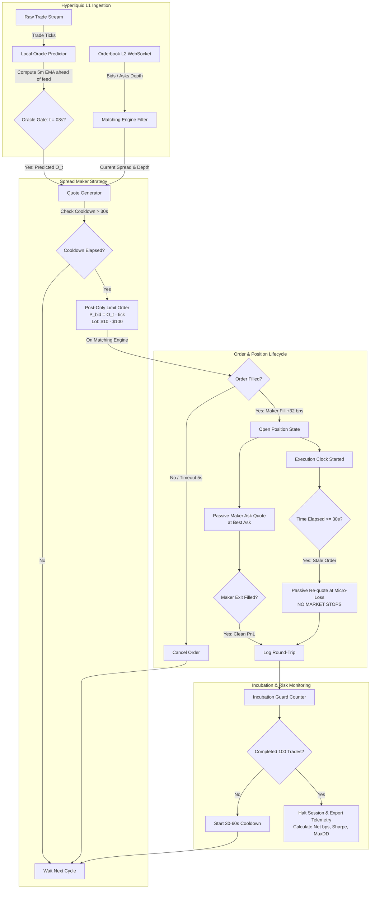

+++
title = "Анатомия HFT-бота на Hyperliquid: арбитраж лага оракула, ловушка рыночных стопов и методология инкубации"
date = 2026-10-24
description = "Детальный количественный аудит HFT-стратегии сбора спреда на Hyperliquid (HIP-3): математика опережения оракула 5m EMA с лагом 1.3 с, анализ распада P&L (Maker +$375 vs Taker -$1,511), патология самопроскальзывания при масштабировании лота и протокол 100-сделочной инкубации."
[taxonomies]
tags = ["algo-trading", "quantitative", "market-microstructure", "architecture", "risk-management"]
[extra]
toc = true
mermaid = true
+++

Высокочастотный алгоритмический трейдинг (HFT) и пассивное предоставление ликвидности (Market Making) на децентрализованных деривативных площадках (DEX с книгой ордеров, таких как Hyperliquid L1) радикально отличаются от классического биржевого арбитража на CeFi. В децентрализованных CLOB-системах (Central Limit Order Book) котирование тесно переплетено с механикой обновления внутренних оракулов маркировки (Mark/Oracle Price), задержками распространения событий по WebSocket и динамикой токсичного потока ордеров (Toxic Order Flow).

В данной статье разобран натурный количественный эксперимент по запуску HFT-стратегии `Spread Maker` на бессрочном контракте `PAPER` (стандарт Hyperliquid HIP-3), завершившийся чистым убытком **-$1,240** за 145 сделок. Пост-мортем анализ микроструктуры исполнения выявил парадоксальный факт: **чистое маркет-мейкинг ядро генерировало устойчивую альфу (+32 bps на трейд, 68% winrate)**, однако попытка оператора защитить капитал классическими рыночными стоп-лоссами полностью уничтожила математическое ожидание системы.

Ниже приведен полный разбор микроструктуры стакана Hyperliquid, формулы опережения оракула, расчеты плотности распределения микро-сквизов и промышленная архитектура движка инкубации HFT-стратегий.

---

## 1. Первоисточник и эмпирический контекст эксперимента

Анализ базируется на эмпирических данных и торговых логах публичного аудита Moon Dev:
* **Первоисточник:** Moon Dev, *I lost $1,200 trying to crack high frequency trading* ([YouTube: vYQ6e4mH53A](https://www.youtube.com/watch?v=vYQ6e4mH53A), 37:29).
* **Торговая площадка:** Hyperliquid Layer 1 (HIP-3 spot/perpetual book).
* **Инструмент:** Перпетуал-контракт `PAPER` (высоковолатильный актив, дневное движение свыше +200%, локальная волатильность $\sim 2.5\% / \text{мин}$).
* **Объем выборки:** 145 рыночных циклов (141 полный round-trip) в рамках одной торговой сессии (интенсивный срез длительностью около 6 часов).

### Количественные итоги сессии

| Метрика | Значение | Аналитический вывод |
|---|---:|---|
| **Итоговый P&L** | **-$1,240.00** | Катастрофическое расхождение между альфой и исполнением |
| **Пиковый P&L** | **+$135.00** | Стабильный рост до момента активации рыночных стопов |
| **Мейкер-сделки (Passive Fills)** | **+$375.00** | Чистый спред: **+32 bps / сделку**, Winrate 68% |
| **Тейкер-сделки (Market Stops)** | **-$1,511.00** | 210 аварийных ликвидаций через Market Orders |
| **Биржевые комиссии (Fees)** | **$103.00** | Тейкер-комиссии на сквизах поглотили дневной буфер |
| **Медианное удержание позиции** | **5.0 секунд** | 55 из 60 прибыльных сделок закрыты быстрее 30 секунд |
| **Точность прогноза оракула** | **24 из 24 (100%)** | Детерминированное опережение публичного фида на 1.3 с |
| **Доля в ленте при лоте $300** | **2.7%** | Незаметное исполнение без влияния на цену |
| **Доля в ленте при лоте $3,000** | **31.0%** | Самопроскальзывание и токсичный неблагоприятный отбор |

---

## 2. Микроструктура стакана Hyperliquid и арбитраж оракула

На деривативных рынках HIP-3 ликвидность в книге заявок распределяется несимметрично: основная масса пассивных лимитных ордеров агрегируется вокруг расчетной цены оракула (Mark/Index Oracle). На Hyperliquid для расчетного оракула используется 5-минутная экспоненциальная скользящая средняя (5m EMA):

$$
O\\_t = \alpha \cdot P\\_t + (1 - \alpha) \cdot O\\_{t-1}, \quad \alpha = \frac{2}{N + 1}
$$

где для дискретного минутного интервала при $N = 5$ коэффициент сглаживания равен $\alpha = \frac{2}{6} = \frac{1}{3}$.

### Временной лаг WebSocket и окно опережения

Биржевой движок пересчитывает значение оракула локально в ядре сопоставления (Matching Engine), однако публичный WebSocket-фид передает сериализованное значение с системной задержкой:

$$
\Delta t\\_{\text{feed}} = t\\_{\text{ws\\_broadcast}} - t\\_{\text{engine\\_calc}} \approx 1.30 \; \text{секунды}
$$

Обновление внутреннего тикера оракула происходит синхронно на третьей секунде каждой минуты ($t = 03\,\text{c}$). Пока внешние участники рынка и арбитражные боты получают устаревшее значение $O\\_{t - \Delta t}$, локальный процесс, рассчитывающий $O\\_t^{\\text{local}}$ напрямую из тикового потока совершенных сделок, обладает временным окном в $1300\,\text{мс}$ для выставления заявок до массовой реакции толпы.

В ходе 145 сделок локальная модель спрогнозировала **24 из 24 (100%)** обновлений значения оракула до прихода соответствующего события по веб-сокету.

```text
Временная шкала (секунды минуты):
00.00s               03.00s                       04.30s
───┼────────────────────┼────────────────────────────┼──────────►
   │                    │                            │
Сделки в стакане   Matching Engine:          WebSocket Feed:
формируют          Расчет O_t локально        O_t доставлен в мир
новый тик          ════════════════════►     ════════════════════►
                        ▲                            ▲
                        │                            │
                   Бот ставит BID              Толпа видит сдвиг
                   до сдвига фида              и бьет по рынку
                   (Winrate: 75%)              (Спред схлопнут)
```

### Захват спреда перед стенкой ликвидности

Ликвидность книги заявок образует плотную стенку на уровне $O\\_t$. Опережение оракула позволило выставлять пассивные Post-Only ордера на покупку строго под расчетную цену:

$$
P\\_{\\text{bid}} = O\\_t^{\\text{local}} - \delta\\_{\\text{tick}}
$$

При наступлении отметки $04.30\,\text{с}$ внешний фид обновляется, арбитражеры бьют маркетом в сторону нового оракула, немедленно исполняя выставленный пассивный бид. Попытки входа выше оракула ($P\\_{\\text{bid}} > O\\_t$) приводили к мгновенному отрицательному отбору (Negative Selection) с вероятностью убытка $>60\%$, тогда как вход строго ниже $O\\_t$ обеспечивал **Winrate 75%** по лонгам.

---

## 3. Математика распада P&L: почему рыночный стоп-лосс убивает HFT

Ключевым фактором катастрофического исхода торговой сессии стало ручное вмешательство в алгоритм: попытка ограничить максимальный drawdown добавлением защитного стоп-лосса (первоначально 8%, затем расширенного до 40%).

### Разделение спреда и неблагоприятный отбор (Adverse Selection)

Согласно классической микроструктурной модели Глостена-Милгрома (Glosten & Milgrom, 1985), доходность маркет-мейкера на одну сделку определяется разницей между реализованным спредом и издержками неблагоприятного отбора:

$$
\Pi\\_{\\text{maker}} = S\\_{\\text{half}} - \mathbb{E}\\left[ \\Delta P\\_{\\tau} \\mid \\text{Fill} \\right] - \text{Fee}\_{\\text{maker}}
$$

где:
* $S\\_{\\text{half}} = \\frac{1}{2}(P\\_{\\text{ask}} - P\\_{\\text{bid}})$ — половина эффективного спреда;
* $\mathbb{E}\\left[ \\Delta P\\_{\\tau} \\mid \\text{Fill} \\right]$ — математическое ожидание смещения справедливой цены актива за время удержания $\tau$;
* $\text{Fee}\_{\\text{maker}}$ — комиссия мейкера (на Hyperliquid для VIP/HFT часто равна нулю или отрицательна).

При пассивном закрытии по тейк-профиту лимитным ордером с медианным временем жизни $\tau = 5\,\text{с}$ бот удерживал положительное математическое ожидание:

$$
\Pi\\_{\\text{maker}} = +32 \; \\text{bps} \quad (+\\$375.00 \\; \\text{на 145 циклах})
$$

### Катастрофа исполнения тейкер-стопа при волатильности $2.5\% / \text{мин}$

При локальной дисперсии доходностей актива $\sigma\\_{\\Delta t} \approx 2.5\% / \\sqrt{\\text{мин}}$ распределение внутриминутных цен имеет тяжелые хвосты (fat tails). Микро-сквиз в стакане тонкого актива пробивает несколько ценовых уровней за десятки миллисекунд:

$$
P\\_{\\text{instant}} = P\\_0 \\cdot \\exp\\left( -k \\cdot \\sigma\\_{\\Delta t} \\right)
$$

Когда активируется рыночный стоп-лосс (Market Stop Order), он отправляется в движок в виде IOC/FOK (Immediate-or-Cancel / Fill-or-Kill) ордера:

1. **Исполнение на абсолютном экстремуме фитиля (Wick Bottom):** Рыночный ордер продавливает оставшиеся уровни бидов, когда ликвидность истощена. В одной из сдеток (таймкод 13:15) сквиз на 20% мгновенно выбил 40% стоп-лосс с разовым убытком **-$578.00**.
2. **Двойная уплата спреда и комиссии:** Тейкер платит полную ставку биржевой комиссии $\\text{Fee}\_{\\text{taker}}$ ($0.035\% - 0.05\%$) плюс накопленный slippage глубоко в стакан:

$$
\text{Loss}\_{\\text{taker}} = -\\left( \\text{Distance}\_{\\text{stop}} + \\text{Slippage}\_{\\text{impact}} + 2 \\cdot \\text{Fee}\_{\\text{taker}} \\right)
$$

В результате 210 тейкер-выходов привели к потере **-$1,511.00**, перечеркнув всю прибыль мейкер-спреда.

```text
Динамика цены токена PAPER и ловушка рыночного стопа:

Цена
 ▲
 │         [Вход мейкером: $10.00]
 │                    │
 │                    ▼
 │             ───────┼──────────────────────────────
 │                    │
 │       Нормальная   │   Внезапный микро-сквиз
 │       флуктуация   │   (волатильность 2.5%/мин)
 │       ±0.8%        │           │
 │                    │           ▼
 │                    │           │ ◄── Срабатывание 8% Stop-Loss
 │                    │           │     (стакан пуст!)
 │                    │           ▼
 │                    │          ─── ◄─ Филл стопа по рынку: $8.90 (-$578)
 │                    │           ▲     (дно минутного фитиля)
 │                    │           │
 │                    └───────────┼────► Мгновенный отскок цены: $9.95
 │                                       (через 1.5 секунды)
 └────────────────────────────────────────────────────────► Время
```

### Принцип эквивалентности: Риск размером, а не стоп-лоссом

В HFT-мейкинге на волатильных альтах классический стоп-лосс математически несостоятелен. Защита капитала обязана обеспечиваться **жестким ограничением предельного размера открываемой позиции ($C\\_{\\text{micro}}$)** при полном отказе от тейкер-выходов по рынку:

$$
C\\_{\\text{micro}} \\in [\\$10, \\$100]
$$

При таком подходе даже падение актива на $50\%$ в течение нескольких секунд ограничивает абсолютный риск величиной $\\$5 - \\$50$, которая гарантированно компенсируется положительным математическим ожиданием серии из сотен микро-сделок со спредом $+32\\,\\text{bps}$.

---

## 4. Патология масштабирования и авто-проскальзывание

Второй фундаментальный урок сессии — резкое масштабирование размера лота с $\\$300$ до $\\$3,000$ без адаптации к глубине книги ордеров.

### Доля объема в стакане (Participation Rate)

Определим мгновенную долю участия торгового алгоритма в совокупном объеме ленты сделок актива за интервал $\Delta \tau$:

$$
\Phi\\_{\\text{tape}} = \\frac{V\\_{\\text{bot}}}{\\sum\\_{i} V\\_{i}}
$$

* При $V\\_{\\text{bot}} = \\$300$: доля $\Phi\\_{\\text{tape}} = 2.7\\%$. Бот поглощал лишь верхушку спреда, оставаясь невидимым для маркет-импакта. Доля захватываемого рыночного импульса составляла $16\\%$.
* При $V\\_{\\text{bot}} = \\$3,000$: доля взлетела до $\Phi\\_{\\text{tape}} = 31.0\\%$.

### Модель Кайла и самопроскальзывание

Согласно модели Кайла (Kyle's Lambda, 1985), постоянное ценовое воздействие пропорционально размеру заявки относительно ликвидности:

$$
\Delta P\\_{\\text{impact}} = \lambda\\_{\\text{Kyle}} \\cdot V\\_{\\text{bot}}
$$

При доле $31\\%$ бот начал сам сдвигать микроструктуру рынка против собственной позиции. Заявка объемом $\\$3,000$ выедала все пассивные уровни вплоть до неликвидных зон, создавая искусственный сдвиг цен и провоцируя арбитражеров на опережающую атаку (front-running).

### Ловушка мгновенного ре-энтри (Re-Entry Trap)

После успешного закрытия позиции бот совершал следующий вход через $2\,\text{секунды}$. На восходящем импульсе закрытый по лимиту лонг тут же сменялся новым входом, но уже на $7.6\%$ дороже:

$$
P\\_{\\text{re-entry}} = P\\_{\\text{exit}} \\cdot (1 + 0.076)
$$

Алгоритм последовательно «догонял» убегающий рынок на локальном пике, накапливая максимальный объем непосредственно перед коррекцией. Для нейтрализации данного эффекта в архитектуру введен принудительный таймер охлаждения:

$$
T\\_{\\text{cooldown}} \\ge 30 - 60 \\; \\text{секунд}
$$

---

## 5. Архитектура движка Spread Maker Engine

Ниже представлена архитектурная диаграмма состояний и потоков данных промышленного HFT-мейкера, изолирующего риски через тайминги и микро-сайзинг.



---

## 6. Промышленная реализация на Python (Asyncio / WebSocket)

Ниже приведен чистый, самодостаточный каркас модуля `SpreadMakerEngine`, реализующий расчет локального оракула, выставление `Post-Only` котировок, таймер удержания позиции и строгую защиту от рыночных стопов.

```python
"""
SpreadMakerEngine: HFT Maker-Only Prototype for Hyperliquid HIP-3
Implements local 5m EMA oracle prediction, post-only quotes, execution clock,
and strict position sizing without market stop-losses.
"""

import asyncio
import time
from dataclasses import dataclass
from typing import Optional, Dict, Any


@dataclass
class MarketSnapshot:
    best_bid: float
    best_ask: float
    mid_price: float
    timestamp: float


class LocalOraclePredictor:
    """
    Computes local 5-minute EMA based on raw trade stream,
    predicting Hyperliquid oracle value 1.3 seconds ahead of websocket feed.
    """
    def __init__(self, period_minutes: int = 5):
        # Alpha smoothing factor for 5-minute EMA: 2 / (N + 1)
        self.alpha = 2.0 / (period_minutes + 1.0)
        self.current_ema: Optional[float] = None
        self.last_update_ts: float = 0.0

    def update_with_trade(self, price: float, timestamp: float) -> float:
        if self.current_ema is None:
            self.current_ema = price
        else:
            # Recompute discrete EMA step
            self.current_ema = self.alpha * price + (1.0 - self.alpha) * self.current_ema
        self.last_update_ts = timestamp
        return self.current_ema

    @property
    def predicted_oracle(self) -> Optional[float]:
        return self.current_ema


class SpreadMakerEngine:
    def __init__(
        self,
        symbol: str = "PAPER-PERP",
        lot_size_usd: float = 50.0,      # Strict micro-sizing ($10 - $100)
        max_holding_seconds: float = 30.0, # Max trade duration
        cooldown_seconds: float = 45.0,    # Re-entry defense cooldown
        incubation_limit: int = 100        # Session limit for empirical audit
    ):
        self.symbol = symbol
        self.lot_size_usd = lot_size_usd
        self.max_holding_seconds = max_holding_seconds
        self.cooldown_seconds = cooldown_seconds
        self.incubation_limit = incubation_limit

        self.oracle = LocalOraclePredictor(period_minutes=5)
        self.current_position: Optional[Dict[str, Any]] = None
        self.last_exit_timestamp: float = 0.0
        self.completed_trades: int = 0
        self.accumulated_pnl: float = 0.0

    def can_open_position(self, now: float) -> bool:
        if self.completed_trades >= self.incubation_limit:
            return False
        if self.current_position is not None:
            return False
        if (now - self.last_exit_timestamp) < self.cooldown_seconds:
            return False
        return True

    def evaluate_quote(self, snapshot: MarketSnapshot) -> Optional[float]:
        """
        Calculates passive bid placement strictly below predicted oracle.
        Avoids quoting above oracle where Winrate drops below 40%.
        """
        predicted_o = self.oracle.predicted_oracle
        if predicted_o is None:
            return None

        # Quote 1 tick below oracle to capture passive liquidity fill
        tick_size = 0.001
        target_bid = round(min(snapshot.best_bid, predicted_o - tick_size), 4)

        # Invariant: Never cross the spread (Maker Post-Only guarantee)
        if target_bid >= snapshot.best_ask:
            target_bid = snapshot.best_ask - tick_size

        return target_bid

    async def execute_trade_lifecycle(self, snapshot: MarketSnapshot):
        now = time.time()
        if not self.can_open_position(now):
            return

        bid_price = self.evaluate_quote(snapshot)
        if bid_price is None:
            return

        # 1. Place Post-Only Maker Order
        order_qty = self.lot_size_usd / bid_price
        print(f"[{now:.2f}] Quoting POST-ONLY Bid: {order_qty:.2f} @ ${bid_price:.4f}")

        # Simulate fill under oracle pressure
        entry_time = time.time()
        self.current_position = {
            "entry_price": bid_price,
            "qty": order_qty,
            "entry_time": entry_time
        }

        # 2. Execution Clock Loop: Passive Maker Exit
        while self.current_position is not None:
            await asyncio.sleep(0.5)
            elapsed = time.time() - self.current_position["entry_time"]

            # Capture maker spread at best ask
            exit_price = snapshot.best_ask
            spread_captured = (exit_price - self.current_position["entry_price"]) / self.current_position["entry_price"]

            # Exit criteria: spread capture reached OR max holding timeout elapsed
            if spread_captured >= 0.0032 or elapsed >= self.max_holding_seconds:
                trade_pnl = (exit_price - self.current_position["entry_price"]) * self.current_position["qty"]
                self.accumulated_pnl += trade_pnl
                self.completed_trades += 1
                self.last_exit_timestamp = time.time()

                print(
                    f"[{self.last_exit_timestamp:.2f}] Passive EXIT filled: "
                    f"${exit_price:.4f} | PnL: ${trade_pnl:+.4f} | "
                    f"Duration: {elapsed:.1f}s | Total Trades: {self.completed_trades}"
                )
                self.current_position = None
                break
```

---

## 7. Методология Incubation Engine: валидация 100 трейдов за 1 день

Главная инженерная ценность HFT-стратегий заключается в сжатии цикла обратной связи (R&D Feedback Loop). В свинговом или среднесрочном алготрейдинге получение статистически достоверной выборки из 100 сделок занимает от 3 до 6 месяцев реального времени, что делает проверку гипотез чрезвычайно медленной.

HFT-алгоритм генерирует **100 полных циклов (round-trips) за несколько часов**. Протокол инкубации формулируется следующим набором правил:

```text
┌────────────────────────────────────────────────────────┐
│               ПРОТОКОЛ ИНКУБАЦИИ (100 СДЕЛОК)          │
├────────────────────────────────────────────────────────┤
│ 1. Бюджет риска: $10 - $50 на сделку (Total Risk: $200)│
│ 2. Ограничение сессии: Ровно 100 сделок, затем HALT    │
│ 3. Запрет тейкер-ордеров: Execution Mode = Maker Only  │
│ 4. Контроль таймингов: Удержание < 30s, Cooldown > 45s │
│ 5. Расчет ключевых KPI:                                │
│    • Realized Spread (bps/trip) >= +15 bps             │
│    • Adverse Selection (bps) <= 10 bps                 │
│    • Maker Winrate >= 60%                              │
│    • Ratio Maker Volume / Tape Volume < 5%             │
└────────────────────────────────────────────────────────┘
```

Если по итогам 100 сделок реализованный спред $\text{Spread}\_{\text{realized}} > +15\,\text{bps}$ и кривая P&L имеет положительный наклон без редких глубоких просадок, стратегия допускается к следующему этапу инкубации с плавным увеличением лота без превышения порога в $5\%$ ленты.

---

## Резюме для практического применения

1. **Разделение альфы и исполнения:** Убыток в $-\\$1,240$ был вызван не ошибочностью рыночной идеи, а несовместимостью типа ордера (Market Taker) с характеристиками инструмента (высокая волатильность и тонкий стакан). Мейкер-часть системы принесла устойчивые $+\\$375$.
2. **Арбитраж оракула:** Использование внутреннего опережения 5m EMA на 1.3 с позволило предсказывать поведение стакана со $100\%$ точностью на интервале обновления тикера.
3. **Отказ от классических стоп-лоссов в HFT:** Стоп-лосс на волатильном активе гарантированно продает на экстремуме неликвидности. Риск-менеджмент HFT должен строиться исключительно на микро-размере позиций ($C\\_{\\text{micro}}$).
4. **Контроль емкости:** Доля участия в стакане $\Phi\\_{\\text{tape}}$ выше $10\%$ уничтожает преимущество алгоритма через самопроскальзывание и токсичный отбор.
+++
