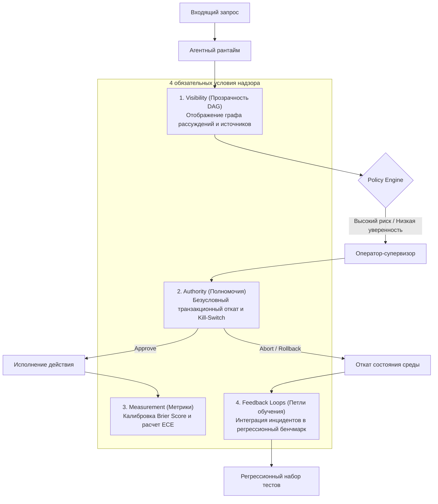

+++
title = "Human-in-the-Loop в агентных системах: 5 измерений доверия, пределы пассивной валидации и архитектура реального надзора"
date = 2026-10-25
description = "Инженерный анализ роли Human-in-the-Loop в автономных агентных архитектурах: проекция формулы доверия на технические требования к AI, 4 обязательных условия надзора, математическая модель когнитивной пропускной способности оператора и реализация governance-гейта."
[taxonomies]
tags = ["ai-agents", "governance", "architecture", "software-engineering", "evals"]
[extra]
toc = true
mermaid = true
+++

При проектировании корпоративных систем на базе автономных AI-агентов механизм подтверждения действий человеком (Human-in-the-Loop, HITL) традиционно рассматривается как базовый рубеж контроля безопасности. Предоставление языковой модели прав на выполнение операций в терминале, базах данных, платежных шлюзах и облачной инфраструктуре сопровождается требованием авторизации каждого вызова оператором.

Однако по мере роста автономности и частоты выполнения задач изолированный просмотр финального действия оператором перестает выполнять функцию надежного управления (AI Governance). В условиях высокой интенсивности потока событий и недостатка контекста оператор теряет возможность выявлять скрытые логические дефекты в цепочках рассуждений модели, что приводит к механическому согласованию вызовов без реальной проверки.

Главный этик IBM по направлению искусственного интеллекта Федра Бойнодирис (Phaedra Boinodiris) указывает на необходимость перехода от номинального присутствия человека в контуре к формальной системе управления доверием. Надежный надзор за недетерминированными агентными средами требует системной проекции межличностной формулы доверия на архитектуру программного обеспечения и соблюдения четырех обязательных технических условий.

> **Первоисточники:**
> * **Видеоматериал:** [Human in the Loop Is Not a Governance Strategy for Agentic AI](https://youtu.be/zRMAvMSSSII) (IBM Technology, спикер: Phaedra Boinodiris).
> * **Методология доверия:** *The Trusted Advisor* (David H. Maister, Charles H. Green, Robert M. Galford) — базовая формула Trust Equation.
> * **Концептуальная база:** IBM AI Governance Framework и стандарты аудита автономных программных систем.

---

## Пределы пассивной валидации: модель когнитивной пропускной способности

В базовом сценарии интеграции агента оператору передается единичное действие:
> *«Агент сформировал SQL-миграцию / торговый ордер / манифест развертывания. Подтвердите выполнение.»*

Если частота запросов не превышает одного события в час, квалифицированный инженер способен провести детальный аудит изменений. Однако в многокомпонентных агентных средах частота генерации вызовов инструментов многократно возрастает: выполняются запросы к векторным индексам, промежуточные агрегации, сетевые вызовы и модификации локальных файлов.

В таких условиях возникает физическое ограничение когнитивной пропускной способности человека. Вероятность пропуска критической ошибки оператором $P(\text{Miss})$ описывается экспоненциальной зависимостью от частоты входящих событий $\lambda$ и объема контекста $L$:

$$P(\text{Miss}) = 1 - \exp\left(-\alpha \cdot \frac{\lambda \cdot L}{C_{\text{budget}}}\right)$$

где:
* $\lambda$ — частота поступающих на валидацию предложений (событий в минуту),
* $L$ — объем анализируемого контекста и сопутствующих артефактов (в тысячах токенов),
* $C_{\text{budget}}$ — доступный бюджет внимания оператора за фиксированный рабочий интервал,
* $\alpha$ — эмпирический коэффициент поверхностной оценки (skimming factor).

При систематическом подтверждении корректных действий у оператора формируется смещение автоматизации (Automation Bias). В результате время на анализ каждого шага сокращается, а нажатие кнопки подтверждения становится формальным. Это нивелирует барьер безопасности, сохраняя при этом задержки исполнения, характерные для ручных процессов.

---

## 5 измерений формулы доверия в агентных системах

В теории организационного управления межличностное доверие описывается классическим уравнением Чарльза Грина (Trust Equation):

$$\text{Trust} = \frac{\text{Credibility} + \text{Reliability} + \text{Intimacy}}{\text{Self\\_Orientation}}$$

В докладе IBM эта концепция адаптирована к системной инженерии AI-агентов. Доверие к автономной программе формулируется как совокупность проверяемых архитектурных характеристик.

### Проекция доверия на технические требования к AI

| Свойство доверия | Технический эквивалент в AI | Архитектурная реализация в агентной системе |
|---|---|---|
| **Credibility (Авторитет)** | **Transparency (Прозрачность)** | Верификация источников обучающих данных, детерминированные снимки контекста, неизменяемые хэши версий системных промптов и весов моделей. |
| **Reliability (Надежность)** | **Explainability & Consistency** | Формирование ациклического графа рассуждений (Action-DAG), каузальная атрибуция каждого шага, воспроизводимость результатов при стабильных входных данных. |
| **Intimacy (Безопасность связи)** | **Observability (Наблюдаемость)** | Сквозная трассировка вызовов OpenTelemetry, мониторинг латентности, сбор логов выполнения и отслеживание дрейфа состояний среды. |
| **Self-Orientation (Направленность)** | **Objective Alignment** | Математическая формализация функции полезности: согласованность локальных метрик агента с системными инвариантами платформы. |
| **Integrity (Целостность)** | **Adversarial Robustness** | Защита от prompt injection, проверка схем входных и выходных данных, изоляция инструментов в выделенных песочницах. |

1. **Transparency (Прозрачность данных и контекста):** Каждое утверждение или действие агента связывается с проверяемым узлом графа знаний либо хэшем документа в долговременной памяти.
2. **Explainability (Объяснимость логики решений):** Система обязана генерировать трассировку причинно-следственных связей до выполнения необратимой операции, позволяя оценить альтернативные сценарии.
3. **Observability (Непрерывная наблюдаемость):** Агентный рантайм предоставляет метрики внутреннего состояния, предотвращая незаметное накопление расхождений между планом и фактической средой.
4. **Objective Alignment (Согласованность целей):** Исключается оптимизация локальных эвристик агента в ущерб стабильности связанных подсистем.
5. **Adversarial Robustness (Устойчивость к внешним воздействиям):** Входные данные сторонних источников проходят через фильтрационные гейты до передачи в контекстное окно исполнителя.

---

## 4 обязательных условия реального надзора (AI Governance)

Для обеспечения полноценного контроля над автономными агентами архитектура рантайма должна отвечать четырем обязательным критериям. Отсутствие любого из них лишает контур надзора управляемости:



### 1. Visibility (Видимость контекста и обоснований)

Оператор должен иметь доступ ко всей цепочке принятия решения:
* **Action-DAG (Граф действий):** последовательность предыдущих вызовов и промежуточных состояний.
* **Калиброванная оценка уверенности:** метрика $P(\text{confidence})$, рассчитанная на основе логарифмических вероятностей токенов либо независимого классификатора решений.
* **Использованные источники:** перечень внешних документов и фрагментов баз данных с подтвержденными хэшами целостности.

### 2. Authority (Безусловные полномочия и транзакционный откат)

Надзор эффективен только при наличии инструментов прямого вмешательства:
* **Асинхронные таймауты безопасности (Fail-Safe Abort):** отсутствие ответа оператора в рамках SLA переводит систему в безопасный режим остановки.
* **Транзакционные чекпоинты (Checkpoints):** возможность отката файловой системы, таблиц баз данных и внешних состояний до момента инициации вызова.
* **Изолированный Kill-Switch:** принудительное завершение агентного процесса без нарушения целостности смежной инфраструктуры.

### 3. Measurement (Количественные метрики качества надзора)

Оценка эффективности контура строится на базе статистических показателей:
* **Калибровочная ошибка (Expected Calibration Error, ECE):** разница между заявленной моделью уверенностью и эмпирической точностью:

$$ECE = \sum_{m=1}^{M} \frac{|B_m|}{N} \left| \text{acc}(B_m) - \text{conf}(B_m) \right|$$

где $B_m$ — бины калиброванной уверенности, $\text{acc}(B_m)$ — фактическая точность решений агента в данном интервале, а $\text{conf}(B_m)$ — средняя расчетная уверенность.
* **Коэффициент расхождения (Divergence Rate):** доля действий, отклоненных оператором или автоматическим супервизором.
* **Время реакции (Time-to-Intervene):** интервал между обнаружением аномалии и вмешательством оператора.

### 4. Feedback Loops (Замкнутые петли исправления)

Каждое отклоненное действие документируется и сохраняется:
* Параметры контекста и причина отклонения сериализуются в защищенный реестр инцидентов.
* Сформированный инцидент автоматически добавляется в постоянный регрессионный бенчмарк (Action-DAG benchmark).
* Изменения в политиках безопасности и промптах валидируются на исторических графах до повторного развертывания.

---

## Архитектура типобезопасного Governance-контракта

Интерфейс контроля формализуется в виде программного контракта, ограничивающего неконтролируемые действия и предотвращающего импульсивные подтверждения критических операций:

```python
"""
agent_governance_contract.py
Типобезопасный контракт надзора и верификации действий AI-агента.
"""

from dataclasses import dataclass, field
from enum import Enum
from typing import List, Dict, Any, Optional
import time
import uuid

class ActionRiskLevel(Enum):
    LOW = "low"            # Чтение данных, валидация кэша
    MEDIUM = "medium"      # Запись временных файлов, вызовы вспомогательных API
    HIGH = "high"          # Мутации в базе данных, внешние вызовы интеграций
    CRITICAL = "critical"  # Удаление ресурсов, финансовые или инфраструктурные операции

class GovernanceDecision(Enum):
    APPROVED = "approved"
    REJECTED = "rejected"
    ESCALATE = "escalate"
    TIMEOUT_ABORT = "timeout_abort"

@dataclass(frozen=True)
class ReasoningStep:
    step_id: str
    action_name: str
    rationale: str
    inputs: Dict[str, Any]
    confidence_score: float
    evidence_uris: List[str]

@dataclass
class ActionProposal:
    proposal_id: str = field(default_factory=lambda: str(uuid.uuid4()))
    timestamp_utc: float = field(default_factory=time.time)
    risk_level: ActionRiskLevel = ActionRiskLevel.MEDIUM
    reasoning_dag: List[ReasoningStep] = field(default_factory=list)
    proposed_payload: Dict[str, Any] = field(default_factory=dict)
    model_declared_confidence: float = 0.0

@dataclass
class AuditRecord:
    proposal_id: str
    decision: GovernanceDecision
    operator_id: str
    review_duration_ms: float
    rejection_reason: Optional[str] = None

class AgentGovernanceGate:
    """
    Архитектурный гейт: обеспечивает Visibility, Authority и Measurement.
    """
    def __init__(self, min_review_time_ms: float = 1200.0, max_sla_seconds: float = 60.0):
        self.min_review_time_ms = min_review_time_ms
        self.max_sla_seconds = max_sla_seconds
        self.audit_log: List[AuditRecord] = []

    def evaluate_preflight(self, proposal: ActionProposal) -> bool:
        """
        Проверка условия Visibility:
        Предложение отклоняется, если отсутствует обоснованный Action-DAG.
        """
        if not proposal.reasoning_dag:
            return False
        
        if proposal.model_declared_confidence < 0.40 and proposal.risk_level in [
            ActionRiskLevel.HIGH, ActionRiskLevel.CRITICAL
        ]:
            return False
            
        return True

    def process_human_feedback(
        self,
        proposal: ActionProposal,
        decision: GovernanceDecision,
        operator_id: str,
        start_display_timestamp: float,
        reason: Optional[str] = None
    ) -> AuditRecord:
        """
        Проверка условий Authority и Measurement:
        Защита от импульсивного согласования критических действий.
        """
        review_time = (time.time() - start_display_timestamp) * 1000.0

        if proposal.risk_level == ActionRiskLevel.CRITICAL:
            if decision == GovernanceDecision.APPROVED and review_time < self.min_review_time_ms:
                decision = GovernanceDecision.ESCALATE
                reason = f"Fast-approval threshold triggered ({review_time:.1f}ms < {self.min_review_time_ms}ms)"

        record = AuditRecord(
            proposal_id=proposal.proposal_id,
            decision=decision,
            operator_id=operator_id,
            review_duration_ms=review_time,
            rejection_reason=reason
        )
        self.audit_log.append(record)
        return record
```

---

## Сравнительный анализ моделей надзора

Сравнение свойств пассивного подтверждения и комплексного контура управления представлено в таблице.

### Сравнение архитектурных характеристик надзора

| Параметр архитектуры | Пассивный Human-in-the-Loop | Инженерный AI Governance |
|---|---|---|
| **Точка валидации** | Единичный диалог перед вызовом инструмента. | Многоуровневый фильтр политик на каждом ребре Action-DAG. |
| **Доступный контекст** | Итоговый payload операции. | Полный граф обоснований, ссылки на источники, уровень калиброванной уверенности. |
| **Поведение при истечении SLA** | Зависание задачи либо автоматическое подтверждение. | Детерминированный безопасный откат (Fail-Safe Abort) к зафиксированному чекпоинту. |
| **Контроль нагрузки** | Не ограничен (поток однотипных уведомлений). | Маршрутизация по уровням риска: ручная валидация только аномалий и пограничных состояний. |
| **Обработка отклонений** | Локальная остановка процесса со статусом ошибки. | Сериализация графа инцидента в регрессионный бенчмарк для последующего аудита. |
| **Контрольные метрики** | Подсчет количества обработанных запросов. | Expected Calibration Error (ECE), Brier Score, Divergence Rate, Time-to-Intervene. |

---

## Междисциплинарный контекст управления

В докладе Федры Бойнодирис подчеркивается, что исключительно инженерных и алгоритмических методов недостаточно для обеспечения безопасной эксплуатации агентов в критических доменах. Языковая модель формирует распределение вероятностей следующего токена на базе статистических закономерностей текста, не обладая осведомленностью о правовых, отраслевых и этических ограничениях текущего момента.

Если формальные атрибуты в учетной записи допускают операцию, внешние контекстные обстоятельства могут требовать превентивной блокировки. В связи с этим контур управления AI-системами в зрелых организациях объединяет специалистов разного профиля:
* **Инженеры и архитекторы:** проектируют телеметрию OpenTelemetry, изолированные песочницы, замеры ECE и целостность графа исполнения.
* **Юристы и комплаенс-эксперты:** определяют соответствие нормативным требованиям (включая положения EU AI Act) и правила хранения аудиторских следов.
* **Отраслевые аналитики:** формализуют границы допустимых рисков и приоритеты между скоростью отклика системы и потенциальным ущербом от сбоя.

---

## Инженерные выводы для производственных сред

Эксплуатация автономных агентных систем требует соблюдения трех практических принципов:

1. **Отказ от изоляции финального действия:** интерфейс оператора должен раскрывать структуру Action-DAG, включая источники данных и промежуточные гипотезы.
2. **Алгоритмический контроль когнитивной нагрузки:** автоматическая фильтрация низкорисковых событий и предотвращение импульсивных согласований на критических операциях снижают влияние человеческого фактора.
3. **Замкнутый цикл воспроизводимости:** каждое отклонение действия оператором должно пополнять постоянный регрессионный набор тестов для верификации будущих версий системы.
