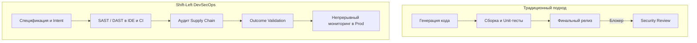
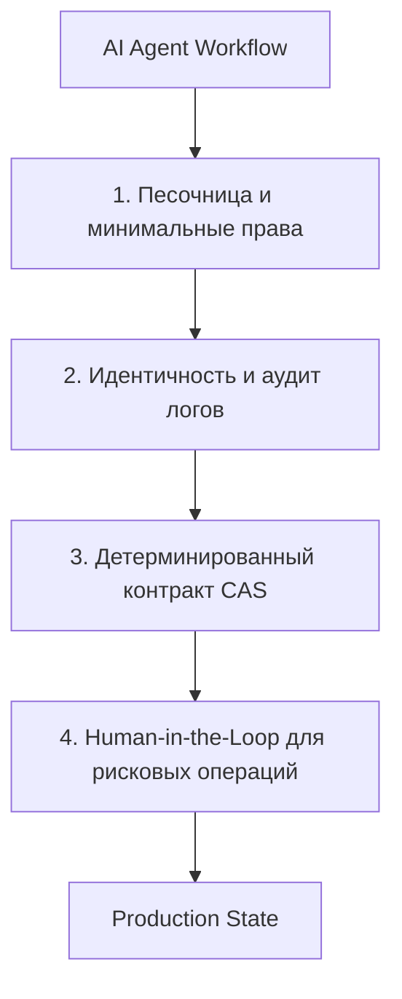

+++
title = "Безопасность AI-кода: пять инженерных принципов защиты сгенерированных решений"
date = 2026-10-12
description = "Инженерный разбор безопасности сгенерированного AI кода: outcome-based проверки, shift-left в DevSecOps, аудит зависимостей и контроль агентных систем."
[taxonomies]
tags = ["ai-agents", "software-engineering", "devops"]
[extra]
toc = true
mermaid = true
katex = false
+++

Генерация кода с помощью AI сокращает время написания функций с часов до секунд, но скорость разработки не равна надежности. Код может успешно компилироваться, проходить синтаксический линтер и модульные тесты, но при этом содержать скрытые утечки прав доступа или уязвимости в зависимостях.

Поводом для системного разбора послужили рекомендации Джеффа Крума (Jeff Crume) из IBM Technology в докладе *How Developers Secure AI-Generated Code*. Ниже — структурированная инженерная модель контроля безопасности: от валидации бизнес-намерений до надзора за автономными AI-агентами.

## Проблема позднего контроля в эпоху LLM

Классический цикл разработки часто выглядит линейно: написание кода → функциональные тесты → коммит → аудит безопасности перед релизом. Когда код создавался вручную, ручной security review успевал за потоком pull request.

С появлением LLM и автономных кодогенераторов поток изменений вырос на порядки. Поздняя проверка на стадии релиза превращается в непреодолимое узкое место (bottleneck).



## Пять ключевых принципов защиты

| Принцип | Что именно проверять | В чем уязвимость обычных тестов |
|---|---|---|
| **1. Outcome-based verification** | Права доступа, утечки чувствительных полей, поведение при сбоях | Тест проверяет `200 OK`, но игнорирует передачу лишних персональных данных |
| **2. Shift-Left DevSecOps** | SAST, DAST, секреты, конфигурационные политики | Поздний аудит перед релизом блокирует поставку и дорог в исправлении |
| **3. Аудит цепочки поставок** | Происхождение библиотек, репутация пакетов, опечатки (typosquatting) | AI легко галлюцинирует несуществующие или вредоносные npm/PyPI-пакеты |
| **4. Верификация намерений (Intent)** | Матрица ролей, бизнес-правила, минимизация привилегий | Синтаксически идеальный код может решать ложную задачу |
| **5. Непрерывный мониторинг** | Новые CVE в зависимостях, дрейф конфигураций, регрессии политик | Безопасный вчера артефакт становится уязвимым при публикации нового эксплойта |

---

## 1. Outcome-Based Verification: проверка последствий, а не синтаксиса

Классический вопрос инженера: *«Работает ли написанный код?»*  
Вопрос инженера безопасности: *«Дает ли он нужный результат строго безопасным способом?»*

Типичный сценарий: агент сгенерировал эндпоинт получения профиля пользователя:

```python
# Потенциально уязвимая логика генерации
@app.get("/api/user/{user_id}")
async def get_user_profile(user_id: int, db: Session = Depends(get_db)):
    user = db.query(User).filter(User.id == user_id).first()
    return user  # Ошибка: сериализуется весь объект, включая password_hash и internal_notes
```

Функциональный тест проходит: статус `200`, JSON возвращается, данные на месте. Однако результат нарушает границы безопасности:
- Сериализуются приватные поля, которые клиенту видеть запрещено.
- Отсутствует проверка прав текущей сессии на чтение чужого профиля (IDOR — Insecure Direct Object Reference).

Outcome-based верификация требует написания негативных assertions: проверка отказа при подмене `user_id`, валидация схемы ответа на отсутствие запрещенных полей и проверка безопасного отказа (fail-safe defaults).

---

## 2. Shift-Left: перенос сканеров в момент генерации

Чтобы не накапливать долг безопасности, проверки должны срабатывать до слияния ветки:

1. **Pre-commit / IDE-уровень:** сканеры секретов (TruffleHog, Gitleaks), предотвращающие случайный коммит API-токенов или закрытых ключей.
2. **Pull Request CI:** автоматический запуск статического анализа (Semgrep, SonarQube) и динамического тестирования контрактов.
3. **Policy-as-Code:** проверка конфигураций Terraform, Kubernetes и Dockerfile через Open Policy Agent (OPA) или Checkov.

---

## 3. Зависимости и галлюцинации пакетов (Package Hallucination)

Один из специфических рисков генеративного кода — добавление зависимостей, которых не было в проекте, либо импорт несуществующих пакетов.

Злоумышленники используют технику *Slopsquatting* / *AI Package Hallucination*: находят имена библиотек, которые часто выдумывают популярные LLM, и публикуют под этими именами вредоносные пакеты в npm или PyPI. Если разработчик или агент выполняет `pip install` без верификации манифеста, система оказывается скомпрометирована.

Правило интеграции:
- Любое изменение `requirements.txt`, `package.json` или `Cargo.toml` должно проходить отдельный шлюз верификации.
- Хэширование зависимостей (lock-файлы с SHA-256 суммами) и сканирование через `pip-audit`, `npm audit` или `cargo-audit`.

---

## 4. Верификация намерений: ловушка царя Мидаса

Миф о царе Мидасе наглядно иллюстрирует проблему согласования: желание превращать всё в золото исполнилось буквально, но привело к катастрофе.

В программировании это означает, что AI генерирует именно то, что вы запросили в промпте, даже если сам запрос упустил критические ограничения:
- *«Сделай сервис быстрым»* → модель отключает валидацию токенов и кэширует ответы без разделения по пользователям.
- *«Упрости доступ к отчетам»* → модель делает эндпоинт публичным.

Спецификация задачи для AI-систем должна явно содержать границы допустимого: кто имеет доступ, какие действия запрещены и как система обязана реагировать на невалидный ввод.

---

## 5. Границы безопасности для автономных AI-агентов

Когда агент не просто советует код в редакторе, а автономно выполняет bash-команды, создает PR и редактирует конфигурации, периметр безопасности расширяется.

Для надежного надзора за агентными системами необходимы четыре барьера:



1. **Минимальные привилегии:** агент должен работать в изолированном контейнере без доступа к корневой файловой системе хоста и внутренним сетям.
2. **Неизменяемый аудит:** каждая выполненная команда и вызов инструмента должны логироваться с сохранением причинно-следственной связи (какой промпт вызвал какое действие).
3. **Human-in-the-loop:** деструктивные операции (удаление баз данных, изменение DNS, публикация пакетов) требуют явного подтверждения человеком.

---

## Практический чеклист DevSecOps для AI-разработки

- [ ] В репозитории настроены пре-коммит хуки на поиск приватных ключей и токенов.
- [ ] Манифесты зависимостей зафиксированы строгими lock-файлами с проверкой хэшей.
- [ ] CI-пайплайн запускает SAST-анализ на каждый pull request.
- [ ] Для эндпоинтов написаны негативные тесты на проверку разграничения прав доступа.
- [ ] Агентные процессы изолированы и не имеют прямого доступа к production-секретам.

---

## Первоисточники и материалы

* **Оригинальный доклад:** [IBM Technology — How Developers Secure AI-Generated Code: 5 Security Best Practices (Jeff Crume)](https://youtu.be/X0UI0O8YzJM)
* **Плейлист серии:** [IBM Technology — Cybersecurity & AppSec](https://www.youtube.com/playlist?list=PLdw2bVqUvsk3C_IFblL7yXXlqY8HBOu6h)
* **Инженерные наработки блога:** [github.com/xsa-dev](https://github.com/xsa-dev)
