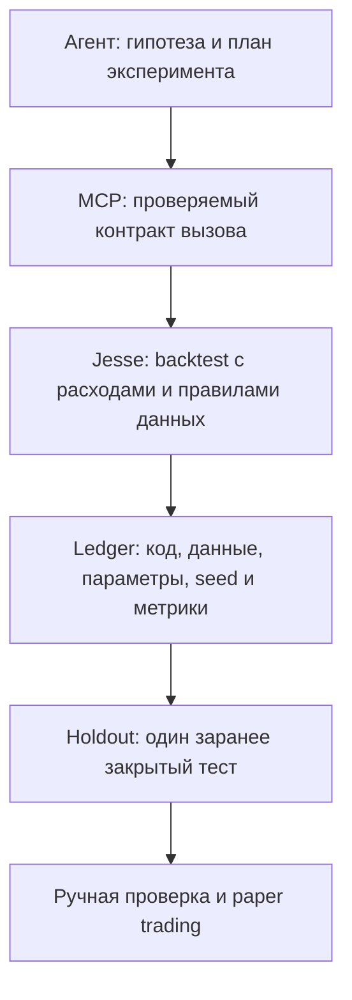

+++
title = "Quant-исследования с Jesse и Claude Code: воспроизводимый контур без обещаний прибыли"
date = 2026-10-15
description = "Как связать Jesse, MCP и CLI-агента в воспроизводимый контур исследований: holdout, Monte Carlo, контроль утечек и пределы анти-оверфиттинг гейтов."
[taxonomies]
tags = ["ai-agents", "algo-trading", "quantitative", "architecture", "evals"]
[extra]
toc = true
mermaid = true
+++

Автоматизация количественных исследований полезна не потому, что агент «находит прибыль», а потому, что делает серию проверяемых экспериментов дешевле и аккуратнее. Видео Sal показывает практический сетап Jesse + Jesse MCP + Claude Code на отдельной машине: агент создаёт стратегии, запускает тесты и сохраняет отчёты. Это разбор архитектуры и ограничений такого подхода, а не рекомендация торговать.

> **Финансовый дисклеймер.** Материал носит исключительно образовательный характер и не является инвестиционной рекомендацией, офертой или обещанием доходности. Бэктесты и симуляции не гарантируют будущий результат. Торговля цифровыми активами и деривативами может привести к потере всего капитала; перед любыми действиями нужны собственная проверка данных, расходов, ликвидности и риска.

## Что именно демонстрирует исходное видео

В ролике описан удалённый Mac Mini, где Jesse работает рядом с Jesse MCP и Claude Code; постоянная сессия `tmux` позволяет не зависеть от открытого SSH-терминала. Цель автора — долго прогонять гипотезы и отбирать стратегии по Sharpe и Monte Carlo. В его отчёте приведён важный отрицательный результат: у одной найденной стратегии исходный Sharpe оказался ниже медианы симуляции, то есть сам фильтр не превратился в декоративный бейдж.

Это наблюдение автора видео, а не независимое исследование: неизвестны полная история сделок, комиссии, состав перебранных гипотез и правила остановки. Поэтому приведённые в ролике диапазоны Sharpe и win rate нельзя переносить на другой рынок или трактовать как ожидаемую доходность.

## Архитектура с явными границами ответственности

Модель формулирует гипотезы и пишет код, но не должна быть источником чисел. Jesse исполняет детерминированный эксперимент, а артефакты фиксируют входные данные, версию кода и результат.



Практический контракт вызова должен включать минимум: имя стратегии и версию, инструмент и таймфрейм, диапазоны train/validation/holdout, источник свечей, комиссию, модель проскальзывания, часовой пояс, seed и хеш входного набора. Если поле не задано явно, результат нельзя считать воспроизводимым. Блок ниже — шаблон контракта для проектирования, а не воспроизведённый запуск Jesse/MCP: значения-заглушки нужно заменить, а команду и ожидаемый артефакт — добавить перед заявлением о репликации.

Разделяйте три слоя:

1. **Control plane** — агент и очередь экспериментов. Его задача — предложить следующую гипотезу и проверить полноту отчёта.
2. **Execution plane** — Jesse и код стратегии. Здесь должны считаться PnL, просадка, комиссии и исполнение, а не в рассуждении модели.
3. **Evidence plane** — неизменяемый ledger. В нём остаются и успешные, и отклонённые прогоны, иначе возникает смещение выжившего.

`tmux` решает только проблему живучести процесса. Он не делает эксперимент корректным, не защищает от потери данных и не превращает удалённую машину в доверенную среду.

## Воспроизводимый минимальный прогон

Начните с детерминированного контракта эксперимента, зафиксированного в репозитории:

```yaml
experiment_id: "2026-10-15-baseline-01"
strategy_commit: "a1b2c3d4"
data_sha256: "e3b0c44298fc1c149afbf4c8996fb92427ae41e4649b934ca495991b7852b855"
asset: "BTC-USDT"
exchange: "Sandbox"
timeframe: "1h"
execution_model: "next-bar"
fee_rate: 0.0007
slippage: 0.0005
train_window: "2021-01-01..2023-12-31"
validation_window: "2024-01-01..2024-12-31"
holdout_window: "2025-01-01..2025-12-31"
random_seed: 42
```

Для запуска в Jesse без Docker под управлением локальных Redis и PostgreSQL используются следующие шаги инициализации:

```bash
# 1. Запуск нативных сервисов
redis-server --daemonize yes --save "" --appendonly no
sudo pg_ctlcluster 16 main start
sudo -u postgres psql -c "CREATE USER jesse_user WITH PASSWORD 'password' SUPERUSER;"
sudo -u postgres psql -c "CREATE DATABASE jesse_db OWNER jesse_user;"

# 2. Настройка окружения и запуск бэктеста через web-dashboard Jesse 3.x
export POSTGRES_HOST=localhost
export REDIS_HOST=localhost
~/jesse-venv/bin/jesse run
```

В файле конфигурации `config.py` параметр `trading_mode='backtest'` фиксирует режим симуляции, а `routes.py` определяет порядок перебора тестируемых стратегий. Отчёт должен содержать количество сделок, коэффициент Шарпа, максимальную просадку и точный хеш набора свечей. При малом числе сделок Шарп нестабилен, поэтому требуется расчёт дефлированного коэффициента Шарпа (DSR):

$$\text{DSR} = \Phi\left( \frac{(\text{SR} - \text{SR}^*) \sqrt{T-1}}{\sqrt{1 - \gamma_3 \text{SR} + \frac{\gamma_4 - 1}{4} \text{SR}^2}} \right)$$

где $\text{SR}$ — наблюдаемый Sharpe, $\text{SR}^*$ — ожидаемый максимальный Sharpe при испытании $N$ независимых стратегий, $T$ — число периодов, $\gamma_3$ и $\gamma_4$ — асимметрия и эксцесс распределения доходностей. Порог уверенности (например, $0.95$) задается как инженерная политика снижения риска ложных открытий при множественном тестировании, а не как универсальная гарантия прибыльности.

## Оверфиттинг: почему «ещё больше бэктестов» усугубляет проблему

Если агент перебирает сотни вариантов и показывает лучший Sharpe на том же наборе данных, этот Sharpe уже является результатом отбора. Увеличение числа попыток без независимой проверки повышает вероятность найти случайный максимум. Поэтому в ledger нужно хранить количество и структуру попыток, а не только победителя.

Deflated Sharpe Ratio (DSR) полезен как способ учесть множественный отбор, длину выборки и особенности распределения доходностей. Но DSR не доказывает причинный механизм и не исправляет утечку данных, неверную модель исполнения или зависимость между гипотезами. Порог вроде `0.95` — это политика конкретного исследования, а не универсальный закон природы.

Точно так же нельзя писать «после 200 тестов шум гарантированно выбран»: результат зависит от корреляции гипотез, размера выборки и правила отбора. Корректная формулировка — «риск ложного открытия растёт, поэтому протокол должен учитывать множественное тестирование».

## Holdout и Walk-Forward: защита с ограниченным сроком действия

Walk-forward разделяет историю на последовательные train и validation окна. Это лучше одной оптимизации на всей истории, потому что имитирует момент, когда параметры ещё не знают будущее. Но повторное принятие решений по validation превращает его в ещё один обучающий набор.

Holdout должен быть зафиксирован до эксперимента и открываться один раз для финальной проверки. Если результат holdout влияет на выбор параметров, это уже не честный holdout. Даже один holdout не защищает от бесконечного перебора разных протоколов, рынков и дат; при серии публикаций нужен новый закрытый набор или независимая репликация.

Проверяйте также:

- отсутствие будущих значений в признаках и ресемплинге;
- задержку между формированием сигнала и исполнением;
- неполные свечи в мультитаймфреймовых признаках;
- делистинги, пропуски, survivorship bias и доступность инструмента в тот момент;
- комиссии, funding, spread, market impact и ограничения ликвидности.

## Monte Carlo: стресс-тест, а не сертификат

Перестановка или bootstrap массива сделок отвечает на узкий вопрос: насколько меняются траектории при другой последовательности или повторной выборке уже наблюдавшихся исходов. Она не создаёт новые рыночные режимы, не моделирует изменение спреда и не проверяет, что сама торговая логика причинно связана с рынком.

Например, можно зафиксировать seed и сравнить оригинальную кривую с распределением максимальной просадки:

```python
from random import Random
from statistics import median
import math


def equity_path(trades):
    equity = 1.0
    path = [equity]
    for ret in trades:
        if not isinstance(ret, (int, float)) or not math.isfinite(ret):
            raise ValueError("returns must be finite fractional equity returns")
        if ret <= -1.0:
            raise ValueError("a return at or below -100% represents bankruptcy")
        equity *= 1.0 + ret
        path.append(equity)
    return path


def max_drawdown(path):
    peak = path[0]
    worst = 0.0
    for value in path:
        peak = max(peak, value)
        worst = min(worst, value / peak - 1.0)
    return worst


def permutation_drawdowns(trades, simulations=1_000, seed=42):
    rng = Random(seed)
    results = []
    for _ in range(simulations):
        sample = list(trades)
        rng.shuffle(sample)
        results.append(max_drawdown(equity_path(sample)))
    return results
```

Эта функция тестирует только порядок уже известных сделок. Вход `trades` — конечные дробные доходности на шаг капитала (например, `0.02` = +2%), а не валютный PnL и не необработанная доходность отдельной позиции с плечом. Значение `ret <= -1` трактуется как банкротство и отклоняется; это явная политика примера, а не модель ликвидации Jesse. Функция не заменяет out-of-sample тест, стресс комиссий или тест на утечки. Поскольку просадка возвращается отрицательной, `q05` — тяжёлый левый хвост, а `q95` — более мягкий правый хвост; не называйте `q95` «95% worst case». Сравнение с медианой и этими квантилями — диагностический сигнал, а не разрешение на live-торговлю. В частности, результат ниже медианы может означать не «плохой рынок», а зависимость от удачного порядка сделок или ошибку в протоколе.

## Как агенту не дать превратить поиск в генератор отчётов

Полезнее ограничить интерфейс, чем усиливать промпт:

- запрещать изменение holdout и комиссий после первого запуска;
- требовать отчёт даже при ошибке и сохранять stderr;
- не разрешать агенту редактировать ledger задним числом;
- отделять генерацию кода от запуска и ревью;
- ограничивать бюджет экспериментов и явно считать все попытки;
- останавливать очередь при расхождении хеша данных или версии стратегии.

После автоматического отбора остаются независимые проверки: чтение кода, повторный запуск другим процессом, проверка сделок на нескольких режимах, затем paper trading с заранее заданным лимитом риска. «Стратегия прошла гейт» означает только соответствие формальному протоколу.

## Выводы

- Jesse и MCP могут сделать исследовательский цикл воспроизводимым, если агент не подменяет движок вычислений.
- Holdout, Walk-forward, DSR и Monte Carlo уменьшают отдельные риски, но не доказывают будущую прибыль и не устраняют все формы data leakage.
- Monte Carlo на переставленных сделках проверяет ограниченную гипотезу о порядке исходов; он не симулирует неизвестные режимы рынка.
- Честный результат включает отрицательные прогоны, число попыток, расходы, ограничения и точный контекст данных.

## Первоисточники и материалы

- [Sal — Jesse + Claude Code: 24/7 algo-research](https://youtu.be/XiLQNCOVQ60) — исходное видео и заявленные автором результаты.
- [Jesse documentation](https://docs.jesse.trade/) — документация фреймворка.
- [Jesse на GitHub](https://github.com/jesse-ai/jesse) — исходный код и история проекта.
- [Model Context Protocol specification](https://modelcontextprotocol.io/specification/2025-06-18) — спецификация протокола инструментов.
- [Deflated Sharpe Ratio](https://papers.ssrn.com/sol3/papers.cfm?abstract_id=2460551) — работа о поправке на множественный отбор и статистические свойства Sharpe.
