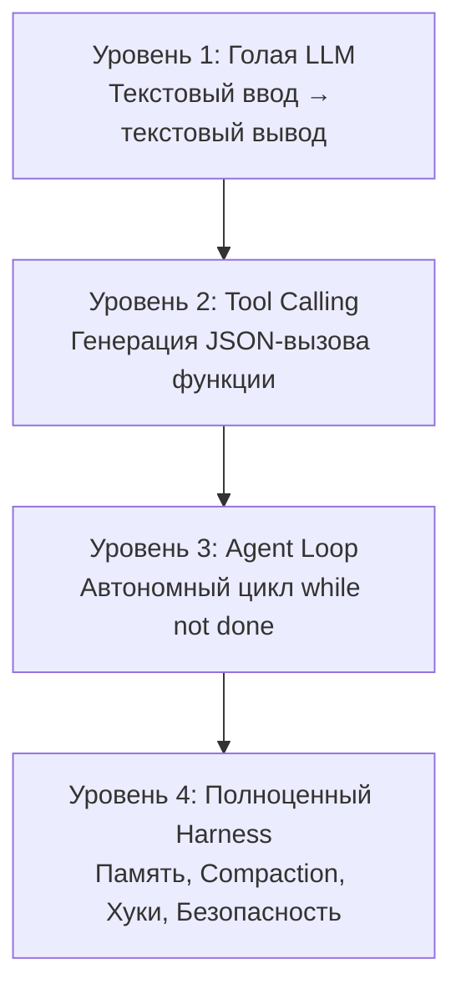
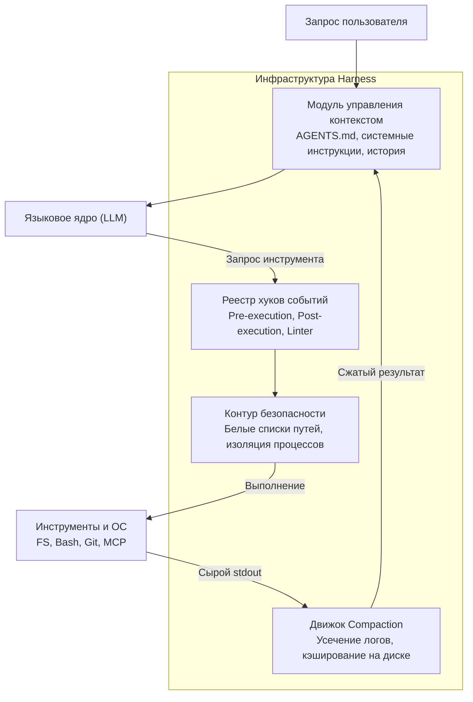

+++
title = "Архитектура Harness для AI-агентов: управление контекстом, compaction вывода и хуки исполнения"
date = 2026-10-12
description = "Инженерный анализ архитектуры Harness для LLM: управление контекстом, сжатие логов, циклы исполнения и хуки валидации в автономных агентах."
[taxonomies]
tags = ["ai-agents", "architecture", "software-engineering"]
[extra]
toc = true
mermaid = true
+++

При разработке автономных AI-систем часто возникает концептуальное заблуждение: поведение и надежность агента приписывают исключительно весам языковой модели (LLM). На практике базовая нейросеть представляет собой детерминированную или стохастическую функцию преобразования текста в текст:

$$\mathcal{M}: \mathcal{T}^{k} \to \mathcal{T}$$

где $\mathcal{T}^{k}$ — последовательность токенов в текущем окне контекста. Модель не обладает собственной памятью между вызовами, не может выполнять системные вызовы и не контролирует поток управления.

Настоящая автономность возникает за счет внешней программной инфраструктуры — среды исполнения, называемой **Harness** (обвязка). В инженерной практике справедливо строгое соотношение:

$$\text{AI-Агент} = \text{Harness (Среда исполнения)} + \text{LLM (Языковое ядро)}$$

В этом материале разобран переход от вызова инструментов к автономному циклу исполнения и детально исследована архитектура современного Harness: управление контекстной памятью, усечение вывода (compaction), перехват событий и барьеры безопасности.

---

## Эволюция от функции к среде исполнения

Развитие систем на базе LLM делится на четыре последовательных уровня зрелости.



### 1. Чистая языковая модель
Модель работает исключительно в режиме запрос-ответ в чате. Любая координация шагов требует участия оператора.

### 2. Подключение инструментов (Tool Calling)
Модели передается схема функций (JSON Schema). Когда запрос пользователя требует внешних данных, модель формирует структурированный ответ с именем инструмента и аргументами:

```json
{
  "name": "read_file",
  "arguments": {
    "path": "/workspace/config.yaml"
  }
}
```

На этом уровне выполнение функции и последующая отправка результата обратно в модель все еще управляются оператором вручную.

### 3. Автономный цикл исполнения (Agent Loop)
Программа запускает цикл обратной связи, в котором результат выполнения инструмента автоматически возвращается модели в качестве следующего сообщения роли `tool` без ожидания команды человека:

```python
def simple_agent_loop(model, client, prompt: str, tools: list):
    messages = [{"role": "user", "content": prompt}]
    while True:
        response = client.chat(messages=messages, tools=tools)
        messages.append(response.message)
        
        if not response.message.tool_calls:
            return response.message.content
            
        for tool_call in response.message.tool_calls:
            result = execute_tool(tool_call.function.name, tool_call.function.arguments)
            messages.append({
                "role": "tool",
                "tool_call_id": tool_call.id,
                "content": result
            })
```

### 4. Инфраструктурный Harness
Простой цикл `while` оказывается нежизнеспособен при реальной разработке: окно контекста быстро переполняется выводом утилит, модель зацикливается при ошибках компилятора, а неконтролируемый доступ к командной строке создает критические уязвимости. Эту системную сложность берет на себя Harness.

---

## Сравнительный анализ уровней зрелости

В таблице ниже сопоставлены функциональные возможности четырех уровней архитектуры.

| Архитектурный уровень | Управление потоком | Память и состояние | Контроль контекста | Взаимодействие со средой |
|---|---|---|---|---|
| **1. Голая LLM** | Ручной диалог | Только активный контекст | Отсутствует | Нет |
| **2. LLM + Tools** | Ручной пошаговый вызов | В рамках сессии | Линейное накопление | Одиночные вызовы функций |
| **3. Agent Loop** | Цикл `while not done` | Сессионная история | Риск переполнения | Автоматический вызов утилит |
| **4. Полноценный Harness** | Политики, тайм-ауты, подзадачи | Долгосрочная база, файлы проекта | Compaction, ротация, вытеснение | Изоляция, хуки, песочницы |

Качественный скачок между уровнями 3 и 4 заключается в переносе ответственности за устойчивость системы с когнитивных способностей модели на надежную инфраструктурную обвязку.

---

## Архитектура современного Harness

Harness выполняет функции операционной системы для языковой модели. Он абстрагирует модель от низкоуровневых операций ввода-вывода и контролирует целостность рабочего пространства.



---

## Ключевые подсистемы Harness

### 1. Подмешивание проектного контекста и иерархия памяти
Модель не должна получать всю кодовую базу в одном запросе. Harness организует многоуровневую загрузку контекста:
- **Глобальные системные правила:** базовые ограничения поведения агента.
- **Инструкции проекта:** автоматическое считывание локальных файлов конфигурации (`AGENTS.md`, `CLAUDE.md`, `.cursorrules`). Harness читает их из рабочей директории и подмешивает в системный контекст до запуска цикла.
- **Динамическая память:** сессионные заметки и процедурные навыки (Skills), подгружаемые только по запросу через специализированные селекторы.

### 2. Сжатие контекста и усечение вывода (Compaction)
При сборке проектов или запуске тестов утилиты могут генерировать мегабайты текстовых логов. Передача такого объема в окно контекста приводит к двум проблемам:
1. Катастрофический рост стоимости и задержки инференса.
2. Деградация внимания модели (эффект *lost in the middle*).

Harness применяет адаптивный алгоритм усечения вывода:

```python
MAX_INLINE_CHARS = 30_000

def compact_tool_output(raw_output: str, cache_dir: str) -> str:
    if len(raw_output) <= MAX_INLINE_CHARS:
        return raw_output

    head_budget = MAX_INLINE_CHARS // 3
    tail_budget = MAX_INLINE_CHARS // 3
    
    # Сохраняем полный вывод на диск для доступа через read_file
    disk_path = persist_to_disk(raw_output, cache_dir)
    
    head = raw_output[:head_budget]
    tail = raw_output[-tail_budget:]
    omitted_chars = len(raw_output) - head_budget - tail_budget
    
    return (
        f"{head}\n\n"
        f"[... Вывод усечен: пропущено {omitted_chars} символов. "
        f"Полный лог сохранен: {disk_path} ...]\n\n"
        f"{tail}"
    )
```

Такой подход гарантирует, что модель видит начало выполнения команды (аргументы, конфигурацию) и ее конец (стектрейс ошибки или статус завершения), сохраняя возможность адресно прочитать пропущенный фрагмент.

### 3. Перехват событий через хуки (Event Hooks)
Вместо надежды на то, что модель сама вспомнит запустить линтер после правки файла, Harness использует детерминированные перехватчики жизненного цикла:
- **Pre-execution hook:** проверка запрашиваемой команды перед выполнением. Блокировка опасных системных вызовов (`rm -rf /`, модификация `.git/config`).
- **Post-execution hook:** автоматический запуск синтаксического анализатора (AST-парсера или компилятора) после записи в файл. Если инструмент создал файл с синтаксической ошибкой, Harness сразу возвращает сообщение об ошибке компиляции в том же шаге.

---

## Архитектура минимального промышленного Harness

Ниже представлена полнофункциональная реализация ядра Harness на Python с поддержкой хуков, усечения вывода и изоляции:

```python
import os
import subprocess
from dataclasses import dataclass
from typing import Callable, Dict, Any, List

@dataclass
class ToolResult:
    output: str
    exit_code: int
    truncated: bool = False

class HarnessKernel:
    def __init__(self, workspace: str, max_output_chars: int = 15000):
        self.workspace = os.path.abspath(workspace)
        self.max_output_chars = max_output_chars
        self.pre_hooks: List[Callable[[str, Dict[str, Any]], None]] = []
        self.post_hooks: List[Callable[[str, ToolResult], ToolResult]] = []

    def register_pre_hook(self, hook: Callable[[str, Dict[str, Any]], None]):
        self.pre_hooks.append(hook)

    def register_post_hook(self, hook: Callable[[str, ToolResult], ToolResult]):
        self.post_hooks.append(hook)

    def execute(self, tool_name: str, **kwargs) -> ToolResult:
        # Фаза Pre-execution: валидация безопасности
        for hook in self.pre_hooks:
            hook(tool_name, kwargs)

        # Вызов целевого инструмента
        if tool_name == "run_shell":
            result = self._exec_shell(kwargs.get("command", ""))
        elif tool_name == "write_file":
            result = self._exec_write(kwargs.get("path", ""), kwargs.get("content", ""))
        else:
            raise ValueError(f"Неизвестный инструмент: {tool_name}")

        # Фаза Post-execution: форматирование и compaction
        for hook in self.post_hooks:
            result = hook(tool_name, result)

        return result

    def _exec_shell(self, command: str) -> ToolResult:
        proc = subprocess.run(
            command,
            shell=True,
            cwd=self.workspace,
            stdout=subprocess.PIPE,
            stderr=subprocess.STDOUT,
            text=True
        )
        return ToolResult(output=proc.stdout, exit_code=proc.returncode)

    def _exec_write(self, rel_path: str, content: str) -> ToolResult:
        target = os.path.abspath(os.path.join(self.workspace, rel_path))
        if not target.startswith(self.workspace):
            raise PermissionError("Выход за пределы рабочей директории")
        
        os.makedirs(os.path.dirname(target), exist_ok=True)
        with open(target, "w", encoding="utf-8") as f:
            f.write(content)
        return ToolResult(output=f"Файл успешно записан: {rel_path}", exit_code=0)
```

В этой архитектуре языковая модель полностью изолирована от низкоуровневых системных дескрипторов, а любая операция проходит через строгий контур валидации.

---

## Ключевые выводы

- Языковая модель сама по себе является функциональным транслятором текста. Реальная автономность и надежность определяются архитектурой внешней среды исполнения.
- Переход от простого `while not done` к промышленному Harness требует решения задач контекстной памяти, ротации истории и сжатия вывода утилит.
- Compaction вывода инструментов устраняет переполнение окна контекста и предотвращает деградацию внимания модели при обработке длинных логов.
- Детерминированные хуки жизненного цикла гарантируют валидацию синтаксиса и безопасность системы надежнее, чем инструкции в системном промпте.

---

## Первоисточники и материалы
* **Оригинальное видео:** [Артём Шумейко — ИИ-Агент vs Харнесс — В чем разница? Пишем свой Харнесс](https://youtu.be/0o08ZDSJy8A)
* **Заметки и детальный конспект:** [Obsidian Vault / YouTube](https://github.com/xsa-dev/obsidian-vault/blob/main/YouTube/Artem-Shumeiko-AI-Agent-vs-Harness-2026.md)
* **Инженерные наработки:** [github.com/xsa-dev](https://github.com/xsa-dev)
