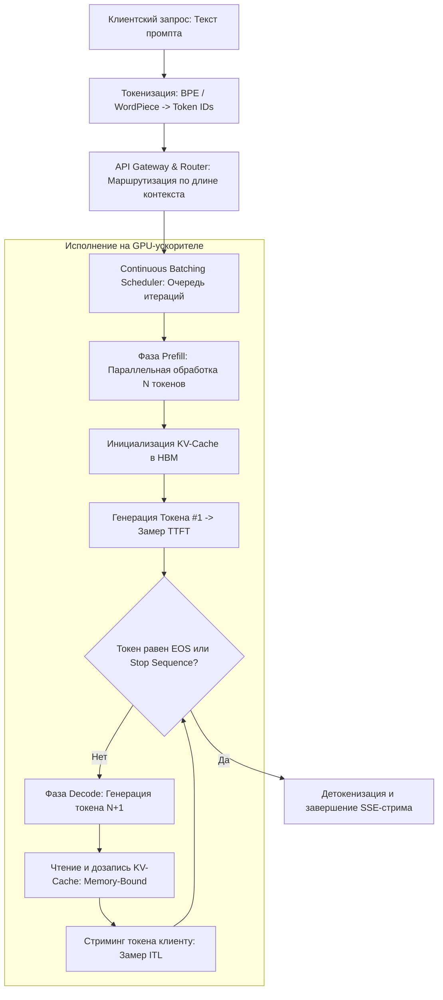

+++
title = "Архитектура LLM-инференса: Prefill vs Decode, физика KV-кэша и оптимизация пропускной способности GPU"
date = 2026-11-01
description = "Глубокий инженерный разбор физики LLM-инференса: разделение на фазы Prefill и Decode, бутылочное горлышко пропускной способности памяти HBM, расчет размера KV-кэша, метрики TTFT/ITL, непрерывный батчинг (Continuous Batching) и PagedAttention."
[taxonomies]
tags = ["mlops", "architecture", "performance", "software-engineering"]
[extra]
toc = true
mermaid = true
+++

В эпоху повсеместного развертывания автономных AI-агентов, чат-систем и ассистентов программирования фокус инженерных команд сместился с обучения моделей на их эффективное обслуживание в продакшене. Обучение Frontier LLM требует сотен миллионов долларов и месяцев работы кластеров, но выполняется один раз, формируя статический набор матриц весов. Инференс, напротив, происходит непрерывно на каждый пользовательский или агентный запрос, и в жизненном цикле успешного продукта совокупные затраты на инференс многократно превышают бюджет обучения.

Ключевая сложность инференса современных трансформеров заключается в фундаментальной асимметрии вычислений: обработка входящего контекста и генерация каждого последующего токена подчиняются совершенно разным законам физики полупроводников и архитектуры ускорителей. 

В данном материале представлен детальный разбор внутреннего устройства инференс-движков, основанный на анализе инженерного доклада IBM Technology ([What Is LLM Inference? How AI Models Generate Responses](https://youtu.be/615-yWyS1n0)) под руководством Мартина Кина (Martin Keen), с углублением в математику внимания, модель Roofline и механизмы управления памятью GPU.

---

## 1. Анатомия сквозного пайплайна инференса

Когда клиентское приложение или агент отправляет запрос к OpenAI-совместимому эндпоинту (`POST /v1/chat/completions`), запрос проходит через многоуровневый конвейер оркестрации, балансировки и планирования вычислений.



### Этап 0: Токенизация и маршрутизация

Трансформер не оперирует сырыми символами или строками. Модуль токенизации (Byte-Pair Encoding, SentencePiece) разбивает входной текст на дискретные целочисленные идентификаторы (`Token IDs`) из словаря $\mathcal{V}$ ($|\mathcal{V}| \approx 32\,000 - 128\,000$). Размер словаря напрямую влияет на вычислительную плотность:
* Чем шире словарь, тем более компактно кодируется текст (меньше токенов на предложение).
* Однако выходной слой проекции (Language Model Head) пропорционален $|\mathcal{V}|$, что увеличивает объем матричных умножений на каждом шаге генерации.

После токенизации запрос поступает в планировщик инференс-сервера (vLLM, TensorRT-LLM, TGI). На этом этапе запрос разделяется на две несовместимые фазы вычислений: **Prefill** и **Decode**.

---

## 2. Prefill Phase: Вычислительная плотность и параллельный GEMM

Фаза Prefill (обработка промпта / Prompt Processing) запускается ровно один раз для каждого входящего запроса. Модель принимает весь вектор входных токенов $X \in \mathbb{R}^{L \times d}$ (где $L$ — длина промпта, $d$ — скрытая размерность) и вычисляет проекции Query, Key, Value параллельно для всех позиций:

$$Q = X W\_Q, \quad K = X W\_K, \quad V = X W\_V$$

Здесь $W\_Q, W\_K, W\_V \in \mathbb{R}^{d \times d}$ — статические матрицы весов внимания.

### Физика выполнения: Compute-Bound режим

Поскольку длина промпта $L$ обычно велика ($L \ge 512$ токенов), умножение активаций на матрицы весов преобразуется в плотные матричные операции **GEMM (General Matrix Multiply)**:

$$\text{GEMM}: [L \times d] \times [d \times d] \to [L \times d]$$

В терминах архитектуры GPU (тензорные ядра NVIDIA Hopper/Blackwell) матричное умножение с большими размерами измерений характеризуется высокой **арифметической интенсивностью** (Arithmetic Intensity):

$$I = \frac{\text{Количество операций (FLOPs)}}{\text{Объем прочитанных данных (Bytes)}}$$

Для операции GEMM размерности $[M \times K] \times [K \times N]$ число операций равно $2 M K N$, а объем передаваемых данных составляет $(M K + K N + M N) \times \text{sizeof(dtype)}$. При $M = L \gg 1$ затраты на чтение матриц весов амортизируются по всем $L$ токенам входного пакета. 

Арифметическая интенсивность достигает $I \gg 100 \text{ FLOPs/Byte}$, что выводит вычисления на горизонтальную полку **модели Roofline** — исполнение ограничено исключительно пиковой мощностью тензорных ядер (Compute-Bound), а не пропускной способностью шины памяти.

```text
Модель Roofline для фазы Prefill:
Производительность (TFLOPs)
     ▲
Пик  │─────────────────────────── [ Compute-Bound: Фаза Prefill ]
     │                          /
     │                         /  (GEMM: высокие значения FLOPs/Byte)
     │                        /
     │                       /
     │                      /
     │                     /
     │                    / [ Memory-Bandwidth-Bound ]
     └───────────────────┴────────────────────────────────────────►
                         Критическая точка            Арифметическая интенсивность
                         баланса системы              I (FLOPs / Byte)
```

Именно фаза Prefill определяет метрику **TTFT (Time to First Token)** — интервал времени от момента отправки HTTP-запроса до получения первого сгенерированного токена. Для интерактивных чат-ботов и агентов реального времени низкий TTFT критичен для субъективного ощущения мгновенного отклика.

---

## 3. Decode Phase: Авторегрессионный цикл и барьер пропускной способности памяти

Как только фаза Prefill завершена и первый токен сгенерирован, модель переходит в авторегрессивную фазу **Decode**. На каждом шаге декодинга генерируется строго один новый токен, который добавляется к контексту для генерации следующего.

### Математика авторегрессии: $O(1)$ токен за шаг

Входными данными для шага декодинга является вектор одного последнего токена $x\_t \in \mathbb{R}^{1 \times d}$. Модель вычисляет:

$$q\_t = x\_t W\_Q, \quad k\_t = x\_t W\_K, \quad v\_t = x\_t W\_V$$

Затем вычисляется вектор внимания к текущему токену и всем предыдущим сохраненным ключам:

$$\alpha\_t = \text{Softmax}\left(\frac{q\_t K_{1..t}^T}{\sqrt{d\_k}}\right), \quad o\_t = \alpha\_t V_{1..t}$$

### Физика выполнения: Memory Bandwidth-Bound режим

В фазе Decode матричное умножение вырождается в операцию **GEMV (General Matrix-Vector Multiply)**: умножение одного вектора длины $d$ на огромную матрицу весов размером $[d \times d]$:

$$\text{GEMV}: [1 \times d] \times [d \times d] \to [1 \times d]$$

Для выполнения этого шага вычислительные ядра GPU обязаны:
1. Загрузить все веса модели (например, 140 ГБ для 70B модели в формате FP16) из глобальной видеопамяти HBM в локальные регистры SRAM вычислительных мультипроцессоров (SM).
2. Выполнить всего $2 \times d^2$ арифметических операций с вектором длины $1 \times d$.
3. Записать результат обратно.

Арифметическая интенсивность падает до критически низкого уровня:

$$I_{\text{decode}} = \frac{2 \times d^2 \text{ FLOPs}}{2 \times d^2 \text{ Bytes (FP16)}} \approx 1 \text{ FLOP/Byte}$$

Современный ускоритель NVIDIA H100 SXM5 обладает пиковой вычислительной мощностью $\approx 1\,000 \text{ TFLOPs}$ (FP16) и пропускной способностью памяти HBM3 $\approx 3.35 \text{ ТБ/с}$. Балансировочная точка системы требует:

$$I_{\text{balance}} = \frac{1\,000 \times 10^{12} \text{ FLOPs/s}}{3.35 \times 10^{12} \text{ Bytes/s}} \approx 298 \text{ FLOPs/Byte}$$

При $I_{\text{decode}} \approx 1 \text{ FLOP/Byte}$ тензорные ядра загружены менее чем на **1%** своей теоретической мощности! Они простаивают в ожидании перекачки данных по шине HBM. Этот феномен называется **Memory Wall** (стена памяти).

Фаза Decode определяет ключевую метрику стриминга — **ITL (Inter-Token Latency)**: задержку между последовательными токенами. Для человека комфортная скорость чтения составляет $15 - 25$ токенов в секунду ($\text{ITL} \approx 40 - 65$ мс). Для автономных агентов, генерирующих сотни строк кода и JSON-схем, требуется максимальная скорость ($> 100$ токенов/сек).

---

## 4. Анатомия и физика KV-кэша (Key-Value Cache)

Без механизма KV-кэша авторегрессионный декодинг был бы невозможен на длинных контекстах.

### Почему без кэша сложность составляет $O(N^2)$

Если бы модель не сохраняла промежуточные результаты, то для генерации токена $t+1$ ей пришлось бы заново прогонять через все слои трансформера всю цепочку токенов $1..t$. Суммарное количество вычислительных операций для последовательности длины $N$ составило бы:

$$\sum_{t=1}^{N} O(t) = O(N^2)$$

При длине контекста $8\,192$ токена время генерации возрастало бы квадратично с каждым шагом, приводя к экспоненциальному замедлению.

### Механика сохранения состояний

Механизм **KV-Cache** сохраняет матрицы ключей $K$ и значений $V$ для всех предшествующих токенов в высокоскоростной памяти GPU (VRAM HBM). На шаге $t$ вычисляются проекции только для одного нового токена $x\_t$, после чего новые векторы $k\_t$ и $v\_t$ дописываются в конец кэша:

$$K_{1..t} = [K_{1..t-1} \,\|\, k\_t], \quad V_{1..t} = [V_{1..t-1} \,\|\, v\_t]$$

Вычислительная сложность каждого шага генерации снижается до константной $O(1)$ относительно матрицы весов модели и линейной $O(t)$ относительно длины кэша для механизма внимания.

```text
Структура сохранения KV-кэша по слоям:

Слой L-1:  [ K_1, K_2, ..., K_t ]    [ V_1, V_2, ..., V_t ]
  ...             ...                          ...
Слой 1:    [ K_1, K_2, ..., K_t ]    [ V_1, V_2, ..., V_t ]
Слой 0:    [ K_1, K_2, ..., K_t ]    [ V_1, V_2, ..., V_t ]
           ▲
           └──── Занимает динамический объем HBM для каждого активного запроса!
```

### Формула расчета объема памяти KV-кэша

Инженеры часто недооценивают размер памяти, необходимый для хранения KV-кэша при масштабировании батча. Объем памяти вычисляется по строгой формуле:

$$M_{\text{KV}} = 2 \times n_{\text{bytes}} \times n_{\text{layers}} \times n_{\text{kv\_heads}} \times d_{\text{head}} \times L \times b$$

Где:
* $2$ — два тензора на каждый слой: Key и Value;
* $n_{\text{bytes}}$ — размер типа данных в байтах (2 для FP16/BF16, 1 для FP8);
* $n_{\text{layers}}$ — количество слоев трансформера;
* $n_{\text{kv\_heads}}$ — количество голов внимания для Key/Value (при Grouped-Query Attention меньше, чем Query-голов);
* $d_{\text{head}}$ — размерность одной головы внимания ($d / n_{\text{heads}}$);
* $L$ — суммарная длина контекста (промпт + сгенерированные токены);
* $b$ — размер батча (число параллельно обрабатываемых запросов).

#### Практический расчет: LLaMA-3 70B
* $n_{\text{layers}} = 80$
* $n_{\text{kv\_heads}} = 8$ (Grouped-Query Attention с 8 KV-головами на 64 Query-головы)
* $d_{\text{head}} = 128$
* Тип данных: BF16 ($n_{\text{bytes}} = 2$)
* Длина контекста: $L = 8\,192$ токенов

Рассчитаем размер KV-кэша на **один** запрос ($b = 1$):

$$M_{\text{KV}} = 2 \times 2 \times 80 \times 8 \times 128 \times 8\,192 \times 1 \text{ байт}$$
$$M_{\text{KV}} = 2\,684\,354\,560 \text{ байт} \approx 2.5 \text{ ГБ на один запрос!}$$

Если сервер параллельно обрабатывает батч из $b = 32$ запросов с контекстом $8\,192$, суммарный объем KV-кэша составит:

$$32 \times 2.5 \text{ ГБ} = 80 \text{ ГБ VRAM}$$

Это сопоставимо с объемом памяти, занимаемым самими квантованными весами модели! Нехватка памяти под KV-кэш приводит к аварийным сбросам запросов (Out-Of-Memory) или принудительному сбросу контекста на хост (CPU swapping).

---

## 5. Метрики производительности: TTFT, ITL, Throughput и Latency Tail

Для объективного профилирования и оптимизации инференса в MLOps-инфраструктуре используется стандартизированная система метрик.

| Метрика | Определение | Определяющая фаза | Влияние на систему | Стратегии оптимизации |
|---|---|---|---|---|
| **TTFT** *(Time to First Token)* | Время от отправки запроса до генерации первого токена | **Prefill** (Compute-Bound) | Отзывчивость чат-ботов, реакция UI, время старта агента | FlashAttention-3, Chunked Prefill, Prompt Caching (кэширование системных промптов) |
| **ITL** *(Inter-Token Latency)* | Среднее время генерации одного токена в процессе стриминга | **Decode** (Memory-Bound) | Скорость потокового вывода, время решения задач генерации кода | Квантование весов (INT4/FP8), Speculative Decoding, тензорный параллелизм (TP) |
| **E2E Latency** | Полное время ответа: $\text{TTFT} + N_{\text{gen}} \times \text{ITL}$ | Prefill + Decode | Полное время блокировки вызывающего пайплайна | Сокращение длины генерации, ранний Stop-токен |
| **Throughput** *(Tokens/sec)* | Суммарное количество сгенерированных токенов в секунду на кластер | Decode батча | Экономическая эффективность сервера, стоимость одного токена | Continuous Batching, PagedAttention, высокий concurrency |
| **P99 Tail Latency** | Задержка 99-го перцентиля запросов под нагрузкой | Очереди планировщика | SLA и стабильность корпоративных сервисов | Приоритизация очередей, ограничение длины промпта |

---

## 6. Современные архитектуры инференса: как преодолеть барьеры

Классические наивные реализации инференса страдают от фрагментации памяти и неэффективного использования вычислительных мощностей GPU. Современные движки (vLLM, TensorRT-LLM, SGLang) используют три прорывные архитектурные концепции:

### 1. PagedAttention: решение проблемы фрагментации

В традиционных фреймворках память под KV-кэш выделялась непрерывным статическим блоком максимального размера (например, под максимальные $8\,192$ токена), поскольку модель не знает заранее, сколько токенов сгенерирует пользователь. Это приводило к катастрофическим потерям:
* **Внутренняя фрагментация:** резервирование 8k токенов для ответа, потребовавшего 50 токенов (до 80% памяти простаивает впустую).
* **Внешняя фрагментация:** разрозненные неиспользуемые куски памяти, не позволяющие выделить новый непрерывный блок.

Технология **PagedAttention** (предложенная исследователями UC Berkeley в проекте vLLM) заимствует концепцию виртуальной страничной памяти из операционных систем:
* KV-кэш разбивается на небольшие фиксированные блоки (страницы), например по 16 или 32 токена.
* Память выделяется динамически по мере генерации новых токенов.
* Физические блоки в VRAM могут располагаться произвольно, а соответствие логического контекста физическим адресам поддерживается через таблицу страниц (`Block Table`).
* Поддерживается механизм Copy-on-Write при параллельном ветвлении промптов (beam search или параллельные агентные траектории).

Результат: утилизация памяти возрастает до **96%**, что позволяет увеличить размер батча в 2–4 раза на том же оборудовании.

### 2. Continuous Batching (Итерационный батчинг)

Традиционный статический батчинг группирует $B$ запросов и ждет, пока завершится самый длинный из них. Если запрос #1 сгенерировал 20 токенов, а запрос #2 — 1000 токенов, то поток #1 будет простаивать на протяжении 980 итераций, удерживая выделенные ресурсы.

**Continuous Batching** (или Cellular/Iteration-Level Batching, впервые реализованный в Orca):
* Планировщик работает на уровне отдельных итераций декодинга.
* Как только запрос завершает генерацию (выдан токен EOS), его слот освобождается.
* На следующей итерации в освободившийся слот мгновенно подсаживается новый входящий запрос из очереди, для которого выполняется фаза Prefill.
* Вычислительные ядра GPU загружены равномерно на 100% времени.

### 3. Chunked Prefill: устранение всплесков задержки ITL

Когда в плотно загруженный сервер, выполняющий Decode для десятков клиентов, поступает новый тяжелый промпт (например, контекст на $32\,000$ токенов), выполнение его фазы Prefill может занять 500–1000 мс. В это время фаза Decode для всех остальных активных запросов полностью замораживается, вызывая резкий скачок ITL (джиттер стриминга).

Механизм **Chunked Prefill** (Sarathi-Serve) разбивает тяжелый промпт на фиксированные чанки (например, по 512 токенов):
* На каждом шаге планировщик совмещает декодинг текущего батча с обработкой одного чанка префилла.
* Нагрузка на GPU сбалансирована: вычисления объединяют GEMM (чанк префилла) и GEMV (шаг декодинга), поднимая среднюю арифметическую интенсивность без деградации ITL.

---

## 7. Сравнительная архитектурная матрица

| Характеристика | Фаза Prefill | Фаза Decode |
|---|---|---|
| **Операция линейной алгебры** | GEMM (Matrix-Matrix Multiply) | GEMV (Matrix-Vector Multiply) |
| **Режим исполнения** | **Compute-Bound** (ограничен TFLOPs) | **Memory-Bound** (ограничен ГБ/с HBM) |
| **Арифметическая интенсивность ($I$)** | Высокая ($I \gg 100 \text{ FLOPs/Byte}$) | Критически низкая ($I \approx 1-2 \text{ FLOPs/Byte}$) |
| **Утилизация тензорных ядер** | Высокая ($> 60-80\%$) | Низкая ($< 5-15\%$ без батчинга) |
| **Ключевая целевая метрика** | TTFT (Time to First Token) | ITL (Inter-Token Latency) |
| **Поведение KV-кэша** | Инициализация и первичное заполнение | Последовательное дописывание по 1 вектору |
| **Эффективное ускорение** | FlashAttention, Prompt Caching, Chunking | Квантование (FP8/INT4), PagedAttention, Speculative Decoding |

---

## 8. Практические выводы для инженеров

1. **Разделяйте требования агентов к TTFT и ITL:** Если агент выполняет поиск и маршрутизацию по коротким промптам, ключевым фактором является TTFT. Используйте Prompt Caching для системных инструкций и спецификаций инструментов.
2. **Используйте Grouped-Query Attention (GQA):** Модели с поддержкой GQA (такие как LLaMA-3 и Mistral) сокращают объем KV-кэша в 4–8 раз по сравнению с Multi-Head Attention, пропорционально снижая требования к пропускной способности памяти при декодинге.
3. **Внедряйте PagedAttention и Continuous Batching в продакшене:** Использование серверов vLLM или TensorRT-LLM вместо базовых реализаций HuggingFace дает 5–10-кратный прирост пропускной способности без изменения весов модели.
4. **Квантуйте KV-кэш до FP8:** Перевод KV-кэша из 16-битного формата в FP8 вдвое снижает нагрузку на шину памяти при декодинге, практически не ухудшая качество генерации на большинстве бенчмарков.

---

## Первоисточники и ссылки
* Видео-доклад: [What Is LLM Inference? How AI Models Generate Responses](https://youtu.be/615-yWyS1n0) — Martin Keen, IBM Technology.
* Архитектура PagedAttention: *Efficient Memory Management for Large Language Model Serving with PagedAttention* (Woosuk Kwon et al., UC Berkeley / vLLM).
* Принципы итерационного планирования: *Orca: A Distributed Serving System for Transformer-Based Generative Models* (OSDI '22).
