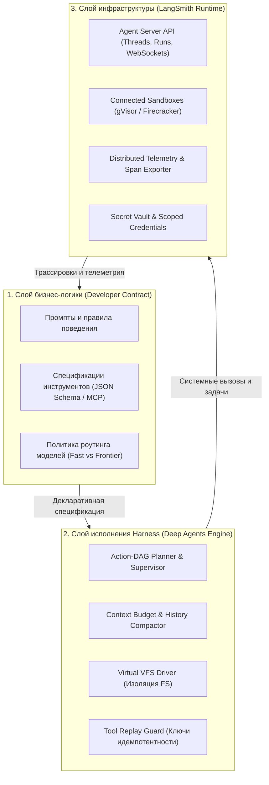
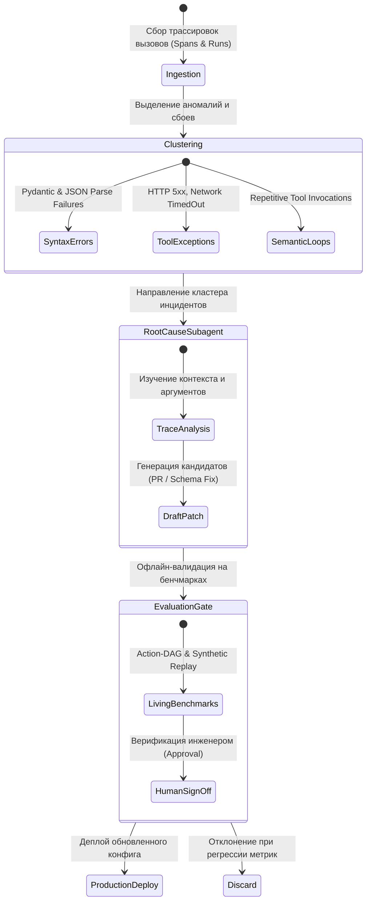

+++
title = "Архитектура агентного рантайма: трехуровневое разделение, изоляция песочниц и аудит сбоев в Managed Deep Agents"
date = 2026-10-25
description = "Инженерный анализ архитектуры серверных агентных рантаймов на примере LangChain Managed Deep Agents: разделение слоев ответственности, изоляция вызовов в MicroVM, идемпотентность инструментов и контур офлайн-анализа инцидентов."
[taxonomies]
tags = ["ai-agents", "architecture", "software-engineering", "evals", "devops"]
[extra]
toc = true
mermaid = true
+++

При переходе от локальных прототипов к многопользовательским производственным системам разработка AI-агентов сталкивается с фундаментальным кризисом надежности. Простейшая реализация агента как цикла над вызовами API языковой модели (`while not done`) рушится при первых же эксплуатационных нагрузках: сбоях сети, исчерпании оперативной памяти контейнера, неконтролируемых модификациях хостовой файловой системы и накоплении ошибок в длинных цепочках действий.

В октябре 2026 года LangChain представил платформенное решение **Managed Deep Agents (MDA)** на базе `LangSmith Agent Server`. За продуктовым релизом сервиса стоит классическая задача распределенных систем: декомпозиция агентного приложения на ортогональные уровни абстракции, формализация транзакционных границ исполнения и изоляция недетерминированного кода модели от инфраструктуры хоста.

В данной статье разобран технический стек Managed Deep Agents, математическая модель деградации надежности многошаговых агентных графов, физика изоляции сред исполнения и устройство контура ретроспективного анализа сбоев без иллюзий «полной автономности».

> **Первоисточники:**
> * **Видео:** [Managed Deep Agents explained in 2 minutes](https://youtu.be/tJ-hlNVS7AI) (LangChain).
> * **Документация:** [LangChain MDA Overview](https://docs.langchain.com/langsmith/python/managed-deep-agents-overview).
> * **Учебный курс:** [LangChain Academy — Introduction to Deep Agents](https://academy.langchain.com/courses/foundation-introduction-to-deepagents).

---

## Проблема связанности: почему монолитные скрипты не масштабируются

Большинство любительских реализаций агентов страдают от архитектурной антипаттерн-монолитности:
* Промпты с бизнес-требованиями зашиты в одном коде с вызовами HTTP-клиента.
* Инструменты обращаются напрямую к операционной системе через `os.system` или `subprocess.run` без изоляции прав и квот ресурсов.
* Управление состоянием диалога хранится в переменной оперативной памяти (`messages = [...]`), из-за чего любой перезапуск процесса приводит к потере контекста.
* Отсутствует механизм идемпотентности: при падении процесса на шаге отправки внешнего уведомления повторный запуск неизбежно дублирует сетевой запрос (Tool Replay Disaster).

Чтобы устранить эти уязвимости, архитектура агентной системы должна быть строго разделена на три технологических слоя с фиксированными контрактами взаимодействия.

---

## Трехуровневая модель архитектуры (3-Tier Separation)

Managed Deep Agents формализует разделение ответственности между разработчиком прикладного решения, открытым агентным движком и серверной платформой:

| Уровень | Ответственность | Компоненты и контракты | Среда исполнения |
|---|---|---|---|
| **1. Бизнес-логика (Business Logic)** | Разработчик сервиса | Промпты, схемы инструментов (MCP / JSON Schema), манифесты навыков, выбор семейства моделей | Git-репозиторий / Декларативный конфиг |
| **2. Агентный цикл (Harness)** | Deep Agents Core | DAG декомпозиции, цикл `Plan-Act-Verify`, сжатие контекста (Compaction), абстракция файловой системы | Локальный или контейнерный исполнитель |
| **3. Управляемый рантайм (Runtime)** | Платформа LangSmith | Жизненный цикл сессий (`Threads & Runs`), распределенный трейсинг, изоляция песочниц, авторизация и стриминг токенов | Облачный кластер / Agent Server |



### Архитектурный контракт интерфейсов

В кодовой базе такое разделение выражается через типизированные абстракции, где Harness не зависит от конкретной реализации хранилища или облака:

```python
from abc import ABC, abstractmethod
from typing import Dict, Any, List, Optional
from dataclasses import dataclass
import hashlib
import json

@dataclass(frozen=True)
class ToolCallPayload:
    tool_name: str
    arguments: Dict[str, Any]
    idempotency_key: str

    @classmethod
    def compute_key(cls, thread_id: str, step_index: int, tool_name: str, args: Dict[str, Any]) -> str:
        serialized = json.dumps({"thread": thread_id, "step": step_index, "tool": tool_name, "args": args}, sort_keys=True)
        return hashlib.sha256(serialized.encode("utf-8")).hexdigest()

class SandboxDriver(ABC):
    """Абстракция изолированной среды исполнения инструментов."""
    @abstractmethod
    def execute_command(self, command: str, timeout_seconds: int = 30) -> Dict[str, Any]:
        """Исполняет shell-команду внутри эфемерного пространства имен."""
        pass

    @abstractmethod
    def read_virtual_file(self, path: str) -> str:
        """Безопасное чтение файла из песочницы."""
        pass

    @abstractmethod
    def create_snapshot(self) -> str:
        """Создает CoW-снапшот файловой системы перед мутацией."""
        pass

    @abstractmethod
    def rollback_snapshot(self, snapshot_id: str) -> None:
        """Откатывает состояние песочницы к сохраненному снапшоту."""
        pass

class CheckpointStore(ABC):
    """Персистентный журнал шагов и состояний (Threads & Runs)."""
    @abstractmethod
    def record_step(self, thread_id: str, step_id: int, state_delta: Dict[str, Any]) -> None:
        pass

    @abstractmethod
    def is_idempotent_executed(self, idempotency_key: str) -> Optional[Dict[str, Any]]:
        pass
```

### Протокол сессий: Threads, Runs и Streaming

Управляемый сервер предоставляет стандартизированный сетевой протокол взаимодействия с агентом:

```text
POST /api/v1/threads
Response: { "thread_id": "thr_9041a8bc", "status": "active" }

POST /api/v1/threads/thr_9041a8bc/runs
Payload:  { "assistant_id": "code_refactor_agent", "input": "Запустить миграцию БД" }
Response: Stream (Server-Sent Events)

event: step_start
data:  { "step_index": 1, "state": "planning" }

event: tool_call_proposed
data:  { "step_index": 2, "tool": "run_sql", "key": "0a8f9c1..." }

event: checkpoint_committed
data:  { "step_index": 2, "snapshot_id": "snap_v1_004" }

event: run_completed
data:  { "status": "success", "final_output": "Миграция применена без ошибок" }
```

---

## Физика изоляции: Песочницы и безопасность вызовов

Предоставление модели доступа к системной консоли хоста — грубое нарушение принципа наименьших привилегий (Least Privilege). Если агент имеет доступ к `bash`, вероятность разрушительных побочных эффектов возрастает с каждым невалидным действием.

В архитектуре MDA изоляция строится по принципу подключаемых сред (Connected Sandboxes):

1. **Host-Level (Недопустимо в Production):** запуск команд непосредственно в среде операционной системы хоста. Ошибочный вызов `rm -rf` или некорректный путь в скрипте приводит к потере данных хоста.
2. **Container-Level (Docker / Podman):** изоляция на уровне пространств имен Linux (Namespaces, cgroups). Недостаток: разделяемое ядро хоста и уязвимости повышения привилегий при монтировании сокетов Docker.
3. **MicroVM-Level (Firecracker / gVisor):** изоляция на уровне виртуализации с минималистичным ядром Linux. Холодный запуск виртуальной машины занимает около 100 мс, при этом агент изолирован аппаратным уровнем виртуализации (KVM), а файловая система монтируется в режиме Copy-on-Write.

Перед выполнением каждого шага с мутирующими действиями рантайм фиксирует легковесный снапшот состояния диска. В случае аварийного завершения или превышения лимитов памяти песочница сбрасывается к исходному состоянию без деградации хостовой инфраструктуры.

---

## Математика надежности многошаговых агентных траекторий

Почему агенты с длинными цепочками рассуждений демонстрируют нестабильные результаты на комплексных задачах? Причина кроется в мультипликативности вероятностей независимых событий.

Формализуем процесс исполнения задачи как дискретный марковский процесс принятия решений в пространстве состояний $\mathcal{S}$, пространстве действий модели $\mathcal{A}$ и наблюдений песочницы $\mathcal{O}$:

$$s_{t+1} = \mathcal{T}(s\_t, a\_t, o\_t)$$

Пусть агент выполняет задачу, состоящую из $N$ последовательных шагов. Обозначим вероятность безошибочного перехода $p\_k = P(s_{k} = \text{valid} \mid s_{k-1})$ для $k \in \{1, \dots, N\}$.

При отсутствии персистентного журнала и локального восстановления вероятность успешного завершения всей траектории $P_{\text{success}}$ строго равна:

$$P_{\text{success}} = \prod_{k=1}^{N} p\_k$$

Если допустить, что качество модели и API высоко и $p\_k = 0.95$ для каждого шага:

* При $N = 3$ шагах: $P_{\text{success}} = 0.95^3 \approx 0.857$ ($85.7\%$)
* При $N = 10$ шагах: $P_{\text{success}} = 0.95^{10} \approx 0.598$ ($59.8\%$)
* При $N = 25$ шагах: $P_{\text{success}} = 0.95^{25} \approx 0.277$ ($27.7\%$)

В наивном stateless-агенте сбой на 24-м шаге приводит к падению всей траектории. Перезапуск задачи с нуля заставляет систему повторно сжигать вычислительные токены, причем вероятность успешного прохождения повторной попытки по-прежнему составляет менее $28\%$.

### Восстановление через идемпотентные чекпоинты

В рантайме Managed Deep Agents каждый шаг сопровождается детерминированным вычислением ключа идемпотентности $\mathcal{K}\_k$:

$$\mathcal{K}\_k = \text{HMAC-SHA256}(\text{ThreadID} \,||\, \text{StepIndex} \,||\, \text{CanonicalJSON}(\text{Payload}))$$

Если шаг завершается системным исключением или таймаутом, рантайм откатывает окружение к чекпоинту $k-1$ и выполняет локальный повтор (Local Retry) или переход на альтернативную ветвь с лимитом попыток $M$:

$$P_{\text{step\_recovered}} = 1 - (1 - p\_k)^M$$

При вероятности базового шага $p\_k = 0.95$ и лимите попыток $M = 3$:

$$P_{\text{step\_recovered}} = 1 - (1 - 0.95)^3 = 1 - 0.000125 = 0.999875$$

Совокупная вероятность успешного завершения всей траектории из $N = 25$ шагов возрастает с катастрофических $27.7\%$ до стабильных промышленных показателей:

$$P_{\text{total}} = \prod_{k=1}^{25} \left[1 - (1 - p\_k)^M\right] \approx (0.999875)^{25} \approx 0.9968 \quad (99.68\%)$$

Это математическое доказательство того, почему инвестиции в инфраструктуру персистентности и идемпотентности важнее бесконечной тонкой настройки промптов.

---

## Контур ретроспективного анализа сбоев (Failure Trace Analysis)

Одной из маркетинговых тем вокруг Managed Deep Agents является тезис о «самообучении и самоисправлении» системы. Инженерный анализ показывает, что в реальности речь идет не о динамическом дообучении весов нейросети в рантайме, а об автоматизированном пайплайне анализа телеметрии и подготовке патчей для рассмотрения человеком.



### Механика работы контура:

1. **Сбор спанов и трасс:** каждое взаимодействие агента с внешней средой логируется через распределенные спаны OpenTelemetry с фиксацией входного контекста, структуры вызова инструмента, латентности и кода возврата.
2. **Кластеризация типовых сбоев:** алгоритмы группируют инциденты по сигнатурам. Например, регулярный сбой инструмента `query_sql` из-за генерации диалекта PostgreSQL вместо SQLite.
3. **Аналитический подагент (Diagnostic Agent):** изолированный агент получает выборку неуспешных трассировок, воспроизводит ошибку в тестовой песочнице и формирует проект исправления: корректировку описания аргумента в схеме инструмента, добавление негативного примера в промпт или обновление валидатора.
4. **Офлайн-бенчмаркинг (Verification Gate):** критический барьер безопасности. Любое предложенное исправление прогоняется через неизменяемый набор тестовых сценариев (Living Benchmarks). Если предложенная правка промпта устраняет одну ошибку, но ломает ранее проходившие тесты (регрессия), патч немедленно отбрасывается.
5. **Human Approval:** в продакшн-контур изменения вносятся только после одобрения инженером через pull request. Полностью автоматический деплой сгенерированных правок в live-окружение исключен из соображений безопасности.

---

## Сравнительный анализ архитектурных подходов

Перед выбором между созданием собственного агентного каркаса и подключением управляемой платформы необходимо сопоставить инженерные затраты и риски:

| Параметр | Кастомный Harness на базе Docker | Платформенный рантайм (MDA / LangSmith) |
|---|---|---|
| **Управление состоянием** | Ручная реализация поверх PostgreSQL/Redis | Встроенное хранилище `Threads & Runs` с историей шагов |
| **Изоляция инструментов** | Ручная настройка контейнеров и сетей | Автоматически выделяемые песочницы с микро-виртуализацией |
| **Интеграция протоколов** | Самописные парсеры и вызовы subprocess | Нативная поддержка Model Context Protocol (MCP) и REST |
| **Стоимость и vendor-lockin** | Полный контроль инфраструктуры, нулевая зависимость | Зависимость от облака вендора, тарификация за трейсы и рантайм |
| **Уровень задержки (Latency)** | Минимальный (локальные вызовы внутри VPC) | Дополнительный сетевой оверхед на обращения к API платформы (~150-300 мс) |
| **Контроль безопасности данных** | Все данные и логи остаются внутри приватного периметра | Трассировки и промпты передаются на сервера поставщика |

---

## Инженерные выводы

1. **Разделяйте ответственность:** архитектура агентной системы должна строго изолировать бизнес-правила от движка исполнения и инфраструктурного слоя. Это позволяет безболезненно менять базовые LLM без переписывания протоколов вызова инструментов.
2. **Инвестируйте в транзакционность, а не в промпты:** математическая устойчивость многошагового агента достигается за счет атомарных чекпоинтов, идемпотентности операций и локальных ретраев, а не бесконечного усложнения формулировок инструкций.
3. **Изолируйте среду аппаратно:** выполнение произвольного агентного кода требует изолированных песочниц на уровне MicroVM (Firecracker/gVisor). Использование хостовой системы для исполнения shell-команд недопустимо.
4. **Контур самовосстановления должен быть офлайновым:** автоматический анализ трассировок сбоев обязан формировать черновики предложений (Draft PR), проходящие через детерминированные тесты и обязательное подтверждение инженером, исключая риск неконтролируемого дрейфа поведения в продакшне.
