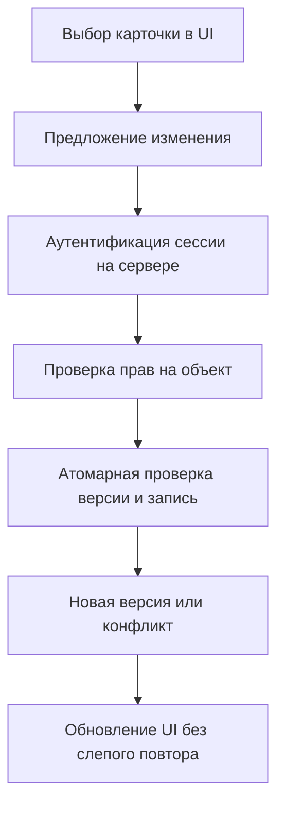

+++
title = "Авторизация MCP: безопасный выбор объекта перед вызовом инструмента"
date = 2026-10-10
description = "Как связать выбор объекта в интерфейсе с MCP-инструментом: серверная авторизация, версии данных, контроль конфликтов и проверяемый пример на Python."
[taxonomies]
tags = ["ai-agents", "architecture", "software-engineering"]
[extra]
toc = true
mermaid = true
+++

Пользователь выделил карточку в интерфейсе и попросил агента изменить её название. Между кликом и вызовом инструмента карточку могли переместить в другой проект, права пользователя — отозвать, а содержимое — обновить. Переданный моделью идентификатор определяет цель операции, но не разрешение на неё.

Повод для разбора — [видео OpenAI об интерфейсных расширениях ChatGPT](https://youtu.be/LiNhqbetrbU). Ниже — самостоятельный проект серверного контракта, а не воспроизведение показанной реализации. Названия API и доступность возможностей ChatGPT здесь не утверждаются: пример не использует SDK и не является готовым MCP-сервером. Единственное утверждение о видео — оно служит исходным материалом для темы; описываемый контракт и код в видео не проверялись.

## Контракт между выбором и действием

Рассмотрим единственную операцию: переименование карточки. Недоверенный payload инструмента содержит только `object_id`, `expected_version` и `title`. Аутентифицированный `actor` приходит из серверного контекста сессии, а не из аргументов модели; payload не может его заменить. Пространство пользователя также определяется сервером.

Граница должна быть видна в коде, а не только в комментарии: middleware извлекает `AuthenticatedActor`, а обработчик получает его отдельным параметром и принимает структуру `RenameRequest` без поля пользователя. Переименование аргумента `actor` внутри одного словаря не является авторизацией. В реальном MCP-адаптере нельзя десериализовать `AuthenticatedActor` из JSON tool arguments или разрешать модели выбирать его.

Три проверки отвечают на разные вопросы:

- **Идентификатор:** какой объект запрошен? Его существование не доказывает право доступа.
- **Авторизация:** может ли текущий пользователь менять этот объект сейчас? Проверка повторяется на каждом вызове.
- **Версия:** совпадает ли версия прочитанного объекта с текущей? При несовпадении изменение отклоняется, чтобы не затереть чужую правку.

Значение `expected_version` защищает от случайного использования устаревшего состояния, но не от злонамеренного клиента, знающего актуальную версию. Подтверждение человеком также не заменяет авторизацию.

Для этого контракта полезно зафиксировать инварианты, а не только последовательность шагов:

1. **Источник полномочий:** `actor` берётся из проверенного серверного контекста; ни одно поле `RenameRequest` не может его заменить.
2. **Безопасное отсутствие записи:** если объект не принадлежит `actor`, не существует или его версия отличается, транзакция не меняет карточку и не создаёт журнал результата.
3. **CAS:** успешная запись возможна только при `id = object_id ∧ owner_id = actor ∧ version = expected_version`; успех увеличивает версию ровно на 1.
4. **Линеаризация:** для одной строки и одного `id` успешным является ровно один из конкурирующих вызовов с одинаковой версией; остальные получают `conflict` и не делают запись.
5. **Идемпотентность:** живой ключ в области `(actor, operation, idempotency_key)` возвращает сохранённый ответ только при том же хеше payload; другой payload — `idempotency_key_reuse` без изменения карточки.

Инварианты 2–4 требуют одной транзакции и атомарного SQL, а не проверки в памяти.



## Минимальная модель проверки на Python

Код рассчитан на Python 3.10+ и последовательное выполнение в одном процессе. Словарь имитирует хранилище; он не обеспечивает транзакционность между потоками или процессами. Имена пользователей и данные синтетические. Сохраните блок как `contract.py` и запустите `python contract.py`.

Большой воспроизводимый пример PostgreSQL вынесен в [`static/examples/mcp-ui-authorization/`](../../static/examples/mcp-ui-authorization/) (после сборки сайта путь будет `/examples/mcp-ui-authorization/`). Он содержит схему, два независимых соединения, CAS-гонку и журнал идемпотентности; ниже показан его существенный SQL-контракт.

```python
from dataclasses import dataclass


@dataclass(frozen=True)
class AuthenticatedActor:
    subject: str


@dataclass(frozen=True)
class RenameRequest:
    object_id: str
    expected_version: int
    title: str


@dataclass
class Card:
    owner: str
    version: int
    title: str


class Rejected(Exception):
    pass


def rename(cards, auth_context, request):
    if not isinstance(auth_context, AuthenticatedActor):
        raise Rejected("missing server auth context")
    if not isinstance(request, RenameRequest):
        raise Rejected("invalid request")
    object_id, expected_version, title = request.object_id, request.expected_version, request.title
    if type(object_id) is not str or not object_id:
        raise Rejected("invalid input")
    if type(expected_version) is not int or expected_version < 0:
        raise Rejected("invalid input")
    if type(title) is not str or not 1 <= len(title.strip()) <= 80:
        raise Rejected("invalid input")
    card = cards.get(object_id)
    if card is None or card.owner != auth_context.subject:
        raise Rejected("not available")
    if card.version != expected_version:
        raise Rejected("conflict")
    card.title = title.strip()
    card.version += 1
    return {"id": object_id, "version": card.version, "title": card.title}


def test_contract():
    cards = {"c1": Card("alice", 7, "Draft")}
    alice = AuthenticatedActor("alice")
    result = rename(cards, alice, RenameRequest("c1", 7, "Reviewed"))
    assert result == {"id": "c1", "version": 8, "title": "Reviewed"}
    rejected = [
        (AuthenticatedActor("bob"), RenameRequest("c1", 8, "Unauthorized")),
        (alice, RenameRequest("c1", 7, "Stale")),
        (alice, RenameRequest("absent", 8, "Missing")),
        (alice, RenameRequest("c1", True, "Boolean version")),
        (alice, RenameRequest("c1", 8, "   ")),
        (alice, RenameRequest("c1", 8, "x" * 81)),
        (AuthenticatedActor("bob"), RenameRequest("c1", 8, "alice")),
    ]
    for auth_context, request in rejected:
        before = (cards["c1"].version, cards["c1"].title)
        try:
            rename(cards, auth_context, request)
        except Rejected:
            pass
        else:
            raise AssertionError("request should be rejected")
        assert before == (cards["c1"].version, cards["c1"].title)
    try:
        rename(cards, {"subject": "alice"}, RenameRequest("c1", 8, "forged context"))
    except Rejected:
        pass
    else:
        raise AssertionError("serialized context must not authorize")
    print("PASS: 1 accepted, 7 rejected; payload cannot supply auth context")


if __name__ == "__main__":
    test_contract()
```

Проверка `type(expected_version) is int` намеренно не принимает `True`: в Python логический тип является подклассом `int`. Ограничение длины здесь измеряется в Unicode-кодовых точках, не байтах и не видимых графемах. Для пользовательского интерфейса эти величины могут различаться.

## Что меняется с настоящей базой данных

Исполняемая схема использует `cards(id text primary key, owner_id text not null, version integer not null, title text not null)` и `idempotency_journal(actor_id, operation, idempotency_key, payload_hash, response jsonb, expires_at)`, с первичным ключом по области ключа. `expires_at` — атомарная политика TTL: в транзакции запрос сначала сериализует решения по scoped key через транзакционный advisory lock, затем блокирует существующую journal-строку; живую запись реплеит только при том же хеше, а просроченную удаляет и заменяет новым результатом. Это не требует фонового cleanup для корректного reuse. При одинаковом payload конкурентный вызов после commit получает replay нового результата; при разном payload он получает `idempotency_key_reuse` — без изменения карточки. Advisory lock удерживается до commit/rollback и закрывает также гонку «строка отсутствует», поэтому `UniqueViolation` не является частью контракта.

Пара «сначала прочитать, затем записать» допускает гонку. Два запроса могут увидеть версию 7, пройти проверку и по очереди записать разные названия. В PostgreSQL для простой модели владения одну проверку владельца и версии можно атомарно совместить с изменением в одной команде, внутри той же транзакции, что и journal:

```sql
UPDATE cards
SET title = :title, version = version + 1
WHERE id = :object_id
  AND owner_id = :authenticated_actor
  AND version = :expected_version
RETURNING id, version, title;
```

Это шаблон параметризованного запроса, а не исполняемый SQL-файл: синтаксис параметров зависит от драйвера. Значения нельзя подставлять конкатенацией строк. Предполагаются уникальный `id`, целочисленная версия и владение в той же строке. При отдельной таблице ACL нужна согласованная транзакционная политика проверки прав; одного условия `owner_id` уже недостаточно. Гарантия относится только к этой строке и этой команде: она не доказывает корректность ACL, триггеров, уровня изоляции, ретраев или побочных записей в других таблицах.

Одна возвращённая строка означает выполненное изменение. Ноль строк означает отсутствие объекта, недостаточные права либо несовпадение версии. Не раскрывайте неавторизованному клиенту, какое именно условие не сработало. Для пользователя с подтверждённым доступом можно отдельно получить актуальную карточку и показать конфликт. Этот SQL-шаблон здесь не проверялся на работающей PostgreSQL: unit-тест модели не является тестом конкурентного доступа к базе.

## Повторы, ошибки и критерии проверки

Если ответ потерялся после записи, повтор с прежней версией получит конфликт. Это предотвращает вторую запись в данной модели, но не позволяет клиенту отличить собственный успешный запрос от чужого изменения. Для такого различения нужен журнал идемпотентности: ключ связывается с пользователем, операцией и хешем аргументов; результат фиксируется в одной транзакции с изменением. Не следует автоматически повторять действие с новой версией — это обходит смысл защиты от устаревшего состояния.

Это не просто unit-тест: companion-тест поднимает две независимые транзакции и синхронизирует их перед `UPDATE`. Ожидаемый результат — ровно один `accepted`, один `conflict`, версия 8; конфликтующий вызов не создаёт journal row. Повтор с тем же ключом и payload возвращает сохранённый JSON-ответ, а другой payload получает `idempotency_key_reuse`. Дополнительные boundary-сценарии вставляют истёкшую строку, проверяют её атомарную замену, конкурентное повторное использование с одинаковым payload и конкурентное повторное использование с разными payload; ни один сценарий не допускает `UniqueViolation` или второго изменения карточки.

- Ошибки наружу лучше фиксировать как стабильный контракт: `invalid_request` (синтаксис/диапазоны), `unauthorized` (нет действующего контекста), `not_found_or_forbidden` (не раскрывать различие объект/ACL), `conflict` (CAS не затронул строку), `idempotency_key_reuse` (живой ключ связан с другим payload). В минимальном SQL-примере отсутствие строки намеренно сводится к `conflict`, поэтому production API может выбрать менее раскрывающий `not_found_or_forbidden` на отдельной проверке, но не должен объявлять успех.

Если PostgreSQL недоступен, эти команды остаются воспроизводимым способом проверки; результат нельзя заменять unit-тестом или утверждением о конкурентности.

Перед подключением к агенту проверьте интеграционные сценарии:

1. Два одновременных запроса с одной версией: принят ровно один, второй не меняет данные.
2. Отзыв доступа после открытия UI: последующий вызов отклонён независимо от сохранённого выбора.
3. Потеря ответа после commit: без журнала идемпотентности текущий пример гарантирует только безопасный `conflict` при повторе со старой версией; восстановление результата требует отдельного расширения.
4. Подмена идентификатора: запрос к объекту другого пользователя должен отклоняться без выдачи его данных и без изменения; это отдельный integration/security test, не доказанный этим примером.
5. Инструкция внутри названия карточки: в этом контракте значение `title` не должно влиять на `actor`, `owner` или решение авторизации; prompt-injection и downstream rendering нужно проверять отдельными тестами.

В журнал достаточно писать идентификатор запроса, исход проверки и версию, если это допускает политика хранения. Токены сессии, полный пользовательский текст и секреты не должны попадать в диагностические записи. Практически полезно разделять полномочия read-only и write-инструментов; конкретная модель зависит от системы и должна быть проверена на сервере. Необходимость подтверждения определяется риском операции, а не уверенностью модели.

## Ключевые выводы

- UI передаёт намерение и идентификатор, сервер независимо проверяет полномочия.
- Проверка версии полезна только вместе с атомарной записью; локальный пример не доказывает отсутствие гонок в production.
- Конфликт требует обновления контекста, а не слепого повтора с новым номером версии.
- Unit-тест проверяет логику отказов. Транзакции, отзыв прав и потерю ответа нужно тестировать отдельно на интеграционном стенде.

---

## Первоисточники и материалы

* **Оригинальное видео:** [OpenAI — Build Plugins for ChatGPT](https://youtu.be/LiNhqbetrbU). Видео послужило поводом для темы; код и контракт разработаны для этой статьи, не взяты из демонстрации.
* **Ограничение атрибуции:** видео — источник постановки темы; контракт, код и проверочные сценарии разработаны для этой статьи и не являются цитатой или спецификацией OpenAI.
* **Нормативный контекст MCP:** [MCP Authorization — specification](https://modelcontextprotocol.io/specification/latest/basic/authorization) (внешний нормативный контекст, не источник кода статьи).
* **Контекст OpenAI для MCP:** [Building MCP servers for ChatGPT Apps and API integrations](https://platform.openai.com/docs/mcp) (проверка границ интеграции и рисков, не источник контракта ниже).
* **SQL-семантика:** [PostgreSQL `UPDATE`](https://www.postgresql.org/docs/current/sql-update.html) и [`RETURNING`](https://www.postgresql.org/docs/current/dml-returning.html).
* **Инженерные наработки:** [github.com/xsa-dev](https://github.com/xsa-dev)
