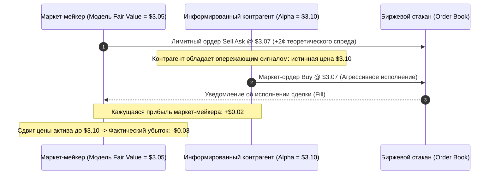
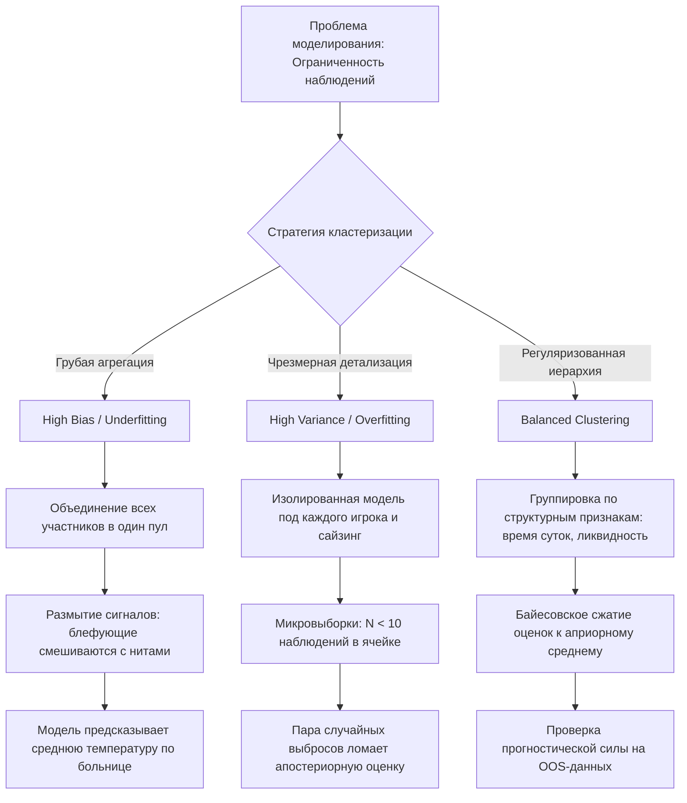
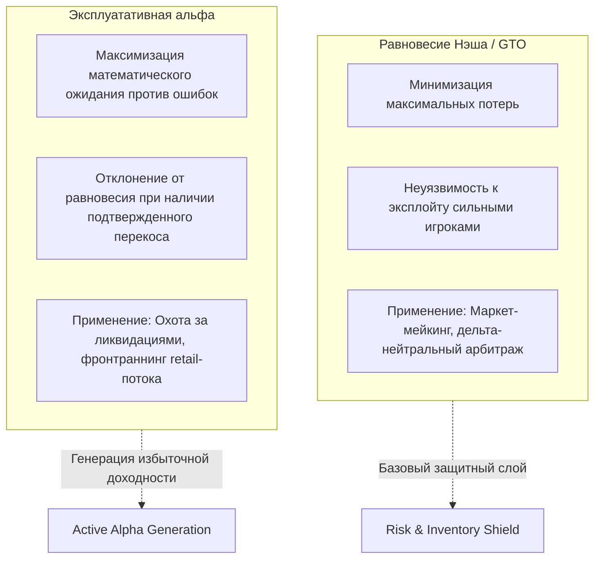
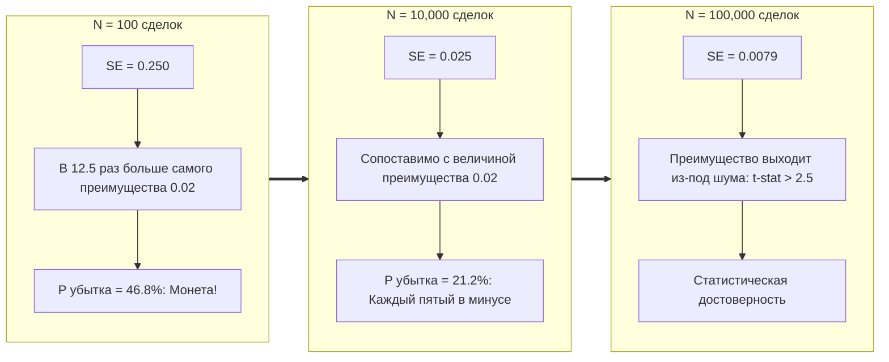
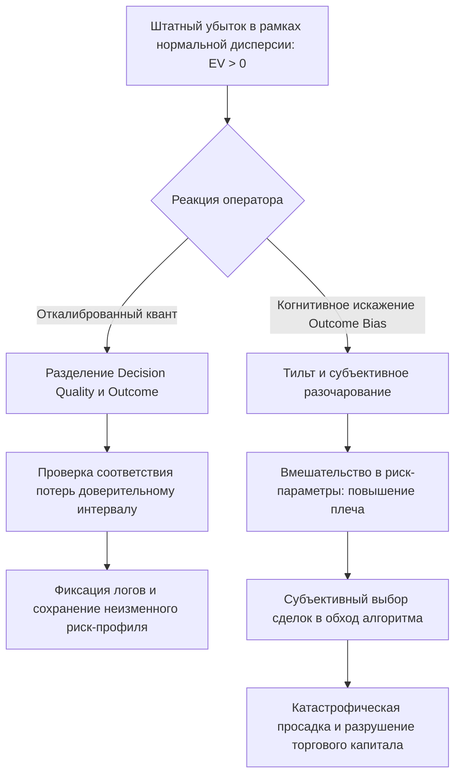

+++
title = "Квант-трейдинг по роадмапу MIT: байесовские спектры, неблагоприятный отбор, GTO и математика дисперсии"
date = 2026-11-02
description = "Детальный разбор курса MIT по покеру и теории игр для трейдеров Susquehanna и Jane Street: байесовская оценка неполной информации, неблагоприятный отбор (Adverse Selection), компромисс смещения и дисперсии при кластеризации рыночных состояний, равновесие Нэша (GTO) против эксплуатативных стратегий и математика хвостовой дисперсии."
[taxonomies]
tags = ["quant-trading", "game-theory", "risk-management", "market-making"]
[extra]
toc = true
mermaid = true
+++

В рекрутинге ведущих количественных фондов и проп-трейдинговых фирм Уолл-стрит существует контринтуитивная традиция. Такие гиганты, как **Susquehanna International Group (SIG)** с годовым объемом операций свыше \$800 млрд и расчетной торговой выручкой свыше \$20 млрд, а также **Jane Street**, системно включают покер в обязательную программу подготовки и стажировки своих количественных исследователей и трейдеров. Более того, в Массачусетском технологическом институте (MIT) был разработан специализированный курс теории игр и покера под руководством Кевина Дезмонда (Kevin Desmond), куда в качестве лекторов приглашаются легендарные кванты: Билл Чен (Bill Chen, соавтор фундаментального труда *«The Mathematics of Poker»* и квант Susquehanna), Мэтт Лоуэрс (Matt Louwerse, профессиональный трейдер и победитель турниров WSOP) и Аарон Браун (Aaron Brown, экс-руководитель риск-менеджмента фонда AQR).

Покер привлекает количественные фонды не азартом, а своей математической природой. В отличие от шахмат или го, представляющих собой игры с полной информацией и детерминированным деревом поиска, финансовый рынок и покер — это **системы с неполной информацией, стохастической средой, скрытыми состояниями и динамической обратной связью (Feedback Loop)**. 

В данном материале разобран инженерный и теоретический роадмап курса MIT, представленный в обзоре канала Unbiased Trading ([MIT's Complete Poker Roadmap for Traders](https://youtu.be/6nJyh2_tVH0)), с глубоким погружением в байесовский вывод, проблему неблагоприятного отбора (Adverse Selection), компромисс смещения и дисперсии при моделировании контрагентов и физику шума в количественных стратегиях.

---

## 1. Асимметрия информации и байесовская калибровка

В любой рыночной транзакции участник оперирует тремя фундаментальными слоями информации:
1. **Приватная информация (Private State):** собственные карты на руках в покере; закрытые лимитные ордера, складские запасы инвентаря и целевая функция в трейдинге.
2. **Публичная информация (Public State):** общие карты на борде; открытый биржевой стакан котировок (L2 Order Book), публичная лента сделок (Time & Sales) и макроэкономические публикации.
3. **Информация, извлекаемая из действий контрагента (Action-Derived Information):** размер ставки, тайминг действия и позиция за столом; агрессивное снятие ликвидности (Market Orders), айсберг-заявки и перекос дельты кумулятивного объема (CVD).

Главная ошибка начинающих исследователей заключается в предположении, что рынок нейтрален, а вероятность успеха зависит исключительно от статических характеристик инструмента. В реальности любое действие другого участника несет байесовский информационный сигнал.

### Байесовское обновление спектра блефа

Рассмотрим хрестоматийный пример из лекции MIT. Ситуация на ривере: новых карт больше не откроется, банк составляет $\$150$ (включая ставку оппонента в $\$50$). Для того чтобы увидеть карты оппонента, необходимо доставить в банк $\$50$ (Call). Итоговый размер банка составит $\$200$. 

Ваша рука побеждает любой блеф оппонента, но гарантированно проигрывает любой готовой сильной комбинации (Value Bet). Необходимый процент побед для безубыточного колла (Pot Odds) рассчитывается как:

$$\text{Break-Even Winrate} = \frac{\text{Cost of Call}}{\text{Total Pot after Call}} = \frac{50}{150 + 50} = \frac{50}{200} = 25\\%$$

Математическое ожидание решения зависит от вероятности того, что ставка оппонента является блефом ($P(\text{Bluff})$):

$$\mathbb{E}[V] = P(\text{Bluff}) \times (\text{Pot}) - (1 - P(\text{Bluff})) \times (\text{Cost})$$

* **Сценарий А (Оппонент с высокой частотой блефа, $P(\text{Bluff}) = 0.40$):**
  $$\mathbb{E}[V] = 0.40 \times (+\\$150) - 0.60 \times (\\$50) = +\\$60 - \\$30 = +\\$30$$
* **Сценарий Б (Консервативный оппонент, $P(\text{Bluff}) = 0.10$):**
  $$\mathbb{E}[V] = 0.10 \times (+\\$150) - 0.90 \times (\\$50) = +\\$15 - \\$45 = -\\$30$$

Физические карты и размер риска ($\$50$) абсолютно идентичны. Однако математическое ожидание меняет знак с $+\$30$ на $-\$30$ исключительно из-за байесовской оценки спектра контрагента.

---

## 2. Неблагоприятный отбор (Adverse Selection) в маркет-мейкинге

В алгоритмическом трейдинге концепция скрытой информации напрямую проявляется через феномен **неблагоприятного отбора**. Квант Susquehanna Джаред Тендлер иллюстрирует это на механике работы опционного маркет-мейкера.

Предположим, внутренняя ценовая модель маркет-мейкера оценивает справедливую стоимость дериватива в $\$3.05$. Желая заработать спред в 2 цента, маркет-мейкер выставляет котировку на продажу (Ask) по $\$3.07$. 



Если покупатель приходит на рынок исключительно для хеджирования портфельного риска корпоративного бизнеса (шумовой / неинформированный поток), маркет-мейкер стабильно забирает свои $\$0.02$. Обе стороны достигают цели: клиент купил страховку от волатильности, маркет-мейкер монетизировал ликвидность.

Однако если покупатель обладает информацией или опережающей моделью, которую текущая система котирования упустила (например, микроструктурный дисбаланс или латентностный арбитраж), истинная ценность актива составляет $\$3.10$. Сделка, совершенная по $\$3.07$, приносит маркет-мейкеру не прибыль в $+2$ цента, а **чистый математический убыток в $-3$ цента** ($\$3.07 - \$3.10$).

> **Инженерный вывод:** Факт исполнения вашей лимитной заявки (Fill) не является нейтральным событием. Те сделки, которые вам дают совершить чаще всего, статистически смещены в сторону ваших самых грубых модельных ошибок. Это фундаментальный закон микроструктуры: лимитные ордера всегда продают бесплатный опцион рынку.

---

## 3. Bias-Variance Dilemma при кластеризации рыночных режимов

Чтобы оценивать намерения контрагентов или предсказывать поведение цены, количественная модель должна обобщать исторические прецеденты. Однако и в покере, и в финансовых рядах исследователь сталкивается с фундаментальным компромиссом смещения и дисперсии (**Bias-Variance Tradeoff**).

Даже профессиональная дистанция в несколько сотен раздач против конкретного игрока охватывает ничтожную часть дерева состояний покера. Аналогично, на бирже конкретный паттерн стакана или микроструктуры на 1-минутном таймфрейме за последнюю неделю насчитывает ограниченное число наблюдений. Возникает необходимость объединять похожие ситуации в кластеры:



### Анатомия ошибок кластеризации

1. **Избыточная агрегация (Высокое смещение, High Bias):**
   Если сложить всех контрагентов в единое распределение, выборка будет гигантской, но агрессивные HFT-арбитражеры усреднятся с пассивными розничными трейдерами и алгоритмами ребалансировки пенсионных фондов. Полученная средняя вероятность токсичности не будет описывать ни одну из реальных групп.
2. **Чрезмерное разделение (Высокая дисперсия, High Variance):**
   Если создавать отдельную подмодель для каждого сочетания параметров (инструмент $\times$ фаза волатильности $\times$ глубина книги $\times$ время до экспирации), размер выборки в каждой ячейке упадет до единиц. Единичная аномальная сделка приведет к катастрофической переоценке вероятностей в бэктесте.

Джаред Тендлер и исследователи MIT подчеркивают: разбиение на подгруппы оправдано только тогда, когда для каждой выделенной группы есть достаточный объем статистических свидетельств, подтверждающий устойчивое различие в поведении на отложенной (Out-of-Sample) выборке.

Например, в биржевых данных ордер на покупку в 10:00:01 может быть плановой календарной ребалансировкой бенчмарка (не несущей направленного прогноза на 15 минут вперед), тогда как идентичный ордер в 14:30:00 после выхода данных по CPI обусловлен институциональной переоценкой макропараметров. Время суток и макрорежим служат обоснованными признаками для кластеризации, разделяющими шумовой поток и токсичный моментум.

---

## 4. GTO (Равновесие Нэша) против эксплуатативных стратегий

Один из центральных разделов курса MIT посвящен дихотомии между **GTO (Game Theory Optimal)** и **эксплуатативным подходом (Exploitative Strategy)**.

Чтобы продемонстрировать математическую необходимость балансировки, профессор Мэтт Лоуэрс использует модельную игру в монетку с асимметричной информацией:

### Игрушечная модель MIT: Игра в монетку с раундом ставок

* **Правила:** Два игрока вносят обязательный взнос (Ante) по $\$1$. Итоговый банк равен $\$2$. Подбрасывается симметричная монета. Если выпадает «Орел», побеждает Игрок 1. Если «Решка» — Игрок 2.
* **Асимметрия информации:** Результат подбрасывания видит **только Игрок 1**.
* **Действие:** Игрок 1 может либо поставить дополнительный $\$1$ (Bet), либо сказать «Чек» (Check).
* **Ответ Игрока 2:** 
  * Если Игрок 1 чекает, монета вскрывается немедленно: победитель забирает исходные $\$2$ банка (чистый выигрыш $+1$).
  * Если Игрок 1 ставит $\$1$, Игрок 2 должен либо сбросить монету (Fold, отдав банк $\$2$), либо уравнять ставку дополнительным $\$1$ (Call, после чего банк $\$4$ забирает победитель).

#### Наивная стратегия (Exploitable)
Наивный Игрок 1 решает: *«Буду ставить \$1 строго тогда, когда выпал Орел, и чекать, когда выпала Решка»*. Кажется логичным — ставить только тогда, когда гарантированно побеждаешь.

Однако рынок быстро адаптируется. Как только Игрок 2 понимает, что ставка всегда означает «Орла», его оптимальным ответом становится **Fold на 100% ставок**. 
* При «Орле» Игрок 1 ставит $\$1$, Игрок 2 сбрасывает, Игрок 1 забирает $\$2$ (чистый выигрыш $+\$1$).
* При «Решке» Игрок 1 чекает, монета вскрывается, Игрок 2 забирает $\$2$ (чистый убыток Игрока 1: $-\$1$).
* Математическое ожидание Игрока 1: 
  $$\mathbb{E}[V] = 0.5 \times (+\\$1) + 0.5 \times (-\\$1) = 0$$

Преимущество тайного знания результата монеты полностью испарилось! Пытаясь избежать риска проигрыша при ставке, Игрок 1 сделал свое поведение тривиально читаемым для оппонента.

#### Равновесное решение (GTO / Mixed Strategy)
Чтобы заставить оппонента коллировать ставки на победных монетах, Игрок 1 **обязан блефовать** с определенной математически выверенной частотой $\alpha$.

Если банк перед ставкой равен $P = 2$, а размер ставки $B = 1$, шансы банка (Pot Odds) для Игрока 2 при колле составляют:

$$\text{Odds} = \frac{B}{P + B} = \frac{1}{2 + 1} = \frac{1}{3} \approx 33.3\\%$$

Следовательно, Игрок 1 должен сбалансировать диапазон так, чтобы отношение блефов к велью-ставкам составляло ровно $1 : 2$ (то есть 1 блеф на 2 ставки на вэлью):
* На всех 100% «Орлов» Игрок 1 ставит $\$1$ (Value Bet).
* На 50% «Решек» Игрок 1 также ставит $\$1$ (Bluff)!
* В остальных 50% «Решек» Игрок 1 чекает.

Теперь при ставке в диапазоне Игрока 1 содержится $\frac{2}{3}$ сильных исходов и $\frac{1}{3}$ блефов. Оппонент становится **индифферентен** между коллом и фолдом (EV обоих действий для него строго равно нулю). Любая попытка эксплуатировать Игрока 1 проваливается. Игрок 1 гарантирует себе строго положительный доход за счет равновесия Нэша.



### Применение в алгоритмических стратегиях

На бирже это разделение определяет специализацию quant-инфраструктуры:
1. **Маркет-мейкеры и HFT (GTO):** Котирование обязано быть максимально сбалансированным. Если маркет-мейкер асимметрично расширяет спред или котирует только одну сторону, он мгновенно подвергается токсичному арбитражу. GTO здесь — это броня от информированных контрагентов.
2. **Направленные фонды (Exploitative):** Игра строго по GTO против слабых нерациональных участников (например, панически ликвидирующихся трейдеров на криптовалютных деривативах) субоптимальна. Если оппонент систематически сбрасывает в 90% случаев, GTO-балансировка теряет деньги: оптимальным действием становится блеф на 100% диапазона до тех пор, пока рынок не адаптируется.

---

## 5. Математика дисперсии: почему 100 сделок ничего не доказывают

Самый драматичный урок, который количественные исследователи выносят из покера, — это истинный масштаб **хвостовой дисперсии (Noise-to-Signal Ratio)**.

Джаред Тендлер приводит реальные цифры из хедз-ап лимитного холдема. В этой дисциплине устойчивое долгосрочное преимущество топового игрока над сильным полем составляет около:

$$\mu = +0.02 \quad \text{больших ставок на раздачу (Big Bets / hand)}$$

При этом стандартное отклонение (волатильность) результата на одну конкретную раздачу равно:

$$\sigma = 2.50 \quad \text{больших ставок}$$

Вычислим отношение шума к полезному сигналу:

$$\frac{\text{Noise}}{\text{Signal}} = \frac{\sigma}{\mu} = \frac{2.50}{0.02} = 125$$

> **Шум превосходит полезный сигнал в 125 раз!** Результат любой отдельной раздачи или торговой сессии на 99.2% определяется случайным блужданием дисперсии и лишь на 0.8% — фундаментальным преимуществом.

### Статистическая неопределенность на выборках

Пусть раздачи независимы и одинаково распределены ($i.i.d.$). Рассмотрим суммарный результат игрока через $N$ раздач. 
* Математическое ожидание совокупного выигрыша: $\mathbb{E}[S_N] = N \cdot \mu$
* Стандартное отклонение совокупного выигрыша: $\sigma_{S_N} = \sigma \cdot \sqrt{N}$

Рассчитаем метрики для выборок разного размера:

| Число раздач / сделок ($N$) | Ожидаемый результат ($\mathbb{E}[S_N]$) | Стандартное отклонение ($\sigma_{S_N}$) | Стандартная ошибка среднего ($\text{SE} = \frac{\sigma}{\sqrt{N}}$) | Вероятность закрыть дистанцию в убытке ($P(S_N < 0)$) |
|---|---|---|---|---|
| **100** | $+2.0\text{ BB}$ | $25.0\text{ BB}$ | $0.250\text{ BB}$ | **$46.8\\%$** |
| **1,000** | $+20.0\text{ BB}$ | $79.1\text{ BB}$ | $0.079\text{ BB}$ | **$39.8\\%$** |
| **10,000** | $+200.0\text{ BB}$ | $250.0\text{ BB}$ | $0.025\text{ BB}$ | **$21.2\\%$** |
| **100,000** | $+2{,}000.0\text{ BB}$ | $790.6\text{ BB}$ | $0.0079\text{ BB}$ | **$0.57\\%$** |



### Выводы для бэктестинга и оценки алгоритмов

1. **Ловушка коротких бэктестов:** Если торговый робот совершил 100 сделок за месяц и показал просадку, с вероятностью почти $47\\%$ это чистая флуктуация дисперсии, не имеющая отношения к работоспособности логики. И наоборот: прибыльная серия из 100 сделок не доказывает наличия альфы.
2. **Квадратный корень времени:** Чтобы повысить точность оценки альфы в 10 раз, объем выборки независимых сделок необходимо увеличить в $10^2 = 100$ раз.
3. **Псевдонезависимость наблюдений (Execution Clustering):** Если алгоритм разбивает один крупный ордер на 10 TWAP-слайсов, исполняемых в течение одной 5-минутки, это **не 10 независимых сделок**. Это одна сделка с коррелированным риском. По аналогии: ставки на флопе, терне и ривере в рамках одной покерной раздачи не являются независимыми проверками преимущества — они оперируют одним и тем же исходным раскладом.

---

## 6. Алгоритмическая симуляция: байесовская калибровка и Монте-Карло дисперсии

Для строгой валидации математических моделей, преподаваемых в MIT, реализуем симуляционный скрипт на Python. Модуль решает три задачи:
1. Вычисляет байесовское апостериорное распределение вероятности блефа оппонента с бета-априорным распределением $\text{Beta}(\alpha_0, \beta_0)$.
2. Рассчитывает матрицу выигрышей и проверяет смешанное равновесие Нэша в игре с неполной информацией.
3. Запускает симуляцию Монте-Карло для 10,000 независимых сессий, рассчитывая эмпирическую вероятность просадки при соотношении шума к сигналу $\sigma / \mu = 125$.

```python
import numpy as np

def bayesian_bluff_update(prior_alpha: float, prior_beta: float, observed_bluffs: int, observed_value_bets: int) -> float:
    """
    Байесовское обновление распределения вероятности блефа:
    Posterior ~ Beta(alpha_0 + observed_bluffs, beta_0 + observed_value_bets)
    Возвращает математическое ожидание апостериорной вероятности P(Bluff).
    """
    post_alpha = prior_alpha + observed_bluffs
    post_beta = prior_beta + observed_value_bets
    expected_bluff_prob = post_alpha / (post_alpha + post_beta)
    return expected_bluff_prob

def solve_coin_game_equilibrium(pot: float, bet: float):
    """
    Аналитическое решение смешанного равновесия Нэша для игры с монеткой (MIT Toy Model).
    Игрок 1 видит монету (Орел/Решка).
    Игрок 2 принимает решение о колле.
    """
    # Шансы банка для Игрока 2: P(Call) безразличен, если Bluff_Freq = Bet / (Pot + Bet)
    alpha_bluff = bet / (pot + bet)
    # Частота колла Игрока 2, делающая блеф Игрока 1 нулевым по EV
    p_call = pot / (pot + bet)
    
    return {
        "p1_bluff_frequency_on_tails": alpha_bluff,
        "p2_call_frequency": p_call,
        "expected_value_p1": 0.5 * (pot / 2) # гарантированная альфа от информации
    }

def monte_carlo_variance_simulation(mu: float, sigma: float, n_steps: int, n_simulations: int = 5000):
    """
    Монте-Карло симуляция накопленного P&L при высоком уровне шума (Noise-to-Signal ratio).
    """
    np.random.seed(42)
    # Генерация N путей
    draws = np.random.normal(loc=mu, scale=sigma, size=(n_simulations, n_steps))
    cumulative_pnl = np.cumsum(draws, axis=1)
    
    final_pnl = cumulative_pnl[:, -1]
    pct_loss = np.mean(final_pnl < 0) * 100.0
    empirical_mean = np.mean(final_pnl)
    empirical_se = np.std(final_pnl) / np.sqrt(n_simulations)
    
    return {
        "n_steps": n_steps,
        "pct_sessions_in_loss": pct_loss,
        "mean_final_pnl": empirical_mean,
        "standard_error": empirical_se
    }

if __name__ == "__main__":
    # 1. Байесовский апдейт: слабоинформированное априорное Beta(1, 1), 4 блефа из 10 проверенных раздач
    p_bluff = bayesian_bluff_update(prior_alpha=1.0, prior_beta=1.0, observed_bluffs=4, observed_value_bets=6)
    print(f"Апостериорная вероятность блефа: {p_bluff:.3f}")
    
    # 2. Равновесие Нэша в игре MIT (Банк $2, Ставка $1)
    eq = solve_coin_game_equilibrium(pot=2.0, bet=1.0)
    print(f"GTO частота блефа: {eq['p1_bluff_frequency_on_tails']:.3f}, Частота колла оппонента: {eq['p2_call_frequency']:.3f}")
    
    # 3. Монте-Карло для 100 и 10,000 сделок при mu=0.02, sigma=2.5
    res_100 = monte_carlo_variance_simulation(mu=0.02, sigma=2.5, n_steps=100)
    res_10k = monte_carlo_variance_simulation(mu=0.02, sigma=2.5, n_steps=10000)
    print(f"N=100: Сессий в минусе = {res_100['pct_sessions_in_loss']:.1f}%")
    print(f"N=10000: Сессий в минусе = {res_10k['pct_sessions_in_loss']:.1f}%")
```

---

## 7. Психология тильта и деградация процесса

Понятие «тильта» пришло в финансовый словарь квантов именно из покера благодаря трудам Джареда Тендлера (*«The Mental Game of Poker»* / *«The Mental Game of Trading»*).

В систематическом трейдинге тильт проявляется не в эмоциональных криках перед монитором, а в **структурном разрушении дисциплины исполнения**:
* Несанкционированное ручное вмешательство в размер позиций (Revenge Trading) с целью быстрее «отыграть» просадку;
* Повышение кредитного плеча после серии убыточных сделок, маскирующее хвостовой риск ликвидации;
* Преждевременное отключение проверенных на долгой дистанции стратегий в момент прохождения штатного расчетного даунсвинга;
* Постоянная перенастройка гиперпараметров фильтров бэктеста под свежие рыночные шумы (Overfitting Feedback Loop).



Когда трейдер совершает колл с математическим ожиданием $+\$30$, он в $60\\%$ случаев встает из-за стола с локальным убытком в $-\$50$. Профессионализм заключается в том, чтобы после 5 таких убытков подряд шестой колл был сделан с точно такой же математической точностью, без страха и колебаний.

---

## 8. Сводная матрица: перенос концептов MIT Poker в архитектуру квант-фондов

Сравнительная таблица соответствия между теоретико-игровыми концептами покера и продакшен-архитектурой количественного фонда:

| Концепт теории игр / Покер | Аналог в количественном трейдинге | Архитектурная реализация в софте | Риск при игнорировании |
|---|---|---|---|
| **Pot Odds & Break-Even Equity** | Соотношение риск/прибыль (R:R) и калибровка порога срабатывания классификатора | Модуль валидации сигналов: фильтрация сделок строго при прогнозируемом $\mathbb{E}[V] > \text{Costs}$ | Вход в отрицательные сделки с видимой высокой частотой побед (Winrate trap) |
| **Adverse Selection** | Неблагоприятный отбор и токсичность потока в биржевом стакане | Quote Skewing алгоритмы: учет направления рыночной дельты и сдвиг котировок от информированного потока | Исполнение лимитных заявок ровно перед сильными пробоями цены против позиции |
| **GTO Mixed Strategy** | Балансировка размера заявок, рандомизация тайминга и дельта-нейтральность | Execution Algos (TWAP/VWAP с гауссовским шумом по времени и объему) | Выявление присутствия алгоритма другими HFT и хищнический фронтраннинг |
| **Bias-Variance State Clustering** | Определение рыночных режимов (Vol regimes, Macro states) | Иерархические байесовские модели, кластеризация скрытых марковских цепей (HMM) | Оверфиттинг на шумных подвыборках либо нечувствительность к смене фазы рынка |
| **Downswing & Noise-to-Signal** | Просадки портфеля при сохранении фундаментальной альфы | Доверительные коридоры Монте-Карло, стресс-тестирование исторических просадок | Паническая ликвидация работающей стратегии на дне штатного даунсвинга |
| **Hand History Review** | Аудит качества исполнения ордеров (TCA — Transaction Cost Analysis) | Неизменяемый структурированный лог: входной вектор признаков $\to$ решение модели $\to$ фактический слиппедж | Невозможность отделить ошибку кода/модели от нормальной рыночной волатильности |

---

## Чеклист для разработчиков торговых алгоритмов

Для перевода покерных принципов MIT в кодовую базу торговой системы необходимо внедрить следующие инженерные инварианты:

- [x] **Изоляция оценки решений (Decision Quality vs Outcome):** Оценивайте эффективность стратегии не по P&L за последнюю неделю, а по метрике опережения бенчмарка и сохранению математического ожидания на дистанции не менее $N = \frac{100 \cdot \sigma^2}{\mu^2}$ наблюдений.
- [x] **Учет стоимости исполнения в $\mathbb{E}[V]$:** Ни один сигнал не должен попадать в исполнение без явного вычитания спреда, биржевой комиссии, фандинга и расчетного проскальзывания.
- [x] **Защита от неблагоприятного отбора:** При лимитном маркет-мейкинге модуль котирования обязан отслеживать дисбаланс ленты сделок (Trade Flow Imbalance) и расширять спред либо снимать заявки при всплеске агрессивных маркет-ордеров.
- [x] **Аппаратные риск-лимиты (Anti-Tilt Hard Stops):** Архитектура торгового демона должна блокировать возможность увеличения размера позиции или частоты сделок после достижения дневного лимита просадки (Kill-Switch на уровне API-шлюза).
- [x] **Журналирование контекста решений:** Каждая отправка ордера должна сопровождаться сохранением снимка признакового пространства (Feature Snapshot), чтобы при последующем аудите отличать плохие решения модели от нормальных потерь при верных шансах.
