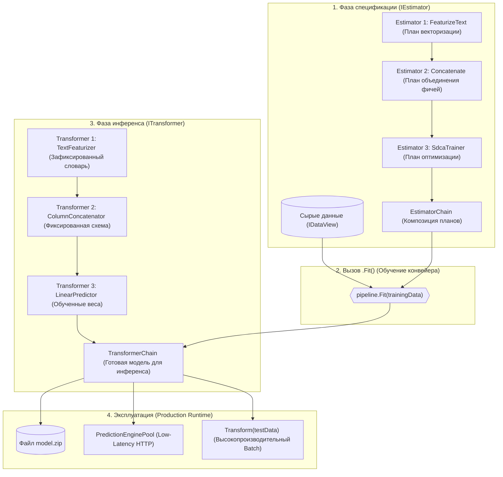
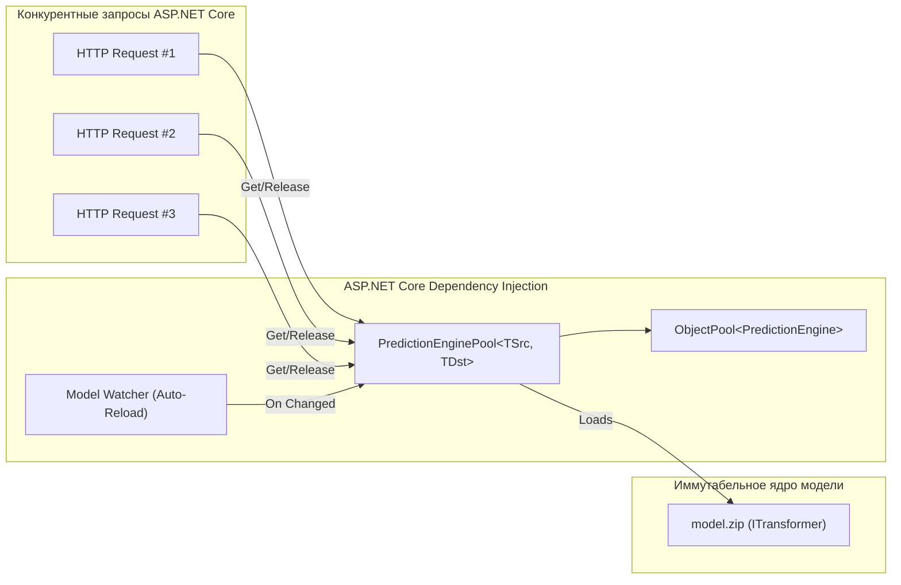

+++
title = "Архитектура конвейеров ML.NET: паттерн Estimator-Transformer, потоковый IDataView и потокобезопасный инференс"
date = 2026-10-27
description = "Глубокий инженерный разбор архитектуры конвейеров машинного обучения в ML.NET: математика паттерна Estimator-Transformer, ленивая потоковая модель IDataView без аллокаций памяти, статическая валидация схемы данных SchemaShape и безопасный пул инференса PredictionEnginePool в продакшене."
[taxonomies]
tags = ["architecture", "machine-learning", "software-engineering", "mlops", "performance"]
[extra]
toc = true
mermaid = true
+++

При переносе моделей машинного обучения в промышленную эксплуатацию (production) большинство инженерных команд сталкиваются с классической архитектурной дилеммой: разделить стек на Python-микросервис инференса (FastAPI / Triton / TorchServe) и основную платформу на C# / .NET либо запускать инференс внутри единого процесса приложения. Первый путь неизбежно налагает накладные расходы: межсетевые задержки сериализации/десериализации (JSON/Protobuf over HTTP/gRPC), усложнение мониторинга распределенных сервисов и фактор возникновения дефектов — **рассинхронизацию этапа предобработки фичей (training-serving skew)**.

Когда нормализация данных, кодирование категориальных признаков и токенизация текста реализуются в Python-пайплайне (например, Pandas / scikit-learn), а в сервисе на C# инженеры пытаются повторить ту же логику на лету, неизбежно возникают расхождения в округлении, словарях и обработке пропусков.

Платформа **ML.NET** от Microsoft решает эту проблему на уровне архитектурного проектирования рантайма. Позаимствовав фундамент компонентной модели Apache Spark и строго типизированный конвейер вычислений, ML.NET инкапсулирует весь цикл — от сырых типов CLR до обученных весов и пост-обработки — в единый сериализуемый артефакт.

Ключевой строительный блок этой экосистемы — паттерн **`Estimator` $\to$ `Transformer`**, работающий поверх легковесной курсорной модели данных **`IDataView`**.

> **Первоисточники и документация:**
> * **Официальная спецификация архитектуры API:** [ML.NET API Concepts](https://learn.microsoft.com/en-us/dotnet/machine-learning/mldotnet-api) (Microsoft Learn).
> * **Репозиторий и исходный код ядра:** [dotnet/machinelearning](https://github.com/dotnet/machinelearning) (Microsoft Open Source).
> * **Концептуальная спецификация IDataView:** [IDataView Design Principles](https://github.com/dotnet/machinelearning/blob/main/docs/code/idataview-design-principles.md).

---

## Проблема компонентной модели ML-пайплайнов

В традиционных объектно-ориентированных архитектурах классы совмещают состояние и поведение. Однако для задач машинного обучения такое совмещение порождает путаницу:
- Алгоритм обучения требует тяжелых оптимизаторов, градиентных шагов, эпох и доступа к полной выборке данных. При этом он не хранит готовых весов до окончания процесса.
- Обученная модель, напротив, должна быть компактной, неизменяемой (immutable) и потокобезопасной. Ей не нужны алгоритмы оптимизации, гиперпараметры и тренировочные датасеты.
- Трансформеры предобработки (например, `OneHotEncoder` или `MinMaxScaler`) имеют две разные фазы: на шаге анализа выборки они вычисляют статистики (словари токенов, минимальные и максимальные значения признаков), а на шаге применения — лишь применяют зафиксированное преобразование к новым строкам.

Попытка объединить эти фазы в едином интерфейсе вида `IModel.TrainAndPredict()` приводит к утечкам памяти, случайному дообучению на тестовых данных (data leakage) и невозможности безопасной сериализации.

Архитектура ML.NET строго разделяет эти две роли через контракты **`IEstimator<TTransformer>`** и **`ITransformer`**.

---

## Архитектурный дуализм: IEstimator vs ITransformer

В основе конвейера ML.NET лежит математический дуализм обучения и отображения:



### Контракт IEstimator<TTransformer>

Интерфейс `IEstimator<TTransformer>` представляет собой **рецепт или алгоритм обучения**. Он не содержит обученных весов и параметров распределения признаков.

```csharp
public interface IEstimator<out TTransformer>
    where TTransformer : class, ITransformer
{
    // Обучение трансформера на предоставленном наборе данных
    TTransformer Fit(IDataView input);

    // Статическая проверка совместимости схемы до выполнения вычислений
    SchemaShape GetOutputSchema(SchemaShape inputSchema);
}
```

Ключевые свойства эстиматора:
1. **Stateless (отсутствие состояния модели):** экземпляр хранит только конфигурационные параметры (гиперпараметры регуляризации `l2Regularization`, размер N-грамм текста, количество деревьев решений `numberOfTrees`).
2. **Фабрика трансформеров:** единственный результат вызова `.Fit(data)` — создание соответствующего объекта `ITransformer`.
3. **Строгая типизация результата:** обобщенный параметр `out TTransformer` гарантирует, что конкретный эстиматор (например, `TextFeaturizingEstimator`) порождает строго определенный трансформер (`TextFeaturizingTransformer`).

### Контракт ITransformer

Интерфейс `ITransformer` представляет собой **обученную модель или завершенное детерминированное преобразование данных**:

```csharp
public interface ITransformer
{
    // Применение трансформации к входному представлению данных
    IDataView Transform(IDataView input);

    // Валидация и получение результирующей схемы колонок
    DataViewSchema GetOutputSchema(DataViewSchema inputSchema);

    // Флаг детерминированности представления
    bool IsRowToRowMapper { get; }
}
```

Ключевые свойства трансформера:
1. **Stateful & Immutable:** трансформер хранит зафиксированные матрицы весов нейросети, веса линейной регрессии, словарь BPE/TF-IDF или средние значения нормализации $\mu$ и $\sigma$. После создания его состояние неизменно.
2. **Потокобезопасность (Thread-Safe):** метод `Transform()` не модифицирует внутреннее состояние трансформера. Один и тот же экземпляр `ITransformer` может одновременно обрабатывать независимые потоки данных из сотен конкурентных запросов.
3. **Автономность от обучающего кода:** трансформер не содержит в себе кода оптимизатора (L-BFGS, SDCA, Adam) и не тянет зависимости для расчета градиентов.

### Математическая композиция в конвейере

Пусть вектор входных признаков сырых данных обозначается как $x \in \mathcal{X}$, а вектор целевой переменной как $y \in \mathcal{Y}$.

Конвейер состоит из последовательности шагов трансформации $\mathcal{T}\_1, \mathcal{T}\_2, \dots, \mathcal{T}\_k$ и финального алгоритма предсказания $\mathcal{P}$.

На этапе построения конвейера композиция эстиматоров формирует составной план:

$$\mathcal{E}\_{\text{pipeline}} = \mathcal{E}\_1 \otimes \mathcal{E}\_2 \otimes \dots \otimes \mathcal{E}\_m$$

При вызове метода `.Fit(\mathcal{D}\_{\text{train}})` происходит поочередное «замораживание» состояний каждого шага:

$$\mathcal{T}\_1 = \mathcal{E}\_1.\text{Fit}(\mathcal{D}\_{\text{train}}), \quad \mathcal{D}\_1 = \mathcal{T}\_1.\text{Transform}(\mathcal{D}\_{\text{train}})$$

$$\mathcal{T}\_2 = \mathcal{E}\_2.\text{Fit}(\mathcal{D}\_1), \quad \mathcal{D}\_2 = \mathcal{T}\_2.\text{Transform}(\mathcal{D}\_1)$$

$$\dots$$

$$\mathcal{M} = \text{TransformerChain} = \mathcal{T}\_m \circ \mathcal{T}\_{m-1} \circ \dots \circ \mathcal{T}\_1$$

Результирующий оператор $\mathcal{M}$ является замкнутым отображением $\mathcal{M}: \mathcal{X} \to \mathcal{Y}'$, готовым к сериализации в бинарный поток.

---

## Сравнительная таблица компонентов конвейера

| Архитектурная характеристика | `IEstimator<TTransformer>` | `ITransformer` |
|---|---|---|
| **Концептуальная аналогия** | Алгоритм / Рецепт вычислений | Скомпилированная модель / Готовое блюдо |
| **Основной метод выполнения** | `Fit(IDataView input)` | `Transform(IDataView input)` |
| **Входные данные** | Обучающий датасет (`IDataView`) | Произвольный датасет или одиночный вектор (`IDataView`) |
| **Выходной артефакт** | Обученный объект `ITransformer` | Обогащенный `IDataView` с добавленными колонками |
| **Хранение состояния** | Stateless (только конфигурация) | Stateful & Immutable (веса, словари, матрицы) |
| **Потокобезопасность** | Не критично (используется однократно) | Строго Thread-Safe для конкурентного инференса |
| **Сериализация в model.zip** | Не сохраняется | Сохраняется в полном объеме |
| **Примеры реализаций** | `SdcaRegressionTrainer`, `TextFeaturizingEstimator` | `LinearRegressionModelParameters`, `NormalizingTransformer` |

---

## Модель потоковых данных: IDataView и SchemaShape

Фундаментальное отличие ML.NET от библиотек вроде Pandas заключается в том, что `IDataView` — это не таблица в оперативной памяти (in-memory DataFrame), а **потоковая курсорная абстракция (streaming data cursor)**, вдохновленная реляционными движками СУБД.

### Архитектурные принципы IDataView:

1. **Ленивые вычисления (Lazy Evaluation):** добавление трансформатора в конвейер не итерирует по данным. Ни один байт из CSV-файла или базы данных не считывается, пока потребитель не запросит курсор `GetRowCursor()`.
2. **Эффективность работы с памятью (Out-of-Core Processing):** поскольку данные читаются через курсор по одной строке (или пачками строк), датасет размером в 500 ГБ может быть успешно обработан на машине с 8 ГБ оперативной памяти.
3. **Отсутствие аллокаций в Large Object Heap (LOH):** сложные объекты (например, текстовые векторы) передаются через структуры `VBuffer<T>`, которые переиспользуют один и тот же буфер памяти для каждой новой строки, предотвращая фрагментацию кучи и частые паузы сборщика мусора (GC Gen 2).

### Механизм SchemaShape и раннее обнаружение ошибок

В динамических языках ошибка несоответствия имен колонок или типов данных (например, передача `float` вместо `double`) проявляется глубоко в рантайме после часов обучения.

В ML.NET интерфейс `IEstimator` содержит метод:

```csharp
SchemaShape GetOutputSchema(SchemaShape inputSchema);
```

Класс `SchemaShape` описывает схему данных в терминах колонок, типов и векторов до запуска обучения:
- Имя колонки (`Name`);
- Тип элементов (`ItemType`, например `NumberDataViewType.Single`);
- Размерность (`IsVector`, `VectorLength`);
- Наличие метаданных (KeyValues, SlotNames).

При связывании цепочки эстиматоров:

```csharp
var pipeline = mlContext.Transforms.Text.FeaturizeText("TextFeatures", "Review")
    .Append(mlContext.Transforms.Concatenate("Features", "TextFeatures", "UserRating"))
    .Append(mlContext.BinaryClassification.Trainers.SdcaLogisticRegression());
```

ML.NET немедленно валидирует граф типов: эстиматор `SdcaLogisticRegression` требует колонку с именем `Features` типа `VBuffer<float>`. Если на предыдущем шаге колонка была случайно названа `FeatureVector`, исключение `ArgumentException` будет выброшено **мгновенно в момент сборки конвейера**, задолго до чтения тяжелых файлов с диска.

---

## Продакшен-инференс: ограничения PredictionEngine и решение через PredictionEnginePool

Для выполнения единичного предсказания с минимальной задержкой ML.NET предоставляет фасад `PredictionEngine<TSrc, TDst>`.

```csharp
var predEngine = mlContext.Model.CreatePredictionEngine<CustomerInput, ChurnPrediction>(model);
var result = predEngine.Predict(new CustomerInput { Age = 34, MonthlySpend = 120.5f });
```

### В чем опасность классического PredictionEngine?

1. **`PredictionEngine` НЕ является потокобезопасным (Thread-Unsafe):**
   Внутри `PredictionEngine` содержит разделяемые изменяемые буферы для отображения объектов C# во внутреннее представление `DataViewRow`. Если вызвать метод `.Predict()` одновременно из двух потоков пула ASP.NET Core, произойдет повреждение внутренних структур памяти и некорректный расчет фичей (race condition).
2. **Создание нового `PredictionEngine` на каждый запрос — архитектурно некорректный паттерн:**
   При вызове `CreatePredictionEngine()` ML.NET генерирует динамический CIL-байткод через Reflection.Emit для оптимизации чтения полей класса. Создание движка занимает 10–50 миллисекунд и нагружает процессор. Создавать его внутри каждого контроллера HTTP-запроса нельзя.

### Архитектура PredictionEnginePool

Для промышленного использования в высоконагруженных веб-сервисах Microsoft разработала компонент **`Microsoft.Extensions.ML`** с пулом предсказаний **`PredictionEnginePool<TSrc, TDst>`**:



`PredictionEnginePool` решает три фундаментальные задачи:
1. **Thread-Safety через переиспользование пула:** на базе высокопроизводительного `ObjectPool<PredictionEngine<TSrc, TDst>>` каждый поток получает эксклюзивный доступ к движку на время расчета и возвращает его обратно в пул без аллокаций.
2. **Dependency Injection:** нативно регистрируется в контейнере зависимостей `IServiceCollection` как синглтон.
3. **Бесшовное горячее обновление моделей (Zero-Downtime Reloading):** пул умеет автоматически отслеживать изменения файла модели на диске или в Azure Blob Storage (`WatchForChanges()`). При появлении новой версии `model.zip` пул фоново инициализирует новые движки и атомарно подменяет активную ссылку без перезапуска процесса и без сброса активных соединений.

---

## Практический код: построение, сохранение и инференс конвейера

Ниже представлен сквозной пример на C# (.NET 8/9, ML.NET 3.0+), реализующий полный цикл: от строго типизированного конвейера до регистрации в ASP.NET Core.

### 1. Доменные модели входных и выходных данных

```csharp
using Microsoft.ML.Data;

namespace MlNetArchitecture.Domain;

// Входной DTO с сырыми признаками
public sealed class SupportTicketData
{
    [LoadColumn(0)]
    public string TicketId { get; set; } = string.Empty;

    [LoadColumn(1)]
    public string Description { get; set; } = string.Empty;

    [LoadColumn(2)]
    public string Department { get; set; } = string.Empty;

    [LoadColumn(3)]
    public float SystemLoadRatio { get; set; }

    [LoadColumn(4)]
    public bool IsCriticalUrgent { get; set; }
}

// Выходной DTO с результатами инференса
public sealed class UrgentPrediction
{
    // Результат бинарного решения
    [ColumnName("PredictedLabel")]
    public bool IsUrgent { get; set; }

    // Калиброванная вероятность принадлежности к классу
    public float Probability { get; set; }

    // Некалиброванный скор модели (raw logit)
    public float Score { get; set; }
}
```

### 2. Конвейер обучения и сохранения модели (Estimator 	o Transformer)

```csharp
using Microsoft.ML;
using MlNetArchitecture.Domain;

namespace MlNetArchitecture.Training;

public static class ModelTrainer
{
    public static void TrainAndExport(string datasetPath, string outputModelPath)
    {
        var mlContext = new MLContext(seed: 42);

        // 1. Потоковая загрузка данных через IDataView
        IDataView fullData = mlContext.Data.LoadFromTextFile<SupportTicketData>(
            datasetPath,
            hasHeader: true,
            separatorChar: ',');

        // 2. Разделение на обучающую и тестовую выборки (Holdout Split)
        var split = mlContext.Data.TrainTestSplit(fullData, testFraction: 0.2);

        // 3. Построение конвейера из IEstimator компонентов
        var pipeline = mlContext.Transforms.Text.FeaturizeText(
                outputColumnName: "DescriptionFeatures",
                inputColumnName: nameof(SupportTicketData.Description))
            .Append(mlContext.Transforms.Categorical.OneHotEncoding(
                outputColumnName: "DepartmentEncoded",
                inputColumnName: nameof(SupportTicketData.Department)))
            .Append(mlContext.Transforms.NormalizeMinMax(
                outputColumnName: "NormalizedLoad",
                inputColumnName: nameof(SupportTicketData.SystemLoadRatio)))
            .Append(mlContext.Transforms.Concatenate(
                outputColumnName: "Features",
                "DescriptionFeatures",
                "DepartmentEncoded",
                "NormalizedLoad"))
            .Append(mlContext.BinaryClassification.Trainers.SdcaLogisticRegression(
                labelColumnName: nameof(SupportTicketData.IsCriticalUrgent),
                featureColumnName: "Features",
                l2Regularization: 0.01f));

        // 4. Обучение: вызов .Fit() производит TransformerChain
        Console.WriteLine("Обучение конвейера (вычисление словарей и оптимизация весов)...");
        ITransformer trainedModel = pipeline.Fit(split.TrainSet);

        // 5. Валидация на тестовой выборке
        IDataView testPredictions = trainedModel.Transform(split.TestSet);
        var metrics = mlContext.BinaryClassification.Evaluate(
            testPredictions,
            labelColumnName: nameof(SupportTicketData.IsCriticalUrgent));

        Console.WriteLine($"Метрики качества: AUC = {metrics.AreaUnderRocCurve:F4}, F1 = {metrics.F1Score:F4}");

        // 6. Сериализация законченного TransformerChain в model.zip
        mlContext.Model.Save(trainedModel, split.TrainSet.Schema, outputModelPath);
        Console.WriteLine($"Модель успешно сохранена в: {outputModelPath}");
    }
}
```

### 3. Регистрация в ASP.NET Core через PredictionEnginePool

```csharp
using Microsoft.AspNetCore.Mvc;
using Microsoft.Extensions.ML;
using MlNetArchitecture.Domain;

var builder = WebApplication.CreateBuilder(args);

// Регистрация PredictionEnginePool с автоматическим мониторингом изменений файла
builder.Services.AddPredictionEnginePool<SupportTicketData, UrgentPrediction>()
    .FromFile(
        modelName: "SupportTicketModel",
        filePath: builder.Configuration["ML:ModelPath"] ?? "model.zip",
        watchForChanges: true);

var app = builder.Build();

// Высокопроизводительный эндпоинт инференса (Thread-Safe, Zero-Allocation)
app.MapPost("/api/v1/predict-ticket", (
    [FromBody] SupportTicketData ticket,
    [FromServices] PredictionEnginePool<SupportTicketData, UrgentPrediction> predictionPool) =>
{
    UrgentPrediction prediction = predictionPool.Predict(
        modelName: "SupportTicketModel",
        example: ticket);

    return Results.Ok(new
    {
        ticketId = ticket.TicketId,
        isUrgent = prediction.IsUrgent,
        probability = Math.Round(prediction.Probability, 4),
        rawScore = Math.Round(prediction.Score, 4)
    });
});

app.Run();
```

---

## Архитектурное сравнение: ML.NET vs scikit-learn vs ONNX Runtime

| Критерий | ML.NET (C#) | scikit-learn (Python) | ONNX Runtime (.NET) |
|---|---|---|---|
| **Модель типизации** | Строгая статическая (`SchemaShape`, Generics) | Динамическая (Duck-typing, NumPy/Pandas) | Бинарные тензоры (`Tensor<T>`, `NamedOnnxValue`) |
| **Единый конвейер (Transform + Train)** | Да (`TransformerChain` объединяет фичи и веса) | Да (`Pipeline`, `ColumnTransformer`) | Нет (только инференс скомпилированного графа) |
| **Межсетевой оверхед в .NET-стеке** | 0 мс (внутрипроцессный прямой вызов) | 5–40 мс (HTTP/gRPC вызов к Python) | 0 мс (нативный C++ биндинг) |
| **Память и аллокации** | Ленивый курсор `IDataView`, переиспользование буферов `VBuffer` | Полная загрузка в RAM (`pandas.DataFrame`, копирование массивов) | Zero-copy тензоры с поддержкой pinned memory |
| **Горячее обновление моделей (Zero-Downtime)** | Из коробки (`PredictionEnginePool.WatchForChanges`) | Требует внешнего оркестратора (Kubernetes Rolling Update) | Ручное управление ссылками на `InferenceSession` |
| **Обучение на больших данных** | Out-of-core потоковая обработка терабайтных датасетов | Ограничено объемом оперативной памяти хоста | Не предназначено для обучения |

---

## Инженерные выводы

1. **Разделение фаз устраняет Training-Serving Skew:** использование `EstimatorChain` для спецификации и `TransformerChain` для инференса гарантирует, что логика нормализации, обработки категорий и токенизации текста сериализуется в единый артефакт `model.zip` и применяется к входящим данным абсолютно идентично.
2. **`IDataView` защищает от OOM-сбоев:** курсорный интерфейс и структуры `VBuffer<T>` позволяют обучать модели на датасетах, многократно превышающих физический объем RAM, минимизируя давление на Garbage Collector.
3. **Статическая валидация схемы экономит часы отладки:** механизм `SchemaShape` отлавливает несоответствия типов, размерностей векторов и пропущенных колонок на этапе сборки конвейера до старта тяжелых вычислений.
4. **В веб-сервисах допустим только `PredictionEnginePool`:** использование стандартного `PredictionEngine` в многопоточном окружении ведет к race conditions, а создание нового экземпляра на каждый запрос создает избыточную нагрузку на CPU из-за динамической компиляции CIL-кода. Интеграция `Microsoft.Extensions.ML` обеспечивает потокобезопасность и автоматическое обновление моделей на лету.
