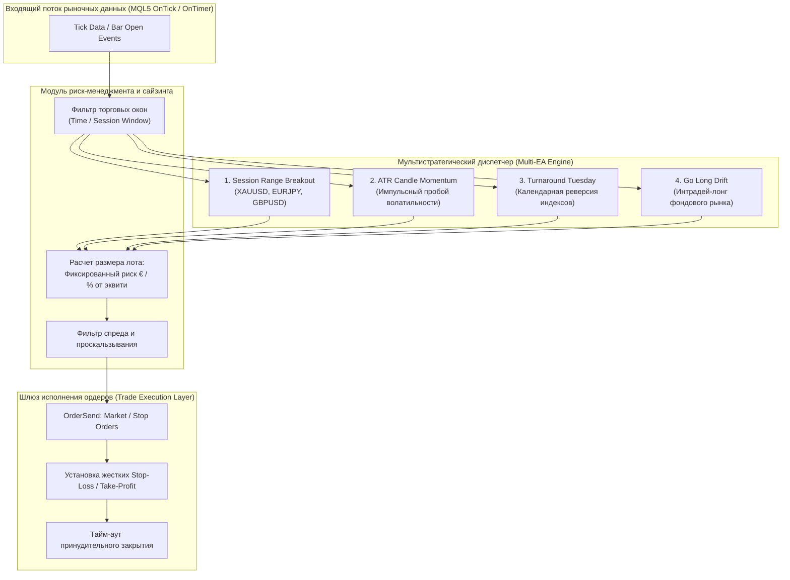
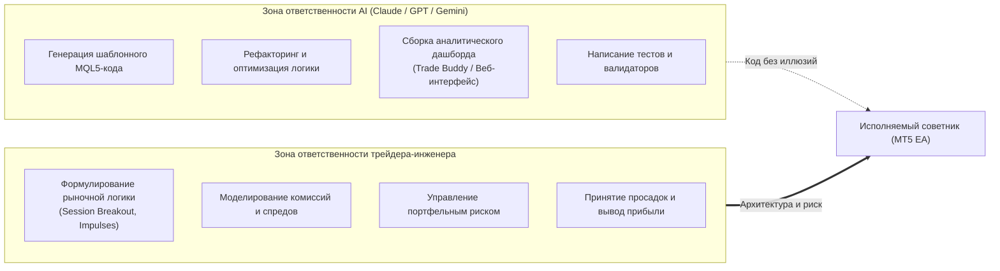

+++
title = "Мультистратегический алготрейдинг в MQL5: архитектура советников, расчет размера позиции от риска и влияние брокерского трения"
date = 2026-11-02
description = "Инженерный анализ архитектуры мультистратегического советника MetaTrader 5: разбор 4 торговых механик, математика расчета лота от риска в валюте счета, моделирование брокерских издержек и разделение зон ответственности AI и торговой логики."
[taxonomies]
tags = ["algo-trading", "quantitative", "risk-management", "architecture", "software-engineering"]
[extra]
toc = true
mermaid = true
+++

В розничном алготрейдинге распространено заблуждение, что успешная торговля требует сложнейших нейросетей, предсказывающих каждый тик котировок. Практика системных трейдеров с реальным подтвержденным капиталом показывает противоположную картину: устойчивое математическое ожидание строится на комбинации простых, устойчивых к шуму рыночных механик (session breakouts, momentum anomalies, macro drift) и жестком контроле брокерских издержек.

В этом материале мы разберем практическую архитектуру мультистратегического портфеля на платформе MetaTrader 5 (MQL5), представленную алготрейдером Рене Балке ([René Balke - Fx Bot Trading](https://www.youtube.com/live/fU1gQO-qi6E)). На публично верифицируемом реальном счете с депозитом €50,000 портфель из четырех советников сгенерировал свыше €97,000 чистой прибыли после вычета всех комиссий и свопов (совокупные депозиты €45,000, выводы €75,000, рабочий остаток около €67,000).

> **Дисклеймер о рисках.** Материал носит исключительно исследовательский и инженерно-образовательный характер и не является инвестиционной рекомендацией или призывом к операциям на финансовых рынках. Алгоритмическая торговля деривативами и валютными контрактами сопряжена с высоким риском частичной или полной потери капитала. Исторические результаты бэктестов и публичных счетов не гарантируют доходность в будущем.

---

## 1. Первоисточник и контекст эксперимента

Разбираемый материал базируется на открытой сессии вопросов и ответов автора:
* **Первоисточник:** [René Balke — Algo Trading Live #3: €50K Forex Account](https://www.youtube.com/live/fU1gQO-qi6E)
* **Инфраструктура исполнения:** Терминал MetaTrader 5 (MQL5) на выделенном Windows VPS, прямой ECN/STP-брокер с институциональным пулом ликвидности.
* **Капитал:** Стартовый депозит около €45,000 с регулярными фиксациями прибыли (€75,000 выведено на банковский счет для снижения инфраструктурного риска брокера).

Главный инженерный вывод серии тестов: **высокочастотный скальпинг на розничных ECN-счетах экономически нежизнеспособен из-за комиссионного трения**. Прибыль извлекается на горизонтах от нескольких часов до суток, где среднее движение цены кратно превышает спред и проскальзывание.

---

## 2. Анатомия четырех торговых советников (Expert Advisors)

Вместо попытки создать один «универсальный Грааль», портфель распределяет риск между четырьмя разнородными источниками рыночной неэффективности.



### Стратегия 1: Session Range Breakout (Утренний пробой диапазона)

* **Инструменты:** Золото (XAUUSD), валютные кроссы (EURJPY, GBPUSD, USDJPY), фондовые индексы (DAX40, US30).
* **Логика формирования:** В утренние часы перед открытием европейской сессии (например, окно с 03:00 до 06:00 UTC для USDJPY или предмаркет Франкфурта) советник фиксирует экстремумы: локальный максимум $H\\_{\text{range}}$ и минимум $L\\_{\text{range}}$.
* **Правило входа:** Выставляются отложенные ордера `Buy Stop` на уровне $H\\_{\text{range}} + \delta$ и `Sell Stop` на уровне $L\\_{\text{range}} - \delta$.
* **Риск и выход:** Уровень Stop-Loss жестко привязывается к противоположной границе диапазона. Если позиция не закрылась по защитному стопу или прибыли в течение дня, срабатывает безусловное закрытие по времени (Time Exit, например в 18:00 UTC).
* **Эмпирический факт из лайв-трейдинга:** На золоте (XAUUSD) пробойная сессионная механика генерирует подавляющую часть совокупного PnL портфеля. На FX-парах (EURJPY, GBPUSD) та же логика часто демонстрирует затяжные просадки из-за возросшего рыночного шума и частых ложных пробоев (mean-reverting intraday regime).

### Стратегия 2: ATR Candle Momentum Breakout (Пробой импульсной свечи)

* **Инструменты:** Высоковолатильные мажоры и сырьевые металлы.
* **Логика формирования:** Мониторинг появления крупной направленной свечи без сложной индикаторной обвязки. Свеча считается импульсной, если диапазон ее тела превышает динамический порог на основе индикатора Average True Range:
  $$|Close\\_t - Open\\_t| > \alpha \cdot ATR\\_{14}(t)$$
  где $\alpha \approx 1.5 - 2.0$.
* **Правило входа:** Вход маркет-ордером в сторону закрытия импульса (Long при бычьем баре, Short при медвежьем).
* **Риск и выход:** Короткий защитный Stop-Loss за противоположную сторону бара или локальный фрактал, асимметричный Take-Profit с соотношением риск/прибыль $R:R \ge 1:1.5$. Трейлинг-стоп намеренно отключен: в импульсных пробоях трейлинг часто выбивает позицию на первом же откате, снижая математическое ожидание.

### Стратегия 3: Turnaround Tuesday (Недельная календарная аномалия)

* **Инструменты:** Американские фондовые индексы (US Tech / NASDAQ-100, US500).
* **Таймфрейм:** Дневной (D1).
* **Логика формирования:** Классическая аномалия институционального поведения. Если в понедельник на дневном графике индекс закрывается ниже среднесрочной скользящей средней ($Close < SMA\\_{20}$), фиксируется локальная перепроданность после распродаж конца недели.
* **Правило входа:** Открытие длинной позиции (Long) в начале американской сессии понедельника или на открытии вторника.
* **Выход:** Принудительное закрытие позиции во вторник вечером перед закрытием регулярной торговой сессии Нью-Йорка.

### Стратегия 4: Go Long Drift (Захват структурного макро-роста)

* **Инструменты:** Фондовые индексы (S&P 500, DAX).
* **Логика формирования:** Интрадей-эксплуатация премии за риск акций (Equity Risk Premium). Советник открывает длинную позицию утром на европейском или американском открытии и закрывает ее вечером перед закрытием рынка.
* **Риск-менеджмент:** Стратегия работает без внутридневного Stop-Loss, рассчитывая на положительный дневной дрейф индексов.
* **Критический анализ:** Сам автор открыто признает, что именно эта стратегия принесла около €60,000 из совокупных €97,000 прибыли, но этот результат во многом обусловлен многолетним бычьим трендом на фондовых площадках. В периоды затяжных медвежьих кризисов или резких гэпов отсутствие стоп-лосса подвергает капитал экспоненциальному риску (tail risk).

---

## 3. Математика управления позицией: Фиксированный риск против процентного

Один из ключевых архитектурных аспектов портфеля — метод расчета рабочего объема (Lot Sizing).

### Сравнение моделей сайзинга

Рене Балке использует два различных подхода в своих проектах:

| Параметр | Модель 1: Фиксированная сумма риска (€) | Модель 2: Процентный риск (% от Equity) |
| :--- | :--- | :--- |
| **Принцип** | Риск на сделку строго зафиксирован (например, €500) | Риск составляет $f\%$ от текущего баланса (например, 1%) |
| **Реакция на рост счета** | Лот не увеличивается при росте баланса | Лот динамически растет вместе с эквити |
| **Реакция на просадку** | Нагрузка в процентах растет при падении счета | Лот уменьшается, смягчая просадку |
| **Сложный процент** | Отсутствует (линейный рост PnL) | Присутствует (геометрический рост) |
| **Психологическая нагрузка** | Предсказуема в абсолютных деньгах | Растет вместе с ростом капитала |

### Формула динамического расчета лота

В MQL5 для любого инструмента размер лота должен учитывать спецификацию контракта (размер тика, стоимость тика и валюту депозита):

$$Lot = \frac{\text{Risk\\_Capital}}{\text{StopLoss\\_Points} \times \text{Tick\\_Value}} \times \text{Tick\\_Size}$$

Если размер риска задан фиксированной суммой $R\\_{\text{fixed}} = 500\text{ EUR}$, а стоп-лосс на XAUUSD составляет 350 пунктов при стоимости пункта $1.00\text{ USD}$ (сконвертированной по курсу EURUSD к евро), советник нормализует лот с учетом минимального шага брокера (`SYMBOL_VOLUME_STEP`):

$$Lot\\_{\text{norm}} = \text{floor}\left(\frac{Lot}{\text{Step}}\right) \times \text{Step}$$

```mql5
//+------------------------------------------------------------------+
//| Расчет объема позиции по фиксированному риску в валюте депозита  |
//+------------------------------------------------------------------+
double CalculateLotSize(string symbol, double riskAmountEUR, double stopLossPoints)
{
    if(stopLossPoints <= 0) return 0.0;
    
    double tickValue = SymbolInfoDouble(symbol, SYMBOL_TRADE_TICK_VALUE);
    double tickSize  = SymbolInfoDouble(symbol, SYMBOL_TRADE_TICK_SIZE);
    double point     = SymbolInfoDouble(symbol, SYMBOL_POINT);
    double step      = SymbolInfoDouble(symbol, SYMBOL_VOLUME_STEP);
    double minLot    = SymbolInfoDouble(symbol, SYMBOL_VOLUME_MIN);
    double maxLot    = SymbolInfoDouble(symbol, SYMBOL_VOLUME_MAX);
    
    if(tickSize == 0 || point == 0) return minLot;
    
    // Расчет стоимости одного пункта движения цены
    double pointValue = tickValue * (point / tickSize);
    
    // Объем позиции
    double rawLot = riskAmountEUR / (stopLossPoints * pointValue);
    
    // Нормализация лота под шаг брокера
    double normalizedLot = MathFloor(rawLot / step) * step;
    
    if(normalizedLot < minLot) normalizedLot = minLot;
    if(normalizedLot > maxLot) normalizedLot = maxLot;
    
    return normalizedLot;
}
```

Использование фиксированной суммы риска (€500) на реальном счете предотвратило перегрузку депозита в моменты эйфории после рекордных прибылей, позволив стабильно зафиксировать и вывести €75,000 живыми деньгами.

---

## 4. Микроструктура и брокерские издержки: почему скальпинг умирает на комиссиях

Критически важный тезис практики алготрейдинга — несостоятельность классического розничного скальпинга (быстрые сделки с удержанием в несколько секунд и профитом 1–3 пункта).

Математическое ожидание одной сделки $E$ определяется уравнением:

$$E = P\\_w \cdot \overline{TP} - (1 - P\\_w) \cdot \overline{SL} - \text{Spread} - \text{Commission} - \text{Slippage}$$

где:
* $P\\_w$ — вероятность положительного исхода (Win Rate),
* $\overline{TP}$ и $\overline{SL}$ — средний тейк-профит и стоп-лосс в пунктах,
* $\text{Spread} + \text{Commission} + \text{Slippage}$ — совокупное брокерское трение ($C\\_{\text{friction}}$).

### Экономика комиссии на разных горизонтах удержания

| Параметр | Ультра-скальпинг (M1) | Интрадей-пробой (H1–H4) | Свинг-трейдинг (D1) |
| :--- | :---: | :---: | :---: |
| Средний таргет ($\overline{TP}$) | 3–5 пунктов | 45–90 пунктов | 200–500 пунктов |
| Спред + Проскальзывание | 1.2–2.0 пункта | 1.5–2.5 пункта | 1.8–3.0 пункта |
| Комиссия round-turn | 0.6 пункта | 0.6 пункта | 0.6 пункта |
| **Доля издержек в таргете** | **35% – 60%** | **2% – 4%** | **< 1%** |
| Устойчивость к расширению спреда | Нулевая (слив депозита) | Высокая | Абсолютная |

При таргете в 4 пункта и совокупном расходе 2.2 пункта алгоритму требуется невероятный Win Rate $> 75\%$ лишь для выхода в безубыток. Переход на сессионные пробои (Range Breakout) с удержанием позиции от 4 до 12 часов увеличивает среднюю цель до 50–120 пунктов, нивелируя влияние спреда до незначительных погрешностей.

---

## 5. Место AI в алгоритмическом пайплайне: строгий водораздел

В докладе Рене Балке озвучен важнейший методологический принцип разделения зон ответственности современного разработчика и больших языковых моделей (LLM):



### Принцип разделения

1. **AI для инженерии (100% кода):** Все эксперты, веб-сайт, база знаний и аналитический журнал торговли (Trade Buddy) написаны с привлечением LLM (Claude, ChatGPT). Модель отлично справляется с синтаксисом MQL5, обработкой торговых структур `MqlTradeRequest` / `MqlTradeResult`, проверкой кодов ошибок брокера и архитектурой классов.
2. **AI для прогнозирования рынка (0% участия):** Попытки скармливать текстовой нейросети тиковые массивы или просить «предсказать курс EURUSD на завтра» не имеют математической базы. Финансовые ряды нестационарны, обладают тяжелыми хвостами распределений и ультранизким соотношением сигнал/шум. Модель выдает правдоподобно звучащие галлюцинации, переобучаясь на случайном шуме котировок.

---

## 6. Ловушка Prop-фирм: математика против трейдера

Отдельная часть разбора посвящена популярному тренду «funded accounts» (проп-компании):

* **Trailing Drawdown от максимального Equity:** Большинство проп-фирм рассчитывают допустимую просадку (5–10%) не от закрытого баланса, а от пикового значения плавающего эквити. Если позиция вышла в плюс €4,000, а затем закрылась по безубытку (+€0), трейдер получает потерю лимита просадки на те же €4,000. Это гарантирует проигрыш (Gambler's Ruin) при любой волатильной стратегии.
* **Асимметрия правил:** Ограничения на перенос позиций через выходные, запрет торговли на новостях и субъективные правила «нестандартного поведения» создают регуляторные риски блокировки выплат.
* **Вывод:** Проп-аккаунты допустимы как дешевый тренажер стрессоустойчивости на малых суммах ($50–$100 за челлендж), но надежный системный бизнес строится только на собственном счете у лицензированного ECN-брокера с регулярным выводом генерируемого фиата.

---

## 7. Сводная матрица стратегий портфеля

| Стратегия | Инструмент | Таймфрейм | Механика входа | Стоп-лосс | Тейк-профит | Источник альфы |
| :--- | :--- | :---: | :--- | :--- | :--- | :--- |
| **Range Breakout** | XAUUSD, USDJPY | M15 / H1 | Пробой утреннего коридора (03:00–06:00 UTC) | Противоположный край диапазона | Закрытие по тайм-ауту (18:00 UTC) | Импульс европейского/лондонского открытия |
| **ATR Momentum** | FX, Металлы | H1 | Бычий/медвежий бар $> 1.8 \cdot ATR\\_{14}$ | Противоположный экстремум бара | Фиксированный $R:R \ge 1.5$ | Кластерная агрессия покупателей/продавцов |
| **Turnaround Tuesday** | US Tech, DAX | D1 | Закрытие понедельника $< SMA\\_{20}$ | Фиксированный аварийный | Закрытие вторника вечер | Институциональный buy-the-dip после паники |
| **Go Long** | Индексы акций | D1 | Утренний вход в лонг | Отсутствует | Вечернее закрытие сессии | Исторический дрейф премий за риск акций |

---

## 8. Архитектурные выводы для разработчика

1. **Диверсификация по источникам неэффективности:** Прибыль портфеля генерируется не за счет идеальности одной стратегии, а за счет низкой корреляции: когда валютные пары консолидируются в коридоре, трендовые импульсы по золоту и макро-рост индексов компенсируют просадки.
2. **Линейный риск спасает от тильта:** Фиксация риска в валюте депозита (€500 на сделку) ограничивает максимальную просадку в периоды смены рыночного режима.
3. **Регулярный вывод капитала:** Рынок цикличен. Снятие €75,000 при депозите €45,000 полностью перевело торговлю в режим «игры на деньги рынка» (house money effect), защитив трейдера от катастрофических рисков брокера.
4. **AI — это инженерный мультипликатор, а не хрустальный шар:** Используйте агентов и LLM для генерации чистого MQL5/C++/Rust кода, написания парсеров и автоматизации бэктестов, оставляя оценку гипотез и контроль рисков на детерминированных математических фильтрах.
