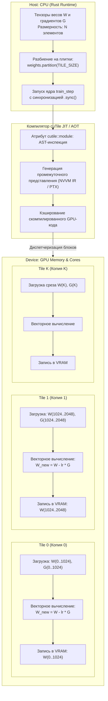

+++
title = "NVIDIA cuTile и Rust: программирование GPU через плиточную модель вычислений"
date = 2026-10-22
description = "Глубокий инженерный разбор библиотеки NVIDIA cuTile (cuda-rust): почему плиточная абстракция вытесняет попоточный CUDA C++, как компилируются Rust-ядра для GPU, broadcast-семантика и оркестрация вычислений с хоста."
[taxonomies]
tags = ["rust", "architecture", "machine-learning", "software-engineering"]
[extra]
toc = true
mermaid = true
+++

Традиционная разработка под графические ускорители (GPU) исторически строилась вокруг модели SIMT (Single Instruction, Multiple Threads). В классическом CUDA C++ разработчик мыслит категорией одного скалярного потока: вычисляет глобальный индекс через `blockDim.x * blockIdx.x + threadIdx.x`, вручную управляет границами массивов, аллоцирует разделяемую память (`__shared__`), расставляет барьеры синхронизации (`__syncthreads()`) и борется с дивергенцией варпов (warp divergence) и неэффективным доступом к памяти (uncoalesced memory access).

С ростом сложности нейросетевых архитектур попоточная модель потребовала избыточного шаблонного кода. Альтернативой стали **плиточные вычисления (tile-based programming)**, изначально реализованные в компиляторе OpenAI Triton для Python. 

NVIDIA развивает этот подход в системном стеке, предоставив библиотеку **cuTile** в составе открытого репозитория **`cuda-rust`**. Библиотека позволяет компилировать GPU-ядра непосредственно из исходного кода на Rust, оперируя многомерными плитками данных (tiles) и перенося задачи выравнивания адресов, распределения регистров и параллельной редукции на уровень специализированного бэкенда компилятора.

> **Первоисточники:**
> * **Оригинальный разбор:** [NVIDIA’s new way to program GPUs with Rust](https://youtu.be/zg6MgDnHlrU) (автор: Let's Get Rusty / Bogdan Flueras).
> * **Официальная документация cuTile:** [nvidia.github.io/cuda-rust/cutile](https://nvidia.github.io/cuda-rust/cutile/latest/).
> * **Репозиторий проекта:** `github.com/NVIDIA/cuda-rust`.

---

## Проблема SIMT: почему попоточный код усложняет GPU-инженерию

Чтобы понять мотивацию создания cuTile, сравним выполнение базовой операции обновления весов градиентного спуска (SGD) на CPU и GPU:

$$W\\_{t+1} = W\\_t - \\eta \\cdot \\nabla L(W\\_t)$$

где $W\\_t$ — тензор параметров модели, $\\eta$ — темп обучения (learning rate), а $\\nabla L(W\\_t)$ — тензор градиентов функции потерь.

На CPU эта операция выражается тривиальным последовательным циклом:

```rust
pub fn update_weights_cpu(weights: &mut [f32], grads: &[f32], lr: f32) {
    for (w, g) in weights.iter_mut().zip(grads.iter()) {
        *w -= lr * g;
    }
}
```

В классическом CUDA C++ разработчик вынужден писать ядро, транслирующее плоский индекс в координаты сетки:

```cpp
__global__ void update_weights_cuda(float* weights, const float* grads, float lr, int n) {
    int idx = blockDim.x * blockIdx.x + threadIdx.x;
    if (idx < n) {
        weights[idx] -= lr * grads[idx];
    }
}
```

При переходе к матричным умножениям ($GEMM$), сверткам и механизмам внимания (FlashAttention) попоточный подход требует:
1. Ручного разбиения данных на фрагменты для регистрового файла и памяти Shared Memory.
2. Тщательного выравнивания адресов для обеспечения 128-битных коалесцированных транзакций к глобальной памяти (DRAM/HBM).
3. Избегания конфликтов банков (bank conflicts) в разделяемой памяти.
4. Ручного двойного буферизирования (double buffering) через асинхронные инструкции `cp.async`.

В результате 90% кода ядра в C++ занимает не математика алгоритма, а микроуправление аппаратными примитивами.

---

## Архитектура cuTile: плиточная модель вычислений (Tile-Based Programming)

В модели cuTile минимальной единицей обработки для программы является не скалярный поток, а **плитка (Tile)** — многомерный блок элементов тензора фиксированного размера.

Разработчик описывает операции над плитками целиком как векторные SIMD-выражения. Компилятор cuTile берет на себя отображение этой плитки на аппаратную иерархию GPU: сетку блоков (Grid), варпы (32 потока) и тензорные ядра (Tensor Cores).



### Ключевые архитектурные абстракции

1. **`#[cutile::module]`**: Макрос атрибута, изолирующий код, предназначенный для исполнения на GPU. Во время компиляции хост-бинарника Rust макрос сохраняет AST-дерево модуля и подготавливает его к трансляции в байткод GPU (PTX/SASS).
2. **`#[cutile::entry]`**: Точка входа в GPU-ядро. Функция, помеченная этим атрибутом, компилируется как запускаемый kernel.
3. **`Tensor<T, Shape>`**: Обобщенный дескриптор памяти тензора на GPU. Размерность формы (Shape) может быть статической (фиксированная константа на этапе компиляции) либо динамической (обозначается как `-1`).
4. **`Tile<T, Shape>`**: Локальный буфер данных, находящийся непосредственно в регистрах и быстрой памяти потокового мультипроцессора (SM).

---

## Реализация GPU-ядра на Rust с cuTile

Рассмотрим полноценный пример реализации ядра градиентного шага `train_step`.

### 1. Определение GPU-модуля и ядра

```rust
use cutile::prelude::*;

#[cutile::module]
pub mod gpu_kernels {
    use super::*;

    // Размер плитки задается на этапе компиляции через const generics
    pub const TILE_SIZE: usize = 1024;

    #[cutile::entry]
    pub fn train_step(
        weights: &mut Tensor<f32, [TILE_SIZE]>,
        lr: f32,
        grads: &Tensor<f32, [-1]>,
    ) {
        // Шаг 1: Разворачивание скаляра lr в плитку идентичной формы (Broadcast)
        let tile_lr = broadcast(lr);

        // Шаг 2: Извлечение среза градиентов, соответствующего текущей плитке
        let tile_grads = load_like(weights, grads);

        // Шаг 3: Чтение текущих весов из глобальной памяти GPU в регистровую плитку
        let tile_weights = load(weights);

        // Шаг 4: Векторное вычисление над всей плиткой (1024 float32 за один шаг)
        let tile_new_weights = tile_weights - tile_lr * tile_grads;

        // Шаг 5: Атомарная или коалесцированная запись результата обратно в VRAM
        store(weights, tile_new_weights);
    }
}
```

### 2. Хост-код оркестрации на CPU

Хост-программа готовит память в VRAM ускорителя, разбивает тензоры на домены плиток и запускает вычисления:

```rust
use cutile::cuda::{CudaDevice, CudaStream};
use gpu_kernels::{train_step, TILE_SIZE};

fn main() -> Result<(), Box<dyn std::error::Error>> {
    // 1. Инициализация CUDA устройства и потока исполнения
    let device = CudaDevice::new(0)?;
    let stream = CudaStream::new(&device)?;

    let total_elements = 1_048_576; // 1M параметров
    let lr = 0.001f32;

    // 2. Аллокация тензоров в памяти устройства (HBM / GDDR)
    let mut device_weights = device.alloc_zeros::<f32>(total_elements)?;
    let device_grads = device.alloc_ones::<f32>(total_elements)?;

    println!("Запуск cuTile ядра на {} элементов...", total_elements);

    // 3. Разбиение глобального тензора весов на сетку плиток TILE_SIZE
    let partitioned_weights = device_weights.partition(TILE_SIZE);

    // 4. Постановка запуска ядра в очередь CUDA-потока
    // cuTile на первом вызове JIT-компилирует ядро в PTX и кэширует бинарник
    unsafe {
        train_step(
            &partitioned_weights,
            lr,
            &device_grads,
        )?;
    }

    // 5. Синхронизация хоста с ускорителем
    stream.synchronize()?;

    println!("Вычисление успешно завершено на GPU без единой строчки C++.");
    Ok(())
}
```

---

## Механика операций над плитками: Broadcast, Load-Like и Store

Плиточная абстракция полностью исключает явную индексацию массивов. Вместо `i = threadIdx.x` в рантайме действуют три фундаментальных оператора:

### Оператор Broadcast

При умножении плитки весов на скаляр темпа обучения $\\eta$ скаляр транслируется на все 1024 позиции виртуальной плитки без лишних аллокаций памяти:

$$\\text{broadcast}(\\eta) \\to [\\eta, \\eta, \\dots, \\eta]_{1 \\times 1024}$$

В коде PTX компилятор помещает значение $\\eta$ в унифицированный регистр, используемый FMA-инструкциями (Fused Multiply-Add) аппаратных ALU.

### Оператор Load-Like

Глобальный тензор градиентов `grads` имеет динамический размер `[-1]` (в данном случае 1 048 576 элементов). Оператор `load_like(reference, source)` определяет смещение текущей копии ядра относительно базового тензора `reference` (плитки весов) и производит коалесцированную выборку 1024 соответствующих градиентов из глобальной памяти.

### Векторный Compute и Store

Операция `tile_weights - tile_lr * tile_grads` разворачивается в инструкции аппаратного параллелизма:
### Аппаратная трансляция: отображение плитки на инструкции PTX

Чтобы оценить уровень абстракции, рассмотрим, в какие низкоуровневые инструкции виртуального ассемблера NVIDIA (PTX) компилятор cuTile транслирует тело ядра `train_step`.

Когда $TILE\\_SIZE = 1024$ назначается на блок потоков из 32 варпов (1024 потока на блок, либо 8 варпов по 4 итерации с векторизацией 128 бит), компилятор генерирует 128-битные векторные инструкции глобальной памяти:

```ptx
// 128-битная загрузка 4 значений float32 за один такт контроллера памяти
ld.global.v4.f32    {%f1, %f2, %f3, %f4}, [%rd_weights];
ld.global.v4.f32    {%f5, %f6, %f7, %f8}, [%rd_grads];

// Fused Multiply-Add (FMA) с округлением к ближайшему четному (rn):
// result = w - (lr * g) -> fma(g, -lr, w)
fma.rn.f32          %f9,  %f5, %f_neg_lr, %f1;
fma.rn.f32          %f10, %f6, %f_neg_lr, %f2;
fma.rn.f32          %f11, %f7, %f_neg_lr, %f3;
fma.rn.f32          %f12, %f8, %f_neg_lr, %f4;

// 128-битная коалесцированная запись обновленных весов обратно в глобальную память
st.global.v4.f32    [%rd_weights], {%f9, %f10, %f11, %f12};
```

Такая трансляция обеспечивает 100% утилизацию шины памяти: 32 потока варпа за один запрос обращаются к смежным $32 \\times 16 = 512$ байтам, что идеально укладывается в четыре 128-байтных транзакции к L2-кэшу без дробления на мелкие секторы (L1 sector misses).

---

## Сравнение парадигм программирования GPU

Ниже приведено сопоставление основных подходов к вычислениям на GPU:

| Критерий | Классический CUDA C++ | OpenAI Triton (Python) | NVIDIA cuTile (Rust) |
|---|---|---|---|
| **Язык разработки** | C++ / CUDA диалект | Python (DSL) | Идиоматичный Rust |
| **Уровень абстракции** | Попоточный (SIMT scalar) | Плиточный (Tile block) | Плиточный (Tile block) |
| **Проверка типов** | Базовый C++ компилятор (nvcc) | Динамическая (рантайм Python) | Строгая статическая (Rust type system) |
| **Управление памятью хоста** | Ручные вызовы `cudaMalloc`/`cudaFree` | Автоматическое через PyTorch ATen | RAII, Zero-cost abstractions, `Drop` |
| **Безопасность параллелизма** | Отсутствует (Data Races в Shared Mem) | Ограничена DSL | Гарантии Send/Sync на уровне Rust |
| **Оверхед хост-рантайма** | Минимальный | Высокий (запуск Python-интерпретатора) | Нулевой (нативный скомпилированный бинарник) |

---

## Производительность и границы применимости

Хотя cuTile радикально упрощает разработку, системный инженер должен учитывать реальные физические свойства аппаратуры:

1. **Memory Bound vs Compute Bound:**
   Для поэлементных операций (Element-wise ops, таких как `weight update` или `ReLU`) узким местом всегда является пропускная способность памяти (Bandwidth), а не вычислительная мощность ALU. Перенос тривиального цикла на GPU эффективен только тогда, когда тензоры уже находятся в VRAM (например, в цикле обучения или генерации токенов LLM). Копирование данных через шину PCIe (Host-to-Device $\\to$ Device-to-Host) нивелирует любой выигрыш в скорости на малых объемах данных.

2. **Выбор размера плитки ($TILE\\_SIZE$):**
   Размер плитки $TILE\\_SIZE$ должен быть кратен размеру варпа (32 потока) и согласован с объемом регистрового файла на потоковый мультипроцессор (SM). При $TILE\\_SIZE = 1024$ достигается полная загрузка варпов SM, однако для 2D-плиток (матричные умножения) оптимальными являются формы $64 \\times 64$ или $128 \\times 128$ с учетом размера SRAM/Shared Memory.

3. **JIT-компиляция при первом запуске:**
   Подобно Triton, cuTile производит компиляцию GPU-ядра при первом обращении хоста. Для продакшн-систем критически важно предварительно разогревать (warmup) ядра перед обслуживанием реального пользовательского трафика, чтобы исключить задержку холодного старта.

---

## Заключение

Инструментарий NVIDIA cuTile в составе `cuda-rust` предоставляет декларативную плиточную модель для разработки GPU-ядер на Rust. Абстрагирование от попоточной адресации и перенос оптимизации коалесцированного доступа на компилятор снижает вероятность ошибок при работе с разделяемой памятью и барьерами синхронизации, сохраняя детерминированную производительность на уровне скомпилированного PTX.
