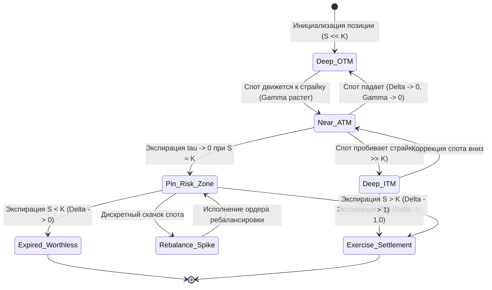

+++
title = "Дельта-хеджирование, профиль Gamma и валютные поверхности волатильности: математика деривативов в FX"
date = 2026-10-28
description = "Математический разбор динамического дельта-хеджирования и геометрии греков: аналитическая связь Gamma и Delta по Гарману-Кольхагену, проблема нумерайра в FX-опционах, динамика Call Skew на развивающихся рынках и режимы Sticky Strike против Sticky Delta."
[taxonomies]
tags = ["quantitative", "algo-trading", "derivatives", "risk-management", "math"]
[extra]
toc = true
mermaid = true
+++

Классическая теория ценообразования деривативов Блэка-Шоулза опирается на предпосылку о непрерывном самофинансируемом ребалансировании портфеля без транзакционных издержек. В реальной торговле опционами на валютном рынке (FX) деск сталкивается с дискретностью исполнения, нелинейными скачками спота, зависимостью от базовой валюты учета (Numeraire) и постоянным дрейфом поверхности волатильности (Volatility Surface).

Ниже представлен формальный математический разбор механики дельта-хеджирования, взаимосвязи греков первого и второго порядков, особенностей валютных опционов на развивающихся рынках (Emerging Markets) и аналитического учета эффектов **Sticky Strike** против **Sticky Delta** по материалам второй лекции продвинутого курса CMF ([CMF Advanced Options Trading: Lecture 2 – Delta, Gamma & FX Vol Surfaces](https://youtu.be/FBpRVcWEYV0)).

> **Финансовый дисклеймер.** Материал носит исключительно академический и исследовательский характер и не является индивидуальной инвестиционной рекомендацией, офертой или призывом к совершению финансовых сделок. Торговля деривативами и опционами сопряжена с высоким уровнем риска потери капитала. Описанные алгоритмы и математические модели предназначены для демонстрации теории количественных финансов и требуют собственной верификации перед любым практическим применением.

## Первоисточник и контекст курса

1. **Оригинал лекции:** CMF Options School, *Advanced Options Trading: Lecture 2 – Delta, Gamma & FX Vol Surfaces* ([YouTube: FBpRVcWEYV0](https://youtu.be/FBpRVcWEYV0), 41:20).
2. **Предметная область:** Количественные финансы (Quantitative Finance), деривативы валютного рынка (FX Options), греки второго порядка (Gamma, Vanna) и структуры волатильности на рынках с асимметричным страновым риском.

---

## 1. Аналитическая геометрия греков: Gamma как плотность, Delta как интеграл

В модели Гармана-Кольхагена (Garman-Kohlhagen, модификация Блэка-Шоулза для двух процентных ставок) цена европейского Call-опциона на валютную пару $S\_t$ (где базовая валюта — Foreign, валюта котировки — Domestic) определяется как:

$$C(S\_t, t) = S\_t e^{-r\_f \tau} \mathcal{N}(d\_1) - K e^{-r\_d \tau} \mathcal{N}(d\_2)$$

где:
* $S\_t$ — спот-курс валютной пары (единиц domestic за 1 foreign);
* $K$ — страйк опциона;
* $\tau = T - t$ — время до экспирации в долях года;
* $r\_d$ — безрисковая ставка валюты котировки (Domestic risk-free rate);
* $r\_f$ — безрисковая ставка базовой валюты (Foreign risk-free rate);
* $\mathcal{N}(\cdot)$ — кумулятивная функция стандартного нормального распределения;
* $\phi(\cdot)$ — функция плотности стандартного нормального распределения $\phi(x) = \frac{1}{\sqrt{2\pi}} e^{-\frac{1}{2}x^2}$.

Параметры $d\_1$ и $d\_2$ определяются стандартными уравнениями:

$$d\_1 = \frac{\ln(S\_t / K) + \left(r\_d - r\_f + \frac{1}{2}\sigma^2\right)\tau}{\sigma \sqrt{\tau}}$$

$$d\_2 = d\_1 - \sigma \sqrt{\tau}$$

### Производные первого и второго порядка

Дельта ($\Delta$) измеряет чувствительность премии опциона к изменению спот-курса базового актива:

$$\Delta\_{\text{call}} = \frac{\partial C}{\partial S\_t} = e^{-r\_f \tau} \mathcal{N}(d\_1)$$

$$\Delta\_{\text{put}} = \frac{\partial P}{\partial S\_t} = -e^{-r\_f \tau} \mathcal{N}(-d\_1)$$

Гамма ($\Gamma$) представляет собой вторую производную премии по споту и первую производную от Дельты:

$$\Gamma = \frac{\partial^2 C}{\partial S\_t^2} = \frac{\partial \Delta}{\partial S\_t} = \frac{e^{-r\_f \tau} \phi(d\_1)}{S\_t \sigma \sqrt{\tau}}$$

Из определения производной следует фундаментальное интегральное соотношение:

$$\Delta(S\_t) = \int\_{-\infty}^{S\_t} \Gamma(u) \, du$$

### Геометрическая асимметрия при сокращении срока до экспирации

Профиль Gamma имеет колоколообразную форму (Bell curve) с максимумом около цены страйка $S\_t \approx K e^{-(r\_d - r\_f - \frac{1}{2}\sigma^2)\tau}$. 

```text
       Gamma (Bell Curve)                    Delta (S-Curve)
          ▲                                    ▲
          │      ┌─┐                           │              ┌────── 1.0 (ITM)
          │    ┌─┘ └─┐                         │            ┌─┘
          │  ┌─┘     └─┐                       │        ┌───┘  Δ ≈ 0.5 (ATM)
          │┌─┘         └─┐                     │    ┌───┘
          └───────▲───────► Spot               └───-▲────────────────► Spot
                Strike                               Strike
             (OTM ◄-► ITM)                        (0.0 ◄-► 1.0)
```

При приближении даты экспирации ($\tau \to 0$):
1. **Пик Гаммы:** распределение $\Gamma(S\_t)$ вырождается в $\delta$-функцию Дирака, сосредоточенную в точке страйка $K$.
2. **Крутизна Дельты:** S-образная кривая Дельты трансформируется в ступенчатую функцию Хевисайда $\theta(S\_t - K)$.
3. **Pin Risk и нестабильность хеджа:** Если на момент экспирации спот колеблется вблизи страйка, мгновенная смена $\Delta$ от $0$ до $1$ требует дискретной покупки или продажи $100\%$ объема базового актива. Это вызывает экстремальное проскальзывание и затраты на спред.

---

## 2. Специфика FX-опционов: нумерайр и асимметрия риска при девальвации

В отличие от фондовых опционов, где базовый актив является акцией, а расчеты идут в фиатной валюте (USD), в валютных деривативах оба актива являются валютами. 

Рассмотрим котировку пары `USD/TRY` (доллар США против турецкой лиры) или `USD/BRL`:
* Базовая валюта (Base / Foreign): `USD`;
* Валюта котировки (Quote / Domestic): `TRY`.

### Выбор базовой валюты учета (Numeraire)

Дельта-хеджирование требует выставления встречной позиции на спотовом рынке:
* Длинный Call на USD/TRY обладает положительной дельтой $\Delta\_{\text{call}} > 0$.
* Для дельта-нейтрализации портфеля маркет-мейкер обязан продать базовую валюту: $\text{Hedge} = -\Delta \times \text{Notional}\_{\text{USD}}$.

Если капитал фонда или маржинальный счет номинирован в национальной валюте (`TRY`), а спот возрастает втрое (катастрофическая девальвация национальной валюты), номинальная стоимость позиции в `TRY` растет пропорционально $S\_t$. При этом величина встречного хеджа должна учитывать не только дельту, но и эффект изменения стоимости самого залога:

$$\text{PnL}\_{\text{total}} = \Delta C - \Delta\_{\text{hedge}} \Delta S\_t + \frac{1}{2} \Gamma (\Delta S\_t)^2 + \Theta \Delta t$$

Если позиция шорт-гамма ($\Gamma < 0$, продажа опционов вне денег):
* При резком росте курса $S\_t \gg K$ дельта проданного Call устремляется к $-1$.
* Деск вынужден покупать доллары по экспоненциально растущим ценам для поддержания дельта-нейтральности.
* Возникает порочный круг: каждый последующий тик роста требует покупки все большего объема базовой валюты на фоне иссякающей ликвидности.

---

## 3. Архитектура состояний опционной позиции

Жизненный цикл опционной позиции и динамика дельта-хеджирования формализуются следующей диаграммой состояний:



### Режимы нахождения позиции

1. **Deep OTM ($S \ll K$):** $\Delta \to 0$, $\Gamma \to 0$. Позиция не требует регулярного спот-хеджирования, портфель нечувствителен к локальным колебаниям.
2. **Near ATM ($S \approx K$):** $\Gamma = \max$, наклон кривой Дельты максимален. Ребалансировка спот-хеджа происходит непрерывно при выходе за коридор толерантности $\pm \epsilon\_{\Delta}$.
3. **Pin Risk Zone ($\tau \to 0, S \approx K$):** Зона критического риска. Малейшее движение цены переводит дельту из $0$ в $1$, генерируя взрывные транзакционные издержки.
4. **Deep ITM ($S \gg K$):** $\Delta \to e^{-r\_f \tau} \approx 1$, $\Gamma \to 0$. Опцион ведет себя как линейный синтетический форвардный контракт.

---

## 4. Поверхность волатильности: Put Skew против Call Skew

В классической модели Блэка-Шоулза предполагается, что подразумеваемая волатильность $\sigma$ константна по всем страйкам и экспирациям. В реальности наблюдается выраженная улыбка или наклон волатильности (Volatility Skew):

$$\sigma = \sigma(K, \tau) \quad \text{или} \quad \sigma = \sigma(\Delta, \tau)$$

### Сравнение наклона волатильности на фондовом и валютном рынках

| Параметр | Фондовый индекс (S&P 500, Nasdaq) | Валюта EM (USD/TRY, USD/BRL, USD/ZAR) |
|---|---|---|
| **Доминирующий риск** | Внезапный обвал котировок (Market Crash) | Катастрофическая девальвация нацвалюты |
| **Форма Skew** | **Отрицательный наклон (Put Skew)** | **Положительный наклон (Call Skew)** |
| **Подразумеваемая волатильность** | $\sigma(K\_{\text{put}}) \gg \sigma(K\_{\text{call}})$ | $\sigma(K\_{\text{call}}) \gg \sigma(K\_{\text{put}})$ |
| **Поведение инвесторов** | Хеджирование длинных портфелей путами | Покупка OTM Call на доллар против девальвации |
| **Асимметрия распределения** | Отрицательная асимметрия (Negative skewness) | Положительная асимметрия (Fat right tail) |

```text
       Equity Put Skew (SPX)                    FX Emerging Call Skew (USD/EM)
   IV                                       IV
    ▲                                        ▲
    │ ╲                                      │             ╱
    │  ╲                                     │            ╱
    │   ╲───┐                                │       ┌───╱
    │       └───                             │    ───┘
    └─────────────────► Strike               └─────────────────► Strike
       Put (Crash)    Call                      Put         Call (Devaluation)
```

На развивающихся рынках премия за риск взрывного ослабления локальной валюты закладывается трейдерами в OTM Call-опционы на иностранную валюту, что создает крутой восходящий наклон кривой подразумеваемой волатильности.

---

## 5. Sticky Strike против Sticky Delta и эффективная Дельта

При смещении спот-курса $S\_t \to S\_t + \Delta S$ поверхность волатильности не остается статичной. Практика квант-десков различает два крайних приближения динамики улыбки:

### 1. Sticky Strike (Фиксированный страйк)
Предполагается, что волатильность жестко привязана к абсолютному значению страйка $K$:

$$\left. \frac{\partial \sigma}{\partial S\_t} \right|\_{K = \text{const}} = 0$$

В этом режиме стандартная дельта Блэка-Шоулза является несмещенной оценкой локальной чувствительности цены: $\Delta\_{\text{eff}} = \frac{\partial C}{\partial S\_t}$.

### 2. Sticky Delta / Sticky Moneyness (Фиксированная дельта)
Предполагается, что волатильность привязана к монейнессу $m = \frac{S\_t}{K}$ или к дельте опциона $\Delta$. При росте спота кривая волатильности смещается вправо вслед за ценой базового актива:

$$\sigma(S\_t, K) = f\left(\frac{S\_t}{K}\right) \implies \frac{\partial \sigma}{\partial S\_t} = \frac{1}{K} f'\left(\frac{S\_t}{K}\right) = \frac{\partial \sigma}{\partial K} \frac{S\_t}{K} \frac{1}{S\_t} \approx \frac{\partial \sigma}{\partial K}$$

### Коррекция эффективной дельты (Vanna-эффект)

По правилу дифференцирования сложной функции полная производная премии опциона по спот-курсу равна:

$$\Delta\_{\text{eff}} = \frac{d C}{d S\_t} = \frac{\partial C}{\partial S\_t} + \frac{\partial C}{\partial \sigma} \cdot \frac{\partial \sigma}{\partial S\_t} = \Delta\_{\text{BS}} + \mathcal{V} \cdot \frac{\partial \sigma}{\partial S\_t}$$

где:
* $\Delta\_{\text{BS}}$ — классическая дельта Блэка-Шоулза;
* $\mathcal{V} = \frac{\partial C}{\partial \sigma} = S\_t e^{-r\_f \tau} \sqrt{\tau} \phi(d\_1)$ — Вега опциона (чувствительность к волатильности);
* $\frac{\partial \sigma}{\partial S\_t}$ — локальный наклон улыбки волатильности при движении спота.

На рынке USD/EM с крутым положительным Call Skew ($\frac{\partial \sigma}{\partial K} > 0$):
* В режиме Sticky Delta при росте спота волатильность для данного страйка увеличивается ($\frac{\partial \sigma}{\partial S\_t} > 0$).
* Так как Вега всегда положительна ($\mathcal{V} > 0$), эффективная дельта оказывается существенно выше номинальной:

$$\Delta\_{\text{eff}} > \Delta\_{\text{BS}}$$

Маркет-мейкер, игнорирующий сдвиг поверхности волатильности и хеджирующий позицию по «сырой» дельте $\Delta\_{\text{BS}}$, систематически недохеджирует восходящее движение и несет скрытые убытки от короткой ванны (Short Vanna).

---

## 6. Практическая реализация: симуляция динамического хеджирования на Python

Ниже приведена модульная реализация расчета аналитических греков модели Гармана-Кольхагена и симуляция дискретного дельта-хеджирования с учетом полос толерантности (Delta Bands) и эффекта Sticky Delta.

```python
"""
Модуль аналитического расчета греков FX-деривативов и симуляции
динамического дельта-хеджирования с учетом наклона волатильности (Skew).
"""

from dataclasses import dataclass
import numpy as np
from scipy.stats import norm


@dataclass(frozen=True)
class FXOptionParams:
    spot: float           # Спот-курс (Domestic / Foreign)
    strike: float         # Страйк опциона
    tau: float            # Время до экспирации в годах
    vol: float            # Подразумеваемая волатильность (годовая)
    r_dom: float          # Безрисковая ставка валюты котировки
    r_for: float          # Безрисковая ставка базовой валюты
    is_call: bool = True  # True для Call, False для Put


class GarmanKohlhagenEngine:
    """Аналитический калькулятор модели Гармана-Кольхагена для FX-опционов."""

    @staticmethod
    def _d1_d2(p: FXOptionParams) -> tuple[float, float]:
        if p.tau <= 1e-7:
            # Предельный случай перед экспирацией
            d1 = np.inf if p.spot > p.strike else (-np.inf if p.spot < p.strike else 0.0)
            return d1, d1
        
        vol_sqrt_tau = p.vol * np.sqrt(p.tau)
        drift = (p.r_dom - p.r_for + 0.5 * p.vol**2) * p.tau
        d1 = (np.log(p.spot / p.strike) + drift) / vol_sqrt_tau
        d2 = d1 - vol_sqrt_tau
        return float(d1), float(d2)

    @classmethod
    def price(cls, p: FXOptionParams) -> float:
        if p.tau <= 1e-7:
            payoff = max(0.0, p.spot - p.strike) if p.is_call else max(0.0, p.strike - p.spot)
            return payoff

        d1, d2 = cls._d1_d2(p)
        df_for = np.exp(-p.r_for * p.tau)
        df_dom = np.exp(-p.r_dom * p.tau)

        if p.is_call:
            return float(p.spot * df_for * norm.cdf(d1) - p.strike * df_dom * norm.cdf(d2))
        else:
            return float(p.strike * df_dom * norm.cdf(-d2) - p.spot * df_for * norm.cdf(-d1))

    @classmethod
    def delta(cls, p: FXOptionParams, skew_slope: float = 0.0, sticky_delta: bool = False) -> float:
        """
        Расчет дельты. При sticky_delta=True учитывается vanna-эффект сдвига волатильности.
        """
        if p.tau <= 1e-7:
            if p.spot > p.strike:
                return np.exp(-p.r_for * p.tau) if p.is_call else 0.0
            elif p.spot < p.strike:
                return 0.0 if p.is_call else -np.exp(-p.r_for * p.tau)
            return 0.5 * np.exp(-p.r_for * p.tau)

        d1, _ = cls._d1_d2(p)
        df_for = np.exp(-p.r_for * p.tau)
        bs_delta = float(df_for * norm.cdf(d1)) if p.is_call else float(-df_for * norm.cdf(-d1))

        if not sticky_delta or abs(skew_slope) < 1e-9:
            return bs_delta

        # Вега опциона
        vega = float(p.spot * df_for * np.sqrt(p.tau) * norm.pdf(d1))
        
        # dSigma / dSpot для режима Sticky Delta: skew_slope * (1 / K)
        d_sigma_d_spot = skew_slope / p.strike
        
        effective_delta = bs_delta + vega * d_sigma_d_spot
        return effective_delta

    @classmethod
    def gamma(cls, p: FXOptionParams) -> float:
        if p.tau <= 1e-7:
            return 0.0
        d1, _ = cls._d1_d2(p)
        df_for = np.exp(-p.r_for * p.tau)
        denom = p.spot * p.vol * np.sqrt(p.tau)
        return float(df_for * norm.pdf(d1) / denom)


def run_hedging_simulation(
    spot_start: float = 30.0,
    strike: float = 30.0,
    tau_days: int = 30,
    annual_vol: float = 0.25,
    r_dom: float = 0.40,       # 40% ставка для развивающегося рынка (Domestic)
    r_for: float = 0.05,       # 5% ставка USD (Foreign)
    steps_per_day: int = 24,   # Почасовая дискретизация
    rebalance_band: float = 0.02, # Полоса толерантности по Дельте (+- 2%)
    skew_slope: float = 0.15   # Положительный наклон волатильности (Call Skew)
) -> dict[str, float]:
    """Симуляция PnL дискретно ребалансируемого дельта-нейтрального портфеля."""
    total_steps = tau_days * steps_per_day
    dt = 1.0 / (365.0 * steps_per_day)
    total_tau = tau_days / 365.0

    # Генерация геометрического броуновского движения для спота
    np.random.seed(42)
    drift = (r_dom - r_for) * dt
    diffusion = annual_vol * np.sqrt(dt)
    shocks = np.random.normal(0, 1, total_steps)

    spot_path = np.zeros(total_steps + 1)
    spot_path[0] = spot_start
    for i in range(total_steps):
        spot_path[i + 1] = spot_path[i] * np.exp(drift - 0.5 * diffusion**2 + diffusion * shocks[i])

    # Инициализация короткой позиции по Call-опциону (объем 1 000 000 USD)
    notional = 1_000_000.0
    p0 = FXOptionParams(spot_path[0], strike, total_tau, annual_vol, r_dom, r_for, is_call=True)
    initial_call_price = GarmanKohlhagenEngine.price(p0)
    current_delta = GarmanKohlhagenEngine.delta(p0, skew_slope=skew_slope, sticky_delta=True)

    # Кассовый баланс (получили премию, купили дельта-хедж)
    cash_domestic = (initial_call_price * notional) - (current_delta * notional * spot_path[0])
    hedge_units_base = current_delta * notional

    rebalance_count = 0
    total_trading_cost = 0.0
    half_spread_bps = 0.0005  # 5 bps транзакционные издержки

    current_tau = total_tau
    for step in range(1, total_steps + 1):
        s_current = spot_path[step]
        current_tau = max(1e-7, total_tau - step * dt)

        # Начисление ставок на остатки денежных средств и позицию хеджа
        cash_domestic *= np.exp(r_dom * dt)

        # Оценка текущей дельты
        params = FXOptionParams(s_current, strike, current_tau, annual_vol, r_dom, r_for, is_call=True)
        target_delta = GarmanKohlhagenEngine.delta(params, skew_slope=skew_slope, sticky_delta=True)

        delta_diff = target_delta - (hedge_units_base / notional)

        # Проверка выхода за полосу толерантности
        if abs(delta_diff) >= rebalance_band or step == total_steps:
            units_to_trade = delta_diff * notional
            trade_cost = abs(units_to_trade) * s_current * half_spread_bps
            total_trading_cost += trade_cost

            cash_domestic -= (units_to_trade * s_current + trade_cost)
            hedge_units_base += units_to_trade
            rebalance_count += 1

    # Финал при экспирации
    terminal_spot = spot_path[-1]
    payoff_per_unit = max(0.0, terminal_spot - strike)
    option_obligation = payoff_per_unit * notional

    # Ликвидация спот-хеджа
    hedge_liquidation = hedge_units_base * terminal_spot
    final_pnl = cash_domestic + hedge_liquidation - option_obligation

    return {
        "final_spot": terminal_spot,
        "initial_option_premium": initial_call_price * notional,
        "option_terminal_payoff": option_obligation,
        "rebalance_count": float(rebalance_count),
        "total_trading_costs": total_trading_cost,
        "final_hedge_error_pnl": final_pnl
    }


if __name__ == "__main__":
    result = run_hedging_simulation()
    print("Результаты симуляции дельта-хеджирования:")
    for k, v in result.items():
        print(f"  {k}: {v:,.2f}")
```

---

## 7. Риск-менеджмент деска: полосы толерантности и издержки ребалансировки

При практическом управлении опционной книгой попытка непрерывно поддерживать строго нулевую Дельту ведет к разорению из-за транзакционных издержек (Bid-Ask Spread и биржевых комиссий). 

По модели Лиланда (Leland, 1985) наличие дискретности ребалансировки $\Delta t$ и спреда $k$ эквивалентно расширению эффективной волатильности:

$$\sigma\_{\text{eff}}^2 = \sigma^2 \left( 1 + \sqrt{\frac{2}{\pi}} \frac{k}{\sigma \sqrt{\Delta t}} \right)$$

Для оптимизации соотношения между рыночным риском и издержками применяются следующие алгоритмические барьеры:

1. **Delta Bands (Полосы толерантности):** Ребалансировка инициируется только при отклонении накопленной дельты портфеля от целевой на величину $|\Delta\_{\text{curr}} - \Delta\_{\text{target}}| > \epsilon$. Величина коридора $\epsilon$ динамически масштабируется пропорционально локальной волатильности и обратно пропорционально глубине ликвидности в биржевом стакане.
2. **Time-decay Scaling:** По мере приближения к экспирации ($\tau < 3$ дней) и вхождении в зону Pin Risk деск переходит от дельта-хеджирования к закрытию позиции через ролловер (Roll forward) во избежание квадратичного роста потерь от гамма-всплесков.
3. **Cross-Greeks Hedging:** Хеджирование риска волатильности (Vega) и наклона улыбки (Vanna) осуществляется встречными позициями в ликвидных биржевых опционах (Vanilla Straddles / Risk Reversals), что снижает локальную кривизну $\Gamma$ всей книги.

---

## Резюме для алготрейдера

* **Гамма задает динамику:** Delta является прямым интегралом от плотности Gamma. Вблизи страйка на коротких экспирациях Gamma сингулярна, что превращает линейный хедж в источник огромных проскальзываний.
* **Валютный нумерайр:** В парах развивающихся рынков (USD/EM) хеджирование требует строгого разделения базовой валюты и валюты котировки. Девальвационный шок делает шорт-гамму асимметрично разрушительной.
* **Учет режима улыбки:** Игнорирование режима **Sticky Delta** при наличии крутого Call Skew приводит к занижению расчетной дельты из-за упущенного члена ванны ($\mathcal{V} \cdot \frac{\partial \sigma}{\partial S}$). Расчет эффективной дельты $\Delta\_{\text{eff}}$ обязателен для сохранения рыночной нейтральности.
