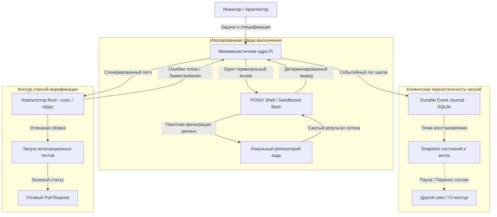

+++
title = "Инженерия AI-агентов по Армину Ронахеру: архитектура Pi, переносимость сессий и строгая типизация"
date = 2026-10-18
description = "Разбор архитектуры Pi Agent: почему Армин Ронахер выбирает минимализм инструментов, открытую персистентность сессий и строгие типы Rust вместо RAG."
[taxonomies]
tags = ["software-engineering", "architecture", "ai-agents", "rust"]
[extra]
toc = true
mermaid = true
+++

Большинство современных фреймворков для создания AI-агентов развиваются по экстенсивному пути: разработчики стремятся оснастить модель десятками специализированных инструментов, внедряют многослойные векторные базы данных для долгосрочной памяти и полагаются на облачную серверную компактизацию контекста. Однако на практике такие монолитные конструкции быстро сталкиваются с деградацией маршрутизации вызовов, дрейфом контекста и вендорным лок-ином.

Армин Ронахер (Armin Ronacher, `@mitsuhiko`), создатель Flask, Sentry, rye и сооснователь компании Earendil, разрабатывающей Pi Agent (`pi.dev`), в подробном интервью с David Ondrej представил альтернативный инженерный манифест. Его подход базируется на радикальном минимализме инструментов, переносе фильтрации в Unix-конвейеры, клиентской персистентности сессий (Durable Execution) и строгой компиляторной верификации на базе Rust.

Ниже представлен детальный системный разбор архитектурных решений Pi Agent, математики надежности агентных систем и уроков для проектирования автономных ассистентов.

## Ловушка раздутых инструментов vs Unix-пайплайны

Типичная ошибка проектирования агентных платформ — создание индивидуального инструмента под каждую задачу: отдельный tool для чтения файла, отдельный tool для поиска по маске, отдельный tool для фильтрации строк. При добавлении каждого нового инструмента в системный промпт экспоненциально растет вероятность того, что модель выберет неоптимальную сигнатуру или ошибется в аргументах.

Если агент совершает последовательность из $k$ шагов вызова инструментов, а вероятность изолированной ошибки на $i$-м шаге составляет $\epsilon\_i$, суммарная вероятность сбоя цепочки действий оценивается как:

$$P\_{\text{error}}(k) = 1 - \prod\_{i=1}^{k} (1 - \epsilon\_i)$$

При наличии 30 инструментов в контексте фоновый шум описаний определений схем JSON Schema увеличивает $\epsilon\_i$, снижая общую надежность длинных автономных цепочек.

В архитектуре Pi Agent используется диаметрально противоположный принцип: сведение окружения агента к минимальному scaffolding и передача управления стандартному интерпретатору командной строки (`bash`). Вместо того чтобы выгружать сотни строк файловой структуры в контекстное окно через вызовы API, агент формулирует конвейер Unix непосредственно в одном терминальном вызове:

```bash
# Поиск целевых определений структур без загрязнения контекста сырым выводом
find src/ -name "*.rs" -exec grep -Hn "pub struct" {} + | awk -F: '{print $1, $2, $3}' | head -n 30
```

Такой подход обеспечивает три инженерных преимущества:
1. **Экономия контекстного окна:** фильтрация, сортировка и отсечение данных происходят на стороне локальной ОС до отправки токенов в контекст инференса.
2. **Детерминизм выполнения:** стандартные утилиты POSIX не страдают от галлюцинаций формата вывода.
3. **Естественная компонуемость:** модель использует встроенные навыки написания shell-скриптов вместо адаптации под нестандартные проприетарные схемы API.

## Архитектура Pi Agent и Durable Execution

Текущее состояние агентных интерфейсов Армин Ронахер сравнивает с «эпохой DOS»: разработчики вынуждены взаимодействовать с LLM через примитивные терминальные CLI-обертки, где любая потеря соединения или сбой процесса приводит к утрате состояния выполнения.

Вторая системная проблема — проприетарная серверная компактизация контекста (Server-Side Context Compaction), продвигаемая крупными провайдерами API (OpenAI, Anthropic). Когда облачный бэкенд непрозрачно сжимает историю диалога на сервере, клиент теряет возможность воспроизвести или перенести сессию на другой хост, что формирует жесткую привязку к платформе (vendor lock-in).

В Pi Agent реализована архитектура открытого устойчивого состояния (Client-Side Durable State Machine), где каждый шаг агента сохраняется локально в структурированном журнале событий.



Локальный журнал событий на базе SQLite фиксирует входящие промпты, параметры вызова внешних процессов, контрольные суммы измененных файлов и диффы. Если сессия прерывается по таймауту или сетевому сбою, агент восстанавливает контекст из последней контрольной точки без необходимости повторного расходования токенов на уже выполненные шаги.

## Миф о векторной памяти vs Детерминированные хранилища

Один из ключевых технологических компромиссов современной индустрии — внедрение RAG (Retrieval-Augmented Generation) на основе векторных эмбеддингов для долговременной памяти агента. Векторный поиск эффективен для нечеткого семантического поиска по статьям базы знаний, но оказывается фундаментально непригодным для точных инженерных задач.

Когда кодинг-агент решает задачу рефакторинга кодовой базы, ему требуются не «схожие по смыслу фрагменты», а строгие инварианты: точные имена типов, сигнатуры функций, зависимости пакетов и схемы таблиц. Семантический векторный поиск часто возвращает устаревшие фрагменты кода, похожие по текстовому описанию, но не соответствующие текущему состоянию ветки Git.

Позиция Армина Ронахера заключается в замене векторного поиска прямым доступом агента к структурированным и детерминированным базам данных (реляционные таблицы, SQLite, метаданные AST и графы зависимостей).

### Сравнение парадигм долговременной памяти

Ниже приведено систематическое сопоставление свойств векторного RAG и детерминированных хранилищ при работе инженерных AI-агентов.

| Характеристика архитектуры | 🔴 Популярный подход - Векторный RAG | 🟢 Инженерный подход Pi - Детерминированное хранилище |
|---|---|---|
| **Механизм индексации** | Неструктурированные векторные эмбеддинги | Реляционные таблицы, SQLite, AST-индексы кодовой базы |
| **Точность извлечения (Precision)** | Вероятностная, подвержена семантическому шуму | Абсолютная, точное соответствие схемам и селекторам |
| **Аудит состояния человеком** | Затруднен: многомерные векторы непрозрачны | Прозрачен: SQL-запросы, файлы состояний и diff в Git |
| **Реакция на изменение кода** | Требует дорогой фоновой переиндексации векторов | Мгновенно отражает текущее состояние рабочей директории |
| **Устойчивость к галлюцинациям** | Низкая: модель путает похожие версии библиотек | Высокая: агент оперирует фактами из компилятора и БД |

При детерминированном подходе агент оперирует явными инструментами чтения и записи данных. Если агенту требуется сохранить контекст архитектурного решения, он записывает его в виде структурированной записи или миграции базы данных, доступной для валидации человеком через стандартные SQL-клиенты.

## Ренессанс строгих технологий: почему агенты ускоряют переход на Rust

Исторически индустрия программного обеспечения шла на компромисс между скоростью разработки и безопасностью выполнения. Языки с динамической типизацией (Python, JavaScript, Ruby) доминировали в создании прототипов благодаря низкому порогу входа и отсутствию длительной компиляции, несмотря на постоянный риск необработанных исключений и утечек памяти в runtime.

Появление кодинг-агентов коренным образом меняет баланс этой экономической модели. Разработчику больше не требуется тратить часы на написание рутинных шаблонных конструкций или ручную аннотацию сложных сигнатур типов. Агент берет на себя синтаксическую нагрузку, в то время как компилятор выступает неподкупным арбитром качества сгенерированного кода.

В связке «агент + компилятор Rust» вероятность просачивания дефекта в эксплуатацию формализуется через совместную вероятность появления ошибки генерации и её пропуска статическим верификатором:

$$R\_{\text{leak}} = P\_{\text{defect}} \cdot P\_{\text{bypass\_compiler}}$$

Для динамических сред без обязательного статического анализатора $P\_{\text{bypass\_compiler}} \approx 1.0$, поэтому типовые и позиционные ошибки проявляются исключительно на этапе исполнения. В проектах на Rust со статической проверкой типов и контролем времени жизни ссылок компилятор детерминированно отсекает ошибки памяти (гонки данных, нулевые указатели, несоответствие типов аргументов) на этапе компиляции, снижая $P\_{\text{bypass\_compiler}}$ для этих классов дефектов.

Диагностический вывод `rustc` в формате JSON или стандартный поток `stderr` возвращает агенту точные координаты ошибки (номер строки, столбец) и структурированную подсказку компилятора (`rustc --explain`). Агент использует эту обратную связь как детерминированный сигнал для итеративного исправления кода в замкнутом цикле верификации.

Аналогичный сдвиг наблюдается в инфраструктурном слое: вместо написания императивных Bash-скриптов для настройки серверов инженеры все чаще поручают агентам генерацию декларативных спецификаций NixOS. Декларативная среда исключает появление дрейфа конфигураций (configuration drift) и гарантирует воспроизводимость сборки между машиной разработчика и производственным сервером.

## Парадигма Human-in-Command против иллюзии полной автономии

Популярная концепция «полностью автономных софтверных фабрик», в которых агенты бесконтрольно генерируют тысячи строк кода для других агентов, сталкивается с фундаментальным экономическим ограничением. Ценность программного обеспечения заключается не в количестве написанных строк, а в решении конкретной бизнес-задачи реальных пользователей.

Армин Ронахер подчеркивает принцип **Human-in-Command**:
- Человек сохраняет за собой роль Главного Архитектора, определяющего границы системы, доменную модель и критерии приемки.
- AI-агент выступает в роли высококвалифицированного исполнителя, выполняющего рутинные инженерные операции в рамках жестко очерченных спецификаций.
- Без человека в контуре управления автономная генерация кода приводит к взрывному росту технического долга и стоимости поддержки системы.

Снижение удельной стоимости токенов не уменьшает общие расходы на инфраструктуру: в соответствии с парадоксом Джевонса удешевление вычислений приводит к многократному увеличению числа прогонов верификационных циклов, интеграционных тестов и параллельных генераций вариантов архитектуры.

## Ключевые выводы

1. **Минимализм инструментов снижает уровень ошибок:** сведение окружения агента к компактному набору базовых примитивов (`POSIX shell`) превосходит перегруженные API-обертки по точности и экономии контекста.
2. **Открытая персистентность защищает от вендорного лок-ина:** клиентский Durable State на базе SQLite гарантирует переносимость сессий и устойчивость к сбоям без зависимости от закрытой серверной компактизации.
3. **Детерминированные базы данных надежнее векторного RAG:** точные инженерные задачи требуют работы со схемами данных, AST и SQL-запросами, а не приблизительного семантического поиска по неструктурированному тексту.
4. **Строгая типизация превращает галлюцинации в синтаксические ошибки:** компилятор Rust выступает автоматическим гейтом качества, отсекающим дефекты до этапа тестирования.
5. **Человек остается центром архитектурных решений:** синергия человека-архитектора и исполнительного агента превосходит неуправляемые автономные конвейеры.

---

## Первоисточники и материалы
* **Оригинальное видео:** [David Ondrej & Armin Ronacher — Pi Agent dev reveals his Agentic Engineering Workflow](https://youtu.be/SxuQs9GGYbk)
* **Заметки и детальный конспект:** [Obsidian Vault (GitHub)](https://github.com/xsa-dev/obsidian-vault/blob/main/YouTube/Pi-Agent-Agentic-Engineering-Armin-Ronacher-2026.md)
* **Инженерные наработки:** [github.com/xsa-dev](https://github.com/xsa-dev)
