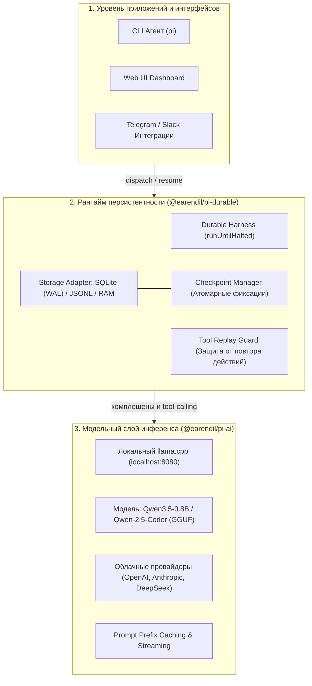
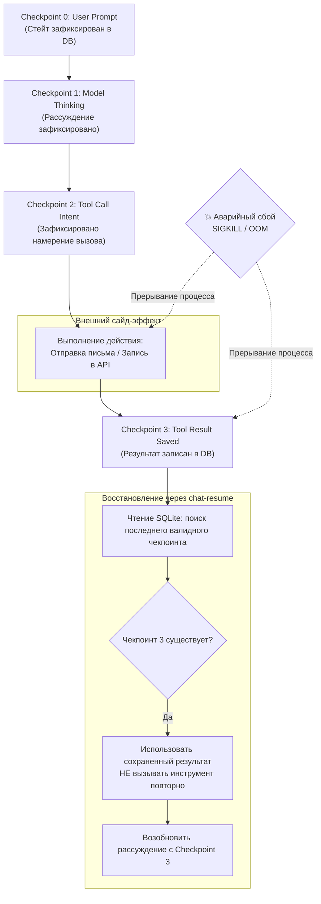

+++
title = "Архитектура Pi Durable: Always-On агенты, транзакционные чекпоинты в SQLite и безопасность повтора инструментов"
date = 2026-10-22
description = "Инженерный разбор библиотеки Pi Durable от Hugging Face: переход от stateless-скриптов к долгоживущим агентам с фиксацией чекпоинтов в SQLite, защита от дублирования вызовов инструментов и запуск с локальной моделью Qwen3.5."
[taxonomies]
tags = ["ai-agents", "architecture", "software-engineering", "evals"]
[extra]
toc = true
mermaid = true
+++

Большинство демонстраций AI-агентов работают в идеализированных условиях: единичный запуск в консоли, линейный диалог и успешное завершение за несколько секунд. В реальном продакшне автономные агенты сталкиваются с суровой сетевой и системной реальностью: падения процессов из-за OOM (Out Of Memory), сетевые таймауты при обращении к внешним API, плановые рестарты контейнеров в Kubernetes и принудительные завершения по `SIGKILL`.

В стандартном агентном цикле (stateless harness) любой сбой процесса фатален: состояние оперативной памяти теряется, а при повторном запуске агент начинает выполнение задачи с самого начала. Если до падения агент успел отправить письмо клиенту, выставить лимитный ордер на бирже или инициировать списание средств, перезапуск приводит к катастрофическому дублированию внешних действий (Tool Replay Disaster).

Инженерная команда Hugging Face и исследователь Алехандро АО (Alejandro AO) представили детальный разбор библиотеки **Pi Durable** (разработка группы Earendil). Pi Durable решает проблему живучести агентных систем на фундаментальном уровне рантайма, вводя транзакционную персистентность каждого шага в SQLite и строгую защиту от повторного выполнения недетерминированных действий.

> **Первоисточники:**
> * **Оригинальное видео:** [Hugging Face — Pi Durable EXPLAINED: Build Always-On Agents with Local Models](https://youtu.be/ti3vVYwzW4A) (автор: Алехандро АО / Alejandro AO).
> * **Демо-репозиторий:** `github.com/alejandro-ao/pi-durable-demo`.

---

## Проблема живучести: почему stateless-агенты ломаются в продакшне

Стандартный цикл работы агента строится как бесконечный цикл `while (!halted)`, удерживающий массив сообщений в оперативной памяти процесса. На каждом шаге модель генерирует либо рассуждение (thinking), либо вызов инструмента (tool call), после чего рантайм исполняет инструмент, возвращает результат в контекст и запрашивает следующий шаг.

Рассмотрим сценарий отказа на шаге $k$:

1. Агент получает задачу: «Сформировать финансовый отчет и отправить копию в бухгалтерию».
2. Шаг 1: Агент вызывает аналитический скрипт и получает выгрузку транзакций.
3. Шаг 2: Агент вызывает инструмент `send_email` для отправки письма. Письмо успешно уходит через SMTP-шлюз.
4. Шаг 3: В процессе генерации итогового ответа хост-машина падает или контейнер перезапускается по лимиту памяти.

В наивной архитектуре внешний супервизор перезапускает агента с исходным промптом. Агент заново анализирует данные и повторно вызывает `send_email`. Бухгалтерия получает дублирующиеся уведомления, а в сценариях с платежными шлюзами или торговыми операциями дублирование транзакций приводит к прямым финансовым убыткам.

Pi Durable разделяет понятия **намерения** вызова инструмента и **зафиксированного результата** выполнения, связывая их в транзакционном журнале состояний.

---

## Архитектура экосистемы Pi: три независимых слоя

Библиотека `pi-durable` не является изолированным скриптом или готовым монолитным CLI. Это модульный слой абстракции, входящий в открытую экосистему Pi от Earendil.



Архитектурное разделение обязанностей четко очерчивает границы каждого уровня:

1. **Модельный уровень (`@earendil/pi-ai`):** Отвечает исключительно за генерацию токенов, структурированный вызов функций (tool-calling) и унифицированный API к провайдерам. Поддерживает локальный сервер `llama.cpp`, совместимый с OpenAI API, и легковесные открытые модели семейства Qwen (включая Qwen3.5-0.8B), что гарантирует нулевые затраты на внешние API и полную приватность данных.
2. **Рантайм персистентности (`@earendil/pi-durable`):** Заменяет стандартный `Pi Harness`. Управляет жизненным циклом задачи, ведет учет сообщений в постоянном хранилище, формирует контрольные точки (чекпоинты) до и после каждого внешнего воздействия и обеспечивает безопасное возобновление (`resume`).
3. **Прикладной уровень:** Пользовательские интерфейсы и демоны, которые взаимодействуют с рантаймом через устойчивый API сессий (`Conversation API`).

---

## Модель состояний и безопасность повтора инструментов (Tool Replay Safety)

Формально агент представляет собой автомат с конечным числом состояний, где переход между состояниями определяется функцией перехода:

$$S\\_{t+1} = \delta(S\\_t, a\\_t)$$

где $S\\_t$ — состояние диалога и памяти на шаге $t$, а $a\\_t$ — воздействие (сообщение пользователя, внутренний reasoning модели или результат исполнения инструмента).

В Pi Durable каждое атомарное изменение состояния $S\\_t$ фиксируется в неизменяемой последовательности чекпоинтов $C\\_0, C\\_1, C\\_2, \dots, C\\_n$:



### Формальный инвариант идемпотентности

Для любого недетерминированного инструмента $T$ с побочными эффектами (I/O, сеть, внешние базы данных) рантайм гарантирует выполнение следующего инварианта:

$$\text{Exec}(T, a\\_t \mid C\\_{result}) = \text{Cached}(C\\_{result}), \quad \forall t \ge t\\_{\text{commit}}$$

Если аварийное падение происходит до момента сохранения $C\\_{result}$, инструмент при возобновлении будет вызван повторно. Но если транзакция записи $C\\_{result}$ зафиксирована в SQLite, повторный запуск агента через `chat-resume` **ни при каких условиях** не вызовет функцию инструмента снова — рантайм извлечет уже имеющийся результат из базы данных и передаст его в контекст модели.

---

## Сравнение бэкендов хранения: SQLite vs JSONL vs In-Memory

Выбор хранилища определяет надежность, скорость и требования к зависимостям агентного сервиса.

| Параметр | SQLite (Рекомендованный продакшн) | Многофайловый JSONL | In-Memory (ОЗУ) |
|---|---|---|---|
| **Транзакционность (ACID)** | Полная (WAL-режим, атомарный коммит) | Отсутствует (риск повреждения файла при аварии) | Отсутствует |
| **Выживаемость при сбое хоста** | 100% данных сохраняются на диске | Сохраняются до буфера файловой системы | 0% (полная потеря стейта) |
| **Параллельный доступ** | Несколько читателей, один писатель (WAL) | Блокировки на уровне файлов ОС | Локально в одном потоке |
| **Читаемость человеком** | Требуется CLI sqlite3 или GUI | Открывается любым текстовым редактором | Недоступно снаружи |
| **Накладные расходы I/O** | Минимальные (страничный кэш SQLite) | Высокие при перезаписи длинных файлов | Нулевые (только оперативная память) |
| **Область применения** | **Де-факто стандарт для Always-On агентов** | Логирование, отладка и аудит | Юнит-тесты и валидация схем |

Использование SQLite с включенным режимом Write-Ahead Logging (`PRAGMA journal_mode = WAL;`) позволяет производить запись контрольных точек с минимальной дисковой задержкой (порядка 1–2 мс на локальном NVMe), не блокируя чтение истории параллельными процессами мониторинга.

---

## Практическая реализация: 6 шагов сборки приложения на Pi Durable

Ниже приведена полная архитектурная схема создания отказоустойчивого агента на TypeScript с использованием `@earendil/pi-durable` и локального инференса.

```typescript
import { 
  createDurableHarness, 
  openStorage, 
  type DurableHarness, 
  type Conversation 
} from "@earendil/pi-durable";
import { initModelProvider } from "@earendil/pi-ai";
import { z } from "zod";

// Шаг 1: Конфигурация локального модельного провайдера
const modelProvider = initModelProvider({
  provider: "openai-compatible",
  baseURL: "http://127.0.0.1:8080/v1", // Локальный сервер llama.cpp
  apiKey: "not-needed-for-local",
  defaultModel: "qwen3.5-0.8b-instruct-q4_k_m"
});

// Шаг 2: Регистрация реестра инструментов со строгой Zod-схемой
interface ToolRegistry {
  executeBash: (params: { command: string }) => Promise<{ stdout: string; exitCode: number }>;
  sendReport: (params: { recipient: string; subject: string; body: string }) => Promise<{ status: string; messageId: string }>;
}

const tools = {
  executeBash: {
    name: "execute_bash",
    description: "Выполнение доверенной шелл-команды в песочнице",
    schema: z.object({
      command: z.string().describe("Команда bash для выполнения")
    }),
    handler: async ({ command }: { command: string }) => {
      // Исполнение команды в изолированном контексте
      return { stdout: `Executed: ${command}`, exitCode: 0 };
    }
  },
  sendReport: {
    name: "send_report",
    description: "Отправка готового отчета внешнему контрагенту (недетерминированное действие)",
    schema: z.object({
      recipient: z.string().email(),
      subject: z.string(),
      body: z.string()
    }),
    handler: async ({ recipient, subject, body }: { recipient: string; subject: string; body: string }) => {
      console.log(`[EXTERNAL SIDE-EFFECT] Отправка письма на адрес ${recipient}`);
      return { status: "DELIVERED", messageId: `msg-${Date.now()}` };
    }
  }
};

// Шаг 3: Инициализация персистентного хранилища SQLite
const storage = await openStorage({
  backend: "sqlite",
  filename: "./agent_state.db",
  busyTimeout: 5000,
  enableWAL: true
});

// Шаг 4: Сборка Durable Harness
const harness: DurableHarness = createDurableHarness({
  modelProvider,
  storage,
  tools: Object.values(tools),
  maxStepsPerRun: 25,
  autoCheckpoint: true
});

// Шаг 5: Получение или создание изолированной сессии
const conversationId = "task-prod-cluster-remediation-001";
const conversation: Conversation = await harness.getOrCreateConversation({
  id: conversationId,
  metadata: {
    environment: "production",
    initiatedBy: "monitoring-alert"
  }
});

// Шаг 6: Диспетчеризация задачи или возобновление прерванного пайплайна
async function runAgent(promptText?: string) {
  if (promptText) {
    console.log(`[DISPATCH] Запуск новой задачи для диалога: ${conversationId}`);
    const dispatchResult = await harness.dispatch({
      conversationId,
      prompt: promptText
    });
    console.log(`[STATUS] Результат диспетчеризации: ${dispatchResult.status}`);
  } else {
    console.log(`[RESUME] Обнаружено прерывание. Возобновление диалога: ${conversationId}`);
    const resumeResult = await harness.resume({
      conversationId
    });
    console.log(`[STATUS] Возобновление завершено со статусом: ${resumeResult.status}`);
  }
}
```

---

## Тест на устойчивость к сбоям: разбор `chat.ts` и `chat-resume.ts`

В репозитории `pi-durable-demo` автор демонстрирует поведение системы в условиях жесткого сбоя:

1. Скрипт `chat.ts` запускает агентную сессию с составной задачей: просканировать структуру директорий, сформировать список устаревших логов и вызвать инструмент отправки отчета.
2. Во время вызова инструмента отправки в консоли инициируется принудительное прерывание через `SIGKILL` (Ctrl+C). Обычный CLI-процесс завершается, стек вызовов очищается.
3. Администратор запускает скрипт восстановления:
   ```bash
   npm run chat:resume
   ```
4. Скрипт возобновления выполняет проверку состояния SQLite базы данных:
   - Считывает последний зафиксированный `checkpoint_id`.
   - Обнаруживает, что запись об исполнении инструмента `send_report` уже присутствует в таблице чекпоинтов с флагом `status: completed`.
   - Восстанавливает полный граф сообщений диалога прямо в контекст локальной модели `Qwen3.5-0.8B`.
   - Модель видит, что письмо уже отправлено, пропускает повторный вызов и сразу генерирует финальное резюме пользователю: «*Отчет сформирован и отправлен, задача завершена без ошибок*».

Такой подход устраняет необходимость в сложных распределенных транзакционных координаторах типа 2PC (Two-Phase Commit) для автономных агентных воркеров.

---

## Инженерные ограничения и рекомендации

Внедрение персистентного агентного рантайма на базе SQLite требует учета нескольких эксплуатационных факторов:

1. **Рост объема базы данных и Compaction:** При длительной работе агента массив сообщений разрастается. Необходимо настраивать политики сжатия (compaction) и архивирования старых завершенных сессий, чтобы время чтения состояния при старте `resume` оставалось константным ($O(1)$ относительно всей базы).
2. **Недетерминизм промежуточных сбоев внутри тула:** Если процесс падает в момент выполнения самого тела функции инструмента (например, сеть разорвалась во время отправки HTTP POST), инструмент должен быть либо идемпотентным со стороны внешнего API (через заголовок `Idempotency-Key`), либо рантайм должен явно регистрировать статус `in_progress` перед началом исполнения.
3. **Требования к локальным моделям:** Легковесные модели уровня `0.8B - 3B` чувствительны к точности следования схемам вызовов инструментов. Для продакшн-систем рекомендуется использовать модели от `7B` параметров (например, `Qwen2.5-Coder-7B`) с аппаратным квантованием GGUF, что обеспечивает безошибочную генерацию JSON-аргументов.

---

## Итоги

Библиотека Pi Durable демонстрирует фундаментальный сдвиг в разработке агентных систем: переход от хрупких чат-ботов к надежной распределенной автоматизации. Перенос ответственности за персистентность состояния и защиту от повторного выполнения инструментов на выделенный рантайм с бэкендом SQLite позволяет создавать Truly Always-On агентов, способных безопасно функционировать на локальном оборудовании без вендорных облачных зависимостей.
