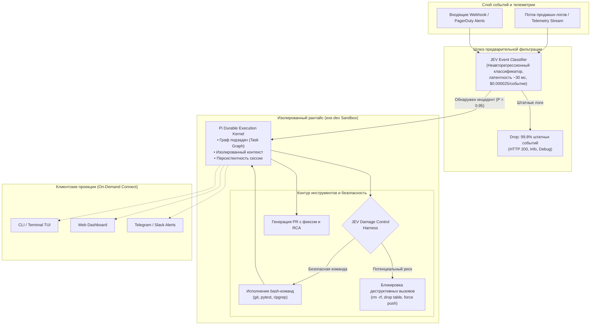
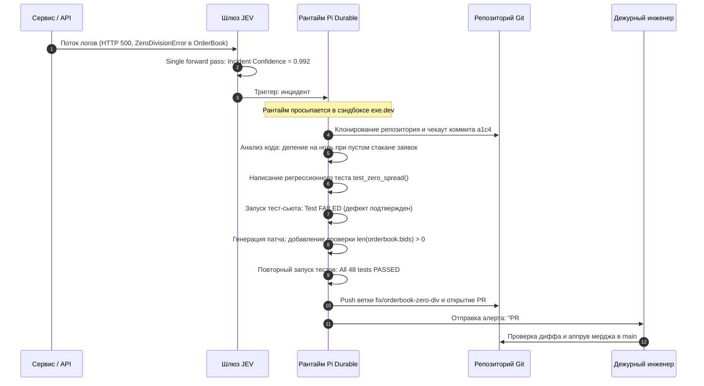

+++
title = "Архитектура проактивных AI-агентов: Pi Durable, классификаторы событий JEV и автономный On-Call в изолированных сэндбоксах"
date = 2026-11-03
description = "Инженерный разбор парадигмы проактивных автономных агентов: разделение рантайма и клиентов в Pi Durable, двухуровневая фильтрация потока логов через легковесный классификатор JEV, защитный harness от деструктивных bash-команд и изоляция в облачных сэндбоксах."
[taxonomies]
tags = ["ai-agents", "architecture", "devops", "software-engineering", "evals"]
[extra]
toc = true
mermaid = true
+++

Большинство существующих систем вспомогательного программирования (Coding Assistants) и агентных фреймворков построены вокруг строго **реактивной модели** взаимодействия. Агент запускается как локальный процесс внутри терминала разработчика или расширения IDE, блокирует ввод и пассивно ожидает текстового промпта от человека («In-the-loop»). Если инженер закрывает окно консоли, отходит от клавиатуры или разрывает SSH-соединение, жизненный цикл агента немедленно обрывается, а контекст и промежуточное состояние оперативной памяти теряются.

В промышленной эксплуатации такой подход создает критическое узкое место: агент не способен выполнять проактивную инженерную работу, реагировать на сбои в продакшне в режиме 24/7 или автономно расследовать инциденты до вмешательства дежурного инженера. 

Сдвиг парадигмы к **проактивным автономным агентам** («Out-of-the-loop» / «On-the-loop») требует радикального пересмотра архитектуры рантайма:
1. **Durable Execution & Client Decoupling:** Полное физическое отделение долгоживущего рантайма агента от пользовательских интерфейсов и клиентских терминалов.
2. **Двухуровневая фильтрация событий:** Невозможность скармливать терабайты сырых логов и метрик напрямую в дорогостоящие генеративные LLM из-за насыщения контекстного окна и экспоненциального роста затрат.
3. **Damage Control Harness:** Защита инфраструктуры от катастрофических недетерминированных действий при автономном исполнении shell-команд.

В данном материале разобран практический стек автономного дежурного инженера, продемонстрированный разработчиком ИндиДевДэном (IndyDevDan) на базе архитектуры **Pi Durable** (разработка создателей Pi coding agent из команды Earendil — Марио и Армина Ронахера) и системы быстрых классификаторов решений **JEV**.

> **Первоисточники:**
> * **Оригинальный разбор:** [IndyDevDan — Pi Durable PROACTIVE Agents: Jev Triggers My ON-CALL Pi Agent](https://youtu.be/DNDYYHsypZg) (хронометраж: 35:16).
> * **Базовые репозитории и спецификации:** [Earendil Pi Durable Architecture](https://earendil.com/posts/pi-durable/), репозиторий `github.com/disler/durable-pi`.

---

## 1. Реактивные против Проактивных: смена агентной парадигмы

В традиционной схеме разработки человек выступает в роли «диспетчера промптов». Когда в распределенной системе падает сервис, дежурный инженер получает алерт в PagerDuty, вручную подключается по VPN к Kibana/Grafana, копирует стек-трейс ошибки, формулирует промпт для LLM, копирует предложенный код в редактор и прогоняет тесты. Агент в этой схеме — всего лишь автокомплит на стероидах.

Проактивный агент функционирует как самостоятельный фоновый актор (Daemon Worker). Он непрерывно подключен к шине событий (Event Bus) и потоку телеметрии инфраструктуры. При возникновении аномалии агент:
* Самостоятельно локализует затронутый сервис и коммит в репозитории;
* Разворачивает изолированную копию окружения;
* Воспроизводит ошибку минимальным unit- или интеграционным тестом;
* Генерирует и верифицирует патч;
* Формирует драфт Pull Request с полным анализом первопричины (Root Cause Analysis, RCA) и отправляет уведомление дежурному инженеру, которому остается лишь нажать кнопку «Approve».

Ниже приведено систематическое сопоставление этих двух парадигм:

| Архитектурное измерение | Традиционный реактивный агент | Проактивный агент Pi Durable + JEV |
| :--- | :--- | :--- |
| **Модель инициации** | Pull-модель: ручной ввод промпта оператором | Push-модель: реакция на входящий поток системных событий |
| **Жизненный цикл рантайма** | Эфемерный: привязан к TTY/CLI-сессии пользователя | Долгоживущий демон: изолированный сэндбокс в облаке |
| **Устойчивость к разрыву связи** | Фатальный сбой: потеря состояния и стека вызовов | Durable State: атомарная персистентность каждого шага |
| **Взаимодействие с клиентами** | Монолитный CLI/GUI (одно окно = один процесс) | Decoupled Projections: клиенты подключаются и отключаются на лету |
| **Фильтрация шума логов** | Человек вручную вырезает нужные строки | Быстрый классификатор прямого прохода (JEV) за доли цента |
| **Политика безопасности** | Подтверждение каждой команды человеком (Y/N) | Автономный Damage Control Harness с валидацией контрактов |

---

## 2. Архитектура Pi Durable: расцепление рантайма и клиентских проекций

Главная архитектурная проблема стандартных агентных библиотек — смешивание логики выполнения (Execution Engine) и слоя представления (Presentation Layer). Если процесс агента крутится в том же процессе, что и интерфейс командной строки (TUI), закрытие ноутбука убивает выполняющуюся задачу.

Архитектура **Pi Durable** разделяет систему на три независимых слоя:

1. **Durable Kernel (Ядро исполнения):** Работает на удаленном сервере или в изолированной виртуальной машине (например, сэндбоксы `exe.dev`). Ядро хранит полный граф состояний (Task State Machine), журнал выполненных действий, стек инструментов и оперативную память.
2. **State Store (Хранилище состояний):** Транзакционный слой (на базе SQLite или WAL-лога), куда синхронно сбрасывается снапшот перед каждым внешним сайд-эффектом. Если сервер перезагружается по `SIGKILL`, при старте ядро восстанавливает точную точку выполнения без риска повторного вызова недетерминированных инструментов (защита от Tool Replay).
3. **Decoupled Clients (Проекции):** Легковесные клиенты (Web Dashboard, Terminal TUI, мобильные мессенджеры), взаимодействующие с ядром через RPC/WebSocket. Инженер может открыть терминал на рабочем компьютере, посмотреть ход расследования, закрыть терминал, а спустя два часа открыть мобильный дашборд и увидеть завершенный результат.



---

## 3. Экономика фильтрации логов: математика шлюза JEV

В современных микросервисных архитектурах генерация логов измеряется сотнями тысяч событий в минуту. Попытка направить нефильтрованный поток логов в генеративную LLM (например, Claude 3.5 Sonnet или GPT-4o) приводит к моментальному банкротству и исчерпанию контекстного окна.

Пусть $N\_{\text{events}}$ — число входящих строк телеметрии в сутки ($N\_{\text{events}} = 10^6$), $C\_{\text{LLM}}$ — средняя стоимость анализа фрагмента лога генеративной моделью (около $\$0.015$), а $P(\text{incident})$ — реальная вероятность наличия критической ошибки в произвольной строке лога ($P \approx 0.0005$).

Если скармливать поток в генеративную модель напрямую:
$$C\_{\text{direct}} = N\_{\text{events}} \cdot C\_{\text{LLM}} = 10^6 \cdot 0.015 = \$15{,}000 \text{ в сутки}$$

В решении IndyDevDan перед агентом устанавливается специализированный классификатор **JEV** (Job Event / Decision Classifier). JEV работает по принципу прямого прохода (Single Forward Pass) без авторегрессионной генерации токенов, выдавая вероятностную оценку принадлежности лога к категории инцидентов за 30 миллисекунд при стоимости $C\_{\text{JEV}} \approx \$0.000025$ за событие.

Совокупная суточная стоимость двухуровневой архитектуры рассчитывается по формуле:
$$C\_{\text{total}} = N\_{\text{events}} \cdot C\_{\text{JEV}} + \left( N\_{\text{events}} \cdot P(\text{incident}) \right) \cdot C\_{\text{agent}}$$

При $C\_{\text{agent}} = \$0.50$ (полноценный цикл расследования агентом):
$$C\_{\text{total}} = 10^6 \cdot 0.000025 + (10^6 \cdot 0.0005) \cdot 0.50 = \$25 + 500 \cdot 0.50 = \$275 \text{ в сутки}$$

Снижение эксплуатационных расходов составляет более **98.1%**. В практическом тесте автора видео обработка 6,000 входящих строк логов реального сервиса обошлась всего в $0.16, при этом агент был запущен только в момент подтвержденной аварии.

---

## 4. Контроль ущерба (Damage Control Harness): изоляция и zero-trust выполнение

Предоставление автономному агенту доступа к bash-терминалу в продакшн-контуре без надзора оператора традиционно считается неприемлемым риском. Попытки ограничить команды регулярными выражениями легко обходятся конкатенацией строк, переменными окружения или кодированием через base64.

Архитектура защитного каркаса (Harness) в связке Pi Durable и JEV реализует политику **Zero-Trust Tool Execution**:

```python
# Концептуальная реализация защитного перехватчика JEV Damage Control
from dataclasses import dataclass
from enum import Enum
import subprocess

class ActionVerdict(Enum):
    ALLOW = "allow"
    BLOCK = "block"
    ESCALATE = "escalate"

@dataclass
class ToolExecutionRequest:
    command: str
    working_directory: str
    environment_variables: dict

class JevDamageControlGate:
    def __init__(self, classifier_client, safety_threshold: float = 0.98):
        self.classifier = classifier_client
        self.safety_threshold = safety_threshold

    def evaluate_command(self, request: ToolExecutionRequest) -> ActionVerdict:
        # Быстрая проверка на деструктивные паттерны и выход за пределы сэндбокса
        features = {
            "cmd": request.command,
            "cwd": request.working_directory,
            "has_network_call": any(tool in request.command for tool in ["curl", "wget", "nc", "ssh"]),
            "has_fs_mutation": any(op in request.command for op in ["rm", "mv", "chmod", "mkfs", "dd"])
        }
        
        # Получение некалиброванной вероятности безопасности через Single Forward Pass
        safety_prob = self.classifier.predict_safety_score(features)
        
        if safety_prob >= self.safety_threshold:
            return ActionVerdict.ALLOW
        elif safety_prob < 0.50:
            return ActionVerdict.BLOCK
        else:
            return ActionVerdict.ESCALATE

    def execute_safely(self, request: ToolExecutionRequest) -> str:
        verdict = self.evaluate_command(request)
        if verdict == ActionVerdict.BLOCK:
            raise PermissionError(f"Command blocked by JEV Damage Control: {request.command}")
        if verdict == ActionVerdict.ESCALATE:
            # Сохранение состояния в SQLite и запрос подтверждения дежурного инженера
            raise InterruptedError(f"Command requires human sign-off: {request.command}")
            
        result = subprocess.run(
            request.command,
            shell=True,
            cwd=request.working_directory,
            capture_output=True,
            text=True,
            timeout=120
        )
        return result.stdout
```

Ключевые механизмы защиты:
* **Песочницы на уровне ОС:** Агент физически заперт в микро-ВМ (`exe.dev` или изолированный Firecracker-контейнер). Доступ к продакшн-БД предоставляется исключительно в режиме Read-Only через реплику с синтетическими данными (Data Masking).
* **Контекстная проверка команд:** Модель классифицирует не просто текст команды, а ее влияние на файловую систему и сетевые сокеты с учетом текущей рабочей директории.
* **Изолированное ветвление (Agent Forking):** Если для локализации бага требуется проверить рискованную гипотезу (например, модифицировать схему данных локальной SQLite), рантайм форкает дочерний сэндбокс. При неудаче дочерний сэндбокс мгновенно уничтожается, не загрязняя родительское рабочее дерево.

---

## 5. Полный цикл инцидента: от лога до Pull Request

Практический сценарий работы проактивного агента на примере сбоя в торговом шлюзе:



В отличие от классического сценария дежурства, где инженер тратит первые 30–40 минут на сбор логов, развертывание окружения и попытку воспроизвести баг, он подключается к уже готовому артефакту: изолированно воспроизведенной проблеме, зеленому CI и аккуратному diff-патчу.

---

## 6. Инженерные выводы для внедрения

1. **Терминальные агенты исчерпали себя для Ops-задач.** Полноценная автоматизация инфраструктуры невозможна, пока жизненный цикл агента привязан к клиентской TUI-сессии. Будущее автономных систем — за архитектурой **Durable Execution** с полным отделением рантайма от отображения.
2. **Не используйте тяжелые LLM в роли сисадминов-наблюдателей.** Непрерывный мониторинг телеметрии должен опираться на гибридную пирамиду: дешевые детерминированные фильтры $\to$ неавторегрессионные классификаторы прямого прохода (JEV) $\to$ оркестрирующий агент на флагманской модели с глубоким контекстом.
3. **Безопасность достигается не запретом инструментов, а изоляцией и контрактами.** Полная изоляция в эфемерных сэндбоксах (`exe.dev`, Firecracker, Docker) в сочетании с верификацией команд через Damage Control Harness позволяет доверить агенту реальные операции исправления без страха за стабильность инфраструктуры.
