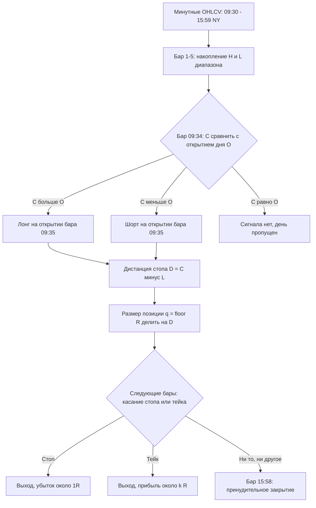

+++
title = "ORB на QQQ в PyBroker: бэктест пробоя открывающего диапазона без заглядывания вперёд"
date = 2026-11-13
description = "Механика бар-за-баром бэктеста ORB-стратегии на QQQ: расчёт открывающего диапазона, вход по следующему бару, размер позиции из риска 1% и скрытое плечо, которое он создаёт, математика 23% winrate и три объяснения провала 2026 года."
[taxonomies]
tags = ["python", "algo-trading", "quantitative", "risk-management"]
[extra]
toc = true
mermaid = true
katex = true
+++

Пробой открывающего диапазона (ORB) — одна из самых старых идей в интрадей-трейдинге: если первые минуты торговли прошли выше цены открытия дня, покупаем, ожидая продолжения импульса. Идея настолько проста, что кажется, будто её нельзя испортить реализацией. На практике всё наоборот: почти вся разница между «стратегия работает» и «стратегия съедает депозит» умещается в детали исполнения бэктеста — на каком баре исполняется сигнал, как считается размер позиции и какие издержки вообще не попали в модель.

Разберём конкретную реализацию: пятиминутный ORB на QQQ в open-source библиотеке **PyBroker 2.x** — с бар-за-бару исполнением, состоянием в `ctx.session`, стопом на противоположной границе диапазона и размером позиции из фиксированного риска. Отдельно посчитаем то, что обычно остаётся за кадром: какое плечо неявно создаёт «риск 1% на сделку» и почему 2026 год ломает кривую доходности при растущем индексе.

**Отправная точка:** видео [PyBroker: Backtesting 5 Minute ORB Strategy on QQQ](https://youtu.be/Rk-Oxn5GzOo) канала Part Time Larry. Числа прогонов ниже — из этого разбора; код и расчёты издержек — авторские, приведены как проверяемая схема, а не как воспроизведение исходного репозитория.

## Что именно проверяется

Формализуем гипотезу, иначе бэктест превращается в подгонку:

> **H1:** знак первых пяти минут торговли на QQQ предсказывает знак оставшейся части сессии с вероятностью, достаточной для положительного математического ожидания после издержек.

Гипотеза не про «магию первого бара», а про продолжение импульса: у крупных участников после открытия остаётся неисполненный объём, и они доносят его в первые часы. Если это верно, распределение доходностей остатка дня должно зависеть от направления первого импульса. Если не верно — мы получаем симметричную лотерею с отрицательным ожиданием после комиссий.

Проверять это на пятиминутных барах означает три требования к движку: доступ только к текущему и прошлым барам, исполнение не на баре сигнала, и учёт ограничения по кэшу. Всё остальное — удобство.

## Математика до кода: чего стоит 23% winrate

Пусть убыток ограничен дистанцией стопа и равен 1R, средний выигрыш равен `k` в тех же единицах R, а доля прибыльных сделок — `p`. Ожидание на сделку в единицах риска:

$$
E = p \cdot k - (1 - p)
$$

Безубыточный порог при заданном `k`:

$$
p^{*} = \frac{1}{1 + k}
$$

При `k = 10` (тейк в десять размеров диапазона) порог — **9.1%**: достаточно угадывать меньше одной сделки из десяти, чтобы не терять деньги. Это и есть экономический смысл стратегии с тейком «в десять раз больше риска»: она продаёт частоту за амплитуду.

| Средний выигрыш k | Порог p* | Ожидание при p = 0.23 |
|---|---|---|
| 3R | 25.0% | −0.08R |
| 5R | 16.7% | +0.38R |
| 8R | 11.1% | +1.07R |
| 10R | 9.1% | +1.53R |

Таблица показывает главную уязвимость конструкции: при `k = 3` стратегия с тем же winrate уже убыточна. Значит, вся прибыль держится не на проценте прибыльных сделок, а на том, что редкие выигрыши действительно дотягивают до десяти R. Любое событие, срезающее хвост выигрышей — выход в конце дня, сдвиг тейка, ранний стоп, — уничтожает ожидание быстрее, чем рост winrate способен его восстановить.

## Контракт исполнения важнее сигнала

В векторном бэктесте («посчитать доходность по колонкам pandas») позиция на бар `t` часто формируется по данным бара `t` и заполняется по цене `t`. Это заглядывание вперёд: в реальной торговле на закрытии бара вы уже не купите по его же цене. Разница в несколько базисных пунктов на сделку при 250 сделках в год превращается в разницу между «работает» и «не работает».

PyBroker решает это архитектурно: функция исполнения вызывается на **каждом баре** и получает контекст, в котором доступны только текущий и прошлые бары (`ctx.close[-1]`, `ctx.high[-2]`), а заявка, выставленная на баре `t`, исполняется на баре `t+1`. Заглядывание вперёд становится технически невозможным, а не «делом дисциплины».

Из этого следуют два неочевидных следствия, которые ломают наивную реализацию:

- Сигнал считается на баре **09:34** (пятый минутный бар сессии), а вход происходит на **09:35**. Цена входа — открытие следующего бара, а не закрытие сигнального.
- Выход «в конце дня» надо ставить на бар **15:58**, а не 15:59: заявка исполнится на следующем баре, и при постановке на 15:59 позиция закроется уже на следующей сессии — с гэпом и переносом риска через ночь.
- Константа «конец дня» не является константой. В укороченные сессии (дни перед праздниками на американском рынке закрытие в 13:00) и при переходе на летнее время бар 15:58 либо не существует, либо приходится на другой момент UTC. Время закрытия надо вычислять из календаря торговых сессий, а не задавать минутами от полуночи; иначе часть дней просто не закроется, и в отчёт попадёт ночной риск, которого в стратегии нет.



## Механика диапазона и границ

Открывающий диапазон — это максимум и минимум первых пяти минут:

$$
H = \max\_{t \in [1,5]} \text{high}\_t, \qquad L = \min\_{t \in [1,5]} \text{low}\_t
$$

Ширина диапазона `w = H − L` — одновременно мера волатильности утра и масштаб всей сделки: от неё считаются и стоп, и тейк, и размер позиции. Сигнал:

$$
\text{signal} =
\begin{cases}
+1, & C > O \\
-1, & C < O \\
0, & C = O
\end{cases}
$$

где `C` — закрытие пятого бара, `O` — цена открытия дня. Случай равенства — не мелочь: в узких диапазонах он встречается регулярно, и молчаливая трактовка «равно нулю = лонг» добавляет к выборке сделки, которых стратегия не предполагала.

Дистанция стопа до противоположной границы диапазона:

$$
D =
\begin{cases}
C - L, & \text{лонг} \\
H - C, & \text{шорт}
\end{cases}
$$

и тейк на расстоянии `k` ширин диапазона от входа:

$$
T = C + k \cdot w \cdot \text{signal}
$$

Обратите внимание: стоп задаётся как **дистанция** от цены входа, а не как абсолютная цена. Это принципиально для корректного расчёта размера позиции и для переноса логики на другие таймфреймы: при переходе с пятиминутного диапазона на пятнадцатиминутный меняется только константа, а не структура кода.

## Скрытое плечо, которое создаёт «риск 1% на сделку»

Стандартная формула размера позиции из риска:

$$
q = \left\lfloor \frac{R}{D} \right\rfloor, \qquad R = 0.01 \cdot \text{equity}
$$

Выглядит консервативно: теряем не больше 1% счёта на сделку. Но посчитаем номинал. Подставив `q`, получим:

$$
\text{notional} = q \cdot C \approx R \cdot \frac{C}{D}
$$

Отношение `C / D` — это **рычаг, который вы не выбирали**: он целиком определяется шириной утреннего диапазона. На QQQ по цене около 109 долларов при ширине диапазона 0.40 доллара отношение равно примерно 272. Умноженное на риск 1%, оно даёт **около 2.7× счёта** в номинале.

Именно поэтому в разборе прогон с фиксированными 250 акциями дал +9% за январь 2016, а прогон с риском 1% — +25%: разница не в «более умной» стратегии, а в том, что risk-based сайзинг на узком стопе вложил втрое больше капитала. Это не обязательно плохо, но это надо знать: стратегия масштабируется не риском на сделку, а плечом, и на кэш-счёте она просто не помещается в капитал — отсюда урезание 250 акций до 229 из-за нехватки средств.

Второе следствие опаснее. Стоп — это заявка, а не гарантия. Если цена проскакивает уровень на величину `g`, реальный убыток:

$$
\text{loss} = q \cdot (D + g) = R\left(1 + \frac{g}{D}\right)
$$

При `D = 0.35` и проскальзывании 0.10 доллара потеря составит 1.29R. При узком диапазоне `D = 0.10` и том же проскальзывании — **2R**, то есть вдвое больше заявленного риска. Узкие диапазоны одновременно дают максимальное плечо и худшее исполнение стопа: двойная асимметрия против стратегии, и её не видно ни в одной метрике, кроме распределения фактических убытков.

## Код: состояние между барами

Ключевая деталь PyBroker — словарь `ctx.session`, переживающий бары внутри дня. В нём живёт накопитель диапазона; при смене даты он сбрасывается. Ниже скелет, адаптированный под API PyBroker 2.x (синтаксис проверен, прогон на данных не выполнялся — числа в статье взяты из первоисточника):

```python
from datetime import datetime
import pandas as pd
from pybroker import Strategy, StrategyConfig, ExecContext

OPEN_BARS = 5            # первые 5 минут: 09:30 - 09:34
LAST_OR_MINUTE = 34      # бар, на котором фиксируется диапазон
FLAT_MINUTE = 58         # 15:58: заявка исполнится на 15:59
RISK_PCT = 0.01
TAKE_MULT = 10.0
MAX_LEVERAGE = 1.0       # жёсткий потолок номинала к капиталу

def orb_exec(ctx: ExecContext):
    ts: datetime = ctx.date
    minute = ts.hour * 60 + ts.minute

    # сброс состояния при смене торгового дня
    if ctx.session.get("day") != ts.date():
        ctx.session.update(
            day=ts.date(), or_high=None, or_low=None,
            day_open=ctx.open[-1], entered=False,
        )

    if minute < 570 or minute >= 960:          # вне 09:30 - 16:00
        return

    if ctx.session["or_high"] is None:
        ctx.session["or_high"] = ctx.high[-1]
        ctx.session["or_low"] = ctx.low[-1]
    else:
        ctx.session["or_high"] = max(ctx.session["or_high"], ctx.high[-1])
        ctx.session["or_low"] = min(ctx.session["or_low"], ctx.low[-1])

    # закрытие всех позиций: заявка уйдёт на следующий бар
    if minute == FLAT_MINUTE:
        ctx.sell_all_shares()
        return

    if minute != 570 + LAST_OR_MINUTE or ctx.session["entered"]:
        return

    high, low = ctx.session["or_high"], ctx.session["or_low"]
    width = high - low
    close, day_open = ctx.close[-1], ctx.session["day_open"]
    if width <= 0 or close == day_open:
        return

    side = 1 if close > day_open else -1
    stop_distance = close - low if side > 0 else high - close

    equity = ctx.calc_total_equity()
    risk_cash = equity * RISK_PCT
    qty = int(risk_cash / stop_distance)
    qty = min(qty, int(equity * MAX_LEVERAGE / close))   # потолок плеча
    if qty <= 0:
        return

    if side > 0:
        ctx.buy_shares = qty
        ctx.stop_loss = close - stop_distance
        ctx.take_profit = close + TAKE_MULT * width
    else:
        ctx.sell_shares = qty
        ctx.stop_loss = close + stop_distance
        ctx.take_profit = close - TAKE_MULT * width

    ctx.session["entered"] = True


config = StrategyConfig(initial_cash=25_000)
df = pd.read_csv("qqq_1min.csv", parse_dates=["date"])
df["symbol"] = "QQQ"

strategy = Strategy(df, "2016-01-01", "2023-12-31", config=config)
strategy.add_execution(orb_exec, ["QQQ"])
result = strategy.backtest()
print(result.orders.tail())
```

Три строки в этом коде важнее остальных. Строка с `MAX_LEVERAGE` превращает неявное плечо из предыдущего раздела в явный, проверяемый параметр. Строка `ctx.stop_loss = ...` ставит стоп как цену, вычисленную от фактической дистанции, — иначе риск на сделку перестаёт совпадать с `RISK_PCT`. Строка с `sell_all_shares()` на 58-й минуте закрывает позицию до конца сессии, а не на утро следующего дня.

## Издержки: считаем, а не предполагаем

В разборе прогоны сделаны без комиссий и проскальзывания — автор обещает отдельный выпуск. Пока этого не произошло, оценим порядок сами, на тех же числах: счёт 25 000, риск 1% ($250), дистанция стопа 0.35, около 714 акций.

- **Комиссия:** при фиксированной ставке около \$0.005 за акцию — примерно \$3.6 на сторону, \$7.2 на круг.
- **Проскальзывание:** один цент на акцию на входе и выходе — около \$14.3 на круг; на пробоях realistic-оценка выше, до трёх-пяти центов.
- **Стоп-ордера:** исполнение по стоп-маркету в момент импульса систематически хуже уровня, особенно в первые минуты.

Итого \$20–35 на сделку, то есть **0.08–0.14R**. При 23 сделках в месяц это 2–3R вычитаемых из валового ожидания. Само по себе терпимо — но это ровно тот порядок, который отделяет «+9% за месяц на фиксированном размере» от результата, который покажет честная модель.

## Инструментирование: измерить ожидание, а не любоваться кривой

Кривая доходности — самая плохая диагностика бэктеста: она суммирует всё и не отвечает ни на один вопрос. Минимальный набор измерений, который нужно снимать с того же прогона, — три величины на сделку: причина выхода, фактический результат в R и экстремумы хода цены до выхода (MAE и MFE). Причина выхода отделяет стратегию от её хвоста: если 70% прибыли приходит из сделок, закрытых по тайм-ауту в 15:58, — вы торгуете не ORB, а интрадей-лонг с фильтром.

```python
import numpy as np
import pandas as pd

def trade_r(orders: pd.DataFrame) -> pd.DataFrame:
    """Приводит сделки PyBroker к единицам риска R."""
    df = orders.copy()
    entry = df["entry_price"].astype(float)
    stop_dist = (entry - df["stop_price"]).abs()
    direction = np.where(df["type"].str.startswith("long"), 1.0, -1.0)
    df["r"] = (df["exit_price"] - entry) * direction / stop_dist
    df["exit_reason"] = np.select(
        [df["bars"] <= 1, df["r"] > 1.0, df["r"] < -0.9],
        ["immediate", "take_or_trail", "stop"],
        default="time_exit",
    )
    return df[["symbol", "entry_date", "r", "exit_reason"]]

def expectancy_ci(r: pd.Series, z: float = 1.96):
    n = len(r)
    mean, sd = r.mean(), r.std(ddof=1)
    half = z * sd / np.sqrt(n)
    return mean, mean - half, mean + half, sd

trades = trade_r(result.orders)
mean_r, lo, hi, sd = expectancy_ci(trades["r"])
print(f"E = {mean_r:+.3f}R  95% CI [{lo:+.3f}, {hi:+.3f}]  sd = {sd:.3f}  n = {len(trades)}")
print(trades.groupby("exit_reason")["r"].agg(["count", "mean", "sum"]))
```

Доверительный интервал здесь важнее самого числа:

$$
E \pm z \cdot \frac{\sigma}{\sqrt{n}}
$$

При 23 сделках в месяц и `σ ≈ 3R` полуширина интервала равна `1.96 · 3 / √23 ≈ 1.23R`. Иначе говоря, за месяц вы не отличите ожидание 1R от нуля — и любой вывод по одному месяцу, включая январь 2016 с его +9% и +25%, статистически пуст. Для разрешения 0.3R при том же разбросе нужно:

$$
n = \left(\frac{z \cdot \sigma}{\Delta}\right)^{2} \approx \left(\frac{1.96 \cdot 3}{0.3}\right)^{2} \approx 384
$$

около 384 сделок, то есть больше полутора лет при 23 сделках в месяц. Это и есть честный горизонт проверки гипотезы H1 — и причина, по которой разбивка по годам из восьми лет in-sample выглядит убедительнее, чем она есть.

## Что показывают числа и чего они не показывают

Все цифры ниже приведены ровно так, как они получены в первоисточнике: один инструмент, параметры подобраны на том же периоде, комиссии и проскальзывание не учитываются. Это **верхняя граница** оценки, а не ожидаемая доходность и не обещание результата.

Сводка прогонов из первоисточника:

| Прогон | Результат |
|---|---|
| Январь 2016, фиксированные 250 акций | \$25 000 → \$27 360 (+9%), 23 сделки |
| Январь 2016, риск 1% на сделку | \$25 000 → \$31 257 (+25%) |
| In-sample 2016–2023 | \$25 000 → около \$200 000, winrate 23% |
| Out-of-sample 2024–2025 | Кривая растёт, обгоняет индекс |
| 2026 (до 27 октября) | −8% при +16% у QQQ |

Восемь лет и восьмикратный рост при winrate 23% выглядят как подтверждение гипотезы продолжения импульса. Но проверка на согласованность даёт важную поправку. Фактический результат января: около \$6 257 прибыли на 23 сделки, то есть примерно **\$272 на сделку ≈ 1.1R**. Формула с `p = 0.23` и `k = 10` обещает 1.53R. Расхождение означает, что средний выигрыш ближе к 8R, а не к 10R: часть прибыльных сделок закрывается по времени в 15:58, не дотягивая до тейка. Распределение выигрышей — не «бимодальное ±k R», а непрерывное, и это надо учитывать при оценке просадок.

Ещё важнее то, чего в таблице нет: результата **после** издержек, и разбивки по годам. Именно разбивка по годам отвечает на вопрос, заданный 2026-м.

## Почему 2026 год ломает кривую

Минус 8% при плюс 16% у индекса — не «неудача», а сигнал о смене режима. Три конкурирующих объяснения, которые можно разделить экспериментом, а не спором:

1. **Режим.** Стратегия зарабатывает на продолжении утреннего импульса. Если рынок переходит в режим возврата к среднему внутри дня, пробой открытия становится точкой разворота — и стратегия систематически покупает локальный максимум. Проверка: доля дней, где направление первого импульса совпало с направлением дня, по годам.
2. **Издержки.** С ростом волатильности растёт и проскальзывание, а дистанция стопа не меняется пропорционально. Проверка: добавить модель издержек и посмотреть, не исчезает ли преимущество уже в 2024–2025.
3. **Слабость условия.** «Закрытие выше открытия дня» — грубый фильтр, не учитывающий ни относительный объём в диапазоне, ни волатильность относительно ATR. Проверка: ожидание по квинтилям ширины диапазона и объёма.

Показательный контр-эксперимент: заменить сигнал на случайный вход в 09:35 с теми же стопом и тейком. Если случайный вход даёт похожую кривую за 2016–2023, стратегия измеряет не импульс, а асимметрию стопа и тейка в трендовом бычьем рынке. Это самый дешёвый способ отличить edge от бета-версии лонга.

## Пять инвариантов, которые проверяются до любых выводов

Отчёт о доходности имеет смысл только после того, как бэктест прошёл формальные проверки на согласованность. Пять утверждений, каждое из которых ломается тихо и превращает результат в фантазию:

1. **Ни одна заявка не исполнена на баре сигнала.** Идентификатор бара входа строго больше идентификатора бара, на котором зафиксирован сигнал.
2. **Сумма R сходится с деньгами.** Приведённая к R прибыль должна совпадать с фактическим P&L, делённым на риск на сделку; расхождение означает, что часть сделок потеряла привязку к своему стопу.
3. **Касса не уходит в минус ни на одном баре.** Отрицательный баланс в кривой — не «плечо», а баг движка или сайзинга.
4. **Число сессий в прогоне равно календарю.** Если уникальных дат меньше, чем торговых дней, пропуски в данных выглядят как отсутствие сигналов и завышают winrate.
5. **На каждом дне не больше одной сделки.** Двойной вход означает, что состояние в `ctx.session` сбрасывается не на той границе дня.

```python
def check_invariants(orders: pd.DataFrame, equity: pd.Series, sessions: int, risk_cash: float):
    assert (orders["entry_bar"] > orders["signal_bar"]).all(), "fill on signal bar"
    assert abs(orders["r"].sum() - orders["pnl"].sum() / risk_cash) < 1e-6, "R mismatch"
    assert (equity >= 0).all(), "negative cash"
    assert orders["entry_date"].dt.date.nunique() == sessions, "session count mismatch"
    assert orders.groupby(orders["entry_date"].dt.date).size().le(1).all(), "double entry"
```

Если в результате `strategy.backtest()` нет колонок `signal_bar` и `entry_bar`, их надо положить в `ctx.session` в момент выставления заявки: движок отдаёт сделки, но не историю решений, и без этого инвариант №1 проверить нечем.

## Чек-лист перед реальными деньгами

Прежде чем переносить такую конструкцию на живой счёт через Interactive Brokers, нужно закрыть четыре разрыва:

- **Издержки в модели.** Комиссия и проскальзывание как параметры бэктеста, а не как «поправка в голове»; отдельно — ухудшение исполнения стоп-маркета.
- **Плечо как ограничение.** Явный потолок `q · C ≤ equity · L`, иначе узкий диапазон превращает риск 1% в 3% счёта.
- **Учёт гэпа через стоп.** Риск на сделку считать как `D + g`, а не как `D`; на коротких диапазонах это меняет размер позиции в разы.
- **Walk-forward, а не in-sample.** Обучение на 2016–2021, проверка на 2022–2023, финальная проверка на 2024–2026. Один и тот же параметр `k`, выбранный по всему периоду, — это уже подгонка.

И пятое, организационное: журнал первых 50 живых сделок с фактическими R и сравнение распределения с бэктестом. Расхождение в медиане больше 0.2R означает, что проблема не в стратегии, а в исполнении — и решать её надо на уровне инфраструктуры, а не параметров.

## Выводы

- Бар-за-бару исполнение в PyBroker снимает целый класс ошибок: заглядывание вперёд становится невозможным, а не «не рекомендованным». Цена этого — необходимость думать про следующий бар (вход на 09:35, выход на 15:58).
- Экономика ORB держится на редких крупных выигрышах: при тейке в десять R безубыточный winrate — 9%, при тейке в три R — уже 25%. Стратегия чувствительна не к точности входа, а к сохранности хвоста выигрышей.
- «Риск 1% на сделку» на узком стопе — это скрытое плечо в 2–3× счёта и удвоение фактического убытка при проскальзывании через стоп. Ограничение номинала обязательно, а не желательно.
- Результат 2026 года (−8% при +16% у индекса) — не аргумент против ORB как идеи, а аргумент против публикации стратегии без разбивки по режимам и без модели издержек.
- Порядок издержек (0.08–0.14R на круг) достаточен, чтобы изменить вывод о пригодности стратегии. Пока он не в модели, любые абсолютные цифры доходности — верхняя граница, а не оценка.

## Первоисточник

- Видео: [PyBroker: Backtesting 5 Minute ORB Strategy on QQQ](https://youtu.be/Rk-Oxn5GzOo), канал Part Time Larry, 31:27. Числа прогонов, константы стратегии и последовательность шагов — из этого разбора; код в статье — авторский скелет под API PyBroker 2.x, а не код автора видео.
- Библиотека: `lib-pybroker` (PyBroker), минутные данные QQQ за 2016–2026.

## Связанные разборы

- [Декомпозиция доходности: где на самом деле живёт альфа](/posts/decomposed-returns-quote-skewing-market-making/)
- [MIT Poker Roadmap: квант как игра с неполной информацией](/posts/mit-poker-roadmap-quant-trading-game-theory-variance/)
- [DCA и мартингейл: бюджет капитала и риск-гейты](/posts/dca-martingale-capital-budget-risk-gates/)
