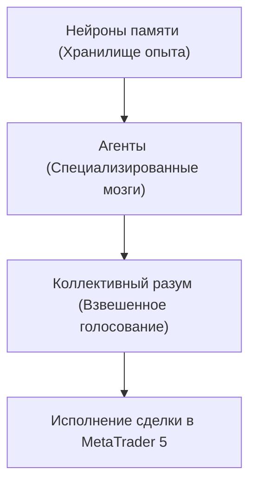

+++
title = "Система обучения с подкреплением для алгоритмической торговли в MQL5"
date = 2026-10-15
description = "Многоагентная архитектура RL для MetaTrader 5: нейроны памяти, стационарные признаки, коллективный разум и эволюционное обучение."
[taxonomies]
tags = ["algo-trading", "quantitative", "architecture"]
[extra]
toc = true
mermaid = true
+++

Представьте торгового робота, который не слепо следует заранее прописанным правилам, а действительно учится на своих ошибках и успехах — точно так же, как это делает живой трейдер. Именно такой системой и является обучение с подкреплением (Reinforcement Learning, RL) в контексте алгоритмической торговли. Это не просто ещё один технический индикатор или набор сигналов — это принципиально иной подход к построению торговых стратегий, при котором машина сама открывает рыночные паттерны через непрерывное взаимодействие с рынком.

В отличие от классического обучения с учителем, где модель обучается на заранее размеченных примерах «правильного» поведения, обучение с подкреплением строит стратегию через пробу и ошибку. Агент совершает действие, наблюдает результат и получает вознаграждение или штраф. Со временем он вырабатывает политику поведения, максимизирующую суммарное вознаграждение. В торговле это означает: система сама понимает, в какие моменты входить в рынок, а в какие — оставаться вне его.

Реализованная на MQL5 для платформы MetaTrader 5 система представляет собой полноценную многоагентную архитектуру машинного обучения, способную торговать автономно и непрерывно дорабатывать свои стратегии на основе накопленного опыта.

## Философия архитектуры: от нейронов к коллективному разуму

В основе системы лежит идея, вдохновлённая работой биологического мозга, но адаптированная под жёсткие требования алгоритмической торговли. Вместо монолитной модели, пытающейся охватить весь рынок сразу, мы строим иерархию из простых, специализированных компонентов.

| Уровень архитектуры | Компонент | Основная функция |
| :--- | :--- | :--- |
| **Нижний уровень** | Нейроны памяти | Автономные хранилища опыта (состояние, действие, Q-значение) |
| **Средний уровень** | Специализированные агенты | Независимые «мозги» для поиска импульсов, трендов и фильтрации шума |
| **Верхний уровень** | Коллективный разум | Взвешенное голосование агентов на основе их исторических результатов |

На самом нижнем уровне находятся **нейроны памяти** (memory neurons) — автономные хранилища опыта. Каждый такой нейрон запоминает конкретную рыночную ситуацию, предпринятое действие и полученный результат. Нади ими возвышаются **агенты**, а объединяет их **коллективный разум** — руководящий совет, где вес голоса каждого агента пропорционален его прошлым заслугам.

## Анатомия нейрона памяти: квантование рыночного опыта

Нейрон памяти — это фундаментальная единица хранения опыта. Рынок непрерывен, а память конечна. Ключевое решение проблемы — **квантование признаков**. Вместо хранения точных значений цен, индикаторов и объёмов, система переводит их в дискретные интервалы (бины).

Каждый нейрон памяти содержит:
- **Ключ состояния** — заквантованный вектор признаков, описывающий рыночную ситуацию;
- **Действие** — что сделал агент (купить, продать, ждать);
- **Q-значение** — оценку ожидаемого вознаграждения для этого состояния-действия;
- **Счётчик посещений** — сколько раз эта ситуация встречалась;
- **Возраст/старение** — метку времени для отсечения устаревшего опыта.

## Стационарные признаки: новый взгляд на представление рынка

Традиционный подход к признакам часто опирается на сырые цены и их производные, которые нестационарны — их статистические свойства меняются со временем. Скользящее среднее на бычьем рынке может не работать на медвежьем. 

Автор предлагает использовать **стационарные признаки** — величины, чьё распределение остаётся примерно постоянным во времени (z-оценки, относительные спреды, циклические компоненты). Например, вместо абсолютной цены закрытия используется её отклонение от скользящей средней в единицах стандартного отклонения. Это позволяет нейронам памяти переносить опыт между разными рыночными режимами.

## Механика обучения: от исследования к мастерству

Система использует модифицированный алгоритм Q-обучения (Q-learning), адаптированный к специфике финансовых рынков:

$$\text{Q}(s,a) \leftarrow \text{Q}(s,a) + \alpha \cdot [r + \gamma \cdot \max\_{a'} \text{Q}(s',a') - \text{Q}(s,a)]$$

где $\alpha$ — скорость обучения, $\gamma$ — коэффициент дисконтирования будущего вознаграждения, $r$ — немедленное вознаграждение, а $\max\_{a'} \text{Q}(s',a')$ — оценка лучшего действия в следующем состоянии.

Для баланса между исследованием и использованием применяется эволюционное сокращение исследования: скорость снижения подстраивается под динамику рынка (в турбулентные периоды система сохраняет готовность к экспериментам).

## Управление сложностью: отсечение и эволюция

По мере работы объём памяти растёт. Для предотвращения раздувания используются два механизма:
1. **Отсечение (Pruning):** Нейроны с нестабильно низкими Q-оценками удаляются («забывание» плохих привычек).
2. **Эволюционное сокращение:** Менее успешные агенты вытесняются, их вес в коллективном разуме падает в пользу лидеров.

## Ключевые выводы

- Многоагентная архитектура RL в MQL5 позволяет строить саморазвивающиеся торговые системы без монолитной хрупкости.
- Квантование состояний и стационарные признаки делают опыт переносимым между различными рыночными режимами.
- Коллективный разум с взвешенным голосованием сглаживает шум и повышает устойчивость итоговых решений.
- Регулярный прунинг и балансировка классов защищают систему от деградации и засорения памяти.

---

## Первоисточники и материалы
* **Оригинальная статья (MQL5):** [Yevgeniy Koshtenko — Система обучения с подкреплением для алгоритмической торговли в MQL5](https://www.mql5.com/ru/articles/20122)
* **Заметки и детальный конспект:** [Obsidian Vault (GitHub)](https://github.com/xsa-dev/obsidian-vault/blob/main/Articles/RL-System-AlgoTrading-MQL5-RU.md)
* **Инженерные наработки:** [github.com/xsa-dev](https://github.com/xsa-dev)
