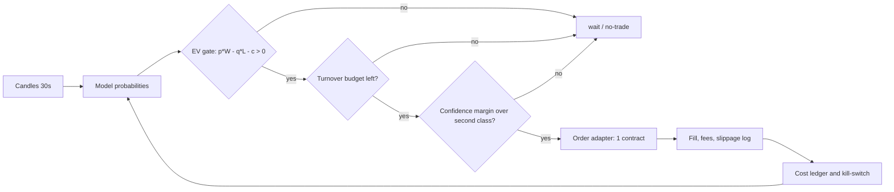

+++
title = "Математика издержек в скальпинге: 600 сделок в сутки, 2.17 USD за круг и порог безубыточности"
date = 2026-11-14
draft = false
description = "Разбор 24-часового paper-теста AI-скальпера: 1 300 USD из 2 300 USD убытка — комиссии. Издержка в пунктах, порог безубыточности, симуляция и бюджет оборота."
[taxonomies]
tags = ["algo-trading", "quantitative", "market-microstructure", "ai-agents"]
[extra]
toc = true
mermaid = true
katex = true
+++

Скальпинг с машинным решением интересен не тем, что модель отвечает быстро, а тем, что при таком темпе арифметика издержек начинает доминировать над качеством сигнала. Проверить это можно на редком случае: автор эксперимента опубликовал убыточный результат и разложил его по статьям — вместо того чтобы показывать latency как доказательство преимущества.

24 часа, около 600 сделок, 100 000 USD виртуального капитала, итог примерно −2.3%. Из 2 300 USD убытка около 1 300 USD — комиссии и сборы. Дальше вся статья — попытка ответить на один вопрос: что должно быть в политике решения, чтобы такой поток сделок не терял деньги механически, ещё до обсуждения предсказательной силы модели.

> **Первоисточник:** [Jev AI scalping bot — 24-hour paper test](https://youtu.be/4_Wks0WLwgo), канал *Ben's AI Trading Lab*, 8:53. Все торговые цифры ниже — из отчёта в видео; расчёты издержек, порогов и симуляции выполнены независимо и воспроизводятся кодом из статьи.

> **Финансовый дисклеймер.** Материал носит образовательный характер и не является инвестиционной рекомендацией или обещанием доходности. Paper-тест — не торговый результат: исполнение, проскальзывание и ликвидность на реальном счёте отличаются. Торговля фьючерсами с плечом может привести к потере всего капитала.

---

## 1. Протокол эксперимента

Разбор имеет смысл только при зафиксированных правилах — иначе непонятно, что именно измерялось.

| Параметр | Значение | Почему это важно для интерпретации |
| --- | --- | --- |
| Счёт | 100 000 USD, paper | Нет реальных филлов, очереди и проскальзывания |
| Период | ~24 часа | Один режим рынка, нет статистической силы |
| Инструменты | микро-фьючерсы на Nasdaq, Bitcoin, золото | Разные тарифы и тики на каждом |
| Такт решений | каждые 30 секунд | 2 880 точек решения за сутки |
| Классы действия | `long`, `short`, `wait`, перенос стопа в безубыток | Выбор — argmax вероятности, без порога и EV |
| Размер позиции | 1 контракт | Риск на сделку почти постоянен |
| Сделок | ~600 | 25 сделок в час |
| Среднее удержание | ~1 минута | Горизонт короче типичного шума |
| Итог | ~−2.3% (≈ −2 300 USD) | Из них ~1 300 USD — комиссии |
| Прибыльных сделок net | ~18% | В знаменателе, вероятно, все сделки, но полного лога в видео нет |
| Латентность решения | 779 мс | Быстро — но это не преимущество |

Автор видео честно оговаривает два ограничения: он не знает, была бы стратегия прибыльной без комиссий, и считает, что одних сырых свечей недостаточно для решений такого горизонта. Оба пункта ниже проверяются арифметикой.

## 2. Разложение 2 300 USD: сколько стоил сигнал, а сколько — инфраструктура

Начнём с того, что можно посчитать без допущений. Делим итог на число сделок:

| Величина | Расчёт | Значение |
| --- | --- | --- |
| Средний результат сделки | 2 300 / 600 | −3.83 USD |
| Средняя издержка на круг | 1 300 / 600 | −2.17 USD |
| Gross-результат сделки | (2 300 − 1 300) / 600 | −1.67 USD |
| Доля издержек в убытке | 1 300 / 2 300 | 56.5% |
| Результат без комиссий | −1 000 USD на 100 000 USD | −1.00% за сутки |

Здесь важны сразу два вывода, и второй обычно теряется.

Первый: **больше половины убытка — не ошибка прогноза, а плата за оборот**. 56.5% итога не зависело от того, угадала модель направление или нет.

Второй: на вопрос «была бы стратегия прибыльной без комиссий» у этой выборки есть ответ — нет. Gross-результат остаётся отрицательным: −1 000 USD, то есть −1.00% за сутки. Комиссии не превратили прибыль в убыток; они увеличили убыток примерно в 2.3 раза. Это принципиально разные диагнозы: в первом случае лечат политику исполнения, во втором — и политику, и сам сигнал.

## 3. Издержка как единица измерения цены

Пока издержка живёт в долларах, её легко спутать с чем-то внешним по отношению к сигналу. Переведём её в пункты инструмента. Для микро-контракта на Nasdaq (MNQ) пункт индекса стоит 2.0 USD, тик 0.25 пункта — 0.50 USD.

$$c\_{\text{pts}} = \frac{c\_{\text{rt}}}{v} = \frac{2.17}{2.0} = 1.083\ \text{пункта}$$

Это и есть настоящая единица измерения стратегии: **любая сделка, чей gross-результат меньше 1.08 пункта, закрывается в минус, даже если направление угадано верно**. Не 18% «неудачных входов», а все входы с движением меньше издержки — механически, независимо от модели.

Поэтому заявленные 18% прибыльных сделок net выглядят уже не как слабость классификатора, а как следствие геометрии: распределение минутных движений сосредоточено вблизи нуля, а порог безубыточности по цене стоит на 1.08 пункта.

Отсюда первое практическое правило, которое не зависит от выбора модели: **сравнивать ожидаемое движение с издержкой нужно до входа, а не после закрытия**. Если типичный целевой ход меньше двух издержек, статистика сделок будет описывать комиссии, а не качество сигнала.

## 4. Порог безубыточности

Формально всё сводится к одной формуле. Пусть $W$ — средний выигрыш, $L$ — средний проигрыш в деньгах, $c\_{\text{rt}}$ — издержка круга, $p$ — доля прибыльных сделок. Ожидание на сделку:

$$\mathbb{E} = p\ W - (1-p)\ L - c\_{\text{rt}}$$

Приравняв к нулю, получаем безубыточный винрейт:

$$p^{\ast} = \frac{L + c\_{\text{rt}}}{W + L}$$

Для симметричного исхода ±$k$ пунктов ($W = L = k\ v$) формула упрощается до $p^{\ast} = \dfrac{k + c\_{\text{pts}}}{2k}$:

| Цель/стоп, пунктов | $p^{\ast}$ | Что это значит на MNQ |
| --- | --- | --- |
| 1 | 1.042 | недостижимо: издержка больше самого хода |
| 2 | 0.771 | нужно угадывать 77% входов |
| 3 | 0.681 | нужно 68% |
| 5 | 0.608 | нужно 61% |
| 10 | 0.554 | нужно 55% |
| 20 | 0.527 | нужно 53% |

Асимметрия помогает, но не спасает: при соотношении прибыль/риск 2:1 и стопе в 5 пунктов порог падает до 0.406 — это уже похоже на достижимую величину, но требует удержания позиции на движение в 10 пунктов, что для минутного горизонта означает совсем другую стратегию.

Проверка согласованности с отчётом. Если принять 18% за долю прибыльных сделок и средний убыток в 3 пункта (6 USD), то gross-результат −1 000 USD на 600 сделках требует средней прибыли около 9 пунктов (18 USD). Иначе говоря, наблюдаемый убыток согласуется только с сильно асимметричным распределением исходов — либо с тем, что часть «побед» по цене была меньше издержки и превратилась в минус. Оба варианта объясняют, почему net-винрейт оказался низким при работающем, возможно, сигнале.

## 5. Симуляция: тот же сигнал до и после издержек

Формула показывает порог, но не показывает разброс. Смоделируем 600 сделок с фиксированными вероятностями и посмотрим, как меняется знак результата при включении издержки:

```python
import math
import numpy as np

rng = np.random.default_rng(7)
EQUITY, LOSS, FEES, TRADES = 100_000, 2_300, 1_300, 600
FEE_RT = FEES / TRADES          # средняя издержка на круг, $
POINT = 2.0                     # MNQ: $2 за пункт индекса
c = FEE_RT / POINT              # издержка в пунктах

def p_star(k):                  # безубыточный винрейт для ±k пунктов
    return (k + c) / (2 * k)

print(f"FEE_RT={FEE_RT:.2f}$  c={c:.3f} п.  gross/сделку={-(LOSS - FEES) / TRADES:+.2f}$")
for k in (2, 5, 10, 20):
    print(f"k={k:>2} п. -> p*={p_star(k):.4f}")

def run(p, k, fee=FEE_RT, paths=20_000):
    wins = rng.random((paths, TRADES)) < p
    pnl = np.where(wins, k * POINT, -k * POINT) - fee
    return pnl.sum(axis=1)

for p, k in ((0.55, 5), (0.60, 5), (0.55, 10)):
    a, b = run(p, k), run(p, k, fee=0.0)
    print(f"p={p:.2f} k={k:>2}: с издержкой mean={a.mean():+.0f}$ P+={(a > 0).mean():.3f} | "
          f"без издержки mean={b.mean():+.0f}$ P+={(b > 0).mean():.3f}")

print(f"drift={FEES/EQUITY*100:.3f}%/сутки, полураспад={math.log(0.5)/math.log(1-FEES/EQUITY):.1f} сессий")
```

Вывод запуска:

```text
FEE_RT=2.17$  c=1.083 п.  gross/сделку=-1.67$
k= 2 п. -> p*=0.7708
k= 5 п. -> p*=0.6083
k=10 п. -> p*=0.5542
k=20 п. -> p*=0.5271
p=0.55 k= 5: с издержкой mean=-700$ P+=0.002 | без издержки mean=+598$ P+=0.992
p=0.60 k= 5: с издержкой mean=-104$ P+=0.351 | без издержки mean=+1201$ P+=1.000
p=0.55 k=10: с издержкой mean=-96$ P+=0.421 | без издержки mean=+1204$ P+=0.992
drift=1.300%/сутки, полураспад=53.0 сессий
```

Читается это так. Один и тот же сигнал с винрейтом 55% и целями в 5 пунктов без издержек даёт в среднем **+598 USD** и прибыль в 99.2% прогонов; с издержкой 2.17 USD за круг он даёт **−700 USD** и прибыль в 0.2% прогонов. Причина видна в таблице из предыдущего раздела: 0.55 ниже порога 0.6083, значит знак ожидания отрицателен по построению, а не из-за неудачной серии.

Обратите внимание на строку p=0.60, k=5: винрейт выше порога 0.608 почти достигнут, средний результат почти нулевой (−104 USD), но вероятность закончить сутки в плюсе — всего 0.351. При 600 сделках шум складывается в широкий разброс вокруг отрицательного среднего, и «почти безубыточная» стратегия всё равно проигрывает в двух случаях из трёх.

## 6. Частота против информации

Теперь про скорость — ту часть, которую обычно принимают за преимущество.

| Величина | Расчёт | Значение |
| --- | --- | --- |
| Точек решения за сутки | 86 400 / 30 | 2 880 |
| Сделок | из отчёта | 600 |
| Конверсия решения в сделку | 600 / 2 880 | 20.8% |
| Сделок в час | 600 / 24 | 25.0 |
| Латентность как доля такта | 0.779 / 30 | 2.6% |
| Издержки на одно решение | 1 300 / 2 880 | 0.45 USD |
| Занятость времени в позиции | 600 × 60 / 86 400 | 41.7% |

Три вывода, каждый — из числа.

**Латентность не является узким местом.** 779 мс — это 2.6% от тридцатисекундного такта. Даже десятикратное ускорение модели изменило бы издержки и PnL в пределах статистического шума: решение принимается раз в 30 секунд не потому, что модель медленная, а потому, что так задан таймер.

**Узкое место — оборот.** Каждое решение стоит в среднем 0.45 USD, потому что пятая часть решений превращается в сделку. Ускорение вывода при том же таймере не меняет ничего; сокращение числа сделок меняет всё линейно.

**Позиция занята 42% времени.** При среднем удержании минута и 600 сделках бот почти половину суток находится в рынке — это уже не выборочный вход, а непрерывное присутствие, при котором вход и выход становятся функцией таймера, а не события.

Отсюда конструктивное следствие: при таком такте «ждать» должно быть действием по умолчанию, а не одним из четырёх равноправных классов. Argmax вероятности всегда возвращает какой-то класс; политика, у которой нет стоимости бездействия, будет торговать даже там, где ожидание отрицательно после издержек.

## 7. Дрейф капитала и бюджет оборота

Издержки, выраженные в процентах счёта, ведут себя как постоянная отрицательная доходность. При 1 300 USD в сутки на 100 000 USD это 1.30% в день. Если бы gross-результат был ровно нулевым, счёт потерял бы половину за 53 торговые сессии — просто за счёт оборота.

Полезно держать перед глазами масштаб: допустимый оборот задаётся бюджетом издержек, а не аппетитом модели.

| Сделок в сутки | Издержки, USD | Доля счёта |
| --- | --- | --- |
| 50 | 108 | 0.108% |
| 100 | 217 | 0.217% |
| 300 | 650 | 0.650% |
| 600 | 1 300 | 1.300% |

Бюджет издержек в 0.2% счёта за сутки при 2.17 USD за круг разрешает не более 92 кругов в день. Это не рекомендация торговать 92 раза — это верхняя граница, за которой издержки начинают определять результат сильнее, чем сигнал.

## 8. Что должно стоять между вероятностями и ордером

Схема из видео короткая: свечи → вероятности → argmax → ордер. Ниже — та же схема с добавленным слоем политики; ни один элемент не является «улучшением модели», все они относятся к исполнению.



Шесть правил, каждое выводится из посчитанного выше.

1. **Гейт по ожиданию, а не по вероятности.** Действие разрешается, если $pW - (1-p)L - c\_{\text{rt}} > 0$ на текущей оценке цели и стопа. Порог $p^{\ast}$ при этом пересчитывается при каждом изменении $W$, $L$ или издержки — он не константа.
2. **Отступ по уверенности.** Решение принимается только если лучший класс превышает второй на заданный зазор. Без него argmax выбирает между почти равными вариантами, и часть сделок — шум классификатора.
3. **Бюджет оборота как жёсткое ограничение.** Число кругов в сутки и суммарные издержки — параметры конфигурации, а не следствие таймера. 92 круга при 0.2% счёта — пример расчёта, не норматив.
4. **Стоимость бездействия равна нулю, и это нормально.** `wait` должен выигрывать при слабом ожидании; отсутствие сделки не является упущенной возможностью, если ожидание после издержек отрицательно.
5. **Издержки входят в журнал на уровне сделки.** Средняя 2.17 USD за круг — это агрегат по трём инструментам; для политики нужна издержка по каждому инструменту отдельно, с проскальзыванием. Пока её нет, гейт по EV считается по завышенной точности.
6. **Управление стопом — отдельный контракт.** Перенос стопа в безубыток меняет распределение исходов и не может быть просто ещё одним классом в том же argmax: у него другая функция потерь.

## 9. Ограничения разбора

Всё, что выше, опирается на один суточный paper-прогон с округлёнными числами, и это ограничивает выводы.

- **Нет полного лога сделок.** 600 сделок, 18% прибыльных net, 1 300 USD издержек — агрегаты из видео. Точное распределение исходов, комиссия по инструментам и проскальзывание неизвестны, поэтому 2.17 USD за круг — восстановленная средняя, а не тариф брокера.
- **Paper-исполнение оптимистично.** Нет очереди, частичных филлов и влияния на рынок; на реальном счёте издержка на круг была бы выше, а результат хуже.
- **Один режим рынка.** 24 часа не позволяют отделить свойство сигнала от удачи режима; вывод «стратегия убыточна» из этой выборки не следует — следует вывод «при такой частоте издержки доминируют».
- **Три инструмента смешаны.** Расчёт в пунктах MNQ — иллюстрация масштаба для одного инструмента; у золота и Bitcoin другие стоимости тика, и пороги $p^{\ast}$ для них другие.
- **Модель не оценивается.** Разбор ничего не говорит о качестве Jev как классификатора: он говорит о том, что при горизонте в минуту и издержке в 1.08 пункта качество должно быть очень высоким, чтобы вообще проявиться.

## 10. Что остаётся после разбора

Убыток в этом эксперименте устроен скучно и поучительно: 56.5% — плата за оборот, 43.5% — отрицательный gross при 600 сделках в сутки. Ни один из этих двух компонентов не лечится ускорением инференса или более красивой моделью; оба лечатся политикой, в которой издержка стоит в числителе ожидания, а не в отчёте после факта.

Практическая формула, которую стоит держать в голове: **торгуй только тогда, когда ожидаемое движение превышает издержку с запасом, и считай этот запас в пунктах, а не в процентах уверенности**. Для минутного горизонта на MNQ этот запас начинается примерно с 1.1 пункта, и всё, что меньше, — это не сделка, а взнос в комиссии.

> **Источник:** [Jev AI scalping bot — 24-hour paper test](https://youtu.be/4_Wks0WLwgo), канал *Ben's AI Trading Lab*. Торговые цифры (капитал, число сделок, издержки, винрейт, латентность) взяты из отчёта в видео; разложение убытка, перевод издержки в пункты, пороги безубыточности, симуляция и бюджет оборота рассчитаны независимо и воспроизводятся кодом из раздела 5.
