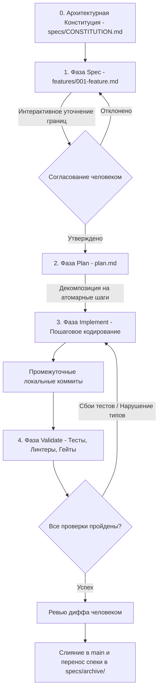
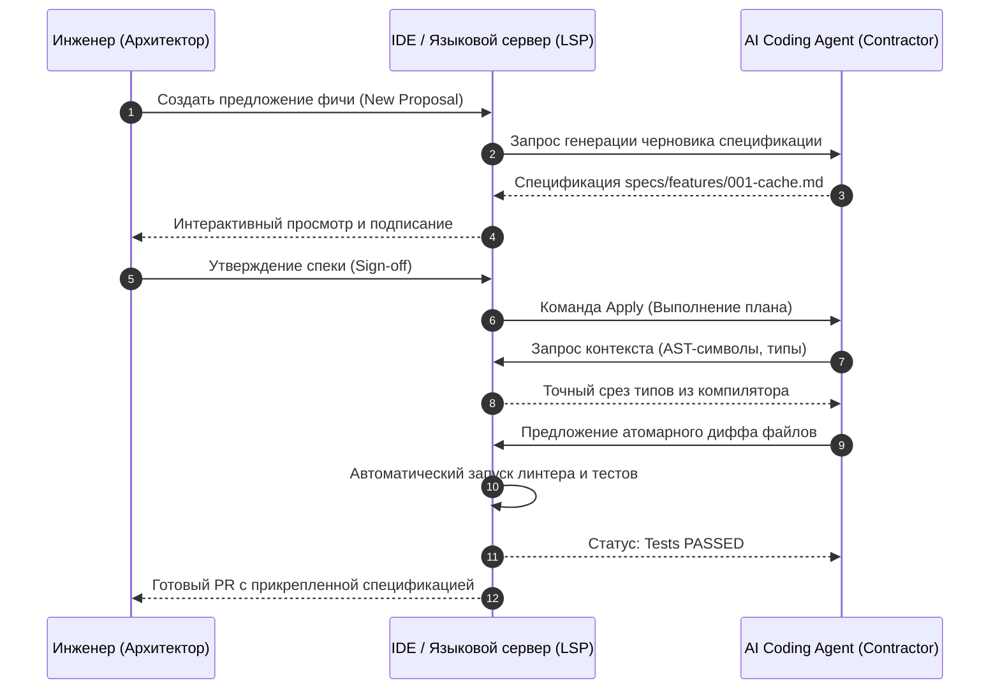

+++
title = "Spec-Driven Development для AI-агентов: архитектура спецификаций, конституция проекта и верификационные гейты"
date = 2026-10-18
description = "Разбор архитектуры Spec-Driven Development: как переход от vibe-кодинга к конституциям, спецификациям и гейтам верификации делает AI-агентов надежными."
[taxonomies]
tags = ["software-engineering", "architecture", "ai-agents"]
[extra]
toc = true
mermaid = true
+++

С развитием больших языковых моделей и автономных ассистентов разработка программного обеспечения столкнулась с явлением так называемого «vibe-кодинга» — хаотичной генерации кода по коротким текстовым промптам без формализации архитектурных границ. На простых прототипах из одного-двух файлов подход выглядит впечатляюще: бот генерирует работающие скрипты за считанные секунды. Однако при переносе в продакшн или кодовые базы размером от нескольких тысяч строк «vibe-кодинг» неизбежно упирается в фундаментальный предел.

Главные причины деградации автономных агентов при обычном промптинге — потеря контекста при росте истории диалога, размывание системных ограничений и накопление скрытых регрессий. Чтобы преодолеть эти барьеры, инженеры JetBrains и исследователи DeepLearning.AI формализовали методологию **Spec-Driven Development (SDD)**.

В материале детально разобран архитектурный каркас SDD: проектирование конституции проекта (`CONSTITUTION.md`), 4-фазный цикл разработки фичей, протокол взаимодействия IDE с агентом через Agent Client Protocol (ACP) и безопасное внедрение спецификаций в legacy-кодовые базы.

---

## Предел «vibe-кодинга» и физика контекстного дрейфа

В классической сессии чата разработчик делегирует агенту не только реализацию алгоритма, но и принятие архитектурных решений: выбор библиотек, сигнатуры интерфейсов и управление зависимостями. При каждом новом запросе агент повторно интерпретирует разросшийся контекст, в котором перемешаны промежуточные ошибки, отладочный вывод и сырые фрагменты кода.

Вероятность того, что агент сохранит все неявные архитектурные инварианты на протяжении $N$ последовательных шагов генерации без внешней формализованной спецификации, описывается мультипликативным убыванием:

$$P\_{\text{valid}}(N) = \prod\_{i=1}^{N} (1 - \epsilon\_i)$$

где $\epsilon\_i \in (0, 1)$ — вероятность внесения скрытой регрессии, архитектурного расхождения или запрещенной зависимости на шаге $i$. Даже если модель демонстрирует $1 - \epsilon\_i = 0.95$ (95% аккуратности на одном шаге), уже через $N = 15$ итераций общая надежность падает ниже 46%:

$$P\_{\text{valid}}(15) = (0.95)^{15} \approx 0.463$$

Более того, при приближении размера диалога к аппаратному лимиту контекстного окна $L\_{\max}$ механизм внимания (Self-Attention) начинает испытывать эффект потери информации в середине контекста («Lost in the Middle»):

$$\text{AttentionQuality}(x\_j) \propto \frac{\exp(\mathbf{q}\_i \mathbf{k}\_j^T / \sqrt{d})}{\sum\_{m=1}^{L} \exp(\mathbf{q}\_i \mathbf{k}\_m^T / \sqrt{d})}$$

Если ключевые архитектурные запреты (например, «не использовать библиотеки, требующие внешнего рантайма NodeJS») затерялись в глубине контекста, вероятность их игнорирования агентом резко возрастает.

Методология SDD меняет эту парадигму:
1. **Человек** выступает в роли Главного Архитектора (Chief Architect), который формулирует и валидирует неизменяемые спецификации.
2. **AI-агент** выполняет роль Подрядчика (Contractor), обязанного строго соблюдать контракт спецификации и не имеющего права менять архитектурные границы без явного согласования.
3. **Файловая система** служит постоянным источником истины: контекст фиксируется в markdown-артефактах репозитория, а не в эфемерной сессии чата.

---

## Нулевой слой: Конституция проекта (`CONSTITUTION.md`)

Фундаментом Spec-Driven Development является файл конституции (обычно располагаемый по пути `.agents/CONSTITUTION.md` или `specs/CONSTITUTION.md`). Это жесткий машинно-читаемый свод правил, загружаемый агентом перед началом любого анализа или модификации файлов.

Конституция решает задачу сужения пространства состояний, отсекая классы решений, противоречащие архитектуре репозитория:

```markdown
# CONSTITUTION.md: Архитектурные инварианты проекта

## 1. Миссия и границы системы
- Высокопроизводительный микросервис агрегации рыночных котировок на Rust.
- Сервис является stateless; долговременное состояние хранится исключительно в Redis.

## 2. Технологический стек и фиксированные зависимости
- Язык: Rust (версия toolchain: 1.80.0 stable).
- Асинхронный рантайм: Tokio 1.38 (строго multi-thread).
- Запрет: не подключать сторонние crates без секции в PR-спецификации.
- Запрет: прямой доступ к libc и небезопасным блокам (unsafe) без формального доказательства.

## 3. Критерии качества и линтинг
- Форматирование: `cargo fmt -- --check`.
- Статический анализ: `cargo clippy -- -D warnings`.
- Тестовое покрытие: unit-тесты для каждого публичного модуля; интеграционные тесты в `tests/`.
- Документация: все публичные структуры и функции должны иметь doc-комментарии.

## 4. Контракт версионирования и коммитов
- Соответствие Conventional Commits: `feat:`, `fix:`, `refactor:`, `chore:`.
- Каждый коммит должен успешно проходить `cargo test`.
```

Наличие конституции снимает проблему «галлюцинаций библиотек»: если агент пытается решить задачу парсинга через неподдерживаемый или устаревший пакет, pre-flight линтер конституции немедленно отклоняет генерацию до внесения правок в код.

---

## 4-фазный жизненный цикл Spec-Driven Development

Разработка любой функциональности в рамках SDD разбивается на четыре детерминированные фазы: `Spec`, `Plan`, `Implement` и `Validate`.



### Фаза 1: Specification (Спецификация)

На этом этапе агент не генерирует рабочий код. Его задача — провести интерактивное интервью со стейкхолдером (разработчиком) и скомпилировать черновик спецификации в `specs/features/<feature-name>.md`.

Спецификация должна содержать:
- **User Story:** контекст бизнес-задачи («Как оператор системы, я хочу...»).
- **Входные и выходные контракты:** структуры JSON, протоколы gRPC, типы Rust/TypeScript.
- **Пограничные условия:** обработка таймаутов, сетевых разрывов, невалидного payload.
- **Acceptance Criteria (Критерии приёмки):** бинарно проверяемые утверждения (PASS/FAIL).

### Фаза 2: Planning (Планирование)

После того как человек подписал спецификацию, агент переходит к файлу плана `plan.md`. План исключает широкие неконтролируемые правки («shotgun surgery») и формирует упорядоченный список задач:

```markdown
# План реализации: Кэширование котировок в памяти

- [ ] Шаг 1: Описать структуру `QuoteCache` и трейт `CacheStorage` в `src/cache/mod.rs`.
- [ ] Шаг 2: Реализовать unit-тест на вытеснение устаревших записей (TTL) в `src/cache/tests.rs`.
- [ ] Шаг 3: Написать логику `QuoteCache::insert` и `QuoteCache::get` с блокировками `RwLock`.
- [ ] Шаг 4: Запустить `cargo test src::cache` и убедиться в прохождении тестов.
- [ ] Шаг 5: Интегрировать кэш в контур диспетчеризации WebSocket в `src/ws/client.rs`.
```

### Фаза 3: Implementation (Реализация)

Агент читает `plan.md` и исполняет ровно один пункт за итерацию. При этом агент не держит в рабочей памяти весь проект, а загружает только те файлы, которые зафиксированы в текущем пункте плана.

После каждого пункта агент запускает компилятор или быстрый синтаксический анализатор, создавая промежуточные локальные git-состояния. Это дает возможность откатиться на один шаг назад, если агент зашел в тупик, вместо полной перегенерации контекста.

### Фаза 4: Validation & Re-planning (Верификация и перепланирование)

На финальной фазе активируются верификационные гейты:
1. Автоматический прогон полного набора unit- и e2e-тестов.
2. Проверка соответствия конституции (отсутствие несанкционированных зависимостей).
3. Инженерное ревью диффа человеком.

После слияния ветки файл спецификации переносится в `specs/archive/`, а в `CHANGELOG.md` вносится запись со ссылкой на закрытую спецификацию.

---

## Архитектура OpenSpec и протокол ACP (Agent Client Protocol)

Для автоматизации процессов SDD в IDE сообщество JetBrains и проект Fission AI разработали открытый стандарт **OpenSpec**, а также протокол взаимодействия **Agent Client Protocol (ACP)**.

OpenSpec формализует жизненный цикл изменения через 4 состояния:
- **Proposal (Предложение):** верхнеуровневое обоснование фичи и постановка проблемы.
- **Explore (Исследование):** агент сканирует AST проекта, сопоставляет зависимости и выявляет точки интеграции.
- **Apply (Применение):** контролируемое внесение правок в исходные файлы строго по согласованной спецификации.
- **Archive (Архивирование):** перемещение утвержденного артефакта в неизменяемую историю репозитория.

В таблице ниже приведено сопоставление ключевых инженерных характеристик классических и агентных подходов:

| Инженерная характеристика | Vibe Coding (Чат) | Классический TDD | Spec-Driven Development (SDD) |
|---|---|---|---|
| **Источник архитектурной истины** | 🔴 Эфемерный контекст LLM | 🔵 Кодовая база тестов | 🟢 Файлы `specs/` и `CONSTITUTION.md` |
| **Устойчивость к регрессиям** | 🔴 Низкая (неконтролируемые сайд-эффекты) | 🟢 Высокая (покрыта юнит-тестами) | 🟢 Максимальная (контракт + тесты + линтер) |
| **Масштабируемость кодовой базы** | 🔴 Деградирует после 500 строк | 🟢 Масштабируется до крупных систем | 🟢 Масштабируется до сотен модулей |
| **Стоимость токенов инференса** | 🔴 Экспоненциальный рост контекста | ⚪️ 0 токенов (ручная разработка) | 🔵 Линейный расход (таргетированные окна) |
| **Аудируемость изменений** | 🔴 Отсутствует | 🔵 Git diff | 🟢 Полная трассируемость (Spec → Plan → Diff) |

Протокол **Agent Client Protocol (ACP)** решает задачу стандартизации обмена сообщениями между средой разработки (IntelliJ IDEA, RustRover, VS Code) и фоновыми агентными рантаймами.

Вместо предоставления агенту бесконтрольного терминального доступа ACP использует структурированный RPC-контракт:



Благодаря тому, что среда разработки поставляет агенту не сырой текстовый дамп репозитория, а точечные срезы типов из LSP (Language Server Protocol), контекст агента не перегружается шумом, а вероятность ошибки при вызове методов стремится к нулю.

---

## Внедрение SDD в Legacy-кодовые базы

Распространенное заблуждение состоит в том, что SDD применим только к проектам «с чистого листа» (Greenfield). В реальной корпоративной разработке основной выигрыш от спецификаций достигается именно на сложных Legacy-системах, где оригинальные авторы кода давно покинули проект.

Алгоритм внедрения SDD в существующий проект состоит из трех шагов:

### Шаг 1: Извлечение фактической конституции (Reverse Engineering)
Агенту ставится задача просканировать существующую структуру проекта, конфигурации сборки (`Cargo.toml`, `package.json`, `pyproject.toml`) и файлы CI/CD. На основе анализа формируется первая редакция `CONSTITUTION.md`, фиксирующая фактические, а не желаемые правила:

$$\text{Rules}\_{\text{const}} = \text{ExtractConstraints}(\text{CIConfigs}) \cup \text{ExtractLinters}(\text{Toolchains})$$

### Шаг 2: Фиксация характеризационных тестов (Golden Master)
Прежде чем разрешать агенту изменять бизнес-логику, создаются сквозные интеграционные тесты, фиксирующие поведение существующей системы «как есть» (даже если текущее поведение содержит известные дефекты):

```python
# tests/test_legacy_characterization.py
def test_legacy_pricing_engine_invariants():
    """Тест-характеристика: гарантирует сохранение исторического поведения расчетного ядра."""
    raw_input = load_fixture("market_snapshot_2026.json")
    result = legacy_engine.calculate_margin(raw_input)
    assert result.total_equity == 142500.50
    assert result.maintenance_margin == 18200.00
```

### Шаг 3: Модификация исключительно через дельту спецификаций
Любое изменение или рефакторинг в legacy-системе начинается с создания спецификации `specs/features/refactor-<module>.md`. В ней явно фиксируются:
- Инварианты, которые **запрещено** нарушать (проверяются характеризационными тестами).
- Конкретные функции, подлежащие оптимизации.
- Критерии эквивалентности результатов работы нового и старого модулей.

---

## Ключевые выводы

1. **Отказ от бесконтрольного промптинга:** «Vibe-кодинг» не масштабируется на корпоративные системы из-за неизбежного накопления ошибок при росте контекста.
2. **Разделение ролей:** Человек принимает архитектурные решения и валидирует границы; агент отвечает за пошаговую реализацию в рамках утвержденного плана.
3. **Конституция как машинный фильтр:** Файл `CONSTITUTION.md` отсекает архитектурные галлюцинации и фиксирует неизменяемый технологический стек.
4. **OpenSpec и протокол ACP:** Стандартизация жизненного цикла спецификаций и обмен структурированными AST-сообщениями между IDE и агентом снижают расход токенов и гарантируют повторяемость результата.
5. **Безопасность для Legacy:** Использование характеризационных тестов и формальных спецификаций позволяет безопасно автоматизировать рефакторинг сложных систем силами AI-агентов.

---

## Первоисточники и материалы
* **Оригинальный видеокурс:** [DeepLearning.AI & JetBrains — Spec-Driven Development with Coding Agents (Paul Everitt)](https://youtu.be/hy8UstR2NEg)
* **Заметки и детальный конспект в базе знаний:** [Obsidian Vault: Spec-Driven Development (GitHub)](https://github.com/xsa-dev/obsidian-vault/blob/main/YouTube/Spec-Driven-Development-Coding-Agents-DeepLearningAI-2026.md)
* **Инженерные наработки блога:** [github.com/xsa-dev](https://github.com/xsa-dev)
