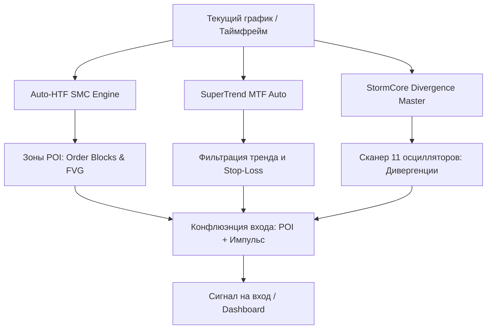

+++
title = "StormCore SMC & Divergence Master [Auto-HTF]: Архитектура гибридного индикатора на Pine Script v6"
date = 2026-10-11
description = "Технический разбор гибридной торговой системы StormCore на Pine Script v6: сочетание Auto-HTF SMC, мультитаймфреймового SuperTrend и движка из 11 осцилляторов дивергенций без repaint-ов."
[taxonomies]
tags = ["algo-trading", "quantitative", "pine-script", "tradingview", "high-risk"]
[extra]
toc = true
mermaid = true
katex = true
+++

**Высокий риск · образовательный разбор.** Материал носит аналитический характер и не является инвестиционной рекомендацией или призывом к использованию советников.

Индикаторы Smart Money Concepts (SMC) часто страдают от двух болезней: либо они загромождают график старыми зонами Order Block / Fair Value Gap, либо перерисовывают историю из-за некорректного использования старших таймфреймов (lookahead bias). 

Открытый скрипт **StormCore | SMC & Divergence Master [Auto-HTF]** на Pine Script v6 предлагает гибридный подход, объединяющий макроконтекст старших таймфреймов (HTF), мульiciosillator-дивергенции для точечного входа и MTF SuperTrend. Ниже — технический разбор его архитектуры и принципов работы.

Первоисточник и исходный код скрипта доступны на [TradingView](https://www.tradingview.com/script/aVFtPnUh-stormcore-smc-divergence-master-auto-htf/).

## Архитектура гибридной системы

Логика индикатора разделена на три изолированных модуля, которые обрабатывают данные независимо друг от друга, не искажая чужие значения:

1. **Auto-HTF SMC Engine (Макроконтекст):** Автоматически определяет старший таймфрейм (например, с 1H на 4H) для поиска институциональных зон Order Blocks (OB) и Fair Value Gaps (FVG) без эффекта перерисовки.
2. **SuperTrend MTF Auto (Макротренд и трейлинг):** Динамический трендовый фильтр на базе Volume Adjusted WMA (VAWMA), обеспечивающий жесткие уровни инвалидации (Stop-Loss).
3. **StormCore Divergence Master (Микроисполнение):** Движок поиска дивергенций по 11 мультиосцилляторным метрикам для фиксации истощения импульса в момент касания зоны POI (Point of Interest).

## 1. Auto-HTF SMC Engine и борьба с Repaint

Главная сложность при построении HTF-уровней на младших таймфреймах — избежать заглядывания в будущее (lookahead bias). В Pine Script v6 это решается жестким ограничением параметров запроса данных (`lookahead = barmerge.lookahead_off`).

- **Dynamic Scaling:** Автоматически повышает масштаб (1m → 1H, 1H → 4H, 1D → 1W) для поиска материнских трендовых зон.
- **True Mitigation Tracking:** Зоны FVG и OB не растягиваются бесконечно. Они плавно продлеваются вправо до тех пор, пока цена физически не проколет границу зоны на младшем таймфрейме. После mitgation зона фиксируется и перестает занимать вычислительные ресурсы графика.

## 2. Мультитаймфреймовый SuperTrend и строгая математика тренда

Модуль SuperTrend в версии v2.0 интегрирован для отсечения шума на 4H и 1D графиках. 

- **VAWMA сглаживание:** В отличие от классического ATR-фильтра, используется сглаживание на базе объемно-взвешенных скользящих средних, что снижает количество ложных срабатываний во флэте.
- **Однонаправленный трейлинг:** Математика линий построена так, что линии могут только подтягиваться за ценой (вверх для лонга, вниз для шорта) и никогда не расширяются обратно во время локальных коррекций рынка.

## 3. Движок дивергенций по 11 осцилляторам

Когда цена подходит к зоне HTF POI, вступать в сделку вслепую опасно — тренд может пробить зону без отката. Для подтверждения используется сканер дивергенций, работающий одновременно с 11 индикаторами:

- MACD и MACD Histogram
- RSI, Stochastic, CCI, Momentum
- OBV (On-Balance Volume)
- VW MACD, CMF (Chaikin Money Flow), MFI (Money Flow Index)
- Внешний настраиваемый источник

Движок ищет как классические разворотные (Regular), так и трендовые (Hidden) расхождения между ценой и осцилляторами, автоматически подстраивая lookback-периоды под текущий таймфрейм.

## Оптимизация производительности в Pine Script v6

Вместо тяжелых фоновых заливок и громоздких графических объектов в скрипте применены следующие инженерные решения:

- **Static v6 Table Dashboard:** Интерфейс реализован через нативную таблицу Pine v6 в углу экрана, что исключает наложение плавающих меток (labels) друг на другу.
- **Изоляция модулей:** Расчеты SMC, Divergences и SuperTrend вынесены в отдельные изолированные блоки кода без перекрестных зависимостей.
- **Ограничение лимитов:** Оптимизированы счетчики `max_boxes_count` и `max_lines_count`, а рендеринг переведен на тернарные операторы для максимизации FPS на графике.

## Практический алгоритм работы трейдера

1. **Определение контекста:** Смотрим на панель StormCore Dashboard, чтобы узнать активный таймфрейм макроструктуры (например, `HTF POI: 1W`).
2. **Ожидание теста зоны:** Ждем подхода цены к полупрозрачным зонам Order Block или Fair Value Gap.
3. **Подтверждение входа:** Дожидаемся срабатывания Divergence Engine (например, *Positive Regular Divergence* на RSI или MACD) непосредственно внутри зоны POI.
4. **Управление риском:** Используем SuperTrend в качестве динамического стоп-лосса.

## Первоисточники и материалы

* **Индикатор на TradingView:** [StormCore | SMC & Divergence Master [Auto-HTF]](https://www.tradingview.com/script/aVFtPnUh-stormcore-smc-divergence-master-auto-htf/)
* **Документация платформы:** [Pine Script v6 Reference Manual](https://www.tradingview.com/pine-script-docs/v6/)
* **Инженерные наработки автора:** [github.com/xsa-dev](https://github.com/xsa-dev)
