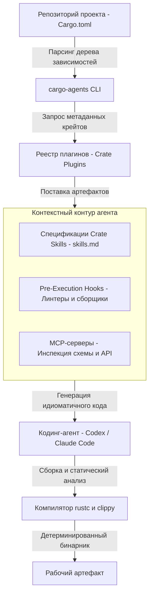

+++
title = "Идиоматичный Rust для кодинг-агентов: архитектура Symposium, сканирование Cargo.toml и аудит Toasty ORM"
date = 2026-10-19
description = "Разбор Symposium от Николаса Мацакиса: доставка Crate Skills и MCP в AI-агенты через Cargo.toml, аудит идиоматичного Rust и кейс Toasty ORM."
[taxonomies]
tags = ["rust", "ai-agents", "software-engineering", "architecture"]
[extra]
toc = true
mermaid = true
+++

Автоматическая кодогенерация на языке Rust с использованием больших языковых моделей (LLM) характеризуется специфическим инженерным компромиссом. С одной стороны, компилятор `rustc` реализует строгий статический анализ: система владения (Ownership), правила заимствования (Borrow Checker) и статический полиморфизм гарантируют отсутствие повреждения памяти и гонок данных при компиляции. С другой стороны, статистический вывод авторегрессионных моделей сталкивается с двумя факторами: меньшим объемом обучающего корпуса кода на Rust по сравнению с C++ или Python и высокой скоростью изменения интерфейсов внешних библиотек на `crates.io`.

В результате автономные кодинг-агенты (OpenAI Codex, Claude Code, Cursor) генерируют неидиоматичный код: прибегают к избыточным аллокациям `.clone()` для обхода ограничений времен жизни, используют императивную индексацию вместо итераторных цепочек и вызывают устаревшие методы крейтов. Для сокращения числа циклов компиляции соавтор языка Rust Николас Мацакис (Nicholas Matsakis) в рамках лаборатории Rust Innovation Lab предложил проект **Symposium** (`symposium.dev`, CLI-инструмент `cargo-agents`). Вместо дообучения весов модель получает контекст через парсинг манифеста `Cargo.toml`, автоматическую загрузку машиночитаемых навыков крейтов (`skills.md`), запуск хуков валидации и подключение локальных серверов протокола MCP (Model Context Protocol).

Ниже разобран механизм работы конвейера Symposium, проведен инженерный аудит кейса Toasty ORM из видеоразбора Let's Get Rusty, представлена математическая модель бюджета ошибок компиляции и описан формат спецификации навыков для библиотек.

---

## Проблема дрейфа API и дефицита идиом в генерации Rust

В средах со сборщиком мусора (Node.js, Go, Python) незначительные ошибки распределения ресурсов не прерывают фазу компиляции. В Rust любая некорректная передача прав владения или разделения мутабельности блокирует сборку.

### 1. Диспропорция обучающего корпуса и навязывание чужих паттернов
Объем открытых исходных кодов на C, C++ и Python в базовых датасетах LLM на два порядка превышает объем кода на Rust. В результате модели проецируют объектно-ориентированные шаблоны (например, разделяемые графы объектов с циклическими ссылками) на синтаксис Rust. Это приводит к неоправданному использованию связок `Rc<RefCell<T>>` или `Arc<RwLock<T>>` в однопоточных сценариях, где задача решается передачей срезов (`&[T]`) или разделением структур данных.

```rust
// Неидиоматичная генерация: обход времен жизни через глубокое копирование
pub fn filter_active_users(users: &Vec<User>) -> Vec<User> {
    users.clone().into_iter().filter(|u| u.is_active).collect()
}

// Идиоматичный код: заимствование среза без дополнительных аллокаций
pub fn filter_active_users(users: &[User]) -> Vec<&User> {
    users.iter().filter(|u| u.is_active).collect()
}
```

При попытке ручного исправления без контекста агент часто попадает в конфликт заимствования, вызывающий диагностику компилятора:

```text
error[E0502]: cannot borrow `users` as mutable because it is also borrowed as immutable
  --> src/registry.rs:24:9
   |
21 |     let first = users.first();
   |                 ----- immutable borrow occurs here
...
24 |     users.push(new_user);
   |     ^^^^^^^^^^^^^^^^^^^^ mutable borrow occurs here
25 |     println!("{:?}", first);
   |                      ----- immutable borrow later used here
```

### 2. Дрейф интерфейсов внешних крейтов (Ecosystem Drift)
Крейты в экосистеме Rust развиваются независимо от циклов обучения базовых моделей. Фреймворки уровня `tokio`, `axum` и `toasty` модифицируют типы параметров и возвращаемые значения в минорных и мажорных релизах. В отсутствие спецификации актуального API агент подставляет сигнатуры из обучающей выборки двухлетней давности, получая ошибку `rustc` вида `E0599 (no method named ... found for struct ... in the current scope)`.

### 3. Затраты контекстного окна на случайные мутации
Классический цикл устранения ошибок агентом (генерация → `cargo check` → передача `stderr` в промпт → исправление) в условиях отсутствия знаний об актуальном API приводит к нецелевому расходу токенов. Модель начинает перебирать варианты типов наугад, что увеличивает длину диалоговой сессии и снижает внимание к исходным функциональным требованиям.

---

## Архитектура Symposium: Контекстная инъекция на базе Cargo.toml

Архитектура Symposium рассматривает манифест проекта как детерминированный источник требований к инструментам агента. Инструмент `cargo-agents` сканирует дерево зависимостей, сопоставляет пакеты с зарегистрированными плагинами и монтирует соответствующие модули расширения в конфигурацию агента.



### Компоненты архитектуры

1. **Детектор окружения (`cargo-agents`):** выполняет синтаксический анализ `Cargo.toml` и `Cargo.lock`, формируя плоский список используемых пакетов с их точными версиями (`semver`). Инициализация выполняется командой `cargo agents init`, а обновление навыков — `cargo agents sync`.
2. **Спецификации библиотек (Crate Skills):** локальные документы `skills/skills.md`, оформленные авторами крейтов. Они содержат правила вызова конструкторов, примеры построения запросов и явные списки запрещенных антипаттернов.
3. **Хуки валидации (Pre/Post Execution Hooks):** команды локальной среды, исполняемые до и после генерации кода (`cargo clippy --all-targets -- -D warnings`, тесты контрактов схемы).
4. **MCP-серверы библиотек:** серверы по спецификации Model Context Protocol, экспортирующие инструменты для статической проверки типов, проверки валидности макросов и инспекции структур данных без обращения к внешней сети.

---

## Инженерный аудит: Кейс Toasty ORM в OpenAI Codex

В обзоре образовательного канала Let's Get Rusty представлен показательный качественный эксперимент: двум независимым сессиям OpenAI Codex была поставлена идентичная инженерная задача — реализовать слой доступа к данным для консольного трекера задач (`Task Tracker`) на базе асинхронного ORM-фреймворка **Toasty** (`tokio-rs/toasty`).

Схема сущностей Toasty описывается декларативными макросами с явным указанием первичных ключей и связей:

```rust
#[derive(Debug, toasty::Model)]
pub struct Project {
    #[key]
    #[auto]
    pub id: Id,
    pub name: String,
    #[has_many]
    pub tasks: HasMany<Task>,
}

#[derive(Debug, toasty::Model)]
pub struct Task {
    #[key]
    #[auto]
    pub id: Id,
    pub title: String,
    pub completed: bool,
    #[belongs_to]
    pub project: BelongsTo<Project>,
}
```

Первый агент (`Baseline Codex`) выполнял задачу без специализированных инструкций по Toasty. Второй агент (`Symposium Codex`) имел доступ к инъецированным спецификациям `skills.md` и инструментам MCP.

### Сценарий 1. Выборка списка сущностей (`Project List`)

При реализации выборки всех проектов базовый агент без контекста сгенерировал код с созданием промежуточного объекта построителя запроса и явной спецификацией типа:

```rust
// Baseline: Избыточный вызов через Query Builder
pub async fn list_projects(db: &toasty::Db) -> Result<Vec<Project>, toasty::Error> {
    let mut query = db.query::<Project>();
    let projects = query.all().await?;
    Ok(projects)
}
```

Агент под управлением Symposium применил лаконичный синтаксис, непосредственно предусмотренный в актуальном релизе Toasty:

```rust
// Symposium: Идиоматичный вызов на модели
pub async fn list_projects(db: &toasty::Db) -> Result<Vec<Project>, toasty::Error> {
    Project::all(db).await
}
```

В данном сценарии Crate Skills обеспечили прямой выигрыш: исключен шаблонный код построителя запросов и снижен риск несовпадения типов при рефакторинге.

### Сценарий 2. Каскадное удаление связанных сущностей (`Project Delete`)

Второй сценарий продемонстрировал побочный эффект избыточно детализированных инструкций. Задача состояла в удалении проекта, содержащего дочерние задачи.

Базовый агент вызвал стандартное удаление проекта, полагаясь на механизм реляционного каскада, настроенный на уровне базы данных:

```rust
// Baseline: Вызов удаления на объекте проекта
pub async fn delete_project(db: &toasty::Db, project_id: &Id) -> Result<(), toasty::Error> {
    let project = Project::find(db, project_id).await?;
    project.delete(db).await?;
    Ok(())
}
```

Агент под управлением Symposium сгенерировал процедурный цикл ручного обхода и поэлементного удаления связанных задач перед удалением родительского проекта:

```rust
// Symposium: Ручной процедурный обход связанных задач
pub async fn delete_project(db: &toasty::Db, project_id: &Id) -> Result<(), toasty::Error> {
    let project = Project::find(db, project_id).await?;
    let tasks = project.tasks(db).all().await?;
    for task in tasks {
        task.delete(db).await?;
    }
    project.delete(db).await?;
    Ok(())
}
```

Причиной такого поведения стал текст в файле `skills.md`, где автор библиотеки детально описал ручной обход дочерних коллекций для сценариев выборочной очистки. Языковая модель восприняла частную рекомендацию как обязательный общий паттерн, породив проблему множественных сетевых запросов ($N+1$).

Ниже приведено структурированное сопоставление качественных характеристик обоих подходов.

### Сравнительные результаты кейса Toasty

| Параметр сравнения | Baseline Codex | Symposium Codex | Практический результат |
|---|---|---|---|
| **Идиоматичность запросов (`Query DSL`)** | Устаревший builder-паттерн | Прямой статический метод `Project::all` | Компактный идиоматичный код |
| **Использование каскадов схемы** | Однократный вызов `project.delete` | Ручной цикл удаления всех дочерних задач | Избыточный процедурный код |
| **Сходимость компиляции (`cargo check`)** | Несколько попыток подбора типов | Быстрая компиляция интерфейса | Сокращение времени сессии |
| **Точность соответствия версии API** | Смешение сигнатур устаревших версий | Точное соответствие текущему релизу | Исключены устаревшие вызовы |

---

## Математическая модель бюджета ошибок (Error Budget)

Для количественного анализа многошаговой кодогенерации сформулируем аналитическую модель надежности конвейера.

Пусть составная инженерная задача декомпозирована на $N$ последовательных шагов. Вероятность успешного завершения каждого $i$-го шага без вмешательства оператора равна $P\_{\text{step}, i}$. При допущении взаимной независимости шагов сквозная вероятность завершения задачи составляет:

$$P\_{\text{task}} = \prod\_{i=1}^{N} P\_{\text{step}, i}$$

Каждый шаг включает первичную генерацию с вероятностью успеха $P\_{\text{gen}}$ и не более чем $K$ повторных итераций исправления ошибок компилятора (`self-healing`). Если условная вероятность устранения ошибки за один цикл равна $P\_{\text{heal}}$, вероятность успешного завершения шага выражается формулой:

$$P\_{\text{step}} = 1 - (1 - P\_{\text{gen}}) \cdot (1 - P\_{\text{heal}})^{K}$$

Ожидаемое число обращений к компилятору на один шаг вычисляется по формуле математического ожидания дискретной случайной величины:

$$\mathbb{E}[K\_{\text{attempts}}] = 1 \cdot P\_{\text{gen}} + (1 - P\_{\text{gen}}) \left[ \sum\_{j=1}^{K} (1 + j) (1 - P\_{\text{heal}})^{j-1} P\_{\text{heal}} + (1 + K)(1 - P\_{\text{heal}})^{K} \right]$$

### Численный пример аналитической модели

Рассмотрим типовой сценарий задачи из $N = 5$ этапов при лимите $K = 3$ попытки компиляции на этап:

1. **Базовый сценарий (без Crate Skills):**  
   Примем гипотетические параметры для сложных системных типов Rust: $P\_{\text{gen}} = 0.40$, $P\_{\text{heal}} = 0.18$ (низкая вероятность исправления ошибок времен жизни случайным подбором).  
   - Вероятность шага: $P\_{\text{step}} = 1 - 0.60 \cdot (0.82)^3 \approx 0.669$ ($66.9\%$).  
   - Сквозная надежность: $P\_{\text{task}} = (0.669)^5 \approx 0.134$ ($13.4\%$).  
   - Ожидаемое число попыток: $\mathbb{E}[K\_{\text{attempts}}] \approx 2.50$ компиляции на этап.

2. **Сценарий с контекстной инъекцией (Symposium + MCP):**  
   При наличии точных сигнатур API и MCP-инструментов валидации схемы: $P\_{\text{gen}} = 0.85$, $P\_{\text{heal}} = 0.65$.  
   - Вероятность шага: $P\_{\text{step}} = 1 - 0.15 \cdot (0.35)^3 \approx 0.9936$ ($99.4\%$).  
   - Сквозная надежность: $P\_{\text{task}} = (0.9936)^5 \approx 0.968$ ($96.8\%$).  
   - Ожидаемое число попыток: $\mathbb{E}[K\_{\text{attempts}}] \approx 1.22$ компиляции на этап.

Снижение среднего числа попыток с $2.50$ до $1.22$ (в $2.05$ раза) предотвращает лавинообразный рост контекстного окна агента и снижает вероятность деградации рассуждений на длинных трассах.

---

## Спецификация Crate Skills: Практическое руководство для авторов библиотек

Для подключения навыков библиотеки к конвейеру Symposium автор крейта размещает метаданные в манифесте `Cargo.toml`:

```toml
[package.metadata.agents]
skills = ["skills/skills.md"]
mcp_servers = ["mcp-toasty"]
hooks.pre_commit = "cargo clippy --all-targets -- -D warnings"
```

### Формат файла `skills/skills.md`

Текст спецификации должен содержать однозначные предписания и явные отрицательные правила:

```markdown
# Crate Skill: toasty-orm

## Core Idioms
- Always call static query methods on models: Model::all(db) instead of building raw query objects.
- All database operations are asynchronous and return toasty::Result<T>.
- Use the ? operator for error propagation; do not call unwrap in library code.

## Relation Handling
- When deleting a parent entity with established has_many relations, call parent.delete(db).await.
- Do NOT manually query and iterate over child records unless transactional partial deletion is explicitly requested.

## Forbidden Anti-Patterns
- Never use std::sync::Mutex around database handles; toasty::Db is internally thread-safe (Clone + Send + Sync).
- Avoid explicit turbofish syntax on all::<T>() where the target type is inferred from the assignment.
```

### Безопасность и границы доверия (Security & Trust Boundaries)

При автоматической установке навыков и хуков из внешних зависимостей возникают риски цепочки поставок (supply-chain risks):
1. **Изоляция хуков:** Команды из `hooks.pre_commit` должны выполняться в песочнице с ограниченными правами файловой системы и отключенным доступом к сети. В CI/CD средах автоматическое исполнение сторонних хуков должно требовать явного подтверждения.
2. **Верификация плагинов:** Инструмент `cargo-agents` должен валидировать криптографические контрольные суммы файлов `skills.md` и манифестов плагинов через доверенный реестр.
3. **Ограничение прав MCP:** Серверы MCP для библиотек должны предоставлять инструменты только для чтения (инспекция типов, проверка синтаксиса DSL), исключая операции с произвольным вводом-выводом хостовой системы.

---

## Ключевые выводы

- **Контекстная доставка против дообучения:** Автоматическое подключение навыков библиотек через разбор `Cargo.toml` устраняет проблему дрейфа API без необходимости регулярного дообучения базовых весов модели.
- **Баланс детализации спецификаций:** Избыточно детальное описание процедурных манипуляций в файлах `skills.md` может спровоцировать генерацию избыточного кода ($N+1$ запросы) в обход декларативных абстракций фреймворка.
- **Машиночитаемая документация как стандарт экосистемы:** Наряду с документацией для разработчиков (`docs.rs`) библиотеки получают слой структурированных правил (`skills.md`) и MCP-инструментов, оптимизированных для взаимодействия с кодинг-агентами.
- **Оптимизация бюджета ошибок:** Повышение вероятности первичной сборки с $40\%$ до $85\%$ снижает среднее число циклов компиляции в $2.05$ раза, обеспечивая стабильное выполнение многоэтапных инженерных задач.

---

## Первоисточники и материалы

* **Официальный репозиторий Symposium:** [github.com/symposium-dev/symposium](https://github.com/symposium-dev/symposium)
* **Анонс в Rust Foundation:** [Welcoming Symposium to the Rust Innovation Lab](https://rustfoundation.org/media/welcoming-symposium-to-the-rust-innovation-lab/)
* **Оригинальное видео:** [Let's Get Rusty — AI agents can now write idiomatic Rust (or can they?)](https://youtu.be/n83pvFuZ5fo)
* **Заметки и детальный конспект:** [Obsidian Vault (GitHub)](https://github.com/xsa-dev/obsidian-vault/blob/main/YouTube/Symposium-Idiomatic-Rust-AI-Agents-Matsakis-2026.md)
* **Инженерные наработки:** [github.com/xsa-dev](https://github.com/xsa-dev)
