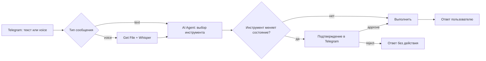

+++
title = "Голосовой Telegram-агент: контракт инструментов важнее ноды n8n"
date = 2026-11-21
description = "Голосовой Telegram-агент на n8n и в коде: схемы инструментов, изоляция памяти, подтверждение необратимых действий и цикл вызова на Python с дедупликацией."
[taxonomies]
tags = ["ai-agents", "architecture", "software-engineering", "python"]
[extra]
toc = true
mermaid = true
+++

Ассистент, который принимает голосовые в Telegram, читает почту и ставит встречи, собирается за один вечер — в этом и проблема. Демонстрация работает, а через неделю выясняется, что агент записал встречу не в тот часовой пояс, отправил письмо не тому адресату и потерял контекст между двумя пользователями бота. Ни одна из этих ошибок не связана с выбором модели: все они живут на границе между моделью и инструментами.

Повод для разбора — [видео David Ondrej о сборке AI-агентов в n8n](https://youtu.be/XVO3zsHdvio). Из него взята схема потоков и набор инструментов; всё, что ниже относится к контрактам, политике подтверждений и коду, — самостоятельная проработка, а не воспроизведение показанной реализации. Утверждения о возможностях n8n, тарифах OpenAI и поведении `whisper-1` здесь не проверялись по документации вендоров.

Дальше — три части: слои, которые скрывает нода агента; контракт инструмента с валидацией и подтверждением; рабочий цикл вызова с фактическим выводом и чек-лист перед публикацией бота.

## Что показано в видео

Схема потоков в ролике такая: Telegram-триггер ловит сообщение, `Switch` разделяет текст и голосовые, голосовые уходят в `Get File` и дальше в Whisper, затем единая нода AI Agent с моделью GPT-4o и окном памяти вызывает один из четырёх инструментов — чтение и отправку Gmail, чтение и создание событий Google Calendar — и отвечает в чат.



Автор отдельно проговаривает четыре вещи, которые ломают такие сборки: модель путает смещение UTC, если в промпте нет текущей даты и целевой зоны; поле `Description` у инструмента — это фактически инструкция для модели, и общее описание приводит к вызовам с пустыми аргументами; отправку письма стоит закрывать подтверждением; ключ памяти нужно привязывать к идентификатору чата, иначе контекст разных пользователей смешивается.

Это верные наблюдения, но они описывают симптомы. Ниже — то, что делает их проверяемыми на уровне инженерных решений.

## Где заканчивается демо

Нода агента скрывает три разных слоя, которые в продакшене отвечают за разные отказы:

- **Транспорт.** Telegram-апдейт, скачивание `.oga`, вызов Whisper, отправка ответа. Отказы здесь — таймауты, лимиты размера, повторная доставка апдейта.
- **Планирование.** Модель выбирает инструмент и аргументы. Отказы — неверный инструмент, лишние или отсутствующие поля, выдуманные значения.
- **Политика исполнения.** Что вообще разрешено делать без человека. Отказы здесь — самые дорогие: отправленное письмо и созданное событие нельзя отменить нажатием «назад».

В n8n все три слоя видны как цепочка нод, и это удобно для прототипа. Но пока политика не вынесена в явные правила, каждое новое «просто добавь инструмент» расширяет область необратимых действий, не требуя решения о ней. Тот же вопрос — кто именно принимает решение о необратимом шаге — разобран в статье о [границах доверия в агентных системах](/posts/human-in-the-loop-agentic-governance-trust-architecture/).

## Схема инструмента — это API, а не подсказка

Описание инструмента в промпте влияет на вероятность вызова, но не может гарантировать корректность аргументов. Гарантию даёт схема, проверяемая до исполнения: обязательные поля, типы, форматы, отсутствие лишних полей. Модель — недоверенный источник данных, ровно как HTTP-клиент. Родственный случай — авторизация объекта в MCP-вызовах, где идентификатор из аргументов не является разрешением: [контракт выбора и авторизации](/posts/mcp-ui-selection-authorization-contract/).

Практическое следствие: аргументы нужно нормализовать и провалидировать в одном месте, а обработчик должен принимать уже проверенную структуру. Если проверка размазана по обработчикам, то новый инструмент почти наверняка появится без неё.

Второй элемент контракта — детерминированный отпечаток аргументов. Он решает две задачи: связывает подтверждение с конкретным вызовом (человек подтверждает не «отправить письмо вообще», а конкретный получатель, тема и тело) и делает повторный вызов с теми же аргументами распознаваемым. Без отпечатка типичный сценарий выглядит так: пользователь нажал «Да», модель переформулировала тело письма и отправила другой текст.

## Голосовой вход и бюджет латентности

Голосовой канал добавляет к каждому запросу этап распознавания. Если считать шаги как последовательные зависимости, бюджет ответа на голосовое сообщение выглядит так:

$$
T_{\text{ответ}} = T_{\text{stt}} + \sum_{i=1}^{n}\left(T_{\text{llm},i} + T_{\text{tool},i}\right)
$$

Здесь `n` — число шагов планирования, а не число инструментов: агент может прочитать календарь, затем создать событие, и это два обращения к модели. Отсюда два инженерных вывода. Первый: голосовой сценарий всегда медленнее текстового, поэтому промежуточный статус («слушаю», «проверяю календарь») — не украшение, а способ удержать пользователя. Второй: каждый лишний шаг планирования умножает задержку, поэтому декомпозиция задачи на десять инструментов ухудшает не только надёжность, но и время ответа.

Для голосовых есть и отдельный класс отказов — распознавание. Аудио может не скачаться, транскрипт может прийти пустым или искажённым. Правильная реакция — не отправлять искажённый текст в модель, а вернуть пользователю запрос подтверждения расшифровки для коротких команд и явную ошибку для длинных. Автоматическое «додумывание» интента по шумному транскрипту — источник неверных необратимых действий.

## Память: ключ, окно и изоляция

Окно памяти хранит последние реплики, и его ключ — это граница изоляции данных. Если ключ равен константе или идентификатору воркфлоу, все пользователи бота делят один контекст: агент может подставить адресата из чужой переписки. Ключ должен собираться из идентификатора чата и, если бот работает в группах, из идентификатора пользователя.

У окна есть второй дефект, менее очевидный: оно обрезает историю по количеству реплик, а не по смыслу. После обрезки агент помнит, что «встреча подтверждена», но не помнит, на какое время. Поэтому состояние незавершённых операций нельзя держать только в истории диалога — оно должно жить в явной структуре: ожидающий подтверждения вызов, его отпечаток, срок жизни. Как это выглядит при перезапуске процесса, разобрано в материале о [долгоживущих агентах с чекпоинтами в SQLite](/posts/pi-durable-always-on-agents-sqlite-checkpoints/).

## Необратимые действия: подтверждение и идемпотентность

Подтверждение человека — это не модальное окно, а протокол из трёх состояний: вызов подготовлен, подтверждён, исполнен. Между первым и вторым не должно быть возможности изменить аргументы незаметно, между вторым и третьим — выполнить действие дважды.

Второй пункт важнее, чем кажется. Telegram доставляет апдейты повторно при таймауте, а сетевой вызов может завершиться успешно на стороне провайдера и неуспешно на стороне агента. Без ключа идемпотентности повторная обработка того же подтверждения создаёт второе событие в календаре или второе письмо. Ключ идемпотентности должен строиться из отпечатка аргументов и идентификатора подтверждения, а не из времени.

## Рабочий минимальный цикл

Порядок шагов в коде ниже фиксирован: `validate → digest → duplicate? → confirm → execute`. Первые два шага не имеют побочных эффектов, поэтому их можно выполнять на любом вызове, включая повторный.

```python
"""Минимальный цикл вызова инструментов: схема, отпечаток, подтверждение, дедупликация.

Запуск: python3 agent_loop.py
Модель подменена сценарием, чтобы прогон был детерминированным:
сеть, API-ключи и реальные Gmail/Calendar не используются.
"""

from __future__ import annotations

import hashlib
import json
import re
from dataclasses import dataclass
from typing import Any, Callable

ISO_MINUTE = re.compile(r"^\d{4}-\d{2}-\d{2}T\d{2}:\d{2}$")
TZ = {"Europe/Moscow", "Europe/Berlin", "Asia/Dubai"}


# --- слой инструментов -------------------------------------------------------

@dataclass(frozen=True)
class ToolSpec:
    name: str
    required: dict[str, type]  # поле -> ожидаемый тип
    handler: Callable[[dict[str, Any]], dict[str, Any]]
    side_effect: bool  # требует подтверждения человека


def args_digest(args: dict[str, Any]) -> str:
    payload = json.dumps(args, sort_keys=True, ensure_ascii=False, separators=(",", ":"))
    return hashlib.sha256(payload.encode("utf-8")).hexdigest()[:12]


def calendar_read(args: dict[str, Any]) -> dict[str, Any]:
    return {"busy": [{"start": "2026-11-24T10:00", "end": "2026-11-24T11:00"}],
            "timezone": args["timezone"]}


def calendar_create(args: dict[str, Any]) -> dict[str, Any]:
    return {"event_id": "evt_7f3a", "start_iso": args["start_iso"], "status": "created"}


TOOLS: dict[str, ToolSpec] = {
    "calendar_read": ToolSpec(
        name="calendar_read",
        required={"date": str, "timezone": str},
        handler=calendar_read,
        side_effect=False,
    ),
    "calendar_create": ToolSpec(
        name="calendar_create",
        required={"title": str, "start_iso": str, "duration_min": int, "timezone": str},
        handler=calendar_create,
        side_effect=True,
    ),
}


# --- политика и исполнение ---------------------------------------------------

class PolicyError(RuntimeError):
    pass


def validate_call(name: str, args: dict[str, Any]) -> ToolSpec:
    spec = TOOLS.get(name)
    if spec is None:
        raise PolicyError(f"unknown_tool:{name}")
    missing = [k for k in spec.required if k not in args]
    extra = [k for k in args if k not in spec.required]
    if missing or extra:
        raise PolicyError(f"schema_violation:{name}:missing={missing}:extra={extra}")
    for field_name, expected in spec.required.items():
        value = args[field_name]
        # bool — подкласс int, поэтому проверяем точный тип
        if type(value) is not expected:
            raise PolicyError(f"type_violation:{name}.{field_name}")
    if "start_iso" in args and not ISO_MINUTE.match(args["start_iso"]):
        raise PolicyError(f"format_violation:{name}.start_iso")
    if "duration_min" in args and not 5 <= args["duration_min"] <= 480:
        raise PolicyError(f"range_violation:{name}.duration_min")
    if "timezone" in args and args["timezone"] not in TZ:
        raise PolicyError(f"unknown_timezone:{name}.timezone")
    return spec


class Executor:
    def __init__(self) -> None:
        self.done: dict[str, dict[str, Any]] = {}
        self.log: list[str] = []

    def execute(self, name: str, args: dict[str, Any], *,
                approved_digest: str | None = None) -> dict[str, Any]:
        spec = validate_call(name, args)
        digest = args_digest(args)

        if digest in self.done:
            self.log.append(f"SKIPPED_DUPLICATE {name} digest={digest}")
            return {"status": "duplicate", "result": self.done[digest]}

        if spec.side_effect and approved_digest != digest:
            self.log.append(f"NEEDS_CONFIRMATION {name} digest={digest}")
            return {"status": "needs_confirmation", "digest": digest}

        result = spec.handler(args)
        self.done[digest] = result
        self.log.append(f"EXECUTED {name} digest={digest} side_effect={spec.side_effect}")
        return result


# --- сценарий «модели» -------------------------------------------------------

MEETING = {"title": "Синк по архитектуре агента", "start_iso": "2026-11-24T11:30",
           "duration_min": 30, "timezone": "Europe/Moscow"}

SCRIPTED_STEPS = [
    ("calendar_read", {"date": "2026-11-24", "timezone": "Europe/Moscow"}),
    ("calendar_create", MEETING),
    ("calendar_create", MEETING),          # подтверждение: те же аргументы
    ("calendar_create", MEETING),          # повторная доставка апдейта
    ("calendar_create", dict(MEETING, duration_min=60)),  # тот же слот, другой объект
]


def main() -> None:
    ex = Executor()
    approved: str | None = None
    for step_no, (name, args) in enumerate(SCRIPTED_STEPS, start=1):
        result = ex.execute(name, args, approved_digest=approved)
        print(f"step {step_no}: {name} -> {json.dumps(result, ensure_ascii=False)}")
        if result.get("status") == "needs_confirmation":
            approved = result["digest"]  # здесь в реальной системе ждём нажатия кнопки
            print(f"  подтверждение получено, digest={approved}")
    print("---")
    print("\n".join(ex.log))


if __name__ == "__main__":
    main()
```

Фактический вывод этого файла на Python 3.14 (сеть и внешние API не используются):

```text
step 1: calendar_read -> {"busy": [{"start": "2026-11-24T10:00", "end": "2026-11-24T11:00"}], "timezone": "Europe/Moscow"}
step 2: calendar_create -> {"status": "needs_confirmation", "digest": "cdebfaa5b565"}
  подтверждение получено, digest=cdebfaa5b565
step 3: calendar_create -> {"event_id": "evt_7f3a", "start_iso": "2026-11-24T11:30", "status": "created"}
step 4: calendar_create -> {"status": "duplicate", "result": {"event_id": "evt_7f3a", "start_iso": "2026-11-24T11:30", "status": "created"}}
step 5: calendar_create -> {"status": "needs_confirmation", "digest": "9177e30421c9"}
  подтверждение получено, digest=9177e30421c9
---
EXECUTED calendar_read digest=c64f12110fa2 side_effect=False
NEEDS_CONFIRMATION calendar_create digest=cdebfaa5b565
EXECUTED calendar_create digest=cdebfaa5b565 side_effect=True
SKIPPED_DUPLICATE calendar_create digest=cdebfaa5b565
NEEDS_CONFIRMATION calendar_create digest=9177e30421c9
```

Что здесь важно:

- Чтение исполняется сразу: у него нет побочного эффекта.
- Создание события возвращает `needs_confirmation` и отпечаток, а не результат. Подтверждение привязано к отпечатку.
- Повторный вызов с теми же аргументами (шаг 4) возвращает `duplicate` и сохранённый результат: второе событие не создаётся, хотя апдейт дошёл дважды.
- Новый объект в том же слоте (шаг 5) получает другой отпечаток и заново требует подтверждения. Старое «Да» не переносится на изменённые аргументы.
- Неизвестный инструмент, лишнее поле, неверный тип, битый формат даты или неизвестная зона дают `PolicyError` до обращения к обработчику. Это тот случай, который в n8n-сборке проявляется как письмо с пустой темой.

В примере хранилище исполненных отпечатков — обычный словарь в памяти процесса. Этого достаточно, чтобы показать политику, но недостаточно для продакшена: после перезапуска словарь пуст, поэтому нужен внешний store с TTL и атомарной вставкой по ключу `(chat_id, digest)`.

## n8n или код

Сравнение без идеологии — по тому, что меняется при переходе от демо к эксплуатации.

| Критерий | n8n-воркфлоу | Код |
|---|---|---|
| Скорость первой сборки | Высокая: ноды и OAuth-интеграции готовы | Ниже: нужно писать транспорт и клиентов API |
| Видимость потока | Схема читается без запуска | Требует дисциплины логирования |
| Проверка аргументов | Выражения и описания нод, без типов | Схема и тесты в репозитории |
| Тесты | Ограничены, сценарии воспроизводятся вручную | Полноценные unit- и integration-тесты |
| Отладка отказа | Просмотр исполнения ноды и её входа | Стектрейс и структурированные логи |
| Изменения | Правка в UI, версионирование отдельно | Diff и code review |
| Изоляция памяти | Зависит от ключа в ноде памяти | Явный ключ в коде, покрыт тестом |
| Деплой | Экспорт воркфлоу и его окружение | Обычный пайплайн |

Вывод не в пользу одного из вариантов. Для ассистента на одного пользователя с четырьмя инструментами n8n экономит дни работы, и это законный выбор. Как только появляются несколько пользователей, необратимые действия и требования к аудиту, стоимость изменения политики в no-code сборке начинает расти быстрее, чем стоимость написания слоя исполнения.

## Чек-лист перед публикацией бота

- Ключ памяти включает идентификатор чата; тест с двумя чатами не показывает пересечения контекста.
- У каждого инструмента есть схема с обязательными полями, типами и запретом лишних.
- Для инструментов с побочными эффектами подтверждение привязано к отпечатку аргументов.
- Повторная доставка одного апдейта не создаёт второе событие или письмо.
- Хранилище отпечатков переживает перезапуск процесса и имеет TTL.
- Часовой пояс передаётся явно в аргументах, а не выводится моделью из текста.
- Транскрипт короче порога подтверждается пользователем до вызова инструментов.
- Все вызовы инструментов логируются с отпечатком аргументов, но без содержимого писем и токенов.
- Есть предел на число шагов планирования, после которого агент возвращает ошибку, а не продолжает цикл.

## Что здесь не проверено

Код в статье исполнен локально, его вывод приведён выше без изменений. Интеграции с Telegram Bot API, Whisper, Gmail и Google Calendar не запускались: в примере нет ни одного сетевого вызова, и утверждения о поведении этих API не проверялись. Повторная доставка апдейтов Telegram и поведение нод n8n — инженерные утверждения из практики, а не измерения в этом тексте. Схема потоков и перечень инструментов взяты из видео; решения о валидации, отпечатках и подтверждениях — самостоятельная проработка, а не описание авторской реализации.

Практический вывод простой: разница между демо и ассистентом, которому можно доверять, — не в модели и не в конструкторе воркфлоу, а в трёх вещах, которые дешево сделать сразу и дорого добавлять потом: валидация аргументов на входе, явная граница необратимых действий и ключ изоляции данных.
