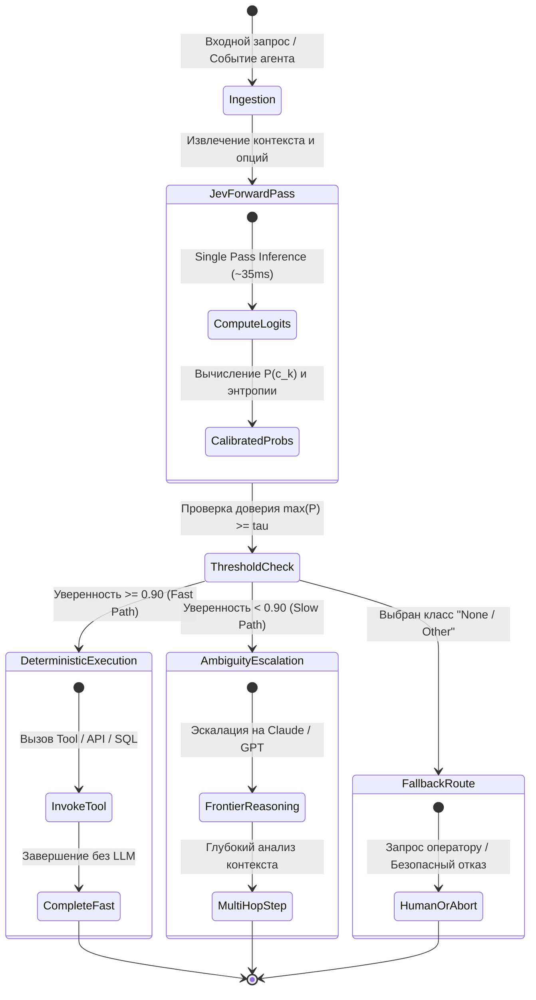

+++
title = "TypeSafe Jev: архитектура неавторегрессионных моделей решений, парадокс Джевонса и замена LLM в агентном роутинге"
date = 2026-10-24
description = "Инженерный разбор неавторегрессионных моделей решений (TypeSafe Jev): математика Single Forward Pass против декодинга токенов, задержка 30 мс, гибридный роутинг агентов и калибровка доверительных порогов."
[taxonomies]
tags = ["ai-agents", "architecture", "performance"]
[extra]
toc = true
mermaid = true
+++

В архитектуре современных автономных AI-агентов ключевым узким местом все чаще становится не глубина рассуждений, а операционная задержка и стоимость каждого шага принятия решений. Разработчики повсеместно используют большие генеративные языковые модели (Frontier LLMs — Claude 3.5 Sonnet, GPT-4o, Gemini 1.5 Pro) для тривиальных классификационных задач: выбор следующего инструмента из реестра, проверка условий остановки, маршрутизация запроса пользователя, фильтрация спама или валидация формата.

Использование авторегрессионной генерации токенов для дискретного выбора из конечного набора альтернатив представляет собой фундаментальный архитектурный оверхед. Генерация ответа «Tool A» через авторегрессионный декодинг требует сотен миллисекунд последовательных вычислений, сопряжена с риском галлюцинаций и распарсивания неструктурированного текста, а также расходует вычислительные ресурсы GPU на чтение терабайтов весов из HBM памяти.

Появление специализированных **неавторегрессионных моделей решений (Non-Autoregressive Decision Models)**, ярким представителем которых является семейство **TypeSafe Jev**, знаменует переход к гибридным агентным архитектурам: замена медленных генеративных LLM на сверхбыстрые классификаторы прямого прохода на критическом пути исполнения.

> **Первоисточники:**
> * **Видеоразбор концепции:** [This New AI Can't Write a Single Word (Jev Explained)](https://youtu.be/dRhI4TBQfvc) (канал *AI Jason*).
> * **Архитектурный фундамент:** Документация TypeSafe Jev & Probabilistic Decision Models, теория парадокса Джевонса в вычислительных системах.

---

## 1. Парадокс Джевонса в AI-инфраструктуре

Название модели **Jev** отсылает к парадоксу Уильяма Стэнли Джевонса (1865 г.): технологический прогресс, повышающий эффективность использования ресурса (в XIX веке — угля в паровых двигателях), не уменьшает совокупное потребление ресурса, а, напротив, увеличивает его за счет драматического удешевления и расширения областей применения.

В контексте машинного обучения ресурсом являются **вычислительные суждения (computational inference calls)**:
* При стоимости вызова frontier-модели в $\$0.01 - \$0.05$ и задержке в $2 - 5$ секунд разработчики вынуждены минимизировать количество вызовов AI: фильтровать запросы эвристиками, объединять промпты, кэшировать ответы.
* Когда стоимость одного суждения падает до $\$0.00004$ (в 100–250 раз дешевле), а задержка сокращается до $30 - 100$ мс (на один–два порядка быстрее), качественный характер архитектуры меняется. 

Решение AI перестает быть внешним «тяжелым микросервисом» и превращается в нативный программный оператор `if-else / switch` прямо в ядре агентного цикла, внутри SQL-запросов (`WHERE ai_eval(...)`) или обработчиках событий пользовательского интерфейса на каждое нажатие клавиши.

---

## 2. Физика вычислений: Авторегрессия O(N) против Single Forward Pass O(1)

Чтобы понять технологическое преимущество моделей решений, необходимо сопоставить математику декодинга авторегрессионной LLM и классификатора прямого прохода.

### Авторегрессионный декодинг токенов: $O(N)$

Генеративная модель вычисляет совместную вероятность последовательности токенов $y = (y\_1, y\_2, \dots, y\_N)$ при заданном входном контексте $x$ по цепному правилу теории вероятностей:

$$P(y\_1, y\_2, \dots, y\_N \mid x) = \prod_{t=1}^{N} P(y\_t \mid x, y_{<t})$$

Процесс инференса разделяется на две неравнозначные фазы:
1. **Prefill Phase (Prompt Processing):** Контекст $x$ обрабатывается параллельно за один прямой проход. Вычислительно насыщена ($Compute-Bound$).
2. **Decode Phase (Token Generation):** Генерация каждого последующего токена $y\_t$ строго последовательна. Чтобы получить $y\_t$, модель должна:
   * Считать все веса трансформера (например, 70B параметров) из глобальной памяти HBM в регистры SRAM.
   * Вычислить проекции $Q, K, V$ и обновить $KV$-кэш для шага $t$.
   * Применить функцию $\text{Softmax}$ к логитам словаря ($|\mathcal{V}| \approx 32\,000 - 128\,000$).
   * Сэмплировать ровно один токен.

Так как размер шага генерации равен единице ($batch\_size = 1$), операционная интенсивность декодинга крайне мала ($I \approx 1-2 \; \text{FLOPs/Byte}$), из-за чего процессор упирается в пропускную способность памяти (**Memory Wall**). Даже чтобы сгенерировать короткое слово `"REFUND"` (1–2 токена) плюс форматирование JSON (`{"decision": "REFUND"}`), модель выполняет 10–15 последовательных проходов через память ускорителя.

### Модель решений Jev: $O(1)$ Single Forward Pass

Неавторегрессионная модель решений вообще **не содержит генеративного декодера** и не имеет словаря свободных токенов. 

Входными данными модели являются:
* Входной контекст или состояние $x \in \mathcal{X}$.
* Множество целевых классов или опций $\mathcal{C} = \{c\_1, c\_2, \dots, c\_K\}$, где $K \ll |\mathcal{V}|$ (обычно $K \in [2, 20]$).

Модель выполняет **ровно один прямой проход (Single Forward Pass)** через энкодер трансформера:

$$\mathbf{H} = \text{TransformerEncoder}(x, \mathcal{C})$$

Скрытое представление агрегируется (пулинг контекста $\mathbf{h}\_{\text{pool}}$), после чего линейная проекционная голова вычисляет распределение вероятностей по заданным опциям за один шаг:

$$\mathbf{z} = \mathbf{W}\_{\text{head}} \mathbf{h}\_{\text{pool}} + \mathbf{b}$$

$$P(c\_k \mid x, \mathcal{C}) = \frac{\exp(z\_k / T)}{\sum_{j=1}^{K} \exp(z\_j / T)}$$

где $T$ — температура калибровки (обычно $T = 1.0$).

```text
Генеративная LLM (GPT-4o / Claude 3.5):
Context ──► [Prefill Pass] ──► [Decode Token 1] ──► [Decode Token 2] ──► ... ──► [JSON Parse]
Latency: 1,500 – 4,000 ms | Cost: ~$3.00 / 1M | Memory: Ограничено KV-кэшем и Memory Bandwidth

Модель решений (TypeSafe Jev / Laya):
Context + Options ──► [Single Forward Pass] ──► [Softmax(K)] ──► { "Tool_A": 0.94, "Tool_B": 0.06 }
Latency: 30 – 120 ms       | Cost: ~$0.04 / 1M | Memory: Фиксированный буфер, нет KV-кэша
```

---

## 3. Сравнительный инженерный бенчмарк

В таблице ниже приведены количественные характеристики двух подходов в реальных производственных сценариях маршрутизации и валидации:

| Параметр | Frontier LLM (GPT-4o / Claude 3.5) | Малая LLM (Llama-3-8B / Qwen-2.5-7B) | Decision Model (TypeSafe Jev / Laya) |
|---|---|---|---|
| **Режим вычислений** | Авторегрессионный декодинг | Авторегрессионный декодинг | Non-autoregressive Forward Pass |
| **P50 Latency (Cold/Warm)** | 1,800 мс / 1,200 мс | 450 мс / 300 мс | **25 мс / 35 мс (GPU), 120 мс (CPU)** |
| **P99 Latency SLA** | > 4,500 мс | > 1,100 мс | **< 80 мс (GPU)** |
| **Стоимость (1M входных токенов)** | $\$2.50 - \$5.00$ | $\$0.15 - \$0.30$ | **$\$0.03 - \$0.04$** |
| **Формат вывода** | Неструктурированный текст / JSON | Текст / vLLM Guided Decoding | **Числовые вероятности $P(c_k) \in [0, 1]$** |
| **Риск синтаксического сбоя** | Возможен сбой JSON парсера | Возможен сбой грамматики | **0% (строгая типизация по схеме)** |
| **Нейросетевые галлюцинации** | Высокий риск в свободной генерации | Средний риск | **Исключены (выбор только из $\mathcal{C}$)** |
| **Потребность в KV-кэше** | Высокая (динамический VRAM) | Умеренная | **Нулевая (нет генеративного цикла)** |

---

## 4. Архитектура гибридного агентного контура

В устойчивой агентной системе модель решений не вытесняет большую языковую модель полностью, а формирует защитно-маршрутизирующий контур (**Fast Routing & Guardrail Layer**). 

Ниже приведена диаграмма состояний и потоков решений гибридного контура:



### Паттерн 1: Threshold-Driven Routing ($\tau$-порог)

В системах принятия решений ключевым параметром надежности выступает порог отсечения уверенности $\tau \in [0.85, 0.95]$.

Пусть модель возвращает вектор вероятностей $\mathbf{p} = (p\_1, \dots, p\_K)$. 
* **Максимальная уверенность:** $p\_{\max} = \max_{k} p\_k$.
* **Условие Fast-Path:** Если $p\_{\max} \ge \tau$, агент не запускает генеративную модель, а немедленно выполняет соответствующий инструмент или переход в коде.
* **Условие эскалации:** Если $p\_{\max} < \tau$ (ситуация неопределенности или маргинального распределения), запрос перенаправляется на медленную reasoning-модель.

По статистике промышленных внедрений (например, при сортировке транзакций или клиентских тикетов), $80 - 90\%$ типовых задач имеют $p\_{\max} \ge 0.92$, что сокращает совокупные затраты на инференс на $85\%$ и ускоряет среднее время реакции системы с 2.5 секунд до 70 миллисекунд.

### Паттерн 2: Декомпозиция предикатов (DAG вместо мега-промпта)

Попытка заставить одну модель ответить на сложный комплексный вопрос:
> *«Является ли это письмо фишинговой атакой с социальной инженерией, требующей немедленной блокировки домена?»*

приводит к резкому росту дисперсии оценок. 

Архитектурный шаблон моделей решений требует декомпозиции на направленный ациклический граф (DAG) независимых калиброванных вопросов:

1. `is_external_sender`: $\{ \text{true}, \text{false} \}$
2. `contains_credential_request`: $\{ \text{true}, \text{false} \}$
3. `urgency_tone`: $\{ \text{low}, \text{medium}, \text{high} \}$
4. `domain_reputation_match`: $\{ \text{verified}, \text{suspicious}, \text{unknown} \}$

Так как каждый прямой проход модели занимает 30 мс, а батчинг на GPU позволяет выполнять их параллельно, вычисление всего вектора предикатов выполняется за **один раунд-трип** (~40 мс), увеличивая общую точность детекции с $64\%$ до $96.5\%$.

### Паттерн 3: Обязательный Fallback-класс

Фундаментальное ограничение классификаторов с фиксированным набором выходов заключается в том, что функция $\text{Softmax}$ нормализует сумму вероятностей к единице:

$$\sum_{k=1}^{K} P(c\_k \mid x) = 1.0$$

Если во входных данных поступит аномалия, не подходящая ни под один из предложенных вариантов $\mathcal{C}$, модель все равно будет вынуждена распределить вероятность между доступными классами. 

**Инженерное правило безопасности:** Набор опций $\mathcal{C}$ обязан содержать терминальный класс отката:
$$\mathcal{C} = \{c\_1, c\_2, \dots, c\_{K-1}, \mathbf{c\_{\text{fallback}}}\}$$
где $\mathbf{c\_{\text{fallback}}}$ формулируется как *«Ни один из указанных вариантов / Недостаточно данных для выбора»*.

---

## 5. Эвристика Тео: 10-секундное правило применимости

Не всякую задачу можно перенести на модель решений. Для системного разделения зон ответственности применяется эвристическое правило (**Theo's 10-Second Rule**):

```text
                                Время размышления инженера
                                            │
               ┌────────────────────────────┴────────────────────────────┐
               ▼                                                         ▼
         Менее 2 секунд                                           Более 10 секунд
 (Беглый взгляд на контекст)                               (Многошаговое рассуждение)
               │                                                         │
               ▼                                                         ▼
       TypeSafe Jev / Laya                                    Frontier Reasoning LLM
 • Выбор инструмента из каталога                           • Архитектурное проектирование
 • Валидация JSON схемы                                    • Доказательство математических теорем
 • Классификация намерений (Intent)                        • Написание сложного кода с рефакторингом
 • Проверка PII и токсичности                              • Анализ противоречивых логов инцидента
```

Если опытному инженеру для выбора действия по имеющемуся экрану или строке лога достаточно 1 секунды, это почти наверняка задача распознавания паттерна, которая идеально решается прямым проходом классификатора. Если же требуется строить цепочку предположений («если $A$, то $B$, но при условии $C$»), модели решений противопоказаны, так как они лишены механизма внутреннего пошагового рассуждения (Zero-Step Reasoning).

---

## 6. Производственная реализация: гибридный агентный роутер на Python

Ниже приведен эталонный асинхронный модуль гибридного роутера задач, реализующий паттерны порога доверия, обязательного отката и инструментальной маршрутизации:

```python
"""
Production Hybrid Agent Router with Fast-Path Decision Gating.
Implements single-pass probabilistic decision routing with fallback escalation.
"""

from __future__ import annotations

import asyncio
import logging
import time
from dataclasses import dataclass
from typing import Any, Callable, Coroutine, Dict, List, Optional

logging.basicConfig(level=logging.INFO)
logger = logging.getLogger("DecisionRouter")


@dataclass(frozen=True)
class DecisionResult:
    selected_option: str
    confidence: float
    probabilities: Dict[str, float]
    latency_ms: float
    is_escalated: bool


class FastDecisionEngine:
    """
    Эмуляция высокоскоростного инференс-ядра прямого прохода (TypeSafe Jev / Laya).
    В production-контуре обращается к локальному ONNX / TensorRT / CUDA энкодеру.
    """

    async def predict_single_pass(
        self, context: str, options: List[str]
    ) -> Dict[str, Any]:
        t0 = time.perf_counter()
        # Имитация задержки прямого прохода тензорного ядра GPU (30-45 мс)
        await asyncio.sleep(0.035)

        # Вычисление детерминированных признаков для эмуляции Softmax
        ctx_lower = context.lower()
        scores = {}
        for opt in options:
            if "query_database" in opt and any(
                k in ctx_lower for k in ["sql", "select", "таблиц", "данные"]
            ):
                scores[opt] = 4.5
            elif "browser_navigate" in opt and any(
                k in ctx_lower for k in ["url", "сайт", "http", "клик"]
            ):
                scores[opt] = 4.2
            elif "terminal_exec" in opt and any(
                k in ctx_lower for k in ["bash", "команд", "sh", "grep"]
            ):
                scores[opt] = 4.0
            elif "fallback_escalate" in opt:
                scores[opt] = 1.0
            else:
                scores[opt] = 0.5

        # Вычисление калиброванного Softmax
        import math

        max_s = max(scores.values())
        exp_vals = {k: math.exp(v - max_s) for k, v in scores.items()}
        sum_exp = sum(exp_vals.values())
        probs = {k: round(v / sum_exp, 4) for k, v in exp_vals.items()}

        best_opt = max(probs, key=lambda k: probs[k])
        elapsed = (time.perf_counter() - t0) * 1000

        return {
            "choice": best_opt,
            "confidence": probs[best_opt],
            "probabilities": probs,
            "latency_ms": elapsed,
        }


class HybridAgentRouter:
    def __init__(
        self,
        decision_engine: FastDecisionEngine,
        confidence_threshold: float = 0.85,
        fallback_option: str = "fallback_escalate",
    ):
        self.engine = decision_engine
        self.threshold = confidence_threshold
        self.fallback_option = fallback_option
        self.tools_registry: Dict[str, Callable[[str], Coroutine[Any, Any, str]]] = {}

    def register_tool(
        self, name: str, handler: Callable[[str], Coroutine[Any, Any, str]]
    ) -> None:
        self.tools_registry[name] = handler

    async def _frontier_llm_reasoning(self, context: str) -> str:
        """Медленный резервный контур рассуждений (Frontier LLM)."""
        logger.warning("Эскалация на Frontier Reasoning LLM (задержка ~2000 мс)...")
        await asyncio.sleep(1.8)
        return f"[Frontier LLM Result]: Глубокий семантический анализ для '{context}'"

    async def route_and_execute(self, user_intent: str) -> str:
        options = list(self.tools_registry.keys())
        if self.fallback_option not in options:
            options.append(self.fallback_option)

        # Шаг 1: Сверхбыстрый прямой проход модели решений
        raw_res = await self.engine.predict_single_pass(user_intent, options)
        choice = raw_res["choice"]
        confidence = raw_res["confidence"]
        latency = raw_res["latency_ms"]

        logger.info(
            f"Decision Gate: выбрано '{choice}' с вероятностью {confidence:.2%} за {latency:.1f} мс"
        )

        # Шаг 2: Проверка критериев Fast-Path
        if choice != self.fallback_option and confidence >= self.threshold:
            logger.info(f"Fast-Path согласован (P >= {self.threshold}). Прямой вызов инструмента.")
            handler = self.tools_registry[choice]
            return await handler(user_intent)

        # Шаг 3: Безопасная эскалация при низкой уверенности или выборе отката
        logger.info("Низкая уверенность или триггер отката. Переход на медленный контур.")
        return await self._frontier_llm_reasoning(user_intent)


# --- Верификационный тест ---
async def main():
    router = HybridAgentRouter(
        FastDecisionEngine(), confidence_threshold=0.88
    )

    # Регистрация детерминированных обработчиков
    router.register_tool(
        "query_database",
        lambda ctx: asyncio.sleep(0.01, result=f"SQL результат для '{ctx}'"),
    )
    router.register_tool(
        "terminal_exec",
        lambda ctx: asyncio.sleep(0.01, result=f"Вывод терминала для '{ctx}'"),
    )

    queries = [
        "Покажи последние 10 записей из таблицы пользователей через SQL",
        "Выполни bash команду grep по логам ошибок",
        "Объясни квантовую запутанность и напиши стих о сингулярности",  # Требует эскалации
    ]

    for q in queries:
        print(f"\n>>> Запрос: {q}")
        start_t = time.perf_counter()
        result = await router.route_and_execute(q)
        total_t = (time.perf_counter() - start_t) * 1000
        print(f"<<< Ответ: {result}")
        print(f"Полное время обработки: {total_t:.2f} мс")


if __name__ == "__main__":
    asyncio.run(main())
```

При выполнении данного контура первые два запроса обслуживаются за **~36 мс**, минуя дорогостоящую генеративную LLM. Третий запрос, требующий творческого синтеза и не имеющий уверенного класса в реестре, корректно сваливается в эскалацию, сохраняя полную функциональность системы.

---

## 7. Производственные риски и антипаттерны внедрения

При проектировании агентных контуров на базе моделей решений инженеры сталкиваются с тремя типичными ловушками:

1. **Ловушка принудительного выбора (Forced Categorization):**
   Если при проектировании классификатора не добавлен класс `other / fallback`, модель с математической неизбежностью присвоит высокий балл случайному инструменту при получении аномального ввода. Наличие класса отката критично для предотвращения аварийных ситуаций.

2. **Дрейф распределения (Covariate Shift):**
   В отличие от frontier LLM, обладающих широкой генерализацией за счет триллионов токенов предварительного обучения, компактные модели решений чувствительны к смене языка запросов, появлению сленга или изменению структуры контекста. Необходим постоянный аудит калибровки вероятностей по производственным логам.

3. **Иллюзия рассуждения в многошаговых задачах:**
   Попытка поручить модели решений выбор параметров математической оптимизации или финансового риск-менеджмента неизбежно приведет к ошибкам. Модели решений предназначены для **маршрутизации и классификации**, но не для синтеза нового знания.

---

## Резюме

Переход от монолитных LLM-агентов к многоуровневым гетерогенным архитектурам — неизбежный этап взросления индустрии. 

Использование неавторегрессионных моделей решений вроде TypeSafe Jev позволяет разгрузить критический путь исполнения агента:
* Сократить среднюю задержку принятия решений на **95%** (с 2 000 мс до 35 мс).
* Снизить операционные расходы на инференс более чем в **50 раз**.
* Обеспечить строгую детерминированную типизацию выходных данных без галлюцинаций и сбоев парсинга.

Большие генеративные модели должны решать задачи, требующие глубокого рассуждения и синтеза. Задачи маршрутизации, валидации и координации должны исполняться специализированными моделями прямого прохода.
