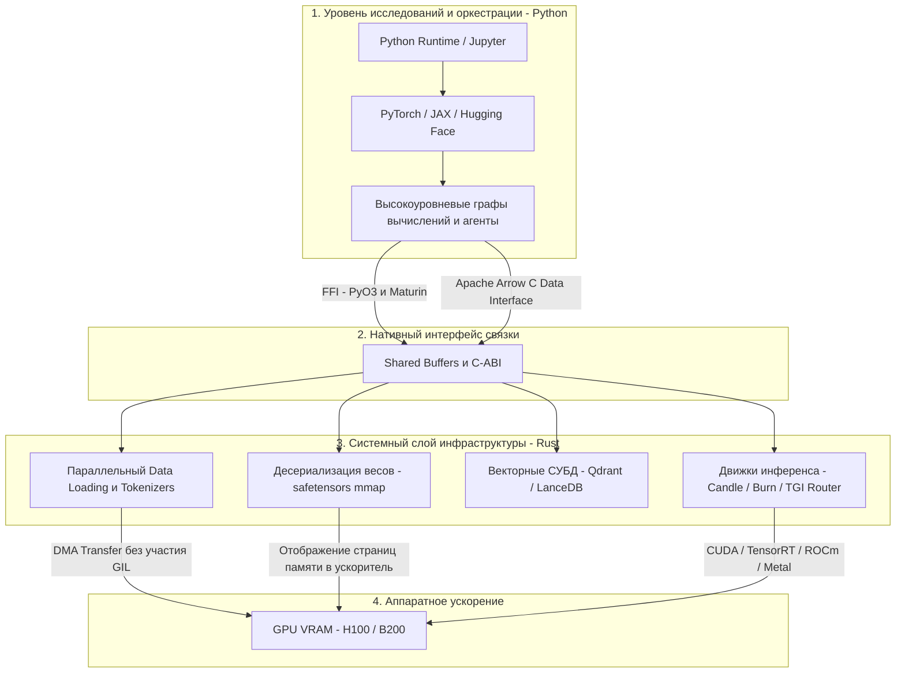
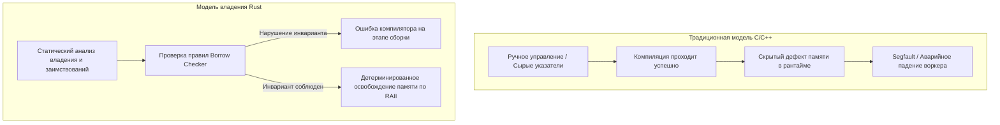

+++
title = "Почему инфраструктура AI переходит на Rust: двухуровневая архитектура, PyO3 и ликвидация GPU Starvation"
date = 2026-10-19
description = "Архитектурный разбор перехода фундамента AI на Rust: двухуровневая модель, обход GIL через PyO3, zero-copy в safetensors и ликвидация GPU starvation."
[taxonomies]
tags = ["rust", "architecture", "mlops", "software-engineering"]
[extra]
toc = true
mermaid = true
+++

В структуре современных AI-систем наблюдается четкая специализация языковых сред. На этапе математического моделирования, валидации гипотез и высокоуровневой оркестрации Python сохраняет доминирующие позиции: экосистемы PyTorch, JAX и Hugging Face обеспечивают максимальную скорость прототипирования. Однако в контурах высоконагруженного инференса, потокового ввода-вывода и сервисов сериализации весов происходит планомерная замена базовых системных модулей.

Вопреки популярным тезисам, Rust не заменяет Python в задачах Data Science. На практике происходит замещение библиотек на C и C++ в критических звеньях инфраструктуры. Компания OpenAI перевела BPE-токенизацию GPT-4 на крейт `tiktoken`, Hugging Face перенесла ядро в библиотеки `tokenizers` и `safetensors`, GitHub перевел рантайм сервиса Copilot на Rust, а xAI использует компилируемый безопасный стек в сервисах обработки очередей.

Ниже представлен инженерный анализ причин этой архитектурной трансформации: сопоставление характеристик латентности, контракт потокобезопасности `Send`/`Sync`, бинарная раскладка формата `safetensors` с отображением `mmap(2)` и практическая реализация FFI-модуля на PyO3 с явным освобождением GIL.

---

## 1. Двухуровневая архитектура современного AI-стека

Инфраструктура промышленных ML-систем разделена на два изолированных контура: уровень прикладной логики (Control Plane) и уровень системного исполнения (Data Plane).



### Разделение ответственности компонентов

1. **Python как уровень управления (Control Plane):** Python выполняет функцию декларативного координатора. Выражение `output = model(inputs)` в PyTorch не производит матричных расчетов внутри виртуальной машины CPython. Интерпретатор инициализирует дескриптор вычислительного графа и делегирует выполнение нативному коду.
2. **Rust как системный фундамент (Data Plane):** Системный уровень берет на себя непрерывный сетевой ввод-вывод, валидацию входных JSON-структур, токенизацию строк и раскладку тензоров в оперативной памяти перед отправкой на тензорные ядра.
3. **Аппаратные ядра (Compute Plane):** Операции матричного умножения (GEMM) и ядра внимания (FlashAttention-2/3) выполняются на кристалле GPU/TPU через специализированные микрокоды CUDA и драйверные интерфейсы.

Исторически системный уровень реализовывался на C и C++. Однако увеличение масштабов распределенного инференса привело к росту скрытых дефектов памяти, требующих детерминированного контроля ресурсов.

---

## 2. Надежность памяти и стабильность распределенного инференса

В распределенных кластерах генеративного инференса аварийное завершение процесса вследствие ошибки сегментации (Segmentation Fault) приводит к выпадению реплики из балансировщика, потере накопленного контекста (KV-cache) и затратам на повторный прогрев очередей.

По данным отчетов по безопасности Microsoft Security Response Center (MSRC) и проекта Chromium (Google), около 70% всех выявленных уязвимостей в кодовых базах на C/C++ обусловлены ошибками прямого управления памятью:
- Разыменование указателей после освобождения (Use-After-Free);
- Повторное освобождение областей памяти (Double Free);
- Выход за допустимые границы буферов (Buffer Overflow / Out-of-Bounds Access);
- Состояния гонки при конкурентном доступе нескольких потоков (Data Races).



Rust решает данную задачу на этапе компиляции посредством аффинной системы типов и правил владения:
1. Каждый ресурс в памяти имеет единственную переменную-владельца.
2. Допускается создание либо произвольного числа неизменяемых ссылок `&T`, либо строго одной изменяемой ссылки `&mut T` в пределах заданного времени жизни (`'a`).
3. При выходе владельца из области видимости память освобождается детерминировано (идиома RAII) без необходимости сборщика мусора.

Это гарантирует отсутствие состояний гонки и повреждений кучи при обработке параллельных потоков запросов.

---

## 3. Четыре инженерных фактора доминирования Rust в AI-инфраструктуре

### 3.1. Предсказуемый tail latency и отсутствие пауз сборщика мусора

Для сетевых сервисов инференса ключевой метрикой качества обслуживания (SLA) выступает задержка старших перцентилей ($T\_{\text{p99}}$ и $T\_{\text{p99.9}}$). Если в системном звене задействован язык со сборщиком мусора (Tracing GC), регулярные фазы маркировки и очистки объектов (Stop-The-World) вносят недетерминированные задержки:

$$T\_{\text{p99}} = T\_{\text{inference}} + T\_{\text{io}} + T\_{\text{gc\_pause}}$$

В Rust среда выполнения не содержит фонового сборщика мусора. Деаллокация привязана к границам лексических областей видимости. В таблице ниже систематизированы модели управления ресурсами:

| Платформа / Стек | Механизм освобождения памяти | Влияние на хвостовую латентность $T\_{\text{p99}}$ | Проверка потокобезопасности |
|---|---|---|---|
| 🔴 **Python (CPython)** | Подсчет ссылок + циклический GC | Высокое (периодические паузы обхода графа) | ❌ Отсутствует (зависимость от GIL) |
| 🔴 **C++20** | Ручные аллокации + `std::unique_ptr` | Низкое, но сохраняется риск UB и гонок | ❌ Возлагается на дисциплину разработчика |
| 🟢 **Rust** | Аффинная система типов + RAII | Детерминированное (отсутствие пауз GC) | 🟢 Гарантируется компилятором (`Send` / `Sync`) |

Благодаря исключению пауз сборщика мусора пропускная способность сетевых маршрутизаторов запросов (таких как роутер TGI от Hugging Face) демонстрирует стабильные временные интервалы при пиковых нагрузках.

### 3.2. Fearless Concurrency и ликвидация проблемы GPU Starvation

При обучении моделей и инференсе с большими батчами стоимость аренды кластеров на базе ускорителей NVIDIA H100 и B200 крайне высока. Если вычислительные ядра тензорных процессоров ожидают завершения подготовки данных со стороны CPU, возникает состояние **GPU Starvation** (простой вычислителя).

В стандартном интерпретаторе CPython параллельная токенизация и аугментация упираются в блокировку GIL. Применение модуля `multiprocessing` влечет за собой сериализацию данных через IPC-каналы с дополнительным расходом памяти:


Rust решает проблему многопоточности на уровне системы типов через встроенные маркерные трейты:
- `Send`: гарантирует безопасность передачи владения структурой между границами потоков.
- `Sync`: гарантирует безопасность совместного чтения структуры по неизменяемой ссылке `&T` из нескольких потоков одновременно.

Если тип содержит небезопасные указатели без потокобезопасной синхронизации (например, `Rc<T>`), компилятор Rust блокирует сборку при попытке передачи такого объекта в фоновый поток:

```rust
// Попытка передать некорректный указатель в поток вызывает ошибку компиляции:
// `Rc<BatchData>` cannot be sent between threads safely
use std::rc::Rc;
use std::thread;

struct BatchData {
    tokens: Vec<u32>,
}

pub fn spawn_worker(data: Rc<BatchData>) {
    // Ошибка компиляции E0277 на этапе cargo build
    // thread::spawn(move || {
    //     let _ = data.tokens.len();
    // });
}
```

Для организации потокобезопасного пайплайна используются типы с атомарным подсчетом ссылок `Arc<T>` и каналы обмена сообщениями `crossbeam_channel`, позволяющие загружать все процессорные ядра без накладных расходов GIL.

### 3.3. Zero-Copy парсинг и формат весов safetensors

Исторически контрольные точки моделей в PyTorch сохранялись с помощью `torch.save`, использующего стандартный формат сериализации `pickle`. Данный формат обладает двумя существенными недостатками:
1. **Риск выполнения произвольного кода:** При десериализации непроверенного файла pickle существует возможность исполнения встроенных системных команд через объектные хуки `__reduce__`.
2. **Множественные аллокации памяти:** Парсинг бинарного дерева pickle требует последовательного создания объектов в куче Python, что приводит к дополнительному расходу оперативной памяти.

Для преодоления этих ограничений в Hugging Face был разработан открытый формат `safetensors`, реализованный на Rust.

Бинарная спецификация `safetensors` включает следующие структурные секции:
1. Смещение `0..8` байт: 64-битное целое число без знака в формате Little-Endian (`u64`), задающее точную длину заголовка метаданных $L\_{\text{header}}$.
2. Смещение `8..(8 + L_header)` байт: валидный JSON-документ в кодировке UTF-8, описывающий словарь тензоров (имя, тип данных `F16`/`BF16`/`F32`, размерности `shape` и относительные смещения байт `data_offsets`).
3. Смещение `(8 + L_header)..EOF`: непрерывный бинарный массив тензорных данных.


Абсолютное смещение тензора $i$ в файле вычисляется по формуле:

$$\text{Offset}\_{\text{tensor}, i} = 8 + L\_{\text{header}} + \text{StartOffset}\_i$$

Операционная система выполняет проецирование дискового файла напрямую в адресное пространство процесса с помощью системного вызова `mmap(2)`:

```rust
use memmap2::MmapOptions;
use std::fs::File;
use std::io::Result;

pub struct SafeTensorsReader {
    mmap: memmap2::Mmap,
    header_length: usize,
}

impl SafeTensorsReader {
    pub fn new(file_path: &str) -> Result<Self> {
        let file = File::open(file_path)?;
        // Системный вызов mmap связывает дисковые страницы с виртуальной памятью
        let mmap = unsafe { MmapOptions::new().map(&file)? };

        let mut length_bytes = [0u8; 8];
        length_bytes.copy_from_slice(&mmap[0..8]);
        let header_length = u64::from_le_bytes(length_bytes) as usize;

        Ok(Self { mmap, header_length })
    }

    /// Получение среза байт тензора без создания промежуточных копий
    #[inline]
    pub fn slice_tensor(&self, start_offset: usize, end_offset: usize) -> &[u8] {
        let base = 8 + self.header_length;
        &self.mmap[base + start_offset .. base + end_offset]
    }
}
```

Срез байт из отображенной памяти передается в память графического ускорителя через системный интерфейс DMA без промежуточной десериализации в куче.

### 3.4. Симбиоз с Python: экосистема PyO3 и Maturin

Распространение Rust в AI-инфраструктуре основано на интеграции без ломки интерфейсов: разработчикам прикладных пайплайнов не требуется переписывать пользовательский код. Инструментарий **PyO3** и сборщик **Maturin** компилируют крейты Rust в стандартные бинарные модули Python (C-Extensions / Wheels).

Пользовательский код взаимодействует с библиотекой стандартным образом:
```python
import tiktoken

tokenizer = tiktoken.get_encoding("cl100k_base")
token_ids = tokenizer.encode("Инженерный анализ стека AI")
```

Трудоемкие циклы сопоставления байтовых последовательностей BPE исполняются скомпилированным машинным кодом Rust с использованием процессорных регистров и аппаратных инструкций.

---

## 4. Практическая реализация: многопоточный Rust-модуль с освобождением GIL

Ниже представлен пример реализации расширения на Rust с библиотекой `pyo3` (версия 0.22+), выполняющего параллельную обработку пакета текстовых строк с освобождением глобальной блокировки GIL через метод `py.allow_threads()`.

```rust
use pyo3::prelude::*;
use rayon::prelude::*;

/// Структура высокопроизводительного пакетного токенизатора
#[pyclass]
pub struct TextBatchProcessor {
    modulus_base: u32,
}

#[pymethods]
impl TextBatchProcessor {
    #[new]
    pub fn new(modulus_base: u32) -> Self {
        Self { modulus_base }
    }

    /// Параллельная обработка пакета строк с передачей работы в пул потоков Rayon
    pub fn process_batch(&self, py: Python<'_>, raw_lines: Vec<String>) -> PyResult<Vec<Vec<u32>>> {
        let base = self.modulus_base;

        // Временное освобождение GIL на период вычислительного цикла
        let output_ids = py.allow_threads(move || {
            raw_lines
                .par_iter()
                .map(|line| {
                    line.bytes()
                        .map(|byte_val| ((byte_val as u32).wrapping_mul(2654435761)) % base)
                        .collect::<Vec<u32>>()
                })
                .collect::<Vec<Vec<u32>>>()
        });

        Ok(output_ids)
    }
}

/// Экспорт функций в модульную структуру Python
#[pymodule]
fn fast_text_engine(module: &Bound<'_, PyModule>) -> PyResult<()> {
    module.add_class::<TextBatchProcessor>()?;
    Ok(())
}
```

Конфигурационный файл сборки `Cargo.toml`:
```toml
[package]
name = "fast-text-engine"
version = "0.1.0"
edition = "2021"

[lib]
name = "fast_text_engine"
crate-type = ["cdylib"]

[dependencies]
pyo3 = { version = "0.22", features = ["extension-module"] }
rayon = "1.10"
```

Команда компиляции модуля в активное виртуальное окружение:
```bash
maturin develop --release
```

После компиляции модуль вызывается из Python как нативный компонент с распределением нагрузки по всем доступным вычислительным ядрам процессора.

---

## 5. Индустриальная карта внедрения: системные компоненты на Rust

В таблице систематизированы основные открытые проекты машинного обучения, где внедрение системных модулей на Rust обеспечило прирост пропускной способности и устойчивости:

| Категория компонента | Проект на Rust | Предшествующий стек | Архитектурное преимущество |
|---|---|---|---|
| 🔵 **Токенизация** | `tiktoken` (OpenAI) | Pure Python / C++ re2 | Векторизованный обход строк и отсутствие оверхеда GIL |
| 🔵 **Хранение весов** | `safetensors` (Hugging Face) | `torch.save` (Python pickle) | Zero-copy mmap, защита от произвольного выполнения кода |
| 🔵 **Валидация схем** | `pydantic-core` | Чистый Python Pydantic v1 | Разбор JSON на уровне машинных инструкций |
| 🔵 **Data Processing** | `Polars` | Pandas (C / Cython) | Параллельное исполнение запросов на движке Apache Arrow |
| 🔵 **Векторный поиск** | `Qdrant` / `LanceDB` | Python / C++ прототипы | Эффективное кэширование страниц HNSW-графов в памяти |
| 🔵 **Инструменты окружения** | `uv` / `ruff` | pip, virtualenv, flake8 | Многопоточный анализ AST и сетевой ввод-вывод |

### Автономные фреймворки инференса: Candle и Burn

Наряду с библиотеками-расширениями для Python в инфраструктуре развиваются самостоятельные ML-движки:
- **Candle (Hugging Face):** Компактный фреймворк машинного обучения на Rust, ориентированный на производительность в serverless-средах и Wasm-окружении. Отсутствие громоздкого C++ ядра PyTorch сокращает размер бинарного дистрибутива до единиц мегабайт.
- **Burn:** Модульный фреймворк глубокого обучения с поддержкой динамических графов вычислений, бэкендов WGPU, CUDA и LibTorch, обеспечивающий строгий контроль распределения памяти в автономных системах.

---

## Ключевые выводы

1. **Разделение сфер ответственности:** Rust не вытесняет Python из задач исследования и построения моделей. Инфраструктура переходит к устойчивой модели: Python служит уровнем декларативного управления (Control Plane), а Rust становится базовым стандартом системного исполнения (Data Plane).
2. **Предотвращение дефектов памяти на этапе сборки:** Перенос логики десериализации, токенизации и сетевых маршрутизаторов на Rust устраняет распространенные ошибки управления указателями (Use-After-Free, повреждения кучи, гонки данных) за счет статических проверок компилятора.
3. **Детерминированная латентность $T\_{\text{p99}}$:** Отсутствие сборщика мусора исключает неконтролируемые паузы Stop-The-World, стабилизируя временные характеристики сервисов под высокой нагрузкой.
4. **Устранение простоя GPU (Starvation):** Трейты `Send` и `Sync` позволяют реализовывать параллельную потоковую загрузку и предобработку батчей на всех ядрах CPU, обеспечивая непрерывную подачу данных в графические ускорители.
5. **Прозрачная интеграция через PyO3:** Инструменты PyO3 и Maturin позволяют компилировать модули Rust в нативные колеса Python без необходимости модификации прикладного API.

---

## Первоисточники и материалы
* **Оригинальное видео:** [Byte Without Bite — Why AI Infrastructure Is Moving to Rust](https://youtu.be/2j4_iPG5Aqk)
* **Заметки и детальный конспект:** [Obsidian Vault (GitHub)](https://github.com/xsa-dev/obsidian-vault/blob/main/YouTube/Why-AI-Infrastructure-Moves-to-Rust-2026.md)
* **Инженерные наработки:** [github.com/xsa-dev](https://github.com/xsa-dev)
